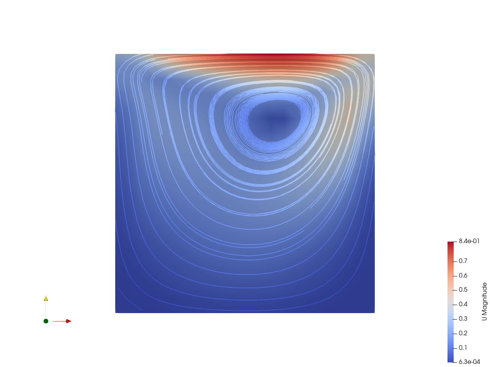
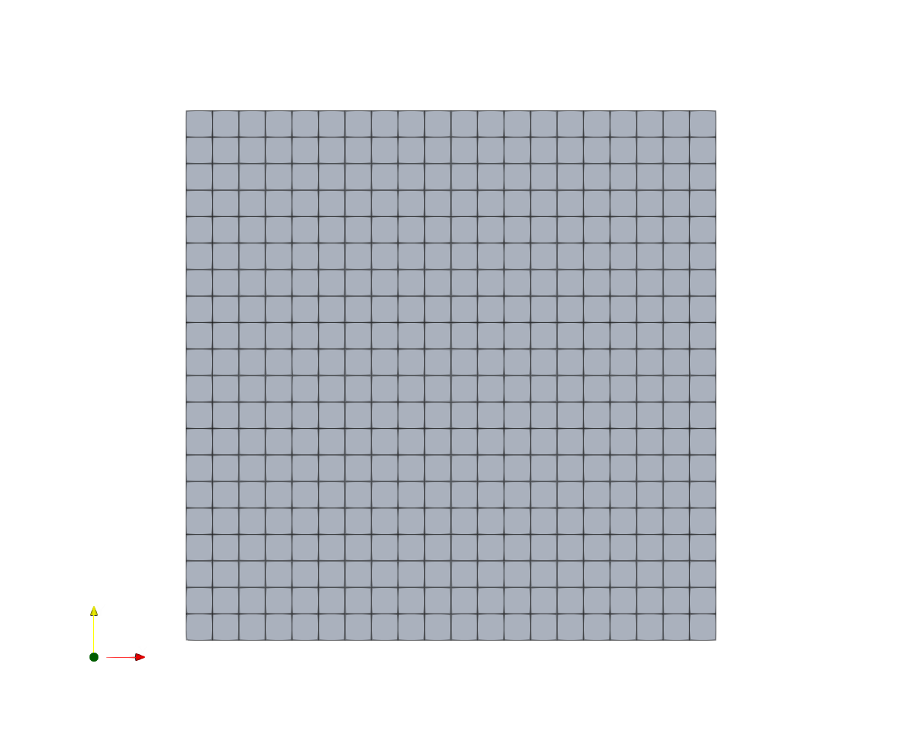
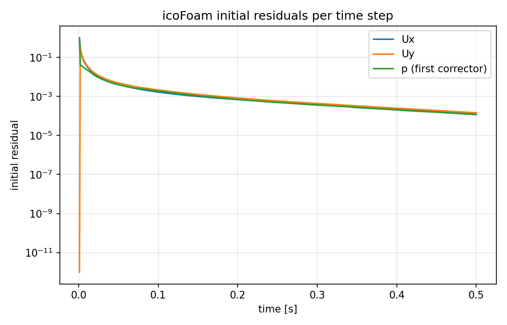
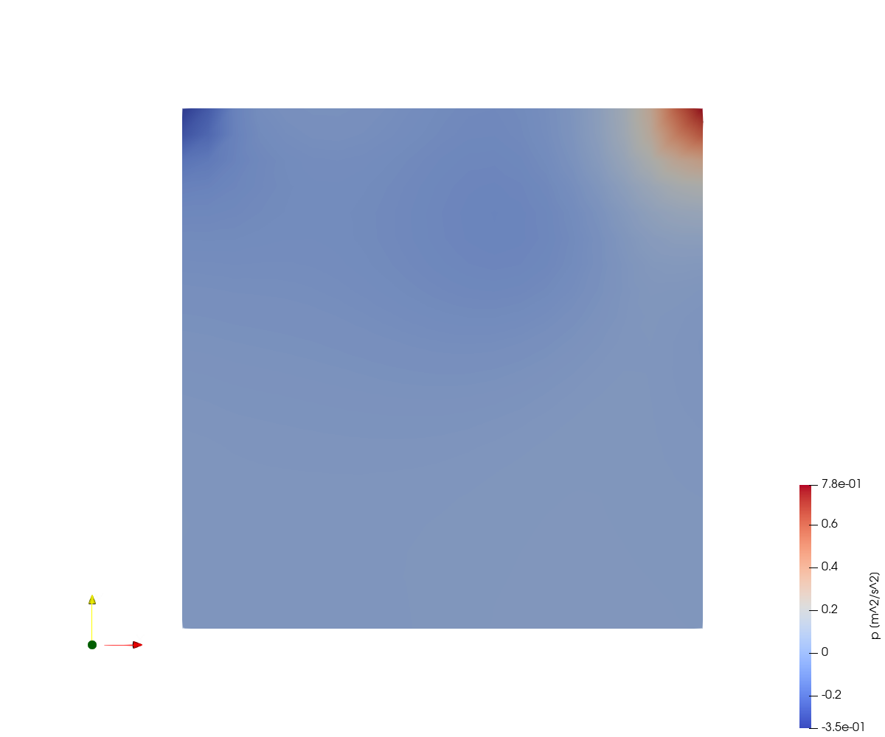
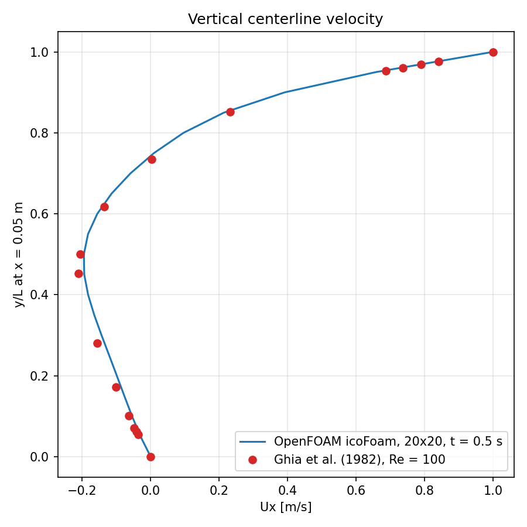

# Lid-Driven Cavity Flow

| Detail | Value |
|---|---|
| **Difficulty** | ⭐ Beginner |
| **Solver** | `icoFoam` (incompressible, laminar, transient) |
| **Algorithm** | PISO (2 correctors) |
| **Reynolds Number** | 100 (U = 1 m/s, L = 0.1 m, $\nu$ = 0.001 m$^2$/s) |
| **Mesh** | 20 x 20 x 1 hexahedra (400 cells), 2D |
| **Run time** | 500 steps of 1 ms (t = 0 to 0.5 s), a few seconds |
| **OpenFOAM Version** | 6 |

---

## Goal

A first complete OpenFOAM workflow on the simplest closed-domain benchmark: build a structured mesh with `blockMesh`, check it with `checkMesh`, set up wall boundary conditions and a pressure reference, run the transient incompressible solver `icoFoam` (PISO), and inspect the result. After this case a learner should be able to:

- read a minimal case (`0/`, `constant/`, `system/`) and say what each dictionary does;
- explain why a closed cavity needs a pressure reference (`pRefCell`/`pRefValue`) and why a 2D case uses an `empty` patch;
- relate time step, cell size and Courant number;
- compare a velocity profile with published benchmark data (Ghia et al., 1982) and judge the effect of a coarse mesh.



*Velocity magnitude on the mid-plane with streamlines at t = 0.5 s: one clockwise primary vortex, the strongest velocities in the thin layer under the lid, and the vortex center in the upper-right half.*

## Target

Reynolds number 100 (lid speed 1 m/s, side 0.1 m, $\nu$ = 0.001 m$^2$/s), 20 x 20 cells, run to t = 0.5 s with $\Delta t$ = 1 ms.

| Quantity | Reference | Value expected from this case |
|---|---|---|
| Primary vortex center (x/L, y/L) | (0.6172, 0.7344), Ghia et al. (1982), Re = 100 | (0.625, 0.725) measured; the location resolution is one cell, 0.05 L |
| Ux along the vertical centerline (x = 0.05 m) | 17 tabulated points of Ghia et al. (see exercise 4) | maximum deviation about 0.02 m/s (2 % of the lid speed) measured; accepted below 0.03 m/s |
| Mass conservation | $\nabla \cdot U = 0$ | continuity error per step about 1e-10, cumulative below 1e-10 |
| Courant number | $Co < 1$ guideline | maximum about 0.17 |
| State at t = 0.5 s | steady solution (reached at about t = 2 s) | nearly steady: initial residuals about 1e-4; the field is still about 2.5 % of the lid speed from the steady solution |

The Ghia values are for a 129 x 129 grid; the 20 x 20 mesh used here is much coarser, so agreement within a few percent of the lid speed (not exact agreement) is the achievable target. There is no reference value for pressure on this setup (it is only defined up to the constant fixed by `pRefValue`).

## Verification method

After the case has run (`./run_docker.sh`, which already calls the script as its last step, or `./Allrun`), run:

```bash
python3 verify.py
```

`verify.py` only reads the logs and time directories (Python standard library, no OpenFOAM or Docker needed). It prints one `PASS`/`FAIL` line per check and exits with 0 only if every check passes (1 if a check fails, 2 if results are missing). Values in the table are those measured in the verification run of this repository.

| Check | What it proves | Expected | Measured |
|---|---|---|---|
| blockMesh cell count | mesh matches `blockMeshDict` | 400 (exact) | 400 |
| checkMesh verdict | mesh passes all checks | `Mesh OK` | `Mesh OK` |
| max non-orthogonality | box mesh is orthogonal | 0 +- 1e-6 deg | 0 |
| icoFoam finished | no `FOAM FATAL ERROR` / floating point exception | `End` | `End` |
| number of time steps | run covers `endTime`/`deltaT` | 500 (exact) | 500 |
| last time directory | results written up to `endTime` | 0.5 | 0.5 |
| max Courant number | time step is in the accurate range | < 1.0 (guideline) | 0.167 |
| continuity error, last step | mass conservation from the pressure equation | < 1e-8 | 4.5e-10 |
| cumulative continuity error | closed cavity conserves mass | < 1e-10 | 5.6e-18 |
| initial residuals Ux, Uy (last step) | solution has largely converged | < 1e-3 | 1.3e-4, 1.4e-4 |
| max \|U\| in cells | maximum principle (lid speed is the maximum) | <= 1.0 m/s | 0.838 |
| p in reference cell 0 | `pRefCell`/`pRefValue` applied | 0 +- 1e-6 | -4.8e-8 |
| change of U over last 0.1 s | start-up transient has mostly decayed (sanity check, not a convergence proof) | < 0.05 m/s | 0.013 |
| max \|Ux - Ghia\| on centerline | Target: matches the benchmark on this coarse mesh | < 0.03 m/s | 0.0216 (at y/L = 0.2813) |
| primary vortex center | Target: vortex position | (0.617, 0.734) +- 0.05 | (0.625, 0.725) |

Tolerances: mesh, step count and verdict checks are exact. The Courant limit is the standard guideline. The continuity and residual limits are generic solver criteria (the pressure tolerance is 1e-6). The Ghia tolerance of 0.03 m/s (3 % of the lid speed) is the expected discretization error of a 20 x 20 mesh and was not tuned to the result (measured 0.0216; a finer mesh should lower it). The vortex tolerance is one cell width. The near-steady limit is deliberately loose because the run is stopped at 0.5 s.

Manual checks (optional):

- `postProcess -latestTime -func centerlineGraph` writes `postProcessing/centerlineGraph/0.5/line_U.xy` (y, Ux, Uy, Uz at 41 points on x = 0.05 m, interpolated with `cellPoint`; Ux at y/L = 0.5 is -0.195 m/s against Ghia's -0.206) so that the profile can be plotted against the table in exercise 4.
- `grep -c '^Time = ' log.icoFoam` gives 500 and `grep "Courant Number" log.icoFoam | tail -1` gives about 0.043 mean and 0.167 max.
- Open the case in ParaView (see the Visualization Guide) and confirm a single clockwise vortex with positive Uy on the left half and negative on the right half.

---

## Problem Description

The lid-driven cavity is one of the most widely studied benchmark problems in computational fluid dynamics. A square cavity is filled with an incompressible fluid. All walls are stationary except the top wall (the "lid"), which moves at a constant horizontal velocity. The moving lid drags the fluid beneath it through viscous shear, generating a recirculating flow inside the cavity.

Despite its geometric simplicity, the lid-driven cavity produces rich flow physics: a primary recirculating vortex dominates the cavity interior, and depending on the Reynolds number, secondary and even tertiary corner vortices appear near the bottom corners. This makes it an ideal first case for validating CFD solvers and learning the fundamentals of setting up a simulation.

```
              movingWall: U = (1 0 0), p zeroGradient
           →  →  →  →  →  →  →  →  →  →  →  →  →
         ┌────────────────────────────────────────┐
         │                                        │
         │    →  →  →  →  →  →  →  →  →  ↘       │
         │    ↑                            ↓      │
 fixed-  │    ↑      primary vortex        ↓      │  fixed-
 Walls   │    ↑      (clockwise)           ↓      │  Walls
 (left)  │    ↑                            ↓      │  (right)
         │    ↖  ←  ←  ←  ←  ←  ←  ←  ←  ←       │
         │                                        │
         │   weak corner vortices (bottom)        │
         └────────────────────────────────────────┘
              fixedWalls (bottom): noSlip, p zeroGradient

   Square 0.1 m x 0.1 m, depth 0.01 m (one cell).
   frontAndBack (z = 0 and z = 0.01): empty for U and p.
```

At the Reynolds number used in this tutorial ($Re = 100$), the flow is laminar and approaches a steady state. The primary vortex fills most of the cavity, with its center shifted toward the upper-right quadrant. At higher Reynolds numbers ($Re \gtrsim 1000$) the corner vortices become more prominent, and in 2D the flow only becomes unsteady at roughly $Re \approx 8000$.

---

## Physics and Theory

### Governing Equations

This case solves the **incompressible Navier-Stokes equations** for a Newtonian fluid:

**Continuity (mass conservation):**

$$\nabla \cdot U = 0$$

**Momentum conservation:**

$$\partial U / \partial t + (U \cdot \nabla)U = -\nabla p + \nu \nabla^2 U$$

where `U` is the velocity vector, `p` is the kinematic pressure (pressure divided by density) and `ν` is the kinematic viscosity.

Since icoFoam is an incompressible solver, density does not appear explicitly. The pressure field `p` has dimensions of m$^2$/s$^2$.

### Reynolds Number

The Reynolds number characterizes the ratio of inertial to viscous forces:

$$Re = U \times L / \nu$$

For this case:

| Parameter | Symbol | Value |
|---|---|---|
| Lid velocity | U | 1 m/s |
| Cavity width | L | 0.1 m |
| Kinematic viscosity | $\nu$ | 0.001 m$^2$/s |

$$Re = 1 \times 0.1 / 0.001 = 100$$

At $Re = 100$ the flow is laminar. The viscous time scale is $L^2/\nu = 10$ s, but the flow is nearly steady well before that: in a run extended to 5 s, the velocity at t = 0.5 s differs from the final steady solution by at most about 0.025 m/s (2.5 % of the lid speed), and by less than $10^{-5}$ m/s from t = 2 s on. The 0.5 s end time therefore gives a nearly, not fully, steady result.

### Expected Flow Features

- **Primary vortex**: A large clockwise recirculation filling most of the cavity. At $Re = 100$, the vortex center is located at approximately ($x/L \approx 0.62$, $y/L \approx 0.73$) according to the Ghia et al. (1982) benchmark data.
- **Bottom corner vortices**: Very small, weak counter-rotating vortices in the bottom-left and bottom-right corners. They are too small to be resolved on the 20 x 20 mesh and become more prominent at higher Reynolds numbers.
- **Boundary layers**: Thin regions of high velocity gradient along the walls, strongest in the shear layer beneath the moving lid.

> **Further reading:**
> - [Introduction to CFD concepts](https://github.com/djeada/OpenFoam-Tutorials/blob/main/notes/01_short_intro_to_cfd.md)
> - [Detailed icoFoam solver analysis](https://github.com/djeada/OpenFoam-Tutorials/blob/main/notes/10_icofoam_solver_analysis.md)
> - [CFL number and time stepping](https://github.com/djeada/OpenFoam-Tutorials/blob/main/notes/08_cfl_number.md)

---

## Case Structure

```
01_lid_driven_cavity/
├── README.md                          ← This file
├── Allrun / Allclean                  ← Run and clean scripts (OpenFOAM environment required)
├── run_docker.sh                      ← Clean and run the case in the cfdengine/openfoam image
├── verify.py                          ← Read-only PASS/FAIL checks of a finished run
├── images/                            ← Result figures used in this README
├── open_paraview.sh                   ← Open the result in ParaView using paraview_cavity.py
├── paraview_cavity.py                 ← ParaView script (velocity magnitude + streamlines)
├── 0/                                 ← Initial and boundary conditions (t = 0)
│   ├── U                              ← Velocity field [m/s]
│   └── p                              ← Kinematic pressure field [m²/s²]
├── constant/                          ← Physical properties and mesh
│   ├── transportProperties            ← Fluid properties (viscosity)
│   └── polyMesh/                      ← Mesh data (generated by blockMesh)
│       ├── boundary
│       ├── faces
│       ├── neighbour
│       ├── owner
│       └── points
└── system/                            ← Simulation control
    ├── blockMeshDict                  ← Mesh generation parameters
    ├── centerlineGraph                ← Optional postProcess dictionary (Ux, Uy along x = 0.05 m)
    ├── controlDict                    ← Run control (time, output, solver)
    ├── fvSchemes                      ← Discretization schemes
    └── fvSolution                     ← Linear solver and algorithm settings
```

The standard OpenFOAM "three-directory" structure is used:

- **`0/`** contains initial conditions and boundary conditions for each field variable.
- **`constant/`** holds time-invariant data: physical properties and the mesh.
- **`system/`** contains all simulation control parameters.

> **Further reading:** [OpenFOAM case structure](https://github.com/djeada/OpenFoam-Tutorials/blob/main/notes/02_openfoam_cases.md) and [OpenFOAM dictionaries](https://github.com/djeada/OpenFoam-Tutorials/blob/main/notes/03_openfoam_dictionaries.md)

---

## Mesh Details

The mesh is generated by `blockMesh` from the dictionary at `system/blockMeshDict`.

### Domain Geometry

The `convertToMeters` factor is **0.1**, so the vertices in the dictionary (x, y from 0 to 1 and z from 0 to 0.1) map to physical coordinates:

| Property | Value |
|---|---|
| Domain size (x $\times$ y $\times$ z) | 0.1 m $\times$ 0.1 m $\times$ 0.01 m |
| Cell count | 20 $\times$ 20 $\times$ 1 = 400 cells |
| Cell type | Hexahedral (structured) |
| Grading | Uniform (simpleGrading 1 1 1) |
| Cell size ($\Delta x$ $\times$ $\Delta y$ $\times$ $\Delta z$) | 0.005 m $\times$ 0.005 m $\times$ 0.01 m |

The single-cell thickness in z and the `empty` boundary condition on the front/back faces make this a **2D simulation**.



*The 20 x 20 uniform mesh (view along z). Every cell is a 0.005 m x 0.005 m square, so there is no refinement towards the lid or the walls.*

### Vertex Numbering and Mesh Diagram

The block is defined by 8 vertices forming a hexahedron:

```
   v7 (0,0.1,0.01)            v6 (0.1,0.1,0.01)
      +----------------------------+
     /|        movingWall         /|
    / |      (top, y = 0.1)      / |
v4 +----------------------------+ v5
(0,0,0.01)                (0.1,0,0.01)
   |  |                         |  |
   |  + v3 (0,0.1,0)           |  + v2 (0.1,0.1,0)
   | /                         | /
   |/     fixedWalls           |/
   +----------------------------+
 v0 (0,0,0)                 v1 (0.1,0,0)

   frontAndBack (empty) = the two z-normal faces (z = 0 and z = 0.01)
```

**Top view (x-y plane) with cell grid:**

```
  y
  ↑
  0.1 ┬───┬───┬───┬───┬───┬───┬───┬─ ··· ─┬───┐  ← movingWall
      │   │   │   │   │   │   │   │       │   │
      ├───┼───┼───┼───┼───┼───┼───┼─ ··· ─┼───┤
      │   │   │   │   │   │   │   │       │   │
      ├───┼───┼───┼───┼───┼───┼───┼─ ··· ─┼───┤
      │   │   │   │   │   │   │   │       │   │
      ·   ·   ·   ·   ·   ·   ·   ·       ·   ·
      ·       20 × 20 hex cells            ·   ·
      ·   ·   ·   ·   ·   ·   ·   ·       ·   ·
      ├───┼───┼───┼───┼───┼───┼───┼─ ··· ─┼───┤
      │   │   │   │   │   │   │   │       │   │
  0.0 ┴───┴───┴───┴───┴───┴───┴───┴─ ··· ─┴───┘
     0.0                                      0.1 → x

      fixedWalls on left (x = 0), right (x = 0.1) and bottom (y = 0)
```

> **Further reading:** [Meshing in OpenFOAM](https://github.com/djeada/OpenFoam-Tutorials/blob/main/notes/04_meshing.md)

---

## Boundary Conditions

All boundary conditions are defined in `0/U` and `0/p`.

### Summary Table

| Boundary | Patch Type | Velocity (`U`) | Pressure (`p`) | Physical Meaning |
|---|---|---|---|---|
| `movingWall` | `wall` | `fixedValue` uniform (1 0 0) | `zeroGradient` | Lid moving at 1 m/s in x |
| `fixedWalls` | `wall` | `noSlip` | `zeroGradient` | Stationary walls (bottom, left, right) |
| `frontAndBack` | `empty` | `empty` | `empty` | 2D constraint (z-normal faces) |

### Notes on Boundary Conditions

- **`fixedValue`**: Sets the velocity directly. The lid moves at 1 m/s in the positive x-direction.
- **`noSlip`**: A shorthand for `fixedValue uniform (0 0 0)`. No fluid motion at stationary walls.
- **`zeroGradient`**: The normal gradient of pressure is zero at walls. This is the standard Neumann condition for pressure in incompressible wall-bounded flows.
- **`empty`**: Tells OpenFOAM not to solve in the direction normal to these faces, giving a 2D simulation in the x-y plane.
- **Pressure reference**: Since the cavity has no inlet or outlet, pressure is only defined up to a constant. The `pRefCell 0` and `pRefValue 0` settings in `fvSolution` fix the pressure of cell 0 (bottom-left corner) to 0 to anchor the pressure field.

> **Further reading:** [Boundary conditions in OpenFOAM](https://github.com/djeada/OpenFoam-Tutorials/blob/main/notes/05_boundary_conditions.md)

---

## Solver Configuration

### controlDict — Run Control

| Setting | Value | Meaning |
|---|---|---|
| `application` | `icoFoam` | Incompressible laminar transient solver |
| `startTime` | `0` | Simulation begins at t = 0 s |
| `endTime` | `0.5` | Simulation ends at t = 0.5 s |
| `deltaT` | `0.001` | Fixed time step of 1 ms |
| `writeControl` | `timeStep` | Output triggered by time step count |
| `writeInterval` | `1` | Write output every time step |
| `writeFormat` | `ascii` | Human-readable output files |
| `purgeWrite` | `0` | Keep all time directories (no pruning) |

With `deltaT = 0.001` and `endTime = 0.5`, the solver runs for **500 time steps**. Because `writeInterval` is 1, every time step is written (500 time directories). Increase `writeInterval` (e.g. to 50) to reduce disk usage.

**Courant number estimate:** With $\Delta x$ = 0.005 m and a speed of 1 m/s (the lid):

$$Co = U \times \Delta t / \Delta x = 1 \times 0.001 / 0.005 = 0.2$$

The maximum Courant number reported by `icoFoam` is about 0.17 (log.icoFoam), because the cell-centre velocities next to the lid stay below 1 m/s. Note that icoFoam is semi-implicit, so $Co < 1$ is a guideline for accuracy rather than a hard stability limit (see exercise 5).

### fvSchemes — Discretization Schemes

| Category | Scheme | Description |
|---|---|---|
| `ddtSchemes` | `Euler` | First-order implicit time discretization |
| `gradSchemes` (default, `grad(p)`) | `Gauss linear` | Second-order central differencing for gradients |
| `gradSchemes` (`grad(U)`) | `cellLimited Gauss linear 1` | Cell-limited gradient (limits the reconstructed face values to the neighbour range, which avoids overshoots); used by `linearUpwind` |
| `divSchemes` (`div(phi,U)`) | `Gauss linearUpwind grad(U)` | Second-order upwind for the convection term |
| `laplacianSchemes` | `Gauss linear corrected` | Second-order diffusion with non-orthogonal correction |
| `interpolationSchemes` | `linear` | Linear interpolation from cell centres to faces |
| `snGradSchemes` | `corrected` | Non-orthogonal corrected surface-normal gradients |

### fvSolution — Linear Solvers and PISO

**Pressure solver (`p`):**

| Setting | Value |
|---|---|
| Solver | `PCG` (Preconditioned Conjugate Gradient) |
| Preconditioner | `DIC` (Diagonal Incomplete Cholesky) |
| Tolerance | 1$\times$10$^{-6}$ |
| Relative tolerance | 0.05 (0 for final corrector) |

**Velocity solver (`U`):**

| Setting | Value |
|---|---|
| Solver | `smoothSolver` |
| Smoother | `symGaussSeidel` (Symmetric Gauss-Seidel) |
| Tolerance | 1$\times$10$^{-5}$ |
| Relative tolerance | 0 |

**PISO algorithm settings:**

| Setting | Value | Meaning |
|---|---|---|
| `nCorrectors` | `2` | Number of pressure-velocity correction loops per time step |
| `nNonOrthogonalCorrectors` | `0` | No extra non-orthogonal corrector loops (mesh is orthogonal) |
| `pRefCell` | `0` | Reference pressure cell index |
| `pRefValue` | `0` | Reference pressure value (anchors the pressure field) |

> **Further reading:** [Linear solvers in OpenFOAM](https://github.com/djeada/OpenFoam-Tutorials/blob/main/notes/09_linear_solvers.md)

---

## How to Run

### Prerequisites

- OpenFOAM 6 (or a compatible version) installed and the environment sourced, or Docker with the `cfdengine/openfoam` image (OpenFOAM 6)
- Python 3 for `verify.py`
- ParaView for post-processing (optional)

### With Docker (as used for verification)

```bash
./run_docker.sh
```

This runs `./Allclean` and `./Allrun` inside the container (project directory mounted at `/case`) and then `python3 verify.py` on the host.

### With a local OpenFOAM 6 installation

```bash
./Allrun         # blockMesh, checkMesh, icoFoam (logs: log.blockMesh, log.checkMesh, log.icoFoam)
python3 verify.py
./Allclean       # remove time directories, mesh, logs and generated files (images/ is kept)
```

`Allrun` sources `/opt/openfoam6/etc/bashrc` or `~/OpenFOAM/OpenFOAM-6/etc/bashrc` if the OpenFOAM environment is not already loaded, and stops at the first failing step.

### Step-by-Step Commands

The same steps run manually from the project directory:

```bash
# 1. Generate the mesh from blockMeshDict
blockMesh

# 2. Verify mesh quality (check for errors, non-orthogonality, skewness)
checkMesh

# 3. Run the solver
icoFoam

# 4. (optional) Convert results to VTK format for ParaView
foamToVTK

# 5. (optional) Open in ParaView for visualization
./open_paraview.sh        # or: touch cavity.foam && paraview cavity.foam
```

Or as a single pipeline:

```bash
blockMesh && checkMesh && icoFoam && foamToVTK
```

### What to Expect During the Run

- **`blockMesh`** creates `constant/polyMesh`: 882 points, 400 cells, 1640 faces and the patches `movingWall` (20 faces), `fixedWalls` (60) and `frontAndBack` (800). The log ends with `End`.
- **`checkMesh`** reports 400 hexahedra, non-orthogonality 0, maximum skewness about 1e-14 and `Mesh OK`.
- **`icoFoam`** runs 500 time steps in a few seconds. In the first step the initial residual of `Ux` is 1; by t = 0.5 s the initial residuals are about 1e-4 (`Ux`, `Uy`) and `p` (first corrector) about 1e-4. The maximum Courant number stays below 0.17.
- Time directories `0.001`, `0.002`, ..., `0.5` are written, each with `U`, `p` and `phi`.



*Initial residuals of `Ux`, `Uy` and `p` (first corrector) per time step: a fast drop from 1 during start-up, then a slow decay to about 1e-4 at t = 0.5 s.*

### Cleaning Up

To reset the case and remove all generated data (time directories, mesh, VTK, logs, `cavity.foam`, `postProcessing/`):

```bash
./Allclean
```

`foamCleanCase` is not available in OpenFOAM 6; `./Allclean` calls the equivalent `cleanCase`. Manually:

```bash
rm -rf 0.* [1-9]* VTK/ postProcessing/ constant/polyMesh log.* *.foam
```

`images/`, `verify.py` and the dictionaries are not touched.

---

## Expected Results

### Flow Field (t = 0.5 s)

Values below are from this case (20 x 20 mesh) at t = 0.5 s:

- **Primary vortex**: Clockwise, with its center near ($x$ = 0.0625 m, $y$ = 0.0725 m), i.e. ($x/L \approx 0.62$, $y/L \approx 0.73$), within about one cell of the Ghia et al. value ($0.617$, $0.734$).
- **Velocity magnitude**: The lid moves at 1 m/s, but the cell-centre values in the top row reach only about 0.84 m/s, since the cell centres are half a cell away from the lid.
- **Pressure** (kinematic, relative to cell 0 at the bottom-left): highest at the top-right corner (about +0.78 m$^2$/s$^2$), where the lid drives fluid into the right wall, and lowest at the top-left corner (about -0.35 m$^2$/s$^2$). At the vortex center it is about -0.08 m$^2$/s$^2$.



*Kinematic pressure at t = 0.5 s: high-pressure region in the top-right corner (flow decelerates against the right wall), low pressure in the top-left corner, and nearly uniform pressure elsewhere.*
- **Corner vortices**: Very small and weak at $Re = 100$; they are not resolved on this mesh and become visible at higher Reynolds numbers.

### Vertical Centerline Velocity Profile (Ux along x = 0.05 m)

Ux sampled with `postProcess -latestTime -func centerlineGraph` (41 points, t = 0.5 s):

| y/L | Ux (this case) |
|---|---|
| 1.0 | 1.000 (lid) |
| 0.975 | 0.829 |
| 0.9 | 0.391 |
| 0.8 | 0.096 |
| 0.75 | 0.010 |
| 0.7 | -0.059 |
| 0.6 | -0.156 |
| 0.5 | -0.195 (minimum) |
| 0.4 | -0.183 |
| 0.3 | -0.143 |
| 0.2 | -0.099 |
| 0.1 | -0.054 |
| 0.0 | 0.000 (no-slip) |

The profile is not symmetric: Ux is 1 at the lid, falls steeply through the shear layer, changes sign near y/L $\approx$ 0.75 and reaches its negative minimum (the return flow of the primary vortex) at mid-height, then goes back to 0 at the bottom wall:

```
  y/L
 1.0 ┤        .                                       *   Ux = +1.000
     │
 0.9 ┤        .               *                           Ux = +0.391
     │
 0.8 ┤        .   *                                       Ux = +0.096
     │
 0.7 ┤      * .                                           Ux = -0.059
     │
 0.6 ┤  *     .                                           Ux = -0.156
     │
 0.5 ┤*       .                                           Ux = -0.195
     │
 0.4 ┤ *      .                                           Ux = -0.183
     │
 0.3 ┤  *     .                                           Ux = -0.143
     │
 0.2 ┤    *   .                                           Ux = -0.099
     │
 0.1 ┤      * .                                           Ux = -0.054
     │
 0.0 ┤        *                                           Ux = -0.000
     └─────────────────────────────────────────────────→ Ux
     -0.2    0.0                             1.0
```



*Ux against y/L on x = 0.05 m: the line is this case (t = 0.5 s), the points are Ghia et al. (1982) at Re = 100. The largest gap is about 0.02 m/s, around y/L = 0.28.*

### Horizontal Centerline Velocity Profile (Uy along y = 0.05 m)

For the clockwise vortex, Uy is positive (upward) in the left part of the cavity and negative (downward) in the right part, with a maximum of about +0.15 m/s near x/L $\approx$ 0.23, a minimum of about -0.23 m/s near x/L $\approx$ 0.83 and a zero crossing near x/L $\approx$ 0.56.

---

## Visualization Guide (ParaView)

### Scripted view

```bash
./open_paraview.sh
```

The figures in this README (`images/velocity.png` etc.) were made from the same case with `pvpython`. This creates an empty `cavity.foam` file and runs `paraview --script paraview_cavity.py` (a local ParaView installation is required). The script shows the velocity magnitude on the z midplane at the last time with streamlines. Running it with `pvpython paraview_cavity.py --screenshot cavity.png` saves an image instead.

### Manual view

Create a `cavity.foam` file in the case directory (`touch cavity.foam`) and open it in ParaView with the OpenFOAM reader. Alternatively, run `foamToVTK` and open the files in `VTK/`.

### Recommended Visualizations

1. **Velocity magnitude contour:**
   - Select the reader → Apply
   - In the toolbar dropdown, change `Solid Color` to `U` (magnitude)
   - Use the `Rescale to Data Range` button for proper color mapping

2. **Streamlines:**
   - Filters → Alphabetical → Stream Tracer
   - Set seed type to `Point Cloud` or `Line`
   - Place the seed line along the vertical centerline
   - Streamlines will reveal the primary vortex structure

3. **Pressure contour:**
   - Color by `p` to see the pressure field
   - High pressure at the top-right corner, low pressure at the top-left corner

4. **Vector plot:**
   - Filters → Alphabetical → Glyph
   - Set Scale Mode to `vector` and choose `U`
   - Reduce the scale factor to avoid overcrowding

5. **Centerline data extraction:**
   - Filters → Alphabetical → Plot Over Line
   - Set the line from (0.05, 0, 0.005) to (0.05, 0.1, 0.005) for a vertical centerline
   - Plot Ux vs. y to compare with the Ghia et al. data (exercise 4)

---

## Exercises and Experiments

These exercises build progressively on the base case. Try them in order:

### 1. Change the Reynolds Number

Modify `constant/transportProperties` to change `ν` and observe different flow regimes:

| $\nu$ (m$^2$/s) | Re | Expected Behavior |
|---|---|---|
| 0.01 | 10 | Very viscous, vortex center closer to the cavity center; this is the viscosity of the standard OpenFOAM cavity tutorial |
| 0.001 | 100 | ← Current case. Clear primary vortex |
| 0.0001 | 1000 | Vortex center moves toward the cavity center, corner vortices appear, needs a longer end time to reach steady state |
| 0.00001 | 10000 | Needs a much finer mesh to be resolved; the 20 x 20 mesh is far too coarse |

> **Note:** For $Re \geq 1000$ refine the mesh and keep the Courant number low. See [CFL number](https://github.com/djeada/OpenFoam-Tutorials/blob/main/notes/08_cfl_number.md).

### 2. Increase Mesh Resolution

Edit `system/blockMeshDict` and change the cell count from `(20 20 1)` to `(40 40 1)`:

```
hex (0 1 2 3 4 5 6 7) (40 40 1) simpleGrading (1 1 1)
```

This quadruples the cell count to 1600 (cell size 0.0025 m, so `deltaT = 0.001` gives $Co \approx 0.4$). Compare:
- Vortex center location — does it shift?
- Velocity profiles — are they smoother?
- Residual convergence — is it faster or slower?

### 3. Apply Mesh Grading

For better resolution near the walls without increasing the cell count, use multi-grading so that cells are refined towards both opposite walls in x and y (the first half of each direction has an expansion ratio of 4, the second half 0.25):

```
hex (0 1 2 3 4 5 6 7) (20 20 1)
simpleGrading
(
    ((0.5 0.5 4) (0.5 0.5 0.25))
    ((0.5 0.5 4) (0.5 0.5 0.25))
    1
)
```

With this grading the smallest cells are about 0.0023 m wide, so the maximum Courant number rises to about 0.24 (checked with `deltaT = 0.001`). A plain `simpleGrading (2 2 1)` would only refine towards x = 0 and y = 0.

### 4. Compare with Ghia et al. (1982) Benchmark

Extract the vertical centerline velocity profile and compare with the tabulated data from Ghia, Ghia, and Shin (1982). Reference values for $Re = 100$:

| y/L | Ux (Ghia et al.) |
|---|---|
| 1.0000 | 1.00000 |
| 0.9766 | 0.84123 |
| 0.9688 | 0.78871 |
| 0.9609 | 0.73722 |
| 0.9531 | 0.68717 |
| 0.8516 | 0.23151 |
| 0.7344 | 0.00332 |
| 0.6172 | -0.13641 |
| 0.5000 | -0.20581 |
| 0.4531 | -0.21090 |
| 0.2813 | -0.15662 |
| 0.1719 | -0.10150 |
| 0.1016 | -0.06434 |
| 0.0703 | -0.04775 |
| 0.0625 | -0.04192 |
| 0.0547 | -0.03717 |
| 0.0000 | 0.00000 |

The 20 x 20 mesh has no cell centre at y/L = 0.5 or at most of these heights, so interpolate (the `centerlineGraph` output does this) or refine the mesh (exercise 2) before comparing. `verify.py` performs this comparison for the base case.

### 5. Experiment with Time Stepping

Maximum Courant numbers measured with this mesh (all runs completed without divergence):

| `deltaT` | max Co |
|---|---|
| 0.001 | 0.17 |
| 0.005 | 0.84 |
| 0.01 | 1.7 |
| 0.02 | 3.3 |
| 0.05 | 8.3 |

Run these and compare the results with the base case. icoFoam is semi-implicit and stays stable well above $Co = 1$, but the transient accuracy degrades as `deltaT` increases (at `deltaT = 0.05` only 10 steps cover the whole run).

### 6. Change the Write Interval

The current `writeInterval 1` saves every time step (500 directories). Change it to write less frequently:

```
writeInterval   50;    // Write every 50 steps -> 10 output directories (0.05, 0.1, ..., 0.5)
```

### 7. Try a Different Solver

Once comfortable with icoFoam, try `pisoFoam`. It needs a `constant/turbulenceProperties` file (`simulationType laminar;` reproduces the icoFoam result); a turbulence model additionally needs the corresponding fields (e.g. `k`, `epsilon`, `nut`) in `0/`.

---

## References

1. **Ghia, U., Ghia, K. N., and Shin, C. T.** (1982). "High-Re Solutions for Incompressible Flow Using the Navier-Stokes Equations and a Multigrid Method." *Journal of Computational Physics*, 48(3), 387–411. — The definitive benchmark for lid-driven cavity flow.

2. **OpenFOAM Foundation.** *OpenFOAM User Guide — Lid-driven cavity flow.* [https://openfoam.org/resources/](https://openfoam.org/resources/)

3. **OpenFOAM Wiki.** *Lid-driven cavity flow tutorial.* [https://wiki.openfoam.com/](https://wiki.openfoam.com/)

---

## Related Notes in This Repository

| Note | Topic |
|---|---|
| [01 — Introduction to CFD](https://github.com/djeada/OpenFoam-Tutorials/blob/main/notes/01_short_intro_to_cfd.md) | Fundamental CFD concepts |
| [02 — OpenFOAM Cases](https://github.com/djeada/OpenFoam-Tutorials/blob/main/notes/02_openfoam_cases.md) | Case directory structure |
| [03 — OpenFOAM Dictionaries](https://github.com/djeada/OpenFoam-Tutorials/blob/main/notes/03_openfoam_dictionaries.md) | Dictionary file format |
| [04 — Meshing](https://github.com/djeada/OpenFoam-Tutorials/blob/main/notes/04_meshing.md) | blockMesh and mesh generation |
| [05 — Boundary Conditions](https://github.com/djeada/OpenFoam-Tutorials/blob/main/notes/05_boundary_conditions.md) | BC types and usage |
| [06 — Turbulence Models](https://github.com/djeada/OpenFoam-Tutorials/blob/main/notes/06_turbulence_models.md) | For extending to turbulent cases |
| [08 — CFL Number](https://github.com/djeada/OpenFoam-Tutorials/blob/main/notes/08_cfl_number.md) | Time step stability |
| [09 — Linear Solvers](https://github.com/djeada/OpenFoam-Tutorials/blob/main/notes/09_linear_solvers.md) | PCG, smoothSolver, preconditioners |
| [10 — icoFoam Analysis](https://github.com/djeada/OpenFoam-Tutorials/blob/main/notes/10_icofoam_solver_analysis.md) | Deep dive into the icoFoam solver |
