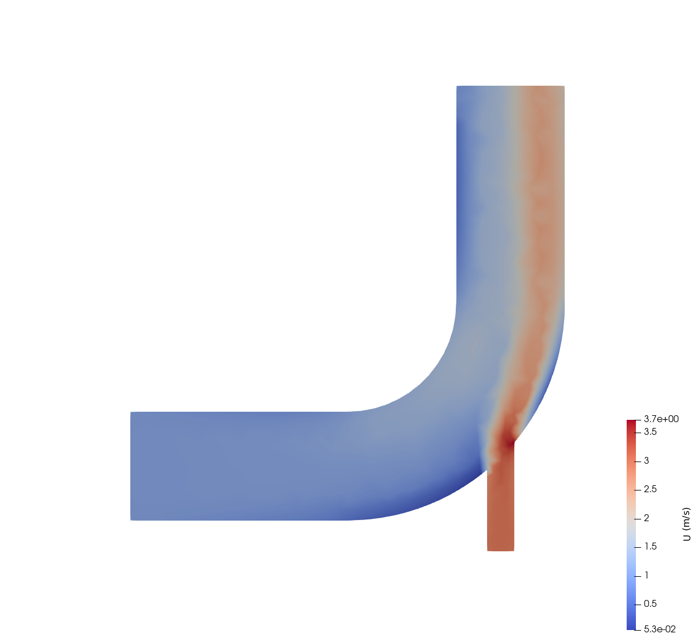
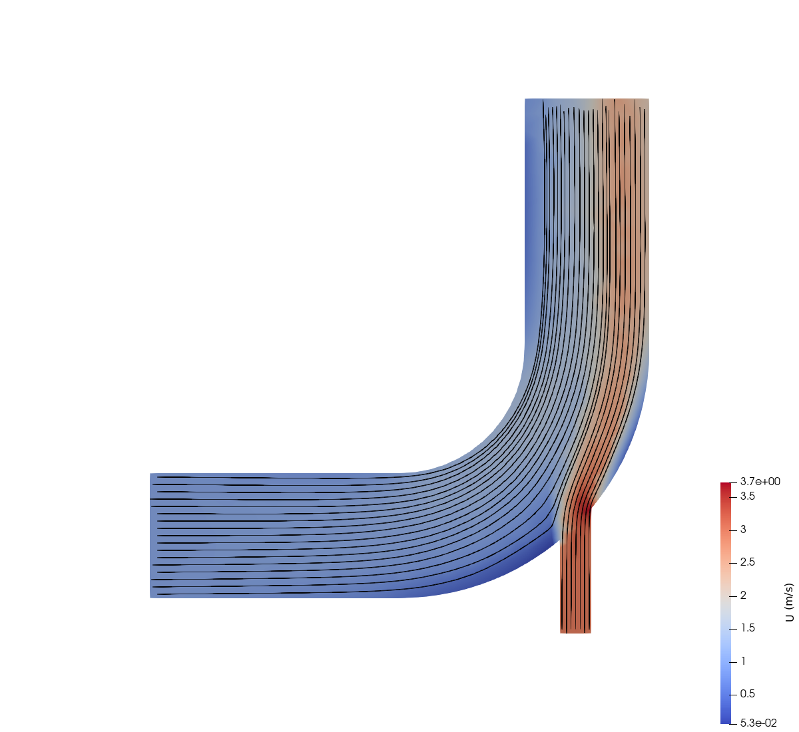
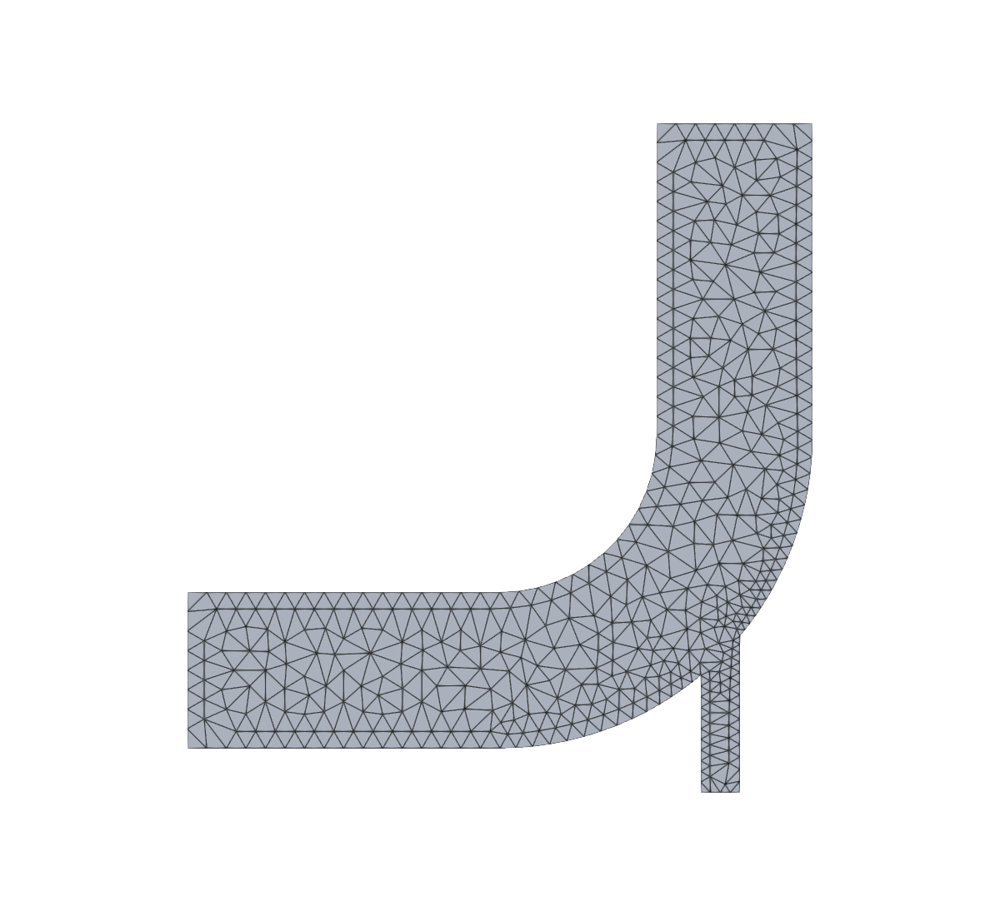
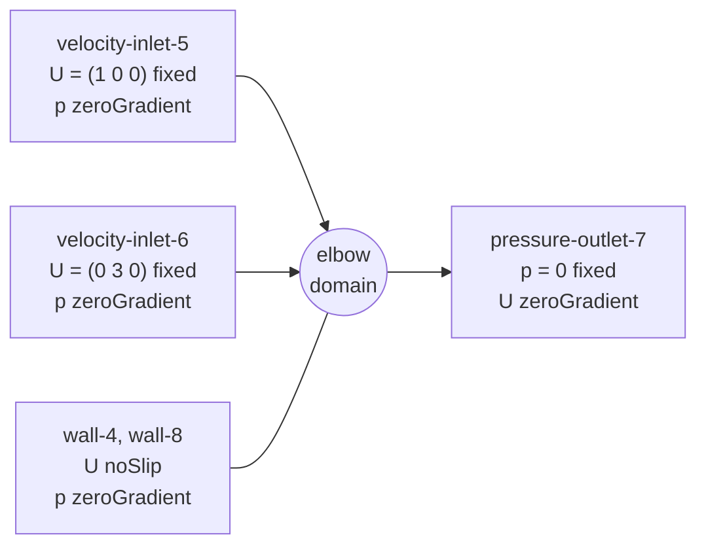
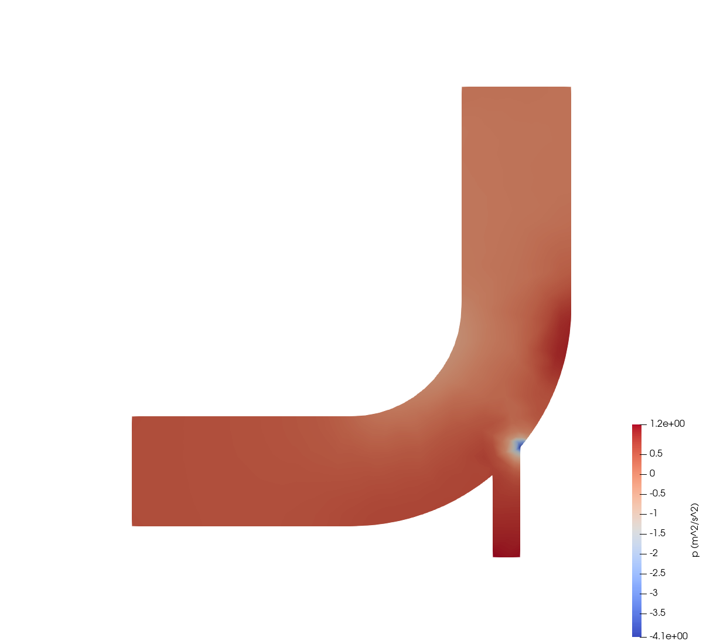

# 02 — Elbow Flow (icoFoam)

| Detail | Value |
|---|---|
| **Difficulty** | Beginner–Intermediate |
| **Solver** | `icoFoam` (incompressible, laminar, transient) |
| **Algorithm** | PISO |
| **Mesh** | Fluent `.msh` file imported with `fluentMeshToFoam` (918 triangular cells, 2-D) |
| **Fluid** | $\nu = 0.01$ $\mathrm{m}^{2}/\mathrm{s}$ |
| **Simulated time** | 75 s, $\Delta t = 0.05$ s (1500 steps) |
| **OpenFOAM version** | 6 |

This tutorial simulates **incompressible, laminar, transient** flow through a
two-inlet elbow geometry using the **icoFoam** solver and the **PISO** algorithm.
It builds on the cavity tutorial by introducing an imported unstructured mesh,
multiple inlet boundaries and Fluent interoperability tools.



*Velocity magnitude at t = 75 s. The fast stream from the side channel (bottom)
bends upward along the outer wall; the inner side of the vertical leg is slow.*

---

## Table of Contents

1. [Goal](#goal)
2. [Target](#target)
3. [Verification Method](#verification-method)
4. [Problem Description](#problem-description)
5. [Physics and Theory](#physics-and-theory)
6. [Case Structure](#case-structure)
7. [Mesh Details](#mesh-details)
8. [Boundary Conditions](#boundary-conditions)
9. [Fluid Properties](#fluid-properties)
10. [Numerical Schemes and Solver Settings](#numerical-schemes-and-solver-settings)
11. [Automation Scripts](#automation-scripts)
12. [How to Run](#how-to-run)
13. [Expected Results](#expected-results)
14. [Key Differences from the Cavity Tutorial](#key-differences-from-the-cavity-tutorial)
15. [Exercises](#exercises)
16. [References](#references)

---

## Goal

What a learner should take away from this case:

- How to bring an externally generated unstructured mesh (Fluent `.msh`) into
  OpenFOAM with `fluentMeshToFoam` and check it with `checkMesh`.
- How a 2-D case is represented in OpenFOAM (one cell thick, `empty` patch).
- How to combine prescribed-velocity inlets with a fixed-pressure outlet, and
  why this combination is well posed for incompressible flow.
- Why non-orthogonal correctors and a limited convection scheme are used on an
  unstructured mesh.
- How to export mesh and results back to Fluent format (`foamMeshToFluent`,
  `foamDataToFluent`).

## Target

The case has no analytical or published reference solution (the OpenFOAM
tutorial ships none), so the target is a set of consistency checks and
reproducible values measured with OpenFOAM 6 (Docker image `cfdengine/openfoam`).

| Quantity | Target | Measured in this repository |
|---|---|---|
| Run completes | 1500 time steps, no `FOAM FATAL ERROR` | yes |
| Mesh | `checkMesh` reports `Mesh OK` | 918 cells, max non-orthogonality 36.3°, max skewness 0.50 |
| Maximum Courant number | below 1 | 0.526 |
| Mass balance at t = 75 s | inflow = outflow | 30.0076 + 22.5057 = 52.5133 in; 52.5133 out |
| Outlet pressure | 0 (fixed) | 0 |
| Maximum $|\mathbf{U}|$ at t = 75 s | 4.07 m/s (regression value, tolerance $\pm 0.05$) | 4.067 m/s at (56.2, 11.6) |
| Pressure range at t = 75 s | -6.2 to 1.2 $\mathrm{m}^{2}/\mathrm{s}^{2}$ (regression value) | -6.17 to 1.24 $\mathrm{m}^{2}/\mathrm{s}^{2}$ |
| Approach to steady state | maximum $|\mathbf{U}|$ changes by less than 0.01 m/s between t = 60 s and 75 s | 4.074 and 4.067 m/s |

The velocity and pressure values are regression values for this mesh and these
schemes, not physical reference data.

## Verification Method

After a run, the script `verify.py` checks the results automatically. It only
reads files the run produced (`log.*`, time directories, `constant/polyMesh`,
`fluentInterface/`), needs only the Python 3 standard library and does not call
OpenFOAM:

```bash
./run_docker.sh          # clean, run, and call verify.py as its last step
python3 verify.py        # or run the checks again on existing results
```

It prints one line per check (`PASS|FAIL  name  measured=...  expected=... ± tol`),
a summary, and exits 0 only if every check passes (exit 1 if a check fails,
exit 2 if results are missing).

There is no analytical or published reference solution for this case, so the
checks are run health, conservation/consistency, and **regression values**
measured with OpenFOAM 6 on this mesh. The regression values detect an
accidental change of mesh, schemes or boundary conditions; they are not
physical reference data.

| # | Check | What it proves | Expected | Tolerance and reason | Measured |
|---|---|---|---|---|---|
| 1 | Fatal errors in all logs | No utility failed | 0 | exact | 0 |
| 2 | `icoFoam` log ends with `End` | Solver finished | True | exact | True |
| 3 | Time steps in `log.icoFoam` | Run reached `endTime` | 1500 (= `endTime`/`deltaT`) | exact | 1500 |
| 4 | Written time directories | Write interval honoured | 76 (0 to 75) | exact | 76 |
| 5 | `checkMesh`: `Mesh OK.` | Mesh passes all checks | True | exact | True |
| 6 | Number of cells | Expected mesh was used | 918 | exact | 918 |
| 7 | Max non-orthogonality | Within PISO correction capability | below 70° | OpenFOAM's severe limit | 36.3° |
| 8 | Max skewness | Mesh quality | below 4 | `checkMesh` failure limit | 0.50 |
| 9 | Max Courant number | Time step is stable | below 1 | usual PISO guideline | 0.526 |
| 10 | Cumulative continuity error | Flux field is divergence-free | below 1e-5 | orders above measured; flags a broken solve | 2.2e-7 |
| 11 | No NaN in `U`, `p` | Solution is finite | True | exact | True |
| 12 | (outflow + inflows) / outflow, from `phi` | Mass is conserved | 0 | $\pm 1e-4$, two orders above the final `p` tolerance (1e-6) | 5.7e-7 |
| 13 | Inflow of each inlet / (prescribed $U$ x patch area) | Boundary conditions applied, mesh areas consistent | 1 | $\pm 1e-4$, boundary flux of a `fixedValue` patch is exact up to round-off | 0.999999 and 1.000000 |
| 14 | Max $|\mathbf{U}|$ at t = 75 s | Regression value | 4.067 m/s | $\pm 0.05$ (about 1 %): allows round-off and platform differences, detects a different scheme, step or mesh | 4.0671 |
| 15 | Min `p` at t = 75 s | Regression value | -6.165 $\mathrm{m}^{2}/\mathrm{s}^{2}$ | $\pm 0.1$ (about 1.5 %), same reason | -6.165 |
| 16 | Max `p` at t = 75 s | Regression value | 1.236 $\mathrm{m}^{2}/\mathrm{s}^{2}$ | $\pm 0.1$, same reason | 1.236 |
| 17 | Change of peak $|\mathbf{U}|$ between t = 60 and 75 s | Flow has reached a plateau | 0 | $\pm 0.01$ m/s (0.25 % of the peak); this tests the peak speed only, not the full field | -0.0068 |
| 18 | `fluentInterface/case.msh` and `case75.dat` exist | Fluent export worked | True | exact | True |

Expected values for checks 14 to 16 are the values measured in this repository,
not published data. If you deliberately change the case (for example the
exercises below), these checks are expected to fail; the other checks stay valid.

The script was also tested against a deliberately damaged copy of the results
(a log with `FOAM FATAL ERROR` and without `End`, a `checkMesh` log without
`Mesh OK.`, and a changed inlet speed in `0/U`): it reported four `FAIL` lines
and exit code 1.

### Manual checks (not covered by `verify.py`)

- Open the case in ParaView (`./open_paraview.sh` or
  `pvbatch paraview_elbow.py --images images`) and compare with the figures in
  this README: fast stream along the outer wall of the vertical leg, slow region
  on its inner side, low pressure at the junction corner.
- Inspect `log.fluentMeshToFoam`: the warning about 1990 undefined faces added to
  a default patch is expected (the front and back faces).
- Plot `foamLog log.icoFoam` residuals (`logs/pFinalRes_0`, `logs/UxFinalRes_0`)
  and confirm they are small and flat at the end of the run.

---

## Problem Description

The **elbow flow** problem models two fluid streams entering a curved channel
from different directions, mixing in a shared passage, and exiting through a
common outlet. This configuration occurs in piping systems, HVAC ductwork and
chemical-process manifolds, which makes it a practical step up from the simple
lid-driven cavity.

### Why Study Elbow Flow?

- **Curved-geometry effects** — pressure gradients across the bend turn the
  flow. In a three-dimensional duct this drives secondary flow (Dean vortices);
  a 2-D simulation such as this one cannot represent them but still shows the
  pressure and velocity redistribution caused by the bend.
- **Multi-inlet mixing** — two streams with different velocity vectors meet,
  creating a shear layer.
- **Pressure drop estimation** — engineers must predict losses through bends to
  size pumps and blowers.
- **External mesh import** — unlike the cavity case (which uses `blockMesh`),
  this case imports a Fluent `.msh` file, which introduces a real-world meshing
  workflow.
- **Fluent round-trip** — the case exports mesh and results back to Fluent
  format, a common requirement in mixed-tool engineering teams.

### Geometry Overview

Schematic, not to scale. The true outline is shown in
[images/mesh.png](images/mesh.png). Coordinates are those of the imported mesh,
which OpenFOAM interprets as metres.

```
                                         pressure-outlet-7
                                         x = 48 ... 64, y = 64
                                         p = 0, U zeroGradient
                                      ┌──────────────────────┐
                                      │    ↑      ↑      ↑   │
                                      │                      │
                                      │                      │
                         wall-4       │                      │      wall-8
                    (inner wall)      │                      │  (outer wall,
                                      │                      │   y = 11.5 ... 64)
                                      │                      │
                                ╭─────╯                      │
         y = 16 ────────────────╯   inner arc, R = 16        ╱
                                    centre (32, 32)         ╱
  velocity-inlet-5                                        ╱  outer arc, R = 32
  x = 0, y = 0 ... 16                                   ╱
  U = (1 0 0) m/s    →  →  →                          ╱
                                                     ╱
         y = 0  ───────────────────────╮           ╱
                      wall-4            ╲        ╱
                                         ╲_____╱  ← junction at x = 52.5 ... 56.5,
                                               │      y = 7.4 ... 11.5
                                               │ ↑ ↑ │
                                        velocity-inlet-6
                                        x = 52.5 ... 56.5, y = -4.5
                                        U = (0 3 0) m/s

   frontAndBackPlanes: empty (z = ±0.94, 2-D constraint)
```

| Feature | Size |
|---|---|
| Main channel width (inlet 5, outlet 7) | 16 |
| Side channel width (inlet 6) | 4 |
| Bend radii (inner / outer) | 16 / 32, centre at (32, 32) |
| Domain extent | x from 0 to 64, y from -4.5 to 64 |
| Depth in z | 1.875 (set by `fluentMeshToFoam` when extruding the 2-D mesh) |

**What is happening physically:**

- **velocity-inlet-5** drives fluid horizontally at 1 m/s into the left end of
  the main channel.
- **velocity-inlet-6** drives fluid vertically at 3 m/s through the narrow side
  channel, which joins the outer wall of the bend.
- The two streams merge in the bend and leave upward through
  **pressure-outlet-7**.
- **wall-4** and **wall-8** are no-slip walls (wall-8 is the outer wall
  downstream of the side-channel junction, wall-4 is everything else).
- **frontAndBackPlanes** makes the simulation two-dimensional (single cell in z)
  by applying the `empty` condition.

The fast side stream (3 m/s through a channel of width 4) carries 22.5 $\mathrm{m}^{3}/\mathrm{s}$
against 30.0 $\mathrm{m}^{3}/\mathrm{s}$ from the main inlet, and it enters at three times the speed.
Where the two streams meet, a shear layer forms and the fast stream stays
attached to the outer wall. Momentum diffusion (controlled by the kinematic
viscosity $\nu$) slowly smooths the velocity differences along the vertical leg.



*Streamlines seeded across both inlets, over the velocity magnitude. The
streamlines of the side channel remain on the outer (right) wall; the main
stream is squeezed toward the inner wall.*

This setup is representative of many practical engineering situations:

| Application area      | Example                                              |
|-----------------------|------------------------------------------------------|
| Piping systems        | Mixing tees, manifolds, header pipes                 |
| HVAC                  | Duct junctions where supply streams merge            |
| Chemical engineering  | Inline mixing of reagent streams                     |
| Hydraulics            | River confluences, irrigation channel merges         |

---

## Physics and Theory

### Governing Equations

`icoFoam` solves the incompressible Navier–Stokes equations for a Newtonian
fluid with constant kinematic viscosity:

$$\nabla \cdot \mathbf{U} = 0 \quad \text{(continuity)}$$

$$\frac{\partial \mathbf{U}}{\partial t} + \nabla \cdot (\mathbf{U}\mathbf{U}) = -\nabla p + \nu \nabla^2 \mathbf{U} \quad \text{(momentum)}$$

where $\mathbf{U}$ is the velocity vector, $p$ is the kinematic pressure
(pressure divided by density, $p/\rho$, units $\mathrm{m}^{2}/\mathrm{s}^{2}$), and $\nu$ is the
kinematic viscosity. Because the fluid is incompressible and the viscosity is
constant, no energy equation or equation of state is needed.

### Secondary Flow and the Dean Number

When fluid negotiates a bend in a three-dimensional duct or pipe, centrifugal
effects push the faster-moving core fluid toward the outer wall while the
slower fluid near the walls moves inward. This establishes a pair of
counter-rotating vortices (Dean vortices) superimposed on the primary axial
flow. The strength of this secondary flow is characterised by the **Dean
number**:

$$De = Re \times \sqrt{D / 2R}$$

where $Re$ is the Reynolds number, $D$ is the hydraulic diameter of the duct and
$R$ is the bend radius of curvature. Higher Dean numbers produce stronger
secondary flows and larger pressure losses through the bend.

This case is two-dimensional (the z-direction is `empty`), so the cross-stream
secondary flow described by the Dean number is **not** resolved here. It is
given as background for extending the case to a 3-D duct.

### Mixing of Two Inlet Streams

The two inlet velocities differ in both magnitude and direction. Where the
streams meet, a shear layer forms. Viscous diffusion and convective transport
gradually blend the two streams. The time scale for complete mixing depends on
the velocity ratio, the channel geometry and the Reynolds number. In this
simulation both streams are the same fluid, so mixing is visible only through
the velocity field; Exercise 6 adds a passive scalar to make it visible.

### Reynolds Number Estimate

With $\nu = 0.01$ $\mathrm{m}^{2}/\mathrm{s}$, based on channel width and the speed at each opening:

| Location | Speed | Width | $Re = UL/\nu$ |
|---|---|---|---|
| Inlet 5 | 1 m/s | 16 | 160 |
| Inlet 6 | 3 m/s | 4 | 1200 |
| Outlet 7 (mean speed 52.5 / 30.0 = 1.75 m/s from mass balance) | 1.75 m/s | 16 | about 2800 |

$$Re = \frac{U L}{\nu}, \qquad \text{e.g. } \frac{1 \times 16}{0.01} = 160$$

The inlet values are well within the laminar regime (the usual transition range
for internal flow starts near $Re \approx 2300$), which justifies `icoFoam`
without a turbulence model. At the outlet the estimate is close to that
range, so the laminar solution there is a modelling assumption.

> **See also:**
> [notes/04_meshing.md](https://github.com/djeada/OpenFoam-Tutorials/blob/main/notes/04_meshing.md) for general meshing theory,
> [notes/05_boundary_conditions.md](https://github.com/djeada/OpenFoam-Tutorials/blob/main/notes/05_boundary_conditions.md) for a
> deeper dive into boundary condition types, and
> [notes/10_icofoam_solver_analysis.md](https://github.com/djeada/OpenFoam-Tutorials/blob/main/notes/10_icofoam_solver_analysis.md)
> for a detailed walkthrough of the icoFoam solver algorithm.

---

## Case Structure

File names in OpenFOAM are case-sensitive: `controlDict`, `fvSchemes`,
`fvSolution`, `transportProperties`, `foamDataToFluentDict`, `Allrun` and
`Allclean` must be spelled exactly like this.

```
02_elbow/
├── 0/
│   ├── p                        # Pressure initial & boundary conditions
│   └── U                        # Velocity initial & boundary conditions
├── constant/
│   ├── polyMesh/                # Generated by fluentMeshToFoam
│   │   ├── boundary             # Patch definitions (6 patches)
│   │   ├── cellZones            # Cell zone information (empty)
│   │   ├── faceZones            # Face zone information (empty)
│   │   ├── faces                # Face-to-vertex connectivity
│   │   ├── neighbour            # Neighbour cell for each internal face
│   │   ├── owner                # Owner cell for each face
│   │   ├── pointZones           # Point zone information (empty)
│   │   └── points               # Vertex coordinates
│   └── transportProperties      # Kinematic viscosity (nu = 0.01)
├── system/
│   ├── controlDict              # Time control, write interval, I/O
│   ├── foamDataToFluentDict     # Field-to-Fluent-ID export mapping
│   ├── fvSchemes                # Discretisation schemes
│   └── fvSolution               # Linear solvers, PISO settings
├── images/                      # Figures used in this README
├── Allclean                     # Script: remove all generated files
├── Allrun                       # Script: mesh conversion, checkMesh, solve, Fluent export
├── elbow.msh                    # Fluent-format mesh (~32 KB, ASCII)
├── open_paraview.sh             # Open the result in ParaView
├── paraview_elbow.py            # ParaView script (velocity slice, README figures)
├── run_docker.sh                # Clean, run (cfdengine/openfoam image), verify
├── verify.py                    # Automatic checks of a finished run
└── README.md                    # This file
```

`constant/polyMesh/` is regenerated from `elbow.msh` by `Allrun`. `Allclean`
(through `cleanCase`) deletes it, so a copy checked into the repository is
removed by cleaning.

The case is the OpenFOAM 6 tutorial
`$FOAM_TUTORIALS/incompressible/icoFoam/elbow` with one change: `endTime` is 75
instead of 10.

---

## Mesh Details

### External Mesh — Fluent Format

Unlike the cavity tutorial (which generates its mesh internally with
`blockMesh`), the elbow geometry has curved walls and is provided as an
unstructured mesh created with an external tool. The file `elbow.msh` (~32 KB)
is in Fluent format (file header: TGrid 2D 2.4.1) and must be converted to
OpenFOAM's native `polyMesh` format before running:

```bash
fluentMeshToFoam elbow.msh
```

This command:

1. Reads the Fluent mesh (nodes, faces, cells, boundary zones).
2. Extrudes the 2-D mesh in z by one cell thickness (1.875) and adds the
   `frontAndBackPlanes` patch of type `empty`.
3. Writes `constant/polyMesh/` with `points`, `faces`, `owner`, `neighbour` and
   `boundary` files (plus empty zone files).
4. Maps Fluent zone names (e.g. `velocity-inlet-5`) to OpenFOAM patch names.

`fluentMeshToFoam` prints a warning that 1990 faces are "undefined" and added to
a default patch. These are the front and back faces, which end up in
`frontAndBackPlanes`; the warning is expected.

### Mesh Statistics

| Patch                | Type    | Faces |
|----------------------|---------|------:|
| wall-4               | wall    |   100 |
| velocity-inlet-5     | patch   |     8 |
| velocity-inlet-6     | patch   |     4 |
| pressure-outlet-7    | patch   |     8 |
| wall-8               | wall    |    34 |
| frontAndBackPlanes   | empty   |  1836 |

- **Points:** 1074 (537 per plane)
- **Internal faces:** 1300
- **Total cells:** 918 (2-D; each cell has one front and one back `empty` face,
  so 1836 ÷ 2 = 918)
- **Cell type:** triangular prisms (the Fluent file holds 918 triangles)
- **Patch types:** `fluentMeshToFoam` creates the inlets and outlet as plain
  `patch`, the walls as `wall`.



*The 918-cell triangular mesh. Cells are smallest in the side channel and around
the junction where it meets the bend.*

### Unstructured Mesh Characteristics

Because the mesh is unstructured, the solver must handle:

- **Non-orthogonality** — corrected by the 2 non-orthogonal corrector loops in
  PISO (configured in `fvSolution`).
- **Variable cell size** — finer in the side channel and near the junction,
  coarser in the straight parts of the main channel and the outlet leg.
- **Arbitrary connectivity** — each cell may have a different number of
  neighbours, unlike the regular structure produced by `blockMesh`.

### Mesh Quality Check

After converting, always verify the mesh quality:

```bash
checkMesh
```

Look for the summary at the end: `Mesh OK.` and no failed checks. For this mesh
`checkMesh` reports maximum non-orthogonality 36.3° (average 11.2°), maximum
skewness 0.50 and maximum aspect ratio 2.4. The 2 non-orthogonal correctors
manage moderate non-orthogonality of this size.

> **Further reading:**
> [notes/04_meshing.md](https://github.com/djeada/OpenFoam-Tutorials/blob/main/notes/04_meshing.md) covers meshing strategies,
> quality metrics, `blockMesh` vs external tools, and troubleshooting.

---

## Boundary Conditions

The boundary conditions are defined in `0/U` (velocity) and `0/p` (pressure).

### Velocity Field — `0/U`

| Patch                | BC Type        | Value / Setting          | Physical Meaning                           |
|----------------------|----------------|--------------------------|---------------------------------------------|
| wall-4               | `noSlip`       | —                        | Zero velocity at the wall (no-slip)         |
| velocity-inlet-5     | `fixedValue`   | `uniform (1 0 0)` m/s    | Horizontal inflow at 1 m/s                  |
| velocity-inlet-6     | `fixedValue`   | `uniform (0 3 0)` m/s    | Vertical inflow at 3 m/s                    |
| pressure-outlet-7    | `zeroGradient` | —                        | Velocity extrapolated to the outlet         |
| wall-8               | `noSlip`       | —                        | Zero velocity at the wall (no-slip)         |
| frontAndBackPlanes   | `empty`        | —                        | 2-D constraint (no solution in z-direction) |

### Pressure Field — `0/p`

| Patch                | BC Type        | Value / Setting     | Physical Meaning                                  |
|----------------------|----------------|---------------------|---------------------------------------------------|
| wall-4               | `zeroGradient` | —                   | No pressure flux through the wall                 |
| velocity-inlet-5     | `zeroGradient` | —                   | Pressure adjusts to the prescribed inlet flow     |
| velocity-inlet-6     | `zeroGradient` | —                   | Pressure adjusts to the prescribed inlet flow     |
| pressure-outlet-7    | `fixedValue`   | `uniform 0`         | Reference pressure fixed at the outlet            |
| wall-8               | `zeroGradient` | —                   | No pressure flux through the wall                 |
| frontAndBackPlanes   | `empty`        | —                   | 2-D constraint                                    |



### Internal Field Initialisation

Both fields are initialised to uniform zero:

- **p:** `internalField uniform 0;`
- **U:** `internalField uniform (0 0 0);`

The simulation starts from rest and develops flow as the inlet conditions take
effect from the first time step.

### Key Points

- Fixing pressure at the outlet and velocity at the inlets is a **well-posed**
  combination for incompressible flow. Never fix both $p$ and $\mathbf{U}$ on the
  same boundary.
- Because pressure is fixed only at the outlet, the pressure level is defined
  relative to the outlet.
- The `noSlip` boundary for walls is a shorthand that sets velocity to
  `uniform (0 0 0)` without requiring an explicit `value` entry.
- The `empty` type tells OpenFOAM to ignore those faces entirely — essential for
  2-D cases modelled as a single-cell-thick 3-D slice.

---

## Fluid Properties

Defined in `constant/transportProperties`:

```
nu    [0 2 -1 0 0 0 0]    0.01;
```

| Property            | Symbol | Value   | Dimensions | Dimensional formula        |
|---------------------|--------|---------|------------|----------------------------|
| Kinematic viscosity | $\nu$  | 0.01    | $\mathrm{m}^{2}/\mathrm{s}$       | [0 2 -1 0 0 0 0]           |

This is a relatively high viscosity (for context, water at 20 °C has
$\nu \approx 1 \times 10^{-6}$ $\mathrm{m}^{2}/\mathrm{s}$). The large value keeps the Reynolds
number low (160 to about 2800, see above), so the flow can be solved as laminar
without a turbulence model.

---

## Numerical Schemes and Solver Settings

### Time Control — `system/controlDict`

| Parameter          | Value         | Notes                                       |
|--------------------|---------------|---------------------------------------------|
| `application`      | `icoFoam`     | Incompressible laminar transient solver      |
| `startFrom`        | `latestTime`  | Resume from the last written time directory; run `Allclean` to start over |
| `startTime`        | `0`           | Used if no time directories exist            |
| `endTime`          | `75`          | Simulation runs for 75 seconds (the OpenFOAM tutorial uses 10) |
| `deltaT`           | `0.05`        | Fixed time step of 50 ms; maximum Courant number 0.53 |
| `writeControl`     | `timeStep`    | Write output every N time steps              |
| `writeInterval`    | `20`          | Write every 20 steps, i.e. every 1.0 s       |
| `purgeWrite`       | `0`           | Keep all time directories                    |
| `writeFormat`      | `ascii`       | Human-readable output                        |
| `writePrecision`   | `6`           | 6 significant digits                         |

Total time steps: 75 / 0.05 = **1500**. With `writeInterval 20` this produces
**75 output directories** (1, 2, ..., 75) plus the initial `0` directory.

### Discretisation Schemes — `system/fvSchemes`

| Category               | Scheme                      | Notes                                    |
|------------------------|-----------------------------|------------------------------------------|
| `ddtSchemes`           | `Euler`                     | First-order implicit, unconditionally stable |
| `gradSchemes`          | `Gauss linear`              | Second-order, cell-centred gradient      |
| `divSchemes`           | `Gauss limitedLinearV 1`    | TVD-limited linear for `div(phi,U)`      |
| `laplacianSchemes`     | `Gauss linear corrected`    | Second-order with non-orthogonal correction |
| `interpolationSchemes` | `linear`                    | Linear (central) face interpolation      |
| `snGradSchemes`        | `corrected`                 | Explicit non-orthogonal correction       |

The `limitedLinearV 1` divergence scheme applies a TVD slope limiter to the
convective term, preventing spurious oscillations that can arise with pure
central differencing on an unstructured mesh, particularly near the junction
where velocity gradients are steep.

### Linear Solvers and PISO Algorithm — `system/fvSolution`

**Pressure solver (`p`):**

| Setting          | Value       |
|------------------|-------------|
| Solver           | `PCG`       |
| Preconditioner   | `DIC`       |
| Tolerance        | 1e-06       |
| Relative tol.    | 0.05        |

**Final pressure corrector (`pFinal`):** same as `p` but with `relTol 0`, i.e.
solved to the absolute tolerance on the last PISO corrector step.

**Velocity solver (`U`):**

| Setting          | Value             |
|------------------|-------------------|
| Solver           | `smoothSolver`    |
| Smoother         | `symGaussSeidel`  |
| Tolerance        | 1e-05             |
| Relative tol.    | 0                 |

**PISO algorithm settings:**

| Parameter                       | Value | Purpose                                      |
|---------------------------------|------:|----------------------------------------------|
| `nCorrectors`                   |     2 | Pressure–velocity coupling correction steps  |
| `nNonOrthogonalCorrectors`      |     2 | Extra corrections for mesh non-orthogonality |

Two PISO correctors enforce the pressure–velocity coupling within each time
step. The two non-orthogonal correctors improve accuracy on the unstructured
mesh, where face normals do not align with the line connecting neighbouring
cell centres.

### Fluent Export Dictionary — `system/foamDataToFluentDict`

This file maps OpenFOAM field names to Fluent variable IDs so that results can
be exported back to Fluent format with `foamDataToFluent`:

| OpenFOAM Field | Fluent ID |
|----------------|----------:|
| `p`            |         1 |
| `U`            |         2 |
| `T`            |         3 |
| `h`            |         4 |
| `k`            |         5 |
| `epsilon`      |         6 |
| `alpha1`       |       150 |

Only `p` and `U` exist in this case; the other entries are unused defaults from
the OpenFOAM tutorial that allow the dictionary to be reused in more complex
simulations.

---

## Automation Scripts

### `Allrun` — Run the Full Case

```bash
#!/bin/sh
cd "${0%/*}" || exit 1    # Run from this directory

# Source tutorial run functions
. "$WM_PROJECT_DIR/bin/tools/RunFunctions"

# Solver name is read from system/controlDict
application=$(getApplication)

runApplication fluentMeshToFoam elbow.msh
runApplication checkMesh
runApplication "$application"
runApplication foamMeshToFluent
runApplication foamDataToFluent
```

**Step-by-step breakdown:**

1. **`fluentMeshToFoam elbow.msh`** — reads the Fluent `.msh` file and writes
   OpenFOAM's `constant/polyMesh/` directory.
2. **`checkMesh`** — checks the converted mesh (log in `log.checkMesh`, used by
   `verify.py`).
3. **`icoFoam`** — runs the transient solver for 1500 time steps (75 s at
   $\Delta t = 0.05$ s). The `getApplication` function reads the solver name
   from `controlDict`.
4. **`foamMeshToFluent`** — converts the OpenFOAM mesh back to Fluent format and
   writes it to `fluentInterface/case.msh`.
5. **`foamDataToFluent`** — exports the fields (p, U) using the IDs from
   `foamDataToFluentDict` to `fluentInterface/case<time>.dat`, one file per
   written time.

The `runApplication` wrapper logs each command's output to a `log.<command>`
file and **skips** a step if its log file already exists. To force a re-run,
delete the relevant log file or run `./Allclean` first.

### `Allclean` — Reset the Case

```bash
#!/bin/sh
cd "${0%/*}" || exit 1    # Run from this directory

# Source tutorial clean functions
. "$WM_PROJECT_DIR/bin/tools/CleanFunctions"

# cleanCase removes time directories, logs and constant/polyMesh
cleanCase
rm -rf fluentInterface
rm -f elbow.foam
```

This removes:

- All generated time directories (1/, 2/, ... 75/)
- All `log.*` files
- `constant/polyMesh/` (regenerated by `fluentMeshToFoam`)
- The `fluentInterface/` export directory
- `elbow.foam` (created by `open_paraview.sh`)
- Processor directories (from parallel runs, if any) and `postProcessing/`

`images/` is not touched. After `Allclean` the case is back to its original
state and ready for a fresh run.

### `run_docker.sh`

Runs `Allclean` and then `Allrun` inside the `cfdengine/openfoam` image with the
project directory mounted at `/case`, then runs `python3 verify.py` on the host.
The script exits non-zero if any check fails.

### `verify.py`

Checks a finished run (see [Verification Method](#verification-method)).
`Allclean` does not delete it.

### `open_paraview.sh` and `paraview_elbow.py`

`open_paraview.sh` checks that `paraview` is available and that results exist,
creates `elbow.foam` and starts ParaView with `paraview_elbow.py`. The script
shows $|\mathbf{U}|$ on a z-midplane slice at the last time step. Headless use:

```bash
pvbatch paraview_elbow.py --screenshot velocity.png   # one image
pvbatch paraview_elbow.py --images images             # mesh, velocity, pressure, streamlines
```

The second command regenerates the figures in this README. Run both from the
case directory after the case has been solved.

---

## How to Run

### Prerequisites

- OpenFOAM 6 installed and sourced (`. $WM_PROJECT_DIR/etc/bashrc`), or Docker
  with the `cfdengine/openfoam` image.
- `icoFoam`, `fluentMeshToFoam`, `checkMesh` and `paraFoam` (or `foamToVTK` plus
  ParaView) available on your `$PATH` for local runs.

### Quick Start (Docker)

```bash
cd projects/02_elbow
./run_docker.sh
```

This takes a few seconds and ends with the `verify.py` summary. Files created in
the container are owned by the container user.

### Quick Start (Local OpenFOAM)

```bash
cd projects/02_elbow
./Allclean            # ensure a clean state
./Allrun              # convert mesh, solve, export to Fluent
```

Check progress by tailing the solver log:

```bash
tail -f log.icoFoam
```

### Manual Step-by-Step

If you prefer to run each stage individually for learning purposes:

```bash
# 1. Navigate to the case directory
cd projects/02_elbow

# 2. Clean any previous results
./Allclean

# 3. Convert the Fluent mesh to OpenFOAM format
fluentMeshToFoam elbow.msh

# 4. Inspect the mesh (optional but recommended; Allrun does this too)
checkMesh

# 5. Run the solver
icoFoam

# 6. View results in ParaView
#    Option A: native OpenFOAM reader
paraFoam
#    Option B: convert to VTK first
foamToVTK
paraview VTK/

# 7. (Optional) Export results back to Fluent format
foamMeshToFluent
foamDataToFluent
```

`verify.py` expects the logs and the `fluentInterface/` directory written by
`Allrun`; use `./Allrun` (or `./run_docker.sh`) if you want the automatic checks.

### Monitoring Convergence

While `icoFoam` runs, watch the residuals printed to the terminal. The initial
residuals for `p` and `Ux`/`Uy` fall during the first time steps and then stay
small; at t = 75 s the initial residuals are of order 1e-5 (U) and 1e-3 to
1e-6 (p, first to last corrector). If residuals grow or the Courant number
exceeds 1, reduce `deltaT` or check the boundary conditions.

You can extract the residual data from the log file for plotting:

```bash
foamLog log.icoFoam
# Creates a logs/ directory with per-field residual data
# (e.g. logs/UxFinalRes_0, logs/pFinalRes_0, logs/CourantMax_0)
# Plot with gnuplot, matplotlib or your preferred tool
```

### Post-Processing with ParaView

In ParaView:

1. Open the case directory with the built-in OpenFOAM reader (`paraFoam` or open
   `elbow.foam`), or load VTK files from the `VTK/` directory after running
   `foamToVTK`.
2. Apply a **Surface** representation coloured by velocity magnitude (`U`) to
   visualise the flow field.
3. Use the **Glyph** filter on `U` to see velocity vectors and flow direction.
4. Colour by `p` to see the pressure distribution, or apply a **Contour** filter.
5. Create a **Plot Over Line** across the vertical leg (for example from
   (48, 50, 0) to (64, 50, 0)) to see the velocity profile and the pressure
   across the channel.
6. Use **Stream Tracer** to follow fluid paths through the elbow (this is how
   the streamline figure was made).



*Kinematic pressure at t = 75 s (point-interpolated, so the colour range is
-4.1 to 1.2; the cell values reach -6.17). The low-pressure spot sits at the
corner where the side channel meets the outer wall, where the speed is highest.*

### Cleaning Up

To reset the case to its original state:

```bash
./Allclean
```

---

## Expected Results

### Flow Development

The fluid is incompressible, so the pressure field responds to the inlet
conditions immediately; the flow does not travel from the inlets to the outlet
as a front. Measured maximum velocity magnitudes:

| Time | 1 s | 5 s | 10 s | 20 s | 60 s | 75 s |
|---|---|---|---|---|---|---|
| Maximum $|\mathbf{U}|$ (m/s) | 3.15 | 4.01 | 4.07 | 4.11 | 4.07 | 4.07 |

1. **Early transient (0 to about 5 s):** the flow field adjusts from rest. The
   peak speed rises from 3 m/s (the side inlet speed) to about 4 m/s at the
   junction corner, and the shear layer between the two streams forms.
2. **Development phase (5 to about 20 s):** the peak speed reaches its maximum
   (4.11 m/s) and the pressure field settles; the fast stream attaches to the
   outer wall and is carried to the outlet.
3. **Quasi-steady state (about 20 to 75 s):** the velocity field changes only
   slowly. It is not perfectly steady: the largest cell-wise change in
   $\mathbf{U}$ between t = 74 s and 75 s is about 0.04 m/s, concentrated near the
   junction.

### Features to Look For

| Feature                  | Where to observe                                        |
|--------------------------|---------------------------------------------------------|
| Velocity maximum (4.07 m/s) | Junction corner where the side channel meets the outer wall, (56.2, 11.6) |
| Fast jet along the outer wall | Right-hand side of the vertical leg up to the outlet |
| Shear layer              | Between the fast side stream and the slower main stream, from the junction upward |
| Slow region              | Inner (left) wall of the vertical leg, below about 1 m/s; the outlet profile is skewed toward wall-8 (about 0.9 m/s at x = 48.7, 2.6 m/s at x = 61.5) |
| Low-speed layer          | Along the outer wall of the bend, upstream of the junction |
| Weak reverse flow        | One or two cells at the upstream corner of the junction near (52, 8), $U_y = -0.26$ m/s; there is no large recirculation zone |
| Pressure minimum         | Junction corner, (56.6, 11.9): -6.17 $\mathrm{m}^{2}/\mathrm{s}^{2}$ |
| Pressure maximum         | Bottom of the side channel (inlet 6): 1.24 $\mathrm{m}^{2}/\mathrm{s}^{2}$ |
| Pressure at the inlets   | Area averages 0.53 (inlet 5) and 1.19 $\mathrm{m}^{2}/\mathrm{s}^{2}$ (inlet 6), relative to the outlet |

### Quantitative Checks

- **Maximum velocity** is about 4.07 m/s, a little above the fastest inlet
  speed (3 m/s), at the junction.
- **Outlet pressure** is 0 (fixed reference).
- **Mass conservation:** the outflow of 52.51 $\mathrm{m}^{3}/\mathrm{s}$ equals the sum of the inflows
  (30.01 + 22.51 $\mathrm{m}^{3}/\mathrm{s}$). Verify with
  `postProcess -func "flowRatePatch(name=velocity-inlet-5)" -latestTime` (and the
  other two patches; the function name in OpenFOAM 6 is `flowRatePatch`), or
  run `python3 verify.py`. See [Verification Method](#verification-method).

---

## Key Differences from the Cavity Tutorial

| Aspect                   | Cavity (01)                          | Elbow (02)                                       |
|--------------------------|--------------------------------------|--------------------------------------------------|
| **Geometry**             | Simple square box                    | Curved channel with two inlets                   |
| **Mesh generation**      | `blockMesh` (built-in, structured)   | `fluentMeshToFoam` (external import)             |
| **Mesh type**            | Structured hexahedral                | Unstructured (triangular prisms)                 |
| **Number of inlets**     | 0 (lid-driven)                       | 2 (velocity-inlet-5, velocity-inlet-6)           |
| **Number of outlets**    | 0 (enclosed)                         | 1 (pressure-outlet-7)                            |
| **Driving mechanism**    | Moving wall (lid)                    | Prescribed inlet velocities                      |
| **Non-orth. correctors** | 0 (orthogonal hex grid)              | 2 (non-orthogonal unstructured mesh)             |
| **Divergence scheme**    | `Gauss linearUpwind grad(U)`         | `Gauss limitedLinearV 1` (TVD limiter)           |
| **Fluent interop**       | None                                 | Import `.msh` + export via `foamDataToFluent`    |
| **Simulation duration**  | 0.5 s                                | 75 s                                             |
| **Key physics**          | Single central vortex                | Turning flow, two-stream merging, junction jet   |
| **New skills learned**   | Basic OpenFOAM workflow              | External meshing, Fluent conversion, PISO tuning |

---

## Exercises

These exercises progressively increase in difficulty. Try them in order.

### Exercise 1 — Change Inlet Velocities

Modify `0/U` to set the side inlet to `(0 1 0)` (so both inlets are 1 m/s).

- How does the mixing pattern change when the velocity ratio is 1:1 instead of
  1:3?
- Does the fast jet along the outer wall persist? Where is the velocity maximum?
- Is the outlet velocity profile more symmetric?

### Exercise 2 — Reduce Viscosity

In `constant/transportProperties`, change `nu` from `0.01` to `0.001`.

- What happens to the flow? Does it become unsteady or show oscillations?
- The case still runs at `deltaT 0.05` (maximum Courant number about 0.5); check
  the CFL number in `log.icoFoam` if you change the mesh or the velocities.
  The peak speed rises to about 4.4 m/s.
- The Reynolds numbers are now ten times larger (inlet 6: 12000), so a laminar
  2-D solution is no longer physically meaningful. Compare velocity profiles at
  the outlet for both viscosities and discuss why.

### Exercise 3 — Increase PISO Correctors

Change `nCorrectors` from 2 to 4 in `system/fvSolution`. Re-run and compare:

- Does the residual history improve (lower residuals per time step)?
- Is the solution noticeably different?
- What is the trade-off in computation time?

### Exercise 4 — Refine the Mesh

Open `elbow.msh` in a meshing tool (e.g. Gmsh or ANSYS Meshing) and generate a
finer mesh with roughly double the cell count, keeping the zone names
(`wall-4`, `velocity-inlet-5`, ...). Export as `.msh` and re-run:

```bash
fluentMeshToFoam elbow_fine.msh
icoFoam
```

- Is the solution noticeably different? This is a basic **mesh independence**
  check.
- Pay attention to the peak velocity at the junction and the outlet velocity
  profile.

### Exercise 5 — Try a Different Divergence Scheme

Replace `Gauss limitedLinearV 1` with `Gauss upwind` in `system/fvSchemes`.

- How does the additional numerical diffusion from upwind affect the sharpness
  of the shear layer between the two streams?
- Is the weak reverse-flow region at the junction still visible, or has it been
  smeared out?

### Exercise 6 — Add a Passive Scalar

Track how the fluid from each inlet mixes by solving a scalar transport
equation on the stored flow field. This was tested with OpenFOAM 6 as follows:

1. After the run, create `75/T` (copy the structure of `0/p`, class
   `volScalarField`, dimensions `[0 0 0 1 0 0 0]`, `internalField uniform 0`):
   `fixedValue uniform 0` on `velocity-inlet-5`, `fixedValue uniform 1` on
   `velocity-inlet-6`, `zeroGradient` on the outlet and walls, `empty` on
   `frontAndBackPlanes`.
2. Add `DT DT [0 2 -1 0 0 0 0] 0.01;` to `constant/transportProperties`.
3. In `system/fvSchemes` add `div(phi,T) Gauss limitedLinear 1;` to `divSchemes`.
   In `system/fvSolution` add a `T` entry (`smoothSolver`, `symGaussSeidel`,
   `tolerance 1e-06`, `relTol 0`) to `solvers` and a `SIMPLE` dictionary with
   `nNonOrthogonalCorrectors 2;`.
4. Set `endTime 100` in `controlDict` and run `scalarTransportFoam`. It reads
   the stored `U` and `phi` at t = 75 s and transports `T` from 75 s to 100 s.

This exercise goes beyond `icoFoam` and is a stepping stone to multi-species
transport simulations.

### Exercise 7 — Export and Compare in Fluent

Run the full `Allrun` script to generate the Fluent export files in
`fluentInterface/` (`case.msh` and `case<time>.dat`). If you have access to
ANSYS Fluent:

- Import the mesh and field data.
- Compare visualisations and residual values between OpenFOAM and Fluent.
- Are there differences due to the different solver implementations?

---

## References

1. **OpenFOAM User Guide — icoFoam**
   [https://openfoam.org/](https://openfoam.org/) — documentation for the
   incompressible laminar transient solver.

2. **OpenFOAM tutorial: elbow**
   The original tutorial shipped with OpenFOAM under
   `$FOAM_TUTORIALS/incompressible/icoFoam/elbow/`.

3. **Dean, W. R. (1928)**
   *The stream-line motion of fluid in a curved pipe.* Phil. Mag. Series 7,
   5(30), pp. 673–695. The foundational paper on secondary flow in curved
   channels.

4. **Versteeg, H. K. & Malalasekera, W.**
   *An Introduction to Computational Fluid Dynamics: The Finite Volume Method.*
   Pearson, 2nd edition. Reference for the PISO algorithm and finite volume
   discretisation.

5. **Repository notes** — background for the concepts used in this tutorial:

   | Note file                        | Relevance                                            |
   |----------------------------------|------------------------------------------------------|
   | [01_short_intro_to_cfd.md](https://github.com/djeada/OpenFoam-Tutorials/blob/main/notes/01_short_intro_to_cfd.md) | Fundamental CFD concepts, governing equations |
   | [02_openfoam_cases.md](https://github.com/djeada/OpenFoam-Tutorials/blob/main/notes/02_openfoam_cases.md)         | OpenFOAM case directory structure (0/, constant/, system/) |
   | [03_openfoam_dictionaries.md](https://github.com/djeada/OpenFoam-Tutorials/blob/main/notes/03_openfoam_dictionaries.md) | Dictionary syntax used in controlDict, fvSchemes, etc. |
   | [04_meshing.md](https://github.com/djeada/OpenFoam-Tutorials/blob/main/notes/04_meshing.md)                       | Mesh generation; blockMesh vs imported meshes |
   | [05_boundary_conditions.md](https://github.com/djeada/OpenFoam-Tutorials/blob/main/notes/05_boundary_conditions.md) | fixedValue, zeroGradient, noSlip, empty types |
   | [08_cfl_number.md](https://github.com/djeada/OpenFoam-Tutorials/blob/main/notes/08_cfl_number.md)                 | CFL condition and time-step selection |
   | [09_linear_solvers.md](https://github.com/djeada/OpenFoam-Tutorials/blob/main/notes/09_linear_solvers.md)         | PCG, smoothSolver, DIC, symGaussSeidel |
   | [10_icofoam_solver_analysis.md](https://github.com/djeada/OpenFoam-Tutorials/blob/main/notes/10_icofoam_solver_analysis.md) | Detailed analysis of the icoFoam algorithm |
