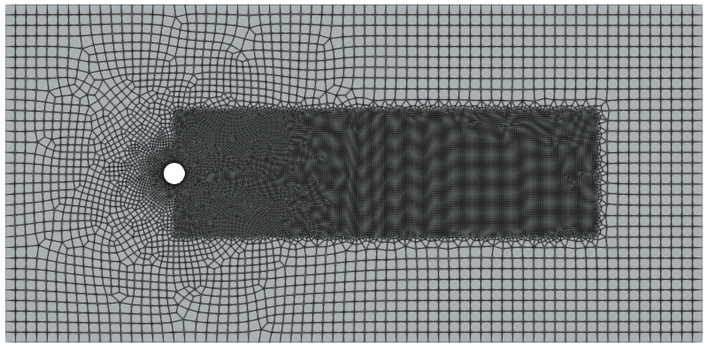
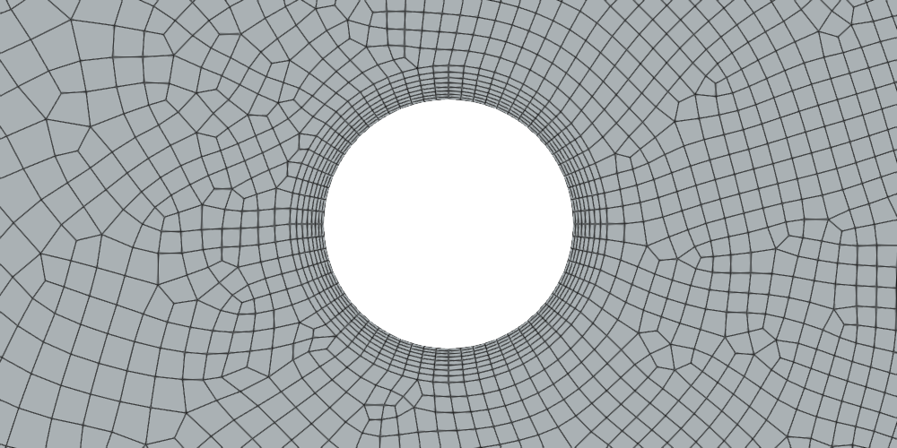
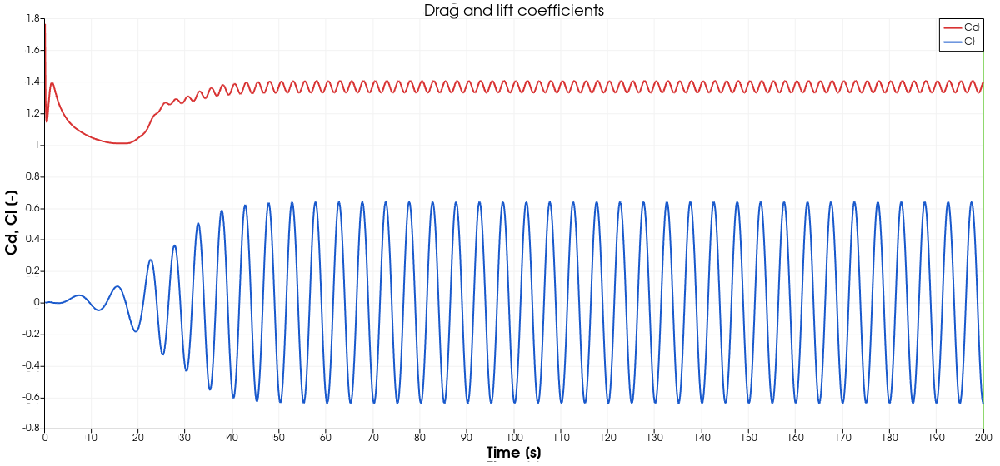
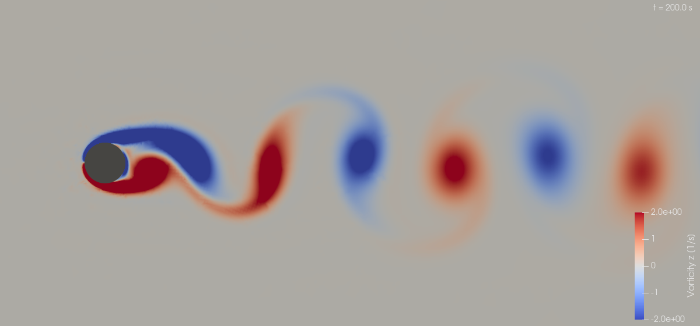
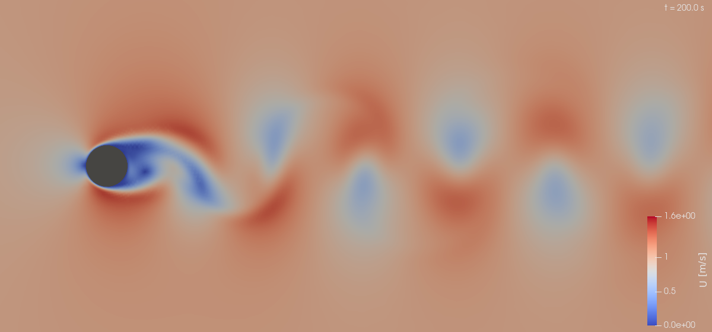
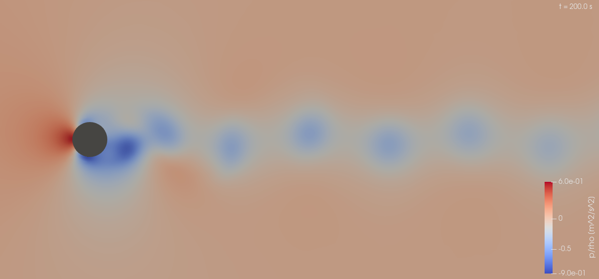

# Flow Around a Cylinder

`Difficulty: Intermediate` · `Solver: pimpleFoam` · `Flow: laminar, Re = 200` · `Mesh: Gmsh (2D quads, one cell in z)` · `OpenFOAM 6`

> **What this project covers:** A transient, laminar, two-dimensional simulation of incompressible
> flow past a circular cylinder at Re = 200, which produces a periodic von Kármán vortex street.
> The guide covers the physics, the Gmsh-based mesh generation, boundary conditions, solver
> configuration, post-processing and checks against published data. The full configuration is
> listed below, and a second, RANS/`snappyHexMesh` approach (a different setup that this case does
> not run) is kept in the [appendix](#appendix-alternative-rans-setup-with-snappyhexmesh).

---

## Goal

After working through this case you should be able to:

- set up an external-flow case with a mesh generated outside OpenFOAM (Gmsh script, `gmshToFoam`, `changeDictionary` to fix patch types);
- run a transient laminar simulation with `pimpleFoam` and an adjustable, Courant-limited time step;
- recognise the onset of vortex shedding in the lift signal and extract the **drag coefficient**, the **lift amplitude** and the **Strouhal number** from `forceCoeffs`;
- judge the result against published 2D data at Re = 200 and explain why such a comparison has a tolerance (blockage, domain size, mesh).

## Target

The case should settle into periodic vortex shedding. The time-averaged quantities are evaluated
on t = 100 s to 200 s (the window that `fieldAverage` also uses).

| Quantity | Target | Basis |
|----------|--------|-------|
| Strouhal number `St = f D / U∞` | 0.197 $\pm 0.02$ | 2D laminar results at Re = 200: 0.197 (Linnick & Fasel 2005), 0.195 (Taira & Colonius 2007), 0.192 (Liu et al. 1998); Williamson's experimental value 0.197; his correlation `St = -3.3265/Re + 0.1816 + 1.6e-4·Re` gives 0.197 |
| Mean drag coefficient `Cd` | 1.34 $\pm 0.13$ | Published 2D computations at Re = 200: 1.34 $\pm 0.044$ (Linnick & Fasel 2005), 1.34 $\pm 0.047$ (Taira & Colonius 2007), 1.31 $\pm 0.049$ (Liu et al. 1998) |
| Lift amplitude `(Clmax - Clmin)/2` | 0.69 $\pm 0.10$ | $\pm 0.69$ (Linnick & Fasel 2005; Liu et al. 1998), $\pm 0.68$ (Taira & Colonius 2007) |
| Mean lift coefficient `Cl` | 0 $\pm 0.05$ | Symmetry of the geometry |
| Mesh | `checkMesh` reports `Mesh OK`, 22605 cells $\pm 10$ % | Cell count of the Gmsh 4.11.1 mesh; Gmsh 4.15.2 gives 22607 |
| Solver | finishes at `endTime = 200` without errors, max Courant $\leq 0.525$ | `controlDict` (`maxCo 0.5`) |

The tolerances are about $\pm 10$ %. Published 2D codes scatter by 3–5 %, and this domain differs from
the unbounded domain of the references: blockage D/H = 1/16 (which raises Cd and St by a few
percent), 8 D upstream, 25 D downstream, symmetry planes at y = $\pm 8$ D. The literature values in the table above
(Linnick & Fasel, Liu et al., Taira & Colonius, Williamson) were checked against a comparison table in
a secondary source (an immersed-boundary paper listing lift, drag and St at Re = 200), not against
the original articles; treat them as approximate.

> **Note:** Real flow past a cylinder becomes three-dimensional at Re $\approx 190$ (mode A instability),
> so a 2D simulation at Re = 200 is an idealisation. It is, however, the standard 2D benchmark
> and the 2D reference data above refer to it.

## Verification method

Everything is checked by one script that only reads the results of a finished run (logs,
`constant/polyMesh/boundary`, `postProcessing/forceCoeffs`, last time directory). It needs only
Python 3 and no OpenFOAM or Docker:

```bash
./run_docker.sh          # ends by calling python3 verify.py
python3 verify.py        # re-check an existing run at any time
```

Output is one line per check (`PASS|FAIL  name  measured=...  expected=...`), a summary, and the
exit status is 0 only if all checks pass (1 on a failed check, 2 if results are missing).

| Check | What it proves | Expected | Measured in the reference run |
|-------|----------------|----------|-------------------------------|
| `checkMesh_ok` | Mesh passes all `checkMesh` tests | `Mesh OK` | `Mesh OK` |
| `cell_count` | Gmsh produced the intended resolution | 22605 $\pm 10$ % | 22607 |
| `max_non_orthogonality` | Mesh quality within solver limits (checkMesh error threshold 70°) | < 70 | 31.3 (average 4.5) |
| `max_skewness` | Mesh quality (checkMesh error threshold 4) | < 4 | 0.92 |
| `patch_types` | `changeDictionary` set wall / symmetryPlane / empty types | all six patches match | all match |
| `no_fatal_error` | No `FOAM FATAL ERROR` in `log.pimpleFoam` | none | none |
| `solver_finished` | Run was not interrupted | `End` in log | `End` |
| `end_time_reached` | Last `Time =` equals `endTime` | 200 $\pm 0.001$ | 200 |
| `max_courant` | Adjustable time step respects `maxCo` (5 % slack: dt reacts one step late) | $\leq 0.525$ | 0.503 |
| `continuity_error` | Mass conservation (largest `|cumulative|` continuity error) | < 1e-5 | 3.6e-08 |
| `last_time_fields` | Last time directory holds `U p UMean pMean UPrime2Mean pPrime2Mean` | present | all present (directory `200`) |
| `mean_Cd` | Drag against 2D reference (t $\geq 100$) | 1.34 $\pm 0.13$ | 1.369 |
| `mean_Cl` | Lift is symmetric on average | 0 $\pm 0.05$ | 0.004 |
| `shedding_developed` | Lift oscillates, i.e. the wake became unsteady | amplitude > 0.1 | amplitude 0.640 |
| `Cl_amplitude` | Strength of the vortex street | 0.69 $\pm 0.10$ | 0.640 |
| `Strouhal` | Shedding frequency from upward zero crossings of `Cl - mean(Cl)` for t $\geq 100$ | 0.197 $\pm 0.02$ | 0.200 (19 periods) |

Reference values and tolerances are documented next to each check in `verify.py`. There is no
reference for the cell count or mesh-quality numbers; they only guard against a broken mesh
(for example a Gmsh version that numbers entities differently). The Strouhal estimate averages
the period over all full cycles in the window, so its resolution is limited by the force output
interval (every 10 time steps, roughly 0.06–0.15 s with the adjustable time step).

**Manual checks** (not scripted):

1. Open `cylinder.foam` in ParaView (`./open_paraview.sh`) and confirm that vortices of
   alternating sign detach from the cylinder and travel downstream (see the figures below).
2. Plot `Cl` against time and confirm that the oscillation grows from numerical noise
   (in the reference run the amplitude is below 0.2 until t = 20 s, about 0.4 at t $\approx 30$ s and saturated at 0.64 from t $\approx 45$ s), and then stays periodic.
3. Look at `log.checkMesh` for the patch list and make sure the `cylinder` patch has 64 faces
   and `frontAndBack` has 45214 ($2 \times 22607$).

---

## Quick Start

Requirements on the host: `docker` (image `cfdengine/openfoam`, OpenFOAM 6), `python3`, `gmsh`
(the image has no Gmsh, so the mesh is generated on the host). ParaView is optional.

> **Gmsh version.** Gmsh 4.12.x, which is the `apt` package on Ubuntu 24.04, segfaults in the 2D
> quad mesher (`Mesh.Algorithm = 8`) on this geometry. Gmsh 4.11.1, 4.13.1 and 4.15.2 work
> (4.15.2 tested end to end: 22607 cells, `checkMesh` OK, all `verify.py` checks pass). `run_docker.sh` stops with a message if it
> finds 4.12.x. A working copy can be installed without touching the system package:
>
> ```bash
> python3 -m venv ~/gmsh-venv && ~/gmsh-venv/bin/pip install gmsh==4.15.2
> PATH=~/gmsh-venv/bin:$PATH ./run_docker.sh
> ```

```bash
./run_docker.sh      # clean, generate .geo, mesh with Gmsh, run OpenFOAM in Docker, verify
./open_paraview.sh   # view the result
```

Without Docker, with OpenFOAM 6 and Gmsh in the environment: `./Allrun`, then `python3 verify.py`.
`./Allclean` removes all generated files (time directories, logs, `postProcessing`, mesh,
`cylinder.foam`).

The run takes about 30 minutes of wall-clock time (15,186 time steps, 22607 cells; one core, on a loaded 20-core machine).

### Files

| File | Purpose |
|------|---------|
| `generate_cylinder_geo.py` | Writes the Gmsh `.geo` (domain, cylinder, size fields, boundary layer, one-cell extrusion, named boundaries) |
| `Allrun` | Meshes (if Gmsh is available), `gmshToFoam`, `changeDictionary`, `renumberMesh`, `checkMesh`, `pimpleFoam` |
| `Allclean` | Removes generated files (keeps `images/`, `verify.py`) |
| `run_docker.sh` | Runs everything with Gmsh on the host and OpenFOAM in Docker, then `verify.py` |
| `verify.py` | Scripted result checks (see above) |
| `open_paraview.sh`, `paraview_cylinder.py` | Opens the case in ParaView; `pvbatch paraview_cylinder.py --images images` regenerates the figures |
| `0/U`, `0/p` | Initial and boundary conditions |
| `constant/transportProperties`, `constant/turbulenceProperties` | `nu = 0.005`, `simulationType laminar` |
| `system/controlDict`, `fvSchemes`, `fvSolution`, `changeDictionaryDict` | Time stepping and function objects, discretisation, solver settings, patch types |

---

## Problem Description

Flow around a circular cylinder is one of the most extensively studied problems in fluid
mechanics. Despite the simple geometry, it produces a remarkably rich set of flow phenomena:
boundary layer separation, recirculation zones, periodic vortex shedding (the von Kármán
vortex street), and turbulent wake dynamics. This makes it an ideal benchmark for validating
CFD codes and learning simulation techniques.

```
          Free stream U∞ →→→→→→→→→→→→→→→→→
                →→→→→→→→→→→→→→→→→→→→→→→→→
                →→→→→→→ ╭─────╮ →→→→→→→→→
                →→→→→→→ │     │    wake   →
                →→→→→→→ │  ●  │  ~~~~~~~ →
                →→→→→→→ │     │    region →
                →→→→→→→ ╰─────╯ →→→→→→→→→
                →→→→→→→→→→→→→→→→→→→→→→→→→
          →→→→→→→→→→→→→→→→→→→→→→→→→→→→→→→

    Inlet                Cylinder          Outlet
```

**Key flow features:**

- **Stagnation point** — The front of the cylinder where the flow velocity drops to zero and
  pressure reaches its maximum value. This is the highest-pressure point on the surface.
- **Separation point** — Where the boundary layer detaches from the cylinder surface due to the
  adverse pressure gradient. For laminar flow at moderate Re, separation occurs at roughly
  80°–90° from the front stagnation point.
- **Wake region** — The low-pressure recirculation zone downstream of the cylinder. The wake
  structure depends strongly on Reynolds number and drives the drag force.
- **Von Kármán vortex street** — At moderate Reynolds numbers (roughly $Re = 47$–$200$), vortices
  shed alternately from the top and bottom of the cylinder, producing a periodic oscillating
  wake pattern. This generates oscillating lift forces and a dominant shedding frequency.
- **Drag and lift forces** — The cylinder experiences a mean drag force (pressure drag dominates
  at moderate-to-high Re) and, during vortex shedding, an oscillating lift force at the
  shedding frequency.

> **💡 Tip:** For background on CFD fundamentals and the governing Navier-Stokes equations,
> see [`notes/01_short_intro_to_cfd.md`](https://github.com/djeada/OpenFoam-Tutorials/blob/main/notes/01_short_intro_to_cfd.md).

### Computational domain and boundary conditions

The cylinder (D = 1 m, centre at the origin) sits in a 33 m $\times$ 16 m rectangle; the case is one
cell (0.1 m) thick in z and uses `empty` front and back faces, so it is solved as 2D.

```
                  top: symmetryPlane   (y = +8)
      ┌─────────────────────────────────────────────────────────┐
      │                                                         │
      │                                                         │
 inlet│  U∞ = (1 0 0)        ╭───╮                              │outlet
 U = (1 0 0)  →  →  →  →    │ ● │  D = 1, noSlip      →  →  →  │p = 0
 p: zeroGradient             ╰───╯   (0, 0)            U: inletOutlet
      │                                                         │
      │                                                         │
      └─────────────────────────────────────────────────────────┘
                bottom: symmetryPlane  (y = -8)
    x = -8                                                    x = 25
```

| Patch | Mesh type (`changeDictionary`) | `U` | `p` |
|-------|-------------------------------|-----|-----|
| `inlet` (x = -8) | `patch` | `fixedValue (1 0 0)` | `zeroGradient` |
| `outlet` (x = 25) | `patch` | `inletOutlet` (inletValue `(0 0 0)`) | `fixedValue 0` |
| `top` (y = +8), `bottom` (y = -8) | `symmetryPlane` | `symmetryPlane` | `symmetryPlane` |
| `cylinder` (r = 0.5) | `wall` | `noSlip` | `zeroGradient` |
| `frontAndBack` (z = 0, z = 0.1) | `empty` | `empty` | `empty` |

Domain extents: 8 D upstream, 25 D downstream, $\pm 8$ D cross-stream (blockage D/H = 1/16).

---

## Physics and Theory

### Reynolds Number

The Reynolds number is the single most important parameter governing this flow:

$$Re = U_\infty \cdot D / \nu$$

where `U∞` is the free-stream velocity, `D` is the cylinder diameter, and `ν` is the
kinematic viscosity of the fluid. In this case `U∞ = 1 m/s`, `D = 1 m` and
`ν = 0.005 m²/s`, so $Re = 1 \cdot 1 / 0.005 = 200$.

### Reynolds Number Regimes

| Re Range | Flow Regime | Description |
|----------|------------|-------------|
| Re < 5 | Creeping flow | Viscous forces dominate. Flow remains attached and symmetric fore-and-aft (nearly). No separation. |
| 5 – 40 | Attached vortex pair | A symmetric pair of steady recirculation vortices forms behind the cylinder. Flow is still steady and laminar. |
| 40 – 200 | Laminar vortex shedding | The wake becomes unstable (onset at Re $\approx 47$). Vortices shed alternately from each side — the von Kármán vortex street. Flow is periodic and laminar; around Re $\approx 190$ the wake becomes three-dimensional. **This case, Re = 200, is at the upper end.** |
| 200 – 300,000 | Subcritical turbulent | The wake is turbulent but the boundary layer on the cylinder remains laminar. Separation occurs before the top of the cylinder (~80°). Cd $\approx$ 1.0–1.2. |
| > 300,000 | Supercritical | The boundary layer transitions to turbulent before separation, which delays separation to ~120°. Dramatic drop in drag (the "drag crisis"). Cd drops to ~0.3. |

```
  Re < 5             5 < Re < 40          40 < Re < 200
  (Creeping)         (Steady vortex pair)  (Vortex shedding)

   →→  ○  →→         →→  ○ ◜◝  →→         →→  ○  ∿∿∿  →→
   →→     →→         →→    ◟◞  →→         →→     ∿∿∿  →→
  No separation      Symmetric wake        Alternating vortices
```

### Strouhal Number

For vortex shedding flows, the Strouhal number relates the shedding frequency to the
flow velocity and cylinder diameter:

$$St = f \cdot D / U_\infty$$

where `f` is the vortex shedding frequency. For a circular cylinder in the subcritical
regime, $St \approx 0.2$ is remarkably constant over a wide range of Reynolds numbers
(roughly $300 < Re < 300{,}000$). This is one of the most well-established empirical results
in fluid mechanics. In the laminar shedding regime the Strouhal number still increases with
Re: about 0.12 at Re = 50, 0.164 at Re = 100 and 0.197 at Re = 200. A commonly used
correlation for $47 < Re < 180$ (Williamson 1988) is

$$St = -3.3265/Re + 0.1816 + 1.6 \times 10^{-4}\, Re$$

(evaluated at Re = 200 it extrapolates slightly beyond its stated range, to 0.197).

### Drag Coefficient

The drag coefficient is defined as:

$$Cd = F_D / (0.5 \cdot \rho \cdot U_\infty^2 \cdot A)$$

where `F_D` is the drag force, `ρ` is the fluid density, and `A` is the projected area
(A = D · L for a cylinder of span L; here `Aref = 0.1 = 1 × 0.1`). Key reference values:

| Re | Cd (approximate) | Source |
|----|-------------------|--------|
| 1 | 10.0 | Analytical / experimental |
| 10 | 2.8 | Experimental |
| 100 | 1.3 | Experimental |
| 200 | 1.3–1.4 | 2D computations (time-mean) |
| 1,000 | 1.0 | Experimental |
| 10,000 | 1.2 | Experimental |
| 100,000 | 1.2 | Experimental |
| 500,000 | 0.3 | Drag crisis — supercritical |

> **💡 Tip:** For details on turbulence modeling and when to use RANS vs LES, see
> [`notes/06_turbulence_models.md`](https://github.com/djeada/OpenFoam-Tutorials/blob/main/notes/06_turbulence_models.md).

---

## Geometry and Mesh

### Geometry Generation (`generate_cylinder_geo.py`)

The geometry is not an STL: a Python script writes a Gmsh `.geo` file using the OpenCASCADE
kernel. The domain rectangle minus the cylinder disk gives one surface, which is meshed with
quadrilaterals and extruded by one layer (0.1 m) in z. Default parameters (all can be changed
on the command line, see `python3 generate_cylinder_geo.py --help`):

| Parameter | Default | Meaning |
|-----------|---------|---------|
| `--xmin / --xmax` | -8 / 25 | Inlet / outlet position |
| `--ymin / --ymax` | -8 / 8 | Bottom / top (symmetry planes) |
| `--radius` | 0.5 | Cylinder radius (D = 1) |
| `--span` | 0.1 | z thickness (single cell) |
| `--first-layer` | 0.01 | First boundary-layer cell height |
| `--bl-ratio`, `--bl-thickness` | 1.15, 0.15 | Boundary-layer growth ratio and total thickness |
| `--near-size`, `--near-dist` | 0.05, 2.0 | Element size at the cylinder and distance over which it grows to the far-field size |
| `--wake-size`, `--wake-xmax`, `--wake-ymin/ymax` | 0.08, 20, $\pm 3$ | Element size and extent of the wake box |
| `--mesh-size-farfield` | 0.5 | Far-field element size |

Boundary patches are named by Gmsh physical groups: `inlet`, `outlet`, `top`, `bottom`,
`cylinder`, `frontAndBack`. The generator selects curves and surfaces by bounding box, not by
numeric tag, because OpenCASCADE tag numbers differ between Gmsh versions (the earlier
tag-based version silently attached the wrong names to the faces). The full case was run with Gmsh 4.11.1 (22605 cells) and again, end to end with `./run_docker.sh`, with Gmsh 4.15.2 (22607 cells); both give the same force results to the printed digits and pass all checks. Gmsh 4.12.x crashes (see Quick Start).

```bash
python3 generate_cylinder_geo.py --output constant/cylinder.geo
gmsh -3 -format msh2 constant/cylinder.geo -o constant/cylinder.msh   # msh2 is required by gmshToFoam
```

### Import into OpenFOAM

`Allrun` runs, in order: `gmshToFoam` (reads the `.msh`; it prints a warning about undefined faces
that are then assigned to the physical-group patches — this is expected), `changeDictionary`
(sets the patch types from `system/changeDictionaryDict`, since `gmshToFoam` creates all patches
as `patch`), `renumberMesh -overwrite` and `checkMesh`.

`system/changeDictionaryDict`:

```
boundary
{
    inlet        { type patch; }
    outlet       { type patch; }
    top          { type symmetryPlane; }
    bottom       { type symmetryPlane; }
    cylinder     { type wall; }
    frontAndBack { type empty; }
}
```

Mesh statistics from the reference run (`log.checkMesh`):

| Quantity | Value |
|----------|-------|
| Cells / faces / points | 22607 cells, 90558 faces, 45474 points (Gmsh 4.15.2) |
| Max non-orthogonality (average) | 31.3 (4.5) |
| Max skewness | 0.92 |
| Max aspect ratio | 4.0 |
| Patches (faces) | frontAndBack 45214, bottom 66, inlet 32, outlet 32, top 66, cylinder 64 |

The figures in this README were rendered from the Gmsh 4.11.1 run; the 4.15.2 mesh differs in
detail (22607 cells) and gave the same Cd, Cl and St to the printed digits.



*Whole domain: refinement is concentrated around the cylinder and in a wake box behind it (x = 0 to 20, |y| < 3).*



*Zoom on the cylinder: structured quadrilateral boundary-layer cells (first height 0.01, growth ratio 1.15) wrap the surface.*

> **💡 Tip:** For details on meshing with `blockMesh`, `snappyHexMesh` and external mesh
> converters, see [`notes/04_meshing.md`](https://github.com/djeada/OpenFoam-Tutorials/blob/main/notes/04_meshing.md).

---

## Case Setup

### Directory Structure

```
03_flow_around_cylinder/
├── 0/
│   ├── U
│   └── p
├── constant/
│   ├── transportProperties
│   ├── turbulenceProperties
│   ├── cylinder.geo        (generated)
│   ├── cylinder.msh        (generated)
│   └── polyMesh/           (generated)
├── system/
│   ├── controlDict
│   ├── fvSchemes
│   ├── fvSolution
│   └── changeDictionaryDict
├── generate_cylinder_geo.py
├── Allrun, Allclean, run_docker.sh, open_paraview.sh
├── paraview_cylinder.py, verify.py
└── images/
```

> **💡 Tip:** For a detailed explanation of the OpenFOAM case directory structure, see
> [`notes/02_openfoam_cases.md`](https://github.com/djeada/OpenFoam-Tutorials/blob/main/notes/02_openfoam_cases.md).

### Boundary Conditions

All field files go in the `0/` directory. Each file specifies initial and boundary conditions
for one variable. The flow is laminar, so only `U` and `p` are needed (no `k`, `epsilon`,
`nut`).

> **💡 Tip:** For a comprehensive reference on boundary condition types, see
> [`notes/05_boundary_conditions.md`](https://github.com/djeada/OpenFoam-Tutorials/blob/main/notes/05_boundary_conditions.md).

#### Velocity — `0/U`

```
dimensions      [0 1 -1 0 0 0 0];

internalField   uniform (1 0 0);

boundaryField
{
    inlet
    {
        type            fixedValue;
        value           uniform (1 0 0);    // U∞ = 1 m/s in x-direction
    }

    outlet
    {
        type            inletOutlet;        // zero gradient, but no inflow through the outlet
        inletValue      uniform (0 0 0);
        value           uniform (1 0 0);
    }

    top     { type symmetryPlane; }
    bottom  { type symmetryPlane; }

    cylinder
    {
        type            noSlip;             // Wall: zero velocity
    }

    frontAndBack
    {
        type            empty;
    }
}
```

#### Pressure — `0/p`

`p` is the kinematic pressure (p/$\rho$, $\mathrm{m}^{2}/\mathrm{s}^{2}$), as always in OpenFOAM's incompressible solvers.

```
dimensions      [0 2 -2 0 0 0 0];

internalField   uniform 0;

boundaryField
{
    inlet     { type zeroGradient; }

    outlet
    {
        type            fixedValue;
        value           uniform 0;          // Reference pressure at outlet
    }

    top       { type symmetryPlane; }
    bottom    { type symmetryPlane; }
    cylinder  { type zeroGradient; }
    frontAndBack { type empty; }
}
```

### Transport and Turbulence Properties

#### `constant/transportProperties`

The kinematic viscosity sets the Reynolds number. For $Re = 200$ with $U_\infty = 1$ m/s and
$D = 1$ m we need $\nu = U_\infty D / Re = 5 \times 10^{-3}$ $\mathrm{m}^{2}/\mathrm{s}$:

```
transportModel  Newtonian;

nu              [0 2 -1 0 0 0 0] 0.005;
```

#### `constant/turbulenceProperties`

OpenFOAM 6's `pimpleFoam` always reads this file, so it is required even for laminar flow:

```
simulationType  laminar;
```

> **💡 Tip:** For a comparison of available turbulence models (k-$\varepsilon$, k-$\omega$ SST,
> Spalart-Allmaras) and guidance on which to choose, see
> [`notes/06_turbulence_models.md`](https://github.com/djeada/OpenFoam-Tutorials/blob/main/notes/06_turbulence_models.md).

### Control and Solver Settings

#### `system/controlDict`

Key settings of the shipped file:

| Entry | Value | Why |
|-------|-------|-----|
| `application` | `pimpleFoam` | Transient incompressible solver |
| `endTime` | 200 | about 5 s shedding period; the averaging window t = 100–200 s contains 19 periods |
| `deltaT`, `adjustTimeStep`, `maxCo`, `maxDeltaT` | 0.005, yes, 0.5, 0.05 | Time step follows a maximum Courant number of 0.5 |
| `writeControl`, `writeInterval` | `adjustableRunTime`, 0.5 | Write every 0.5 s of simulated time (`adjustableRunTime` makes the adjustable time step hit the write times exactly; with `runTime` the time directories get names such as `10.4934004030096659`) |
| `forceCoeffs` | patch `cylinder`, `rhoInf 1`, `magUInf 1`, `lRef 1`, `Aref 0.1` | `Aref = D * span`; written every 10 time steps |
| `fieldAverage` | `timeStart 100` | Mean and prime2Mean of `U`, `p` after the initial transient |

```
functions
{
    forceCoeffs
    {
        type            forceCoeffs;
        libs            ("libforces.so");
        writeControl    timeStep;
        writeInterval   10;
        patches         (cylinder);
        p               p;
        U               U;
        rho             rhoInf;
        rhoInf          1.0;
        liftDir         (0 1 0);
        dragDir         (1 0 0);
        CofR            (0 0 0);
        pitchAxis       (0 0 1);
        magUInf         1;
        lRef            1;
        Aref            0.1;        // D * span = 1 * 0.1
    }
    ...
}
```

The `forceCoeffs` coefficients are computed per the reference quantities above, so `Aref` must
be changed together with `--span` (a 1 m span would need `Aref 1`).

#### `system/fvSchemes`

| Scheme | Setting | Comment |
|--------|---------|---------|
| `ddtSchemes` | `backward` | Second-order implicit; needed to resolve the vortex street without strong damping |
| `gradSchemes` | `Gauss linear` | |
| `div(phi,U)` | `bounded Gauss linearUpwind grad(U)` | Second-order, stable |
| `div((nuEff*dev2(T(grad(U)))))` | `Gauss linear` | Required by the laminar stress model |
| `laplacianSchemes`, `snGradSchemes` | `Gauss linear corrected` / `corrected` | Max non-orthogonality is 31°, so `corrected` is adequate |

> **💡 Tip:** `linearUpwind` for the momentum equation provides a good balance between
> accuracy and stability. For details on discretization schemes and their accuracy, see
> [`notes/03_openfoam_dictionaries.md`](https://github.com/djeada/OpenFoam-Tutorials/blob/main/notes/03_openfoam_dictionaries.md).

#### `system/fvSolution`

| Entry | Setting |
|-------|---------|
| `p` | GAMG, GaussSeidel smoother, `tolerance 1e-06`, `relTol 0.01` (`pFinal`: `relTol 0`) |
| `U` | smoothSolver, symGaussSeidel, `tolerance 1e-06`, `relTol 0.05` (`UFinal`: `relTol 0`) |
| `PIMPLE` | `nOuterCorrectors 2`, `nCorrectors 2`, `nNonOrthogonalCorrectors 1` |
| `relaxationFactors` | equations `U 0.7` (`UFinal 1`), fields `p 0.3` (`pFinal 1`) |

> **💡 Tip:** For an in-depth explanation of linear solvers (GAMG, PCG, smoothSolver)
> and how to choose tolerances, see
> [`notes/09_linear_solvers.md`](https://github.com/djeada/OpenFoam-Tutorials/blob/main/notes/09_linear_solvers.md).

#### Parallel runs (optional, not set up in this case)

The mesh has about 22,000 cells, so a serial run is adequate. To run in parallel, add a
`system/decomposeParDict`:

```
FoamFile
{
    version     2.0;
    format      ascii;
    class       dictionary;
    object      decomposeParDict;
}

numberOfSubdomains 4;

method          scotch;
```

> **💡 Tip:** For parallel decomposition strategies and MPI configuration, see
> [`notes/07_parallelization.md`](https://github.com/djeada/OpenFoam-Tutorials/blob/main/notes/07_parallelization.md).

---

## Running the Simulation

### Docker (recommended)

```bash
./run_docker.sh
```

The script (1) runs `Allclean` in the container, (2) generates the `.geo` and meshes it with the
host's Gmsh, (3) runs `Allrun` in the container as the calling user (so no root-owned files are
left), and (4) runs `python3 verify.py`.

### Serial Execution (OpenFOAM and Gmsh in the environment)

```bash
cd projects/03_flow_around_cylinder
./Allrun                  # python3 + gmsh → gmshToFoam → changeDictionary → renumberMesh → checkMesh → pimpleFoam
python3 verify.py
```

The individual steps, if you want to run them by hand:

```bash
python3 generate_cylinder_geo.py --output constant/cylinder.geo
gmsh -3 -format msh2 constant/cylinder.geo -o constant/cylinder.msh
gmshToFoam constant/cylinder.msh
changeDictionary
renumberMesh -overwrite
checkMesh
pimpleFoam
```

### Parallel Execution

Add `system/decomposeParDict` (above), then after `checkMesh`:

```bash
decomposePar
mpirun -np 4 pimpleFoam -parallel
reconstructPar
```

### Changing the Reynolds Number

Edit `nu` in `constant/transportProperties`: `nu = U∞ D / Re`. For vortex shedding at
$Re = 100$ (`nu = 0.01`) the Strouhal number should converge to $St \approx 0.164$. The time
step is controlled by `maxCo`, so no other change is needed. If you change the Reynolds number,
the reference values in `verify.py` no longer apply. For guidance on choosing time steps using
the CFL condition, see
[`notes/08_cfl_number.md`](https://github.com/djeada/OpenFoam-Tutorials/blob/main/notes/08_cfl_number.md).

---

## Post-Processing

### Force Coefficients

The `forceCoeffs` function object writes
`postProcessing/forceCoeffs/0/forceCoeffs.dat` with columns
`Time  Cm  Cd  Cl  Cl(f)  Cl(r)`.

Plot the history:

```bash
gnuplot -persist -e "
    set xlabel 'Time [s]';
    set ylabel 'Coefficient';
    set title 'Force Coefficients';
    plot 'postProcessing/forceCoeffs/0/forceCoeffs.dat' using 1:3 with lines title 'Cd',
         '' using 1:4 with lines title 'Cl'
"
```



*Cl grows from numerical noise and settles into a periodic oscillation around zero; Cd oscillates at twice the shedding frequency about a mean of about 1.37 (range 1.33–1.41).*

### Residuals

Monitor convergence by plotting residuals from the solver log:

```bash
foamLog log.pimpleFoam
gnuplot -persist -e "
    set logscale y;
    set xlabel 'Time step';
    set ylabel 'Initial residual';
    plot 'logs/p_0' with lines title 'p',
         'logs/Ux_0' with lines title 'Ux',
         'logs/Uy_0' with lines title 'Uy'
"
```

For a transient case the residuals do not decrease to zero; they should stay bounded and small.

### ParaView Visualization

```bash
./open_paraview.sh        # touches cylinder.foam and runs paraview --script paraview_cylinder.py
```

or open the case manually (no conversion needed with modern ParaView):

```bash
touch cylinder.foam
paraview cylinder.foam &
```

`paraview_cylinder.py` shows the z-vorticity of the last time step; `pvbatch paraview_cylinder.py
--images images` (re)generates all figures of this README offscreen.

**Recommended visualizations:**

1. **Pressure contours** — Apply a "Surface" representation colored by `p`. Observe the
   high-pressure stagnation region at the front and the low-pressure wake behind the cylinder.

2. **Velocity streamlines** — Use Filters → Stream Tracer, seeded from a line upstream of
   the cylinder. This reveals the flow separation and recirculation zone.

3. **Vorticity / Q-criterion** — For transient simulations, compute Q-criterion to visualize
   vortex structures:
   - Filters → Calculator: `0.5*(mag(Vorticity)^2 - mag(Strain)^2)`
   - Or use the built-in Q-Criterion filter if available.

4. **Wake profile** — Use Filters → Plot Over Line to extract velocity profiles at various
   downstream locations (x/D = 1, 2, 5, 10) for comparison with experimental data. The averaged
   fields `UMean`, `UPrime2Mean` (from `fieldAverage`) give the mean wake and the Reynolds
   stresses.



*z-vorticity at the last time step: alternating positive (red) and negative (blue) vortices form the von Kármán street.*



*Velocity magnitude: the low-speed wake, with the flow accelerating to about 1.5 $U_\infty$ (maximum 1.48 at t = 200 s) beside the cylinder.*



*Kinematic pressure: the stagnation overpressure in front and the low-pressure cores of the shed vortices.*

---

## Expected Results

### What to Look For

| Quantity | Expected value (Re = 200) | Notes |
|----------|---------------------------|-------|
| Strouhal number | 0.197 (target 0.197 $\pm 0.02$) | Shedding frequency from the `Cl` signal |
| Mean drag coefficient (Cd) | 1.34 $\pm 0.13$ | 2D computations, t $\geq 100$ s |
| Lift coefficient (Cl) | mean $\approx 0$, amplitude 0.69 $\pm 0.10$ | Oscillates at the shedding frequency; Cd at twice that |
| Separation angle | ~110°–120° from the front stagnation point at Re = 200 (from published 2D results; not measured here) | Laminar boundary layer separation |
| Time to saturated shedding | Reference run: `Cl` amplitude < 0.2 up to t = 20 s, about 0.4 at t $\approx 30$ s, 0.64 from t $\approx 45$ s | Depends on the numerical noise that triggers the instability |

Measured values from the reference run are in the [verification table](#verification-method).

### Convergence Criteria

For a transient run there are no steady-state residual targets. A run is acceptable when:

- the solver reaches `endTime` without errors and the Courant number stays at `maxCo`;
- the force coefficients are periodic over the averaging window (`t ≥ 100`);
- `python3 verify.py` passes.

### Common Issues

- **Divergence at startup** — Reduce relaxation factors (e.g., p → 0.2, U → 0.5) and
  increase `nNonOrthogonalCorrectors` if mesh quality is poor.
- **Asymmetric steady solution** — At $Re > 47$, the flow naturally wants to shed vortices.
  A steady solver will find one of the two possible asymmetric solutions or oscillate.
  Use `pimpleFoam` (as in this case) if you need the physical transient behavior.
- **High y+ values** — Check with `yPlus` function object. For wall functions (RANS runs), aim for
  30 < y+ < 300. If y+ < 30, add more boundary layers or switch to a low-Re model. Not
  relevant for this laminar case, which resolves the boundary layer.
- **`Increased the timePrecision ... to distinguish between timeNames`** — Appears when
  `writeControl runTime` is combined with an adjustable time step; use `adjustableRunTime`.
- **Wrong patch types / `empty` errors** — Check `constant/polyMesh/boundary` after
  `changeDictionary`; `verify.py` tests the six patch types.
- **Gmsh import fails** — `gmshToFoam` needs the msh2 format (`-format msh2`).

---

## Exercises

1. **Reynolds Number Study** — Run the simulation at $Re = 20, 100, 200, 1000$, and $10000$
   by adjusting the kinematic viscosity (`nu` in `transportProperties`). Compare drag
   coefficients with published data and observe the different flow regimes. Note that at
   $Re = 20$ the flow is steady (no shedding), and above about $Re = 200$ a 2D laminar
   simulation is no longer physical (3D and turbulent effects; see the RANS appendix).

2. **Mesh Refinement Study** — Run with 3 progressively finer meshes (e.g. `--near-size 0.1,
   0.05, 0.025` and `--wake-size 0.16, 0.08, 0.04` in `generate_cylinder_geo.py`; in the
   `snappyHexMesh` approach of the appendix, refinement levels 3, 4, and 5). Plot Cd vs.
   cell count to assess mesh independence. The Richardson extrapolation can give an estimate of
   the grid-converged value.

3. **Turbulence Model Comparison** — Run the same case with k-$\varepsilon$, k-$\omega$ SST, and
   Spalart-Allmaras models (RAS setup in the appendix). Compare predicted Cd, separation angle,
   and wake structure.

4. **3D Extension** — Remove the `empty` boundary condition on `frontAndBack`, extend the
   domain to 4D in the spanwise direction (`--span 4` and more extrusion layers in the
   generated `.geo`, with periodic or symmetry front/back patches), and add cells in z. Observe
   3D wake instabilities (mode A and mode B) that appear at $Re > 190$.

5. **Vortex Shedding Frequency** — Run the transient simulation at $Re = 100$ using
   `pimpleFoam` with laminar flow (`nu = 0.01`). Measure the vortex shedding frequency from
   the lift coefficient time history and compute the Strouhal number. Compare with
   $St \approx 0.164$ from literature.

6. **Domain Size Sensitivity** — Test the effect of domain boundaries by running with
   smaller (10D downstream) and larger (40D downstream) domains (`--xmax`). How does the
   outlet distance affect the predicted Cd? Also vary `--ymin/--ymax` to see the blockage
   effect on Cd and St.

---

## References

1. Schlichting, H., & Gersten, K. (2017). *Boundary-Layer Theory* (9th ed.). Springer.
   The definitive reference for boundary layer separation and wake flow theory.

2. Zdravkovich, M. M. (1997). *Flow Around Circular Cylinders, Vol. 1: Fundamentals*.
   Oxford University Press. Comprehensive review of circular cylinder aerodynamics.

3. Wieselsberger, C. (1922). "New data on the laws of fluid resistance." *NACA TN-84*.
   Classic experimental data for drag coefficient vs. Reynolds number.

4. Roshko, A. (1954). "On the development of turbulent wakes from vortex streets."
   *NACA Report 1191*. Foundational work on vortex shedding and Strouhal number.

5. Williamson, C. H. K. (1996). "Vortex dynamics in the cylinder wake."
   *Annual Review of Fluid Mechanics*, 28, 477–539. Modern review of wake instabilities.

6. OpenFOAM Foundation. *OpenFOAM User Guide*.
   [https://www.openfoam.com/documentation/user-guide](https://www.openfoam.com/documentation/user-guide)

7. Versteeg, H. K., & Malalasekera, W. (2007). *An Introduction to Computational Fluid
   Dynamics: The Finite Volume Method* (2nd ed.). Pearson. Accessible CFD textbook covering
   turbulence modeling and discretization schemes used in this tutorial.

8. Williamson, C. H. K. (1988). "Defining a universal and continuous Strouhal–Reynolds number
   relationship for the laminar vortex shedding of a circular cylinder." *Physics of Fluids*,
   31, 2742–2744.

9. Linnick, M. N., & Fasel, H. F. (2005). "A high-order immersed interface method for
   simulating unsteady incompressible flows on irregular domains." *Journal of Computational
   Physics*, 204, 157–192. 2D benchmark data for the cylinder at Re = 200.

10. Taira, K., & Colonius, T. (2007). "The immersed boundary method: a projection approach."
    *Journal of Computational Physics*, 225(2), 2118–2137. 2D cylinder data at Re = 200.

11. Liu, C., Zheng, X., & Sung, C. H. (1998). "Preconditioned multigrid methods for unsteady
    incompressible flows." *Journal of Computational Physics*, 139(1), 35–57. 2D cylinder data
    at Re = 200.

---

## Appendix: Alternative RANS Setup with snappyHexMesh

The sections below are the original description of this tutorial, which used a **steady RANS
(`simpleFoam`, k-$\varepsilon$) setup with a `snappyHexMesh` mesh** around an STL cylinder, at Re = 1000. That
is **not** what the files in this directory run; the case above (laminar `pimpleFoam`, Gmsh mesh,
Re = 200) is. The appendix is kept as a reference for the 3D/RANS approach and for the exercises
that use it (turbulence model comparison, mesh refinement with `snappyHexMesh`).

> **Caveats (corrections to the original text):**
> - `snappyHexMesh` always produces 3D meshes: it refines cells in z as well. The one-cell
>   `blockMesh` background below therefore does not give a 2D (`empty`) mesh; for a 2D RANS case
>   use the Gmsh mesh of this project (set `simulationType RAS` and add `k`, `epsilon`, `nut`).
> - The `epsilon` value in the original text was wrong: with `k = 1.5e-4 m²/s²` and `l = 0.07 D`,
>   $\varepsilon = 0.09^{0.75} (1.5\times10^{-4})^{1.5} / 0.07 \approx 4.3\times10^{-6}$ $\mathrm{m}^{2}/\mathrm{s}^{3}$
>   (not 4.85e-7). The corrected value is used below.
> - `forceCoeffs` writes `forceCoeffs.dat` (not `coefficient.dat`) with columns
>   `Time Cm Cd Cl Cl(f) Cl(r)`.
> - A steady RANS solution at Re = 1000 averages over unsteady vortex shedding; the values in the
>   table at the end of this appendix are order-of-magnitude expectations, not checked results.

### Geometry — Creating the Cylinder STL

Since we are using `snappyHexMesh` for mesh generation, we need a surface geometry file
(STL format) representing the cylinder. There are several ways to obtain one.

#### Option 1: Python Script

The following Python script generates a simple cylinder STL using `numpy` and `numpy-stl`.
The cylinder has diameter `D = 1.0 m` and span `L = 1.0 m`, centered at the origin.

```python
#!/usr/bin/env python3
"""Generate a cylinder STL for OpenFOAM snappyHexMesh."""

import numpy as np
from stl import mesh

def create_cylinder_stl(filename, radius=0.5, length=1.0, n_facets=64):
    """Create a closed cylinder STL with the axis along the z-direction."""
    angles = np.linspace(0, 2 * np.pi, n_facets, endpoint=False)
    triangles = []

    for i in range(n_facets):
        j = (i + 1) % n_facets
        c0, s0 = radius * np.cos(angles[i]), radius * np.sin(angles[i])
        c1, s1 = radius * np.cos(angles[j]), radius * np.sin(angles[j])

        # Side face — two triangles per segment
        triangles.append([[c0, s0, 0], [c1, s1, 0], [c1, s1, length]])
        triangles.append([[c0, s0, 0], [c1, s1, length], [c0, s0, length]])

        # Bottom cap
        triangles.append([[0, 0, 0], [c1, s1, 0], [c0, s0, 0]])

        # Top cap
        triangles.append([[0, 0, length], [c0, s0, length], [c1, s1, length]])

    data = np.zeros(len(triangles), dtype=mesh.Mesh.dtype)
    for i, tri in enumerate(triangles):
        data["vectors"][i] = tri

    cylinder = mesh.Mesh(data)
    cylinder.save(filename)
    print(f"Saved {filename} with {len(triangles)} triangles")

if __name__ == "__main__":
    create_cylinder_stl("cylinder.stl")
```

Install the dependency and run:

```bash
pip install numpy-stl
python generate_cylinder.py   # save the script above under this name
```

#### Option 2: OpenSCAD

Create a file `cylinder.scad`:

```
cylinder(h=1, r=0.5, center=true, $fn=64);
```

Export to STL from the OpenSCAD GUI or command line:

```bash
openscad -o cylinder.stl cylinder.scad
```

#### Option 3: FreeCAD

Open FreeCAD, create a cylinder primitive (Part → Cylinder, radius 0.5, height 1.0),
and export as STL via File → Export.

> **💡 Tip:** Whichever method you use, ensure the STL is watertight (no gaps or
> self-intersections). You can verify with `surfaceCheck cylinder.stl` in OpenFOAM.

### Directory Structure (RANS / snappyHexMesh variant)

Create the full case directory:

```bash
mkdir -p $FOAM_RUN/cylinder
cd $FOAM_RUN/cylinder
mkdir -p 0 constant/triSurface system
```

Copy your cylinder STL into the geometry directory:

```bash
cp /path/to/cylinder.stl constant/triSurface/
```

The complete directory tree when finished:

```
cylinder/
├── 0/
│   ├── U
│   ├── p
│   ├── k
│   ├── epsilon
│   └── nut
├── constant/
│   ├── transportProperties
│   ├── turbulenceProperties
│   └── triSurface/
│       └── cylinder.stl
├── system/
│   ├── controlDict
│   ├── fvSchemes
│   ├── fvSolution
│   ├── blockMeshDict
│   ├── snappyHexMeshDict
│   └── decomposeParDict
└── Allrun
```

> **💡 Tip:** For a detailed explanation of the OpenFOAM case directory structure, see
> [`notes/02_openfoam_cases.md`](https://github.com/djeada/OpenFoam-Tutorials/blob/main/notes/02_openfoam_cases.md).

### blockMeshDict — Background Mesh

The background mesh is a simple rectangular box that encloses the entire computational domain.
`snappyHexMesh` will later refine this mesh around the cylinder. The domain extends from
-5D upstream to 20D downstream, and $\pm$5D in the cross-stream direction, which is standard
practice for external flow simulations.

Create `system/blockMeshDict`:

```
FoamFile
{
    version     2.0;
    format      ascii;
    class       dictionary;
    object      blockMeshDict;
}

// Cylinder diameter D = 1.0 m, centered at origin
// Domain: x = [-5, 20], y = [-5, 5], z = [0, 1]

scale   1;

vertices
(
    (-5  -5  0)    // 0
    (20  -5  0)    // 1
    (20   5  0)    // 2
    (-5   5  0)    // 3
    (-5  -5  1)    // 4
    (20  -5  1)    // 5
    (20   5  1)    // 6
    (-5   5  1)    // 7
);

blocks
(
    hex (0 1 2 3 4 5 6 7) (100 40 1) simpleGrading (1 1 1)
);

edges
(
);

boundary
(
    inlet
    {
        type patch;
        faces
        (
            (0 4 7 3)
        );
    }
    outlet
    {
        type patch;
        faces
        (
            (1 2 6 5)
        );
    }
    top
    {
        type symmetryPlane;
        faces
        (
            (3 7 6 2)
        );
    }
    bottom
    {
        type symmetryPlane;
        faces
        (
            (0 1 5 4)
        );
    }
    frontAndBack
    {
        type empty;
        faces
        (
            (0 3 2 1)
            (4 5 6 7)
        );
    }
);

mergePatchPairs
(
);
```

> **💡 Tip:** The `(100 40 1)` cell count gives 100 cells in the streamwise direction and
> 40 in the cross-stream direction. The single cell in z makes this a 2D simulation (with
> `empty` boundary condition on the front and back faces). For details on `blockMesh`, see
> [`notes/04_meshing.md`](https://github.com/djeada/OpenFoam-Tutorials/blob/main/notes/04_meshing.md).

### snappyHexMeshDict — Mesh Refinement Around the Cylinder

`snappyHexMesh` refines the background mesh around the STL geometry and snaps the mesh to
the cylinder surface. This dictionary controls refinement levels, surface layers, and mesh
quality.

Create `system/snappyHexMeshDict`:

```
FoamFile
{
    version     2.0;
    format      ascii;
    class       dictionary;
    object      snappyHexMeshDict;
}

castellatedMesh true;
snap            true;
addLayers       true;

geometry
{
    cylinder.stl
    {
        type triSurfaceMesh;
        name cylinder;
    }

    refinementBox
    {
        type searchableBox;
        min (-1 -1.5 -0.5);
        max (8  1.5  1.5);
    }
}

castellatedMeshControls
{
    maxLocalCells       100000;
    maxGlobalCells      2000000;
    minRefinementCells  10;
    maxLoadUnbalance    0.10;
    nCellsBetweenLevels 3;
    features            ();

    refinementSurfaces
    {
        cylinder
        {
            level (4 4);

            patchInfo
            {
                type wall;
            }
        }
    }

    resolveFeatureAngle 30;

    refinementRegions
    {
        refinementBox
        {
            mode inside;
            levels ((1E15 2));
        }
    }

    locationInMesh (5 0 0.5);
    allowFreeStandingZoneFaces true;
}

snapControls
{
    nSmoothPatch            3;
    tolerance               2.0;
    nSolveIter              100;
    nRelaxIter              5;
    nFeatureSnapIter        10;
    implicitFeatureSnap     false;
    explicitFeatureSnap     true;
    multiRegionFeatureSnap  false;
}

addLayersControls
{
    relativeSizes       true;

    layers
    {
        "cylinder.*"
        {
            nSurfaceLayers 5;
        }
    }

    expansionRatio      1.2;
    finalLayerThickness 0.3;
    minThickness        0.1;
    nGrow               0;
    featureAngle        60;
    slipFeatureAngle    30;
    nRelaxIter          3;
    nSmoothSurfaceNormals 1;
    nSmoothNormals      3;
    nSmoothThickness    10;
    maxFaceThicknessRatio 0.5;
    maxThicknessToMedialRatio 0.3;
    minMedialAxisAngle  90;
    nBufferCellsNoExtrude 0;
    nLayerIter          50;
}

meshQualityControls
{
    maxNonOrtho         65;
    maxBoundarySkewness 20;
    maxInternalSkewness 4;
    maxConcave          80;
    minVol              1e-13;
    minTetQuality       1e-15;
    minArea             -1;
    minTwist            0.02;
    minDeterminant      0.001;
    minFaceWeight       0.05;
    minVolRatio         0.01;
    minTriangleTwist    -1;
    nSmoothScale        4;
    errorReduction      0.75;
}

writeFlags
(
    scalarLevels
    layerSets
    layerFields
);
```

> **💡 Tip:** The `level (4 4)` on the cylinder surface means 4 levels of refinement
> (each level halves the cell size). With a background cell size of ~0.25 m, level 4 gives
> cells of ~0.016 m near the cylinder. The 5 boundary layers with expansion ratio 1.2 help
> resolve the boundary layer. Adjust these for your target Reynolds number.

### Turbulence Fields — `0/k`, `0/epsilon`, `0/nut`

The `0/U` and `0/p` files are the same as in the laminar case above, with `outlet` for `U` as `zeroGradient`.

#### Turbulent Kinetic Energy — `0/k`

The inlet values for `k` and `epsilon` are estimated from a turbulence intensity of 1%
and a turbulent length scale of 0.07D:

$$k = 1.5 \cdot (U_\infty \cdot I)^2 = 1.5 \cdot (1 \cdot 0.01)^2 = 1.5 \times 10^{-4} \text{ m}^2/\text{s}^2$$

```
FoamFile
{
    version     2.0;
    format      ascii;
    class       volScalarField;
    object      k;
}

dimensions      [0 2 -2 0 0 0 0];

internalField   uniform 1.5e-04;

boundaryField
{
    inlet
    {
        type            fixedValue;
        value           uniform 1.5e-04;
    }

    outlet
    {
        type            zeroGradient;
    }

    cylinder
    {
        type            kqRWallFunction;
        value           uniform 1.5e-04;
    }

    top
    {
        type            symmetryPlane;
    }

    bottom
    {
        type            symmetryPlane;
    }

    frontAndBack
    {
        type            empty;
    }
}
```

#### Turbulent Dissipation Rate — `0/epsilon`

$$\varepsilon = C_\mu^{0.75} \cdot k^{1.5} / l = 0.09^{0.75} \cdot (1.5 \times 10^{-4})^{1.5} / 0.07 \approx 4.3 \times 10^{-6} \text{ m}^2/\text{s}^3$$

For simplicity we use a rounded value (the original text used 4.3e-06, which did not match this
formula):

```
FoamFile
{
    version     2.0;
    format      ascii;
    class       volScalarField;
    object      epsilon;
}

dimensions      [0 2 -3 0 0 0 0];

internalField   uniform 4.3e-06;

boundaryField
{
    inlet
    {
        type            fixedValue;
        value           uniform 4.3e-06;
    }

    outlet
    {
        type            zeroGradient;
    }

    cylinder
    {
        type            epsilonWallFunction;
        value           uniform 4.3e-06;
    }

    top
    {
        type            symmetryPlane;
    }

    bottom
    {
        type            symmetryPlane;
    }

    frontAndBack
    {
        type            empty;
    }
}
```

#### Turbulent Viscosity — `0/nut`

```
FoamFile
{
    version     2.0;
    format      ascii;
    class       volScalarField;
    object      nut;
}

dimensions      [0 2 -1 0 0 0 0];

internalField   uniform 0;

boundaryField
{
    inlet
    {
        type            calculated;
        value           uniform 0;
    }

    outlet
    {
        type            calculated;
        value           uniform 0;
    }

    cylinder
    {
        type            nutkWallFunction;
        value           uniform 0;
    }

    top
    {
        type            symmetryPlane;
    }

    bottom
    {
        type            symmetryPlane;
    }

    frontAndBack
    {
        type            empty;
    }
}
```

### Transport and Turbulence Properties (RANS variant)

#### `constant/transportProperties`

Set the kinematic viscosity to achieve your target Reynolds number. For $Re = 1000$ with
$U_\infty = 1$ m/s and $D = 1$ m, we need $\nu = U_\infty \cdot D / Re = 10^{-3}$ $\mathrm{m}^{2}/\mathrm{s}$:

```
FoamFile
{
    version     2.0;
    format      ascii;
    class       dictionary;
    object      transportProperties;
}

transportModel  Newtonian;

nu              [0 2 -1 0 0 0 0] 1e-03;
```

#### `constant/turbulenceProperties`

```
FoamFile
{
    version     2.0;
    format      ascii;
    class       dictionary;
    object      turbulenceProperties;
}

simulationType  RAS;

RAS
{
    RASModel        kEpsilon;
    turbulence      on;
    printCoeffs     on;
}
```

> **💡 Tip:** For a comparison of available turbulence models (k-$\varepsilon$, k-$\omega$ SST,
> Spalart-Allmaras) and guidance on which to choose, see
> [`notes/06_turbulence_models.md`](https://github.com/djeada/OpenFoam-Tutorials/blob/main/notes/06_turbulence_models.md).

### Control and Solver Settings (steady simpleFoam variant)

#### `system/controlDict` (steady)

This configuration includes `forceCoeffs` function objects to automatically compute drag
and lift coefficients during the simulation:

```
FoamFile
{
    version     2.0;
    format      ascii;
    class       dictionary;
    object      controlDict;
}

application     simpleFoam;

startFrom       startTime;
startTime       0;
stopAt          endTime;
endTime         1000;

deltaT          1;

writeControl    timeStep;
writeInterval   100;

purgeWrite      3;

writeFormat     ascii;
writePrecision  8;
writeCompression off;

timeFormat      general;
timePrecision   6;

runTimeModifiable true;

functions
{
    forceCoeffs
    {
        type            forceCoeffs;
        libs            (forces);
        writeControl    timeStep;
        writeInterval   1;

        patches         (cylinder);
        rho             rhoInf;
        rhoInf          1;          // Density [kg/m³]
        liftDir         (0 1 0);
        dragDir         (1 0 0);
        CofR            (0 0 0);    // Center of rotation
        pitchAxis       (0 0 1);
        magUInf         1;          // Free-stream velocity magnitude
        lRef            1;          // Reference length (diameter)
        Aref            1;          // Reference area (D * span, span = 1 m here)
    }

    fieldAverage
    {
        type            fieldAverage;
        libs            (fieldFunctionObjects);
        writeControl    writeTime;
        timeStart       500;        // Start averaging after initial transient

        fields
        (
            U
            {
                mean        on;
                prime2Mean  on;
                base        time;
            }
            p
            {
                mean        on;
                prime2Mean  on;
                base        time;
            }
        );
    }
}
```

#### `system/fvSchemes` (steady)

```
FoamFile
{
    version     2.0;
    format      ascii;
    class       dictionary;
    object      fvSchemes;
}

ddtSchemes
{
    default         steadyState;
}

gradSchemes
{
    default         Gauss linear;
    grad(p)         Gauss linear;
    grad(U)         cellLimited Gauss linear 1;
}

divSchemes
{
    default         none;
    div(phi,U)      bounded Gauss linearUpwind grad(U);
    div(phi,k)      bounded Gauss upwind;
    div(phi,epsilon) bounded Gauss upwind;
    div((nuEff*dev2(T(grad(U))))) Gauss linear;
}

laplacianSchemes
{
    default         Gauss linear corrected;
}

interpolationSchemes
{
    default         linear;
}

snGradSchemes
{
    default         corrected;
}

wallDist
{
    method          meshWave;
}
```

> **💡 Tip:** `linearUpwind` for the momentum equation provides a good balance between
> accuracy and stability. For details on discretization schemes and their accuracy, see
> [`notes/03_openfoam_dictionaries.md`](https://github.com/djeada/OpenFoam-Tutorials/blob/main/notes/03_openfoam_dictionaries.md).

#### `system/fvSolution` (SIMPLE)

```
FoamFile
{
    version     2.0;
    format      ascii;
    class       dictionary;
    object      fvSolution;
}

solvers
{
    p
    {
        solver          GAMG;
        tolerance       1e-06;
        relTol          0.1;
        smoother        GaussSeidel;
    }

    "(U|k|epsilon)"
    {
        solver          smoothSolver;
        smoother        symGaussSeidel;
        tolerance       1e-06;
        relTol          0.1;
    }
}

SIMPLE
{
    nNonOrthogonalCorrectors 1;
    consistent      yes;

    residualControl
    {
        p               1e-5;
        U               1e-5;
        "(k|epsilon)"   1e-5;
    }
}

relaxationFactors
{
    fields
    {
        p               0.3;
    }
    equations
    {
        U               0.7;
        k               0.7;
        epsilon         0.7;
    }
}
```

> **💡 Tip:** For an in-depth explanation of linear solvers (GAMG, PCG, smoothSolver)
> and how to choose tolerances, see
> [`notes/09_linear_solvers.md`](https://github.com/djeada/OpenFoam-Tutorials/blob/main/notes/09_linear_solvers.md).

#### `system/decomposeParDict`

Required only for parallel runs:

```
FoamFile
{
    version     2.0;
    format      ascii;
    class       dictionary;
    object      decomposeParDict;
}

numberOfSubdomains 4;

method          scotch;
```

> **💡 Tip:** For parallel decomposition strategies and MPI configuration, see
> [`notes/07_parallelization.md`](https://github.com/djeada/OpenFoam-Tutorials/blob/main/notes/07_parallelization.md).

### Running the RANS Variant

#### Serial Execution

Run the full simulation sequence:

```bash
cd $FOAM_RUN/cylinder

# 1. Generate background mesh
blockMesh

# 2. Refine mesh around cylinder using STL geometry
snappyHexMesh -overwrite

# 3. Verify mesh quality
checkMesh

# 4a. Run steady-state solver (RANS, time-averaged solution)
simpleFoam

# 4b. OR run transient solver (captures vortex shedding)
#     Change ddtSchemes to "Euler" and application to "pimpleFoam" first
# pimpleFoam
```

#### Parallel Execution

For larger meshes, decompose and run in parallel:

```bash
cd $FOAM_RUN/cylinder

blockMesh
snappyHexMesh -overwrite
checkMesh

# Decompose the domain
decomposePar

# Run on 4 processors
mpirun -np 4 simpleFoam -parallel

# Reconstruct the results
reconstructPar
```

For the transient variant, modify `system/controlDict`:

```
application     pimpleFoam;
endTime         100;            // Physical seconds
deltaT          0.005;          // Time step — check CFL < 1
writeInterval   200;            // Write every 200 time steps
```

and change the time discretisation in `system/fvSchemes`:

```
ddtSchemes
{
    default         Euler;      // First-order implicit for transient
}
```

(also add `PIMPLE` settings to `fvSolution` instead of `SIMPLE`; see the laminar case above.)

> **💡 Tip:** For vortex shedding at $Re = 100$ (laminar), you can use `pimpleFoam` with
> `simulationType laminar` in `turbulenceProperties`. The Strouhal number should converge
> to $St \approx 0.164$. For guidance on choosing time steps using the CFL condition, see
> [`notes/08_cfl_number.md`](https://github.com/djeada/OpenFoam-Tutorials/blob/main/notes/08_cfl_number.md).


### Residuals of a steady run

```bash
foamLog log.simpleFoam
gnuplot -persist -e "
    set logscale y;
    set xlabel 'Iteration';
    set ylabel 'Residual';
    plot 'logs/p_0' with lines title 'p',
         'logs/Ux_0' with lines title 'Ux',
         'logs/Uy_0' with lines title 'Uy',
         'logs/k_0' with lines title 'k',
         'logs/epsilon_0' with lines title 'epsilon'
"
```

### Expected values and convergence (RANS, Re ≈ 1000)

| Quantity | Expected Value (Re $\approx$ 1000) | Notes |
|----------|---------------------------|-------|
| Drag coefficient (Cd) | ~1.0 – 1.2 | Compare with Wieselsberger (1922) data |
| Separation angle | ~80° from stagnation point | Laminar boundary layer separation |
| Wake length (steady) | ~1–2 D | Recirculation zone behind cylinder |
| Strouhal number (if transient) | ~0.2 | Vortex shedding frequency |
| Lift coefficient (Cl) | ~0 (mean), oscillating | Mean $\approx$ 0 by symmetry; amplitude depends on Re |

For a steady-state `simpleFoam` run:

- All residuals (p, U, k, epsilon) should drop below 1e-5.
- The drag coefficient should stabilize to a constant value.
- The simulation typically converges within 500–1000 iterations for this mesh.


### Allrun for the RANS variant

Save the following as `Allrun` in the case directory and make it executable (`chmod +x Allrun`):

```bash
#!/bin/bash
#------------------------------------------------------------------------------
# Allrun script for flow around a cylinder
# Usage: ./Allrun [serial|parallel]
#------------------------------------------------------------------------------

cd "${0%/*}" || exit 1
. "${WM_PROJECT_DIR:?}/bin/tools/RunFunctions"

MODE="${1:-serial}"
NPROCS=4

echo "============================================="
echo "  Flow Around a Cylinder — OpenFOAM Case"
echo "  Mode: $MODE"
echo "============================================="

# Clean previous results
echo "Cleaning case..."
. "${WM_PROJECT_DIR:?}/bin/tools/CleanFunctions"
cleanCase
rm -rf logs

# Generate background mesh
echo "Running blockMesh..."
runApplication blockMesh

# Refine mesh around cylinder
echo "Running snappyHexMesh..."
runApplication snappyHexMesh -overwrite

# Check mesh quality
echo "Running checkMesh..."
runApplication checkMesh

if [ "$MODE" = "parallel" ]; then
    echo "Decomposing for $NPROCS processors..."
    runApplication decomposePar

    echo "Running simpleFoam in parallel on $NPROCS processors..."
    runParallel simpleFoam

    echo "Reconstructing..."
    runApplication reconstructPar
else
    echo "Running simpleFoam..."
    runApplication simpleFoam
fi

echo "============================================="
echo "  Simulation complete!"
echo "  Check postProcessing/forceCoeffs/ for Cd/Cl"
echo "  Run: paraview cylinder.foam"
echo "============================================="
```

```bash
./Allrun              # Serial
./Allrun parallel     # Parallel on 4 processors
```

