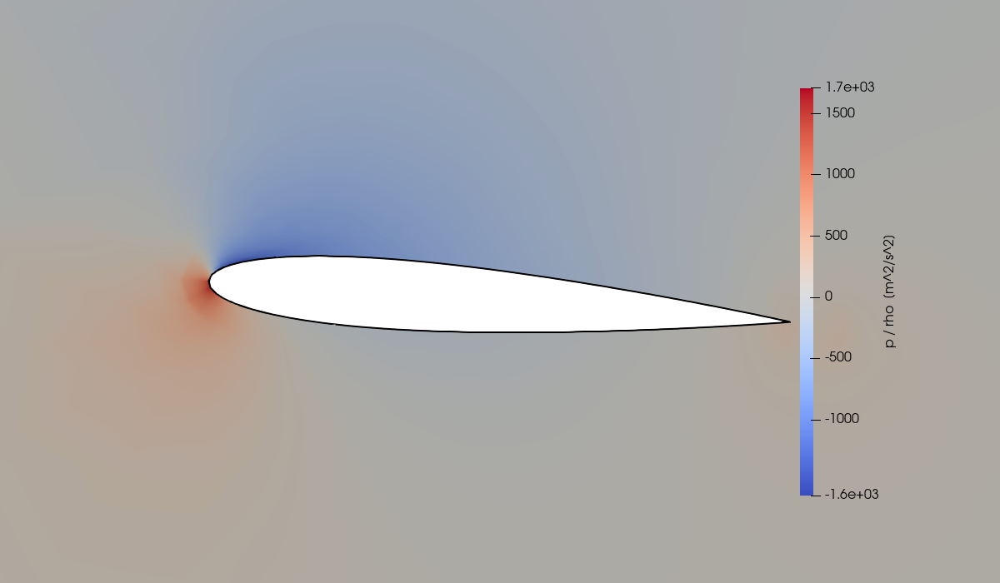
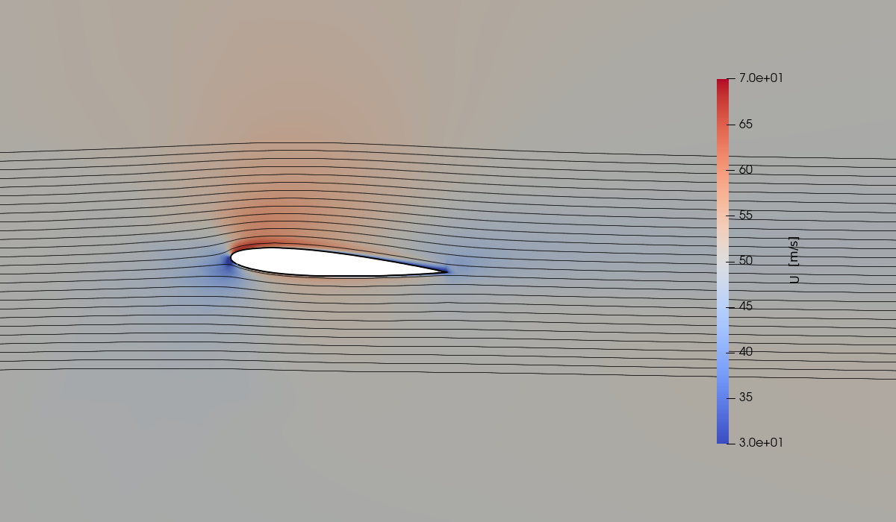
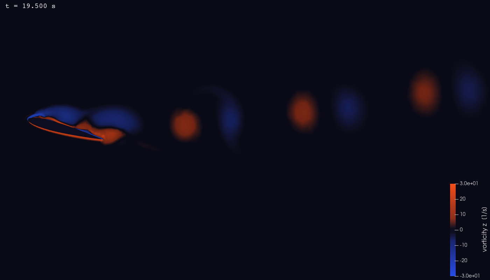
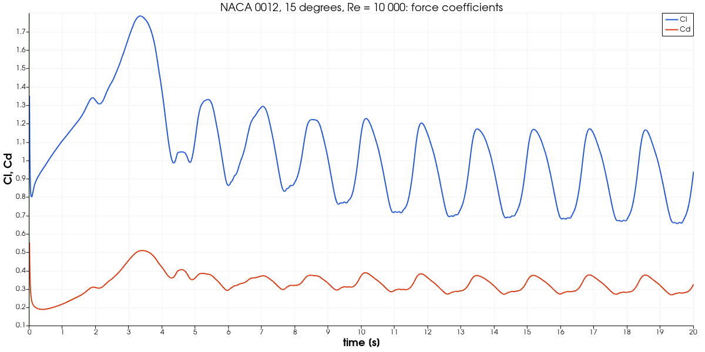
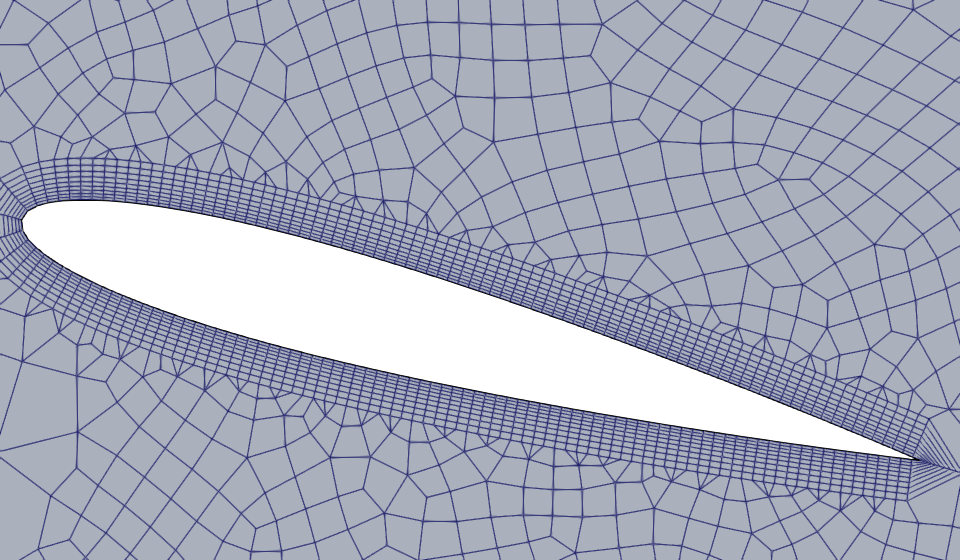
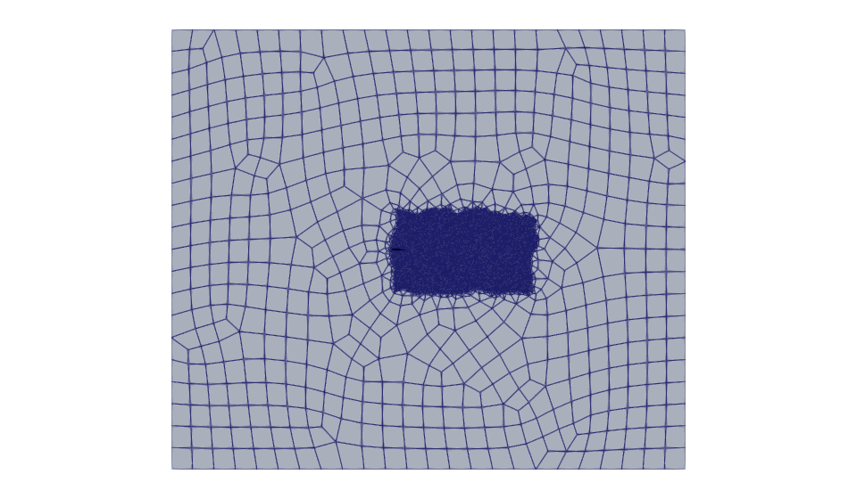
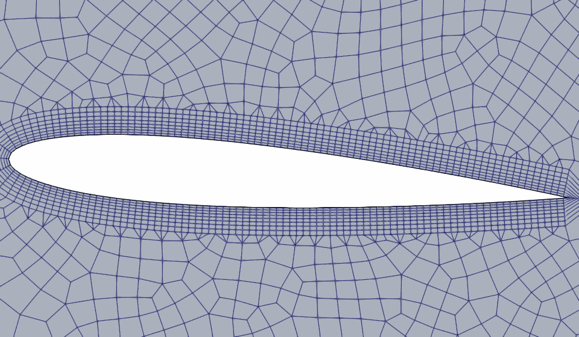

# NACA 0012 Airfoil Analysis

This project contains two OpenFOAM airfoil cases built around a NACA 0012 profile:

- a default steady RANS case in the project root (`simpleFoam`, Spalart-Allmaras, 4 degrees angle of attack)
- a separate transient animation case in [`transient_animation/`](https://github.com/djeada/OpenFoam-Tutorials/tree/main/projects/04_naca_airfoil_analysis/transient_animation) (`pimpleFoam`, laminar, 15 degrees angle of attack, Re = 10 000, vortex shedding)

The default case is intended to be runnable and visually useful. It is not a validation-grade
reproduction of the NASA NACA 0012 benchmark; see [Known Limitations](#known-limitations).



*Kinematic pressure p/rho at iteration 600. Look for the high-pressure region (red) at the
leading edge below the nose, where the flow stagnates, and the low-pressure region (blue) over
the front part of the upper surface (suction peak).*

## Goal

Show the complete external-aerodynamics workflow on a single airfoil:

- generating a 2D-style mesh with a boundary layer from a parametric NACA 0012 profile (Python -> Gmsh -> `gmshToFoam`)
- setting up a steady incompressible RANS case with the Spalart-Allmaras model and wall functions
- applying an angle of attack by rotating the geometry while keeping the freestream horizontal, so
  `liftDir` / `dragDir` stay `(0 1 0)` / `(1 0 0)`
- reading lift, drag and moment coefficients from `forceCoeffs`, and judging them against theory
- understanding why mesh quality, $y^+$ and numerical schemes limit the drag prediction

## Target

| Quantity | Target | Basis |
| --- | --- | --- |
| Reynolds number | $U c / \nu = 6.0\times10^{6}$ | $U = 50 m/s$, `c = 1 m`, $\nu = 8.333\times10^{-6} \mathrm{m}^2/\mathrm{s}$ |
| Angle of attack | `+4 degrees` | airfoil rotated by `-4 degrees` about the quarter chord |
| Lift coefficient | $C_l = 0.439 \pm  0.05$ | thin-airfoil theory $2\pi\alpha$; the NACA 0012 lift-curve slope at this Re is close to it for small alpha |
| Drag coefficient | $0 < C_d < C_l$ (see note) | consistency only, no reference value at 4 degrees is used |
| Moment coefficient | $abs(C_m) < 0.02$ about `x = 0.25 c` | symmetric section: theory gives zero about the quarter chord |
| Mesh | no `checkMesh` failures other than skewness, non-orthogonality below 70 degrees; skewness is known to fail (see below) | OpenFOAM's own limits |
| Solution | mean `Cl` of the last 100 iterations differs from the mean of the 100 before by less than 2 %, and mean `Cd` by less than 1 % | stationary forces; the residuals are not used (see below) |

Note on drag: `Cd` at this mesh is **not expected to match published values** for the NACA 0012,
and no validated reference value for this angle of attack, Reynolds number and solver is
available in this repository, so none is used as a pass/fail criterion. The reasons are numerical:
the mesh is coarse, the boundary layer is handled only by wall functions with $y^+$ of about
215 to 750 (average 476, far from the $y^+$ of about 1 needed to resolve the sublayer), and `U` and
`nuTilda` use first-order upwind. The measured $C_d = 0.0441$ is much larger than a well-resolved
turbulent airfoil at this Reynolds number would give; only $C_d > 0$ and $C_d < C_l$ are checked.
The reference data for a proper comparison is listed under [References](#references).

## Verification Method

After a run, check the results with

```bash
./run_docker.sh        # runs the case and ends with verify.py
python3 verify.py      # re-check an existing run; reads only log.* and postProcessing/
```

[`verify.py`](https://github.com/djeada/OpenFoam-Tutorials/blob/main/projects/04_naca_airfoil_analysis/verify.py)
uses only the Python standard library. It prints one `PASS`/`FAIL` line per check and a summary,
exits `0` only if all checks pass, and exits `2` if results are missing. Values in the last
column were measured in a complete `./run_docker.sh` run of this repository's case
(Gmsh 4.12.1 on the host, OpenFOAM 6 in the container, 600 iterations, `forceCoeffs` written
every iteration). Results depend somewhat on the Gmsh version, which changes the mesh slightly:
an earlier full run with Gmsh 4.11.1 gave 38 584 cells, $C_l = 0.430$, $C_d = 0.0447$, average $y^+$
476 and final `p` residual 1.2e-2; one with Gmsh 4.15.2 gave 39 412 cells, $C_l = 0.427$,
$C_d = 0.0465$, average $y^+$ 485 and max non-orthogonality 58.1 degrees. All three pass the
checks below.

| Check | What it proves | Expected | Measured |
| --- | --- | --- | --- |
| freestream `abs(U)` at inlet vs `magUInf` | force coefficients use the actual freestream | equal, relative 1e-6 | 50 vs 50 |
| `Aref` = `lRef` x span | reference area matches the 0.02 m extrusion | equal, 1e-9 | 0.02 |
| Reynolds number $U c / \nu$ | case is at the stated Re | 6.0e6 +/- 5 % (nu is rounded) | 6.0e6 |
| `checkMesh` failed checks other than skewness | topology, openness, aspect ratio, non-orthogonality are fine | 0 | 0 |
| max non-orthogonality | below OpenFOAM's severe limit | < 70 deg | 62.18 deg |
| `simpleFoam` no `FOAM FATAL ERROR` | solver ran cleanly | none | none |
| `simpleFoam` ran to `End` | log is complete | `End` | `End` |
| run finished | `residualControl` met or `endTime` reached | 600 iterations | 600 iterations |
| `Cl` vs $2\pi\alpha$ (alpha = 4 deg) | lift magnitude is physically right | 0.4386 +/- 0.05 | 0.4264 |
| $C_l > 0$ | lift direction is consistent with nose-up rotation and `liftDir` | > 0 | 0.4264 |
| $0 < C_d < C_l$ | drag acts downstream and is smaller than lift | 0 < Cd < Cl | 0.04407 |
| $abs(C_m)$ about quarter chord | symmetric section has near-zero moment | < 0.02 | 0.0059 |
| `forceCoeffs` values finite | no NaN / inf in the force history | yes | yes |
| `Cl` drift: mean of last 100 iterations vs the 100 before | lift is stationary | < 2 % | 0.94 % |
| `Cd` drift: mean of last 100 iterations vs the 100 before | drag is stationary | < 1 % | 0.10 % |

Tolerance rationale:

- `Cl` band `0.05` is about 11 %: it has to absorb the coarse wall-function mesh, the
  15-chord domain with symmetry-plane top and bottom boundaries, first-order upwind schemes and
  the idealisation of $2\pi\alpha$. It is a consistency check, not a validation.
- Convergence is judged from the force coefficients, not from the residuals. The pressure
  residual plateaus at about `1e-2` (1.0e-2 at iteration 600, 8e-3 at iteration 1000) with first-order
  upwind, $y^+$ of several hundred and 62 degree non-orthogonality, so it never gets near
  any useful tolerance. An earlier version of `verify.py` accepted any final residual below `1e-1`,
  which only proved that the residual was below its initial value of 1. The final residuals are now
  printed as `INFO` lines without a limit.
- Window limits `2 %` (`Cl`) and `1 %` (`Cd`) come from the behaviour observed in this case, in a
  1000-iteration run of the same mesh (all iterations written). Drift between consecutive
  100-iteration windows ending at iteration 400 / 500 / 600 / 700 / 800 / 900 / 1000 was, for `Cl`,
  4.7 / 2.5 / 0.9 / 0.1 / 0.9 / 1.5 / -0.9 %, and for `Cd` 0.6 / 0.0 / -0.1 / 0.1 / 0.0 / -0.2 /
  -0.1 %. The lift is still developing at iterations 400 and 500, and afterwards it keeps wandering
  by up to 1.5 % per window (window means 0.4246 at 600, 0.4290 at 800, 0.4353 at 900, 0.4313 at
  1000), so `Cl` is stationary only to about 1 to 2 %; the drag is stationary to 0.2 %. 600
  iterations (limit 2 %, measured 0.94 %) is therefore enough for the checks, and 1000 iterations
  do not give a better converged lift. Window means are used because single values scatter
  (standard deviation in the last window 0.3 % of `Cl`, 0.4 % of `Cd`).
- $abs(C_m) < 0.02$ is about 5 % of `Cl`.
- Non-orthogonality 70 degrees is the limit `checkMesh` itself uses for a severe error.

`checkMesh` does not report `Mesh OK` for this mesh. It ends with `Failed 1 mesh checks`: the
skewness check fails with max skewness 4.25 on 2 faces (OpenFOAM limit 4). All other checks
pass (max non-orthogonality 62.2 degrees, average 6.6; max aspect ratio 4.0). `simpleFoam` ran
without problems on this mesh, so `verify.py` does not count the skewness failure but prints it
as a `WARN` line. It also prints `INFO` lines for $y^+$ (min 216, max 747, average 476), for the mean and standard
deviation of `Cl` and `Cd` in the last 100 iterations (`Cl` 0.4246 +/- 0.0012, `Cd` 0.04423 +/- 0.00016),
for the final residuals (`p` 1.0e-2, `Ux` 1.1e-3, `Uy` 1.3e-3, `nuTilda` 1.7e-4; no limit) and for
`Cd`, which is deliberately not compared with any published value (see the note above).

Manual checks (visual, not automated):

- Open the case in ParaView (`./open_paraview.sh`): the stagnation point should be at the leading edge
  on the lower side and the suction peak on the upper surface near the nose.
- `postProcessing/forceCoeffs/0/forceCoeffs.dat`: `Cl` should rise smoothly and flatten
  (the first iterations are the start-up transient; the last 100 are scatter of about 0.3 %).
- Streamlines should stay attached to the whole airfoil at 4 degrees.

## What Is In This Project

### Default case

- Solver: `simpleFoam`
- Flow model: incompressible, steady, RANS
- Turbulence model: `SpalartAllmaras`
- Mesh path: Gmsh `.geo` -> `gmshToFoam` -> OpenFOAM
- Geometry setup: airfoil rotated by `4` degrees about the quarter chord, freestream remains horizontal
- Intended output: attached steady field for pressure / velocity visualization

### Transient case

- Directory: [`transient_animation/`](https://github.com/djeada/OpenFoam-Tutorials/tree/main/projects/04_naca_airfoil_analysis/transient_animation)
- Solver: `pimpleFoam`, laminar, 2D-style (one cell thick), run on 4 MPI ranks
- Setup: $U = 1 m/s$, $\nu = 1\times10^{-4} \mathrm{m}^2/\mathrm{s}$ (Re = 10 000), airfoil rotated by 15 degrees, `endTime = 20 s`,
  adaptive time step with `maxCo = 0.5`, fields written every `0.25 s` (80 times), `forceCoeffs`
  every `0.01 s`
- Intended output: many saved time steps for animation and unsteady visualization
- This is the case to use if you want actual time evolution instead of SIMPLE iterations
- Status: **runs and passes its own checks** (`transient_animation/verify.py`, 17/17): a complete
  `./run_docker.sh transient` run (Gmsh 4.12.1, OpenFOAM 6) meshed in 6 minutes, solved 20 s of
  physical time in 10 348 time steps (about 26 minutes on 4 cores) and produced a shedding vortex
  street; details under [Transient case: verification and results](#transient-case-verification-and-results)

Changes made to the original settings so that the case actually runs (the original settings had
never been run to the end):

| Item | Original | Now | Why |
| --- | --- | --- | --- |
| Gmsh mesh | 121 chord points, airfoil size 0.008, far-field size 0.8, first layer 0.002, near size 0.018 within 2.0, wake size 0.025 to x = 15, half height 4 | 101 chord points, airfoil size 0.012, far-field size 1.5, first layer 0.003, near size 0.03 within 1.5, wake size 0.04 to x = 12, half height 3 | with the original values Gmsh's 2D recombination (about 650 000 edges) had still not finished after 25 minutes and was stopped; the new mesh has 44 596 cells and is generated in about 6 minutes |
| Parallel run | 1 core | 4 ranks (`system/decomposeParDict`, `scotch`; `Allrun` runs `decomposePar`, `pimpleFoam -parallel`, `reconstructPar`) | one core needs about 0.6 s per time step (about 2 h in total), four cores about 0.15 s |
| Output interval | every `0.05 s` (400 times) | every `0.25 s`, `adjustableRunTime` (80 times, 460 MB with the case directory) | limits the output size; `adjustableRunTime` makes the time step hit the write times, so the directories are called `0.25`, `0.5`, ... `20` |

Everything else (`endTime = 20`, laminar, `maxCo = 0.5`, `backward` in time, `linearUpwind`) is as
before. The vorticity animation scripts read these directories unchanged; at `0.25 s` spacing the
animation is coarser than it was meant to be, so set `writeInterval 0.05` again if a smooth
video is the goal (400 times, about 2 GB estimated from the 5.5 MB per written time of this mesh).

## Results

From the verification run (OpenFOAM 6, Gmsh 4.12.1, 600 SIMPLE iterations, 99 s of solver
time on one core; meshing takes about 4 minutes):

- $C_l = 0.426$, $C_d = 0.0441$, $C_m = 0.0059$ (about `x = 0.25 c`); mean of the last 100 iterations
  $C_l = 0.4246$, $C_d = 0.04423$
- average $y^+$ on the airfoil about `476` (min 216, max 747)
- mesh: 38 585 cells (38 491 hexahedra, 94 prisms), one cell thick

Result files:

- [`postProcessing/forceCoeffs/0/forceCoeffs.dat`](https://github.com/djeada/OpenFoam-Tutorials/blob/main/projects/04_naca_airfoil_analysis/postProcessing/forceCoeffs/0/forceCoeffs.dat)
- [`postProcessing/yPlus/0/yPlus.dat`](https://github.com/djeada/OpenFoam-Tutorials/blob/main/projects/04_naca_airfoil_analysis/postProcessing/yPlus/0/yPlus.dat)
- [`postProcessing/residuals/0/residuals.dat`](https://github.com/djeada/OpenFoam-Tutorials/blob/main/projects/04_naca_airfoil_analysis/postProcessing/residuals/0/residuals.dat)

(`postProcessing/` is generated by the run and not tracked in git.)

Important limitations of these numbers:

- the wall treatment is coarse for an airfoil case: average $y^+$ of about `476` is acceptable for a
  runnable tutorial-style wall-function case, but too high for validation-quality drag prediction
- $C_d = 0.0441$ is not expected to match published NACA 0012 values on this mesh (see the note
  under [Target](#target)); it should not be used as a result
- `checkMesh` fails one check: max skewness 4.25 on 2 faces (limit 4), so it does not print `Mesh OK`
- the residuals stall between about `1e-4` and `1e-2`: the forces are stationary (`Cd` to 0.1 %, `Cl` to
  about 1 %), but the residuals are not converged in the usual sense, which is why `fvSolution` has no
  `residualControl`



*Velocity magnitude (color limits 30 to 70 m/s) with streamlines seeded 1 chord upstream. Look
for the accelerated flow (red) above the nose, the low-speed stagnation region (blue) at the
leading edge, and the streamlines following the whole surface without separation.*

### Transient case: verification and results

```bash
./run_docker.sh transient            # about 35 minutes, ends with transient_animation/verify.py
python3 transient_animation/verify.py     # re-check an existing run
```

[`transient_animation/verify.py`](https://github.com/djeada/OpenFoam-Tutorials/blob/main/projects/04_naca_airfoil_analysis/transient_animation/verify.py)
has the same interface as the steady one (standard library only, one `PASS`/`FAIL` line per
check, exit `0` / `1` / `2`). Measured in the run described above:

| Check | Expected | Measured |
| --- | --- | --- |
| freestream `abs(U)` vs `magUInf`, `Aref` = `lRef` x span | equal | 1, 0.02 |
| Reynolds number $U c / \nu$ | 1.0e4 +/- 5 % | 1.0e4 |
| `checkMesh` failed checks other than skewness; max non-orthogonality | 0; < 70 deg | 0; 55.45 deg |
| `pimpleFoam` no `FOAM FATAL ERROR`, ran to `End` | none; `End` | none; `End` |
| end time reached | 20 s +/- `maxDeltaT` | 20 s |
| Courant number after the first 10 steps | <= 1.01 x `maxCo` = 0.505 | 0.502 |
| Courant number over the whole run | <= 1.2 x `maxCo` = 0.6 | 0.575 (third step, impulsive start) |
| written time directories; last time | 80; 20 | 80; 20 |
| `forceCoeffs` finite, reaches endTime | yes | yes |
| max abs(`Cl`) over the run | < 1.5 x $2\pi\alpha$ = 2.47 | 1.785 (at t = 3.3 s) |
| mean `Cl` in the second half | > 0 | 0.904 |
| $0 < C_d < C_l$ (means, second half) | yes | 0.319 < 0.904 |

Tolerance rationale: the Courant checks follow from the time-step control (the step is chosen
from the previous step's Courant number and may grow by at most 20 %, so the first steps after
the impulsive start overshoot by 15 %, later steps by 0.4 %); the `Cl` bound is a generous
sanity bound around thin-airfoil theory (`2 pi alpha = 1.64` at 15 degrees), not a validation.
There is no published reference value for this mesh and set-up, so `Cl` and `Cd` are only
checked for plausibility.

`checkMesh` ends with `Failed 1 mesh checks` for this mesh as well (max skewness 5.32 on 4 faces,
limit 4; 44 596 cells: 44 510 hexahedra, 86 prisms; max aspect ratio 5.4; max non-orthogonality
55.4 degrees, average 7.0), printed as a `WARN` line; the solver was not affected.

Measured behaviour (not checks):

- start-up: after the impulsive start `Cl` rises to a maximum of 1.78 at `t = 3.3 s`, then falls
  and settles into periodic shedding by about `t = 10 s`
- shedding: from `t = 10 s` the `Cl` peaks are 1.68 s apart (frequency about 0.59 per second,
  Strouhal number about 0.15 based on the projected chord `c sin(alpha)`)
- second half of the run (`t >= 10 s`): `Cl` mean 0.904, standard deviation 0.186, range
  0.656 to 1.228; `Cd` mean 0.319, standard deviation 0.036; `Cm` mean 0.142 about
  `x = 0.25 c` (the section is stalled, so the moment is not near zero as in the steady case)
- time step 0.0010 to 0.0023 s (10 348 steps), solver 1545 s on 4 cores; mesh 6 minutes



*Out-of-plane vorticity at `t = 19.5 s` (colour limits -30 to 30 1/s). Look for the shear layers
rolling up on the suction side and the alternating red (counter-clockwise) and blue (clockwise)
vortices convecting downstream.*



*`Cl` (blue) and `Cd` (red) from `postProcessing/forceCoeffs/0/forceCoeffs.dat`. Look for the
start-up peak near `t = 3.3 s` and the periodic shedding afterwards.*



*Mesh of the transient case near the airfoil (first layer 0.003 c, growth ratio 1.12).*

The images were made with `pvbatch transient_animation/paraview_streamlines.py --screenshot
images/transient_vorticity.png --time 19.5 --resolution 1400 800 --zoom 1.8 --camera-x 2.8
--camera-y -0.2`, `pvbatch transient_animation/paraview_force_plot.py` and
`pvbatch paraview_images.py --case transient_animation/airfoil.foam --out <dir>` (mesh image).
The batch export of all frames (`./open_paraview.sh transient render`, MP4 with `ffmpeg`) was not
run.

## Case Layout

```text
04_naca_airfoil_analysis/
├── 0/                              # initial / boundary fields (U, p, nut, nuTilda)
├── constant/
│   ├── transportProperties
│   ├── turbulenceProperties
│   ├── airfoil_benchmark.geo       # generated Gmsh geometry
│   └── airfoil_benchmark.msh       # generated Gmsh mesh
├── images/                         # figures used in this README
├── mesh_generation_scripts/
│   └── generate_naca0012_benchmark_geo.py
├── system/
│   ├── changeDictionaryDict
│   ├── controlDict
│   ├── fvSchemes
│   └── fvSolution
├── transient_animation/            # separate transient case (own Allrun, Allclean, make_mesh.sh,
│                                   #   verify.py, decomposeParDict, paraview_*.py)
├── Allclean
├── Allrun
├── make_mesh.sh                    # geometry + Gmsh meshing (called by Allrun)
├── run_docker.sh
├── verify.py
├── open_paraview.sh
├── paraview_airfoil.py
├── paraview_images.py              # renders images/*.png
└── paraview_guide.md
```

## Physics And Setup

### Default steady case

| Parameter | Value | File |
| --- | --- | --- |
| Freestream velocity `U` | `50 m/s`, direction `(1 0 0)` | `0/U`, `magUInf` in `system/controlDict` |
| Kinematic viscosity `nu` | `8.333e-6 m^2/s` | `constant/transportProperties` |
| Chord length `c` | `1 m` (`lRef`) | `system/controlDict` |
| Span of the extrusion | `0.02 m` | `make_mesh.sh` / generator default |
| Reference area `Aref` | `0.02 m^2` (chord x span) | `system/controlDict` |
| Reynolds number | $U c / \nu = 6\times10^{6}$ | derived |
| Angle of attack | `+4 degrees` (geometry rotated by `-4 degrees`) | `make_mesh.sh` |
| Moment reference point `CofR` | `(0.25 0 0)` (quarter chord of the unrotated airfoil) | `system/controlDict` |
| Density for coefficients `rhoInf` | `1.225 kg/m^3` (the solver is kinematic) | `system/controlDict` |
| Freestream `nuTilda`, `nut` | `2.5e-5 m^2/s` (3 nu) | `0/nuTilda`, `0/nut` |
| Iterations | `600`, write fields every `10`, `forceCoeffs` every iteration | `system/controlDict` |

Numerics: first-order `bounded Gauss upwind` for `U` and `nuTilda`, `cellLimited Gauss linear 1`
gradients, GAMG for `p`, relaxation `p 0.2`, `U 0.3`, `nuTilda 0.2`. There is deliberately no
`residualControl` in `fvSolution`: an earlier `1e-6` was never reached (the pressure residual
plateaus at about `1e-2`) and only suggested that the run stops on convergence, whereas it always
ends at `endTime`; see the tolerance rationale above.

Lift and drag directions stay `(0 1 0)` and `(1 0 0)` because the freestream is horizontal and
the airfoil, not the flow, is rotated.

Relevant files:

- [`constant/transportProperties`](https://github.com/djeada/OpenFoam-Tutorials/blob/main/projects/04_naca_airfoil_analysis/constant/transportProperties)
- [`constant/turbulenceProperties`](https://github.com/djeada/OpenFoam-Tutorials/blob/main/projects/04_naca_airfoil_analysis/constant/turbulenceProperties)
- [`system/controlDict`](https://github.com/djeada/OpenFoam-Tutorials/blob/main/projects/04_naca_airfoil_analysis/system/controlDict)

### Domain

Dimensions in chord lengths `c = 1 m`; the mesh is one cell thick in `z` (0.02 m).

```text
                       top: symmetryPlane,  y = +15
      +-------------------------------------------------------------+
      |                                                             |
      |                                                             |
      |                                                             |
      |                       airfoil (wall)                        |
 U -> |                  .-==========-.__                           |-> outlet
inlet |  x = -15         LE (0,0)       TE (1,-0.05)    wake box    |  x = +20
      |                  4 deg AoA      <--- 0 < x < 10, |y| < 3 -->|  p = 0
      |                                                             |
      |                                                             |
      |                                                             |
      +-------------------------------------------------------------+
                       bottom: symmetryPlane, y = -15
      frontAndBack: empty (z = 0 and z = 0.02)
```

The airfoil (leading edge near the origin, trailing edge near `(1, -0.05)`) is rotated by
`-4 degrees` about `(0.25, 0)`, which is a +4 degree angle of attack to the +x freestream.



*Whole domain (x from -15 to 20, y from -15 to 15). The dark box is the wake refinement region
(0 < x < 10, abs(y) < 3); the airfoil is the small black shape at its upstream edge.*

### Boundary conditions

Root case fields:

- [`0/U`](https://github.com/djeada/OpenFoam-Tutorials/blob/main/projects/04_naca_airfoil_analysis/0/U)
- [`0/p`](https://github.com/djeada/OpenFoam-Tutorials/blob/main/projects/04_naca_airfoil_analysis/0/p)
- [`0/nuTilda`](https://github.com/djeada/OpenFoam-Tutorials/blob/main/projects/04_naca_airfoil_analysis/0/nuTilda)
- [`0/nut`](https://github.com/djeada/OpenFoam-Tutorials/blob/main/projects/04_naca_airfoil_analysis/0/nut)

| Patch | Type | `U` | `p` | `nuTilda` | `nut` |
| --- | --- | --- | --- | --- | --- |
| `inlet` | patch | `fixedValue (50 0 0)` | `zeroGradient` | `fixedValue 2.5e-5` | `calculated` |
| `outlet` | patch | `pressureInletOutletVelocity` | `fixedValue 0` | `inletOutlet` | `calculated` |
| `top`, `bottom` | `symmetryPlane` | symmetryPlane | symmetryPlane | symmetryPlane | symmetryPlane |
| `airfoil` | `wall` | `noSlip` | `zeroGradient` | `fixedValue 0` | `nutUSpaldingWallFunction` |
| `frontAndBack` | `empty` | empty | empty | empty | empty |

The patch types are assigned after import by `system/changeDictionaryDict`, because
`gmshToFoam` creates every patch as a plain `patch`.

## Mesh Workflow

The root case used an older `blockMesh + snappyHexMesh` path earlier in its history; the
dictionaries for it have been removed. The current workflow is:

1. [`make_mesh.sh`](https://github.com/djeada/OpenFoam-Tutorials/blob/main/projects/04_naca_airfoil_analysis/make_mesh.sh) calls
   [`mesh_generation_scripts/generate_naca0012_benchmark_geo.py`](https://github.com/djeada/OpenFoam-Tutorials/blob/main/projects/04_naca_airfoil_analysis/mesh_generation_scripts/generate_naca0012_benchmark_geo.py),
   which writes the Gmsh geometry `constant/airfoil_benchmark.geo`
2. Gmsh generates `constant/airfoil_benchmark.msh` (format 2, as `gmshToFoam` requires)
3. `gmshToFoam` imports the mesh
4. `changeDictionary` fixes patch types
5. `renumberMesh`, `checkMesh`, `simpleFoam` run in sequence


Mesh parameters used by `make_mesh.sh` (lengths in chord lengths):

| Parameter | Value |
| --- | --- |
| Chord points per side (cosine spacing) | 101 |
| Airfoil surface size | 0.012 |
| Boundary layer: first layer / total thickness / growth ratio | 0.004 / 0.05 / 1.12 |
| Near-body size, transition distance | 0.03, 1.5 |
| Wake box: size, x extent, half height | 0.04, 0 to 10, 3 |
| Far field | x from -15 to 20, y from -15 to 15, size 1.5 (generator default) |

The mesh is a practical compromise:

- it runs reliably
- it gives a useful attached-flow field
- it is not fine enough near the wall for benchmark drag accuracy
- `checkMesh` fails one check, `Failed 1 mesh checks`: max skewness 4.25 on 2 faces (limit 4);
  max non-orthogonality is 62.2 degrees (limit 70)



*Mesh around the airfoil, cells seen from +z. Look for the boundary-layer strip of about eight
stacked quad layers along both surfaces (first layer 0.004 c, growth ratio 1.12), the irregular
quads outside it. The mesh has 94 prisms (triangular-based cells) among 38 490 hexahedra.*

## How To Run

### Recommended: Docker

Requirements: `docker`, `python3` and `gmsh` on the host (the OpenFOAM image contains no Gmsh).
Run the steady case from the project directory:

```bash
cd projects/04_naca_airfoil_analysis
./run_docker.sh
```

This script:

1. cleans the case through the OpenFOAM container (`./Allclean`)
2. generates the Gmsh geometry and the `.msh` mesh on the host with `make_mesh.sh`
3. runs `./Allrun` in the container (`gmshToFoam` ... `simpleFoam`)
4. runs `python3 verify.py` and prints the PASS/FAIL summary

Meshing is the slowest step (several minutes); the solver itself runs for one to two minutes.

### Native OpenFOAM shell

If OpenFOAM, `python3` and `gmsh` are available locally and OpenFOAM is sourced:

```bash
cd projects/04_naca_airfoil_analysis
./Allclean
./Allrun
python3 verify.py
```

### Transient animation case

To run the transient case instead:

```bash
./run_docker.sh transient
```

or, natively:

```bash
cd projects/04_naca_airfoil_analysis/transient_animation
./Allrun
```

That case uses `pimpleFoam` on 4 MPI ranks (`mpirun` is needed natively) and writes 80 time
steps (460 MB) for animation. It takes about 35 minutes: 6 minutes meshing, 26 minutes of
solver on 4 cores. `./run_docker.sh transient` ends with `transient_animation/verify.py`;
`./run_docker.sh all` runs both cases one after the other.

### Cleaning

`./Allclean` removes time directories, `postProcessing/`, logs, the generated mesh and the
`airfoil.foam` marker. `images/` and `verify.py` are not touched.

## ParaView

### One-command launcher

From the project directory:

```bash
./open_paraview.sh
```

This opens ParaView with [`paraview_airfoil.py`](https://github.com/djeada/OpenFoam-Tutorials/blob/main/projects/04_naca_airfoil_analysis/paraview_airfoil.py) and builds the
default scene automatically.

Default ParaView view:

- mid-plane slice
- `Surface LIC`
- colored by `U Magnitude`
- white airfoil surface
- tight 2D camera

### Changing the view

The ParaView GUI does not pass command-line options to a script, so `open_paraview.sh` takes none.
The options of [`paraview_airfoil.py`](https://github.com/djeada/OpenFoam-Tutorials/blob/main/projects/04_naca_airfoil_analysis/paraview_airfoil.py)
are set through the `default=` values of its argument parser:

- `--scalar U` (default) for velocity magnitude, `--scalar p` for pressure
- `--u-min 20`, `--u-max 70` color limits for `U` magnitude
- `--pressure-limit 300` symmetric color limit for `p`
- `--case` path of the `.foam` file, `--screenshot` output image

The script was not rendered headless in the verification: `pvpython paraview_airfoil.py
--screenshot out.png` produced an image with only the color bar (the `Surface LIC` slice was
not drawn offscreen). Use `paraview_images.py` for headless figures.

Manual notes are in [`paraview_guide.md`](https://github.com/djeada/OpenFoam-Tutorials/blob/main/projects/04_naca_airfoil_analysis/paraview_guide.md).

### Regenerating the README figures

```bash
pvbatch paraview_images.py        # writes images/mesh_domain.png, mesh_airfoil.png, pressure.png, velocity.png
```

### Transient animation

```bash
./open_paraview.sh transient            # interactive
./open_paraview.sh transient render     # PNG frames with pvbatch, then MP4 with ffmpeg (not run)
```

Single frames and the force plot (both run headless with `pvbatch` on the verified run):

```bash
pvbatch transient_animation/paraview_streamlines.py --case transient_animation/airfoil.foam \
        --screenshot images/transient_vorticity.png --time 19.5 --resolution 1400 800 \
        --zoom 1.8 --camera-x 2.8 --camera-y -0.2
pvbatch transient_animation/paraview_force_plot.py     # images/transient_forces.png
```

## Important Interpretation Notes

### The root case is steady

The root solver is `simpleFoam`, so the directories `10/`, `20/`, ... `600/` are
SIMPLE iteration outputs, not physical seconds.

That means:

- the field becoming stationary is expected
- you will not get a true animation from the root case
- if you want real time evolution, use the transient case in
  [`transient_animation/`](https://github.com/djeada/OpenFoam-Tutorials/tree/main/projects/04_naca_airfoil_analysis/transient_animation)

### Why the internet images look stronger

Most reference-style airfoil images differ from this case in one or more of these ways:

- they are colored by velocity magnitude rather than pressure
- they use a transient or more strongly separated flow regime
- they use much finer boundary-layer resolution
- they use structured or higher-quality external-aero meshes

So ParaView can improve presentation, but it cannot create stronger physical effects than
the CFD solution actually contains.

## Known Limitations

- The steady root case is stable, but not validation-grade.
- Drag is much higher than expected for a high-quality NACA 0012 benchmark case ($C_d = 0.0441$);
  no validated reference value is available in this repository to quantify the difference.
- Near-wall resolution is too coarse for trustworthy airfoil drag prediction ($y^+$ 217 to 749).
- `U` and `nuTilda` use first-order upwind, which adds numerical diffusion.
- Residuals plateau (pressure at about `1e-2`); the run always ends at `endTime` and there is no
  `residualControl`. `Cl` is stationary only to about 1 to 2 % (it wanders by up to 1.5 % per
  100 iterations even after 1000 iterations).
- `checkMesh` reports `Failed 1 mesh checks`: two faces exceed the skewness limit (4.25 against 4).
- Top and bottom are symmetry planes 15 chords from the airfoil, so the far field is not a true
  free stream.
- The transient case is a moderate-resolution mesh (44 596 cells, one layer thick, first layer 0.003 c)
  at Re = 10 000 without a turbulence model: it is a qualitative picture of the vortex shedding, not
  a validated result, it is 2D-style so the real 3D wake of this flow is not represented, and
  fields are written only every 0.25 s.
- More aggressive boundary-layer meshes were tested earlier, but in this repo's Gmsh workflow they
  either stalled during recombination or produced poor-quality tetrahedral meshes that
  destabilized the solver.

## Recommended Next Steps

If you want to improve physics rather than just visualization, the best next steps are:

1. move the steady case to a better airfoil mesh topology, ideally a structured or true
   C-grid style external-aero mesh
2. reduce wall-function dependence by improving first-layer control and $y^+$
3. use a second-order scheme for `U` and `nuTilda` (for example `linearUpwind`)
4. compare `Cl`, `Cd`, and surface pressure against NASA / TMR reference data
5. use the transient case for animation-oriented work rather than trying to animate the
   steady SIMPLE solution

## References

- NASA Turbulence Modeling Resource, NACA 0012 validation:
  <https://turbmodels.larc.nasa.gov/naca0012_val.html>
- NASA TMR, Spalart-Allmaras reference results:
  <https://turbmodels.larc.nasa.gov/naca0012_val_sa.html>
- NASA TMR, benchmark grids:
  <https://turbmodels.larc.nasa.gov/naca0012_grids.html>
- OpenFOAM `simpleFoam` documentation:
  <https://doc.openfoam.com/2306/tools/processing/solvers/rtm/incompressible/simpleFoam/>
- OpenFOAM `pimpleFoam` documentation:
  <https://doc.openfoam.com/2306/tools/processing/solvers/rtm/incompressible/pimpleFoam/>
