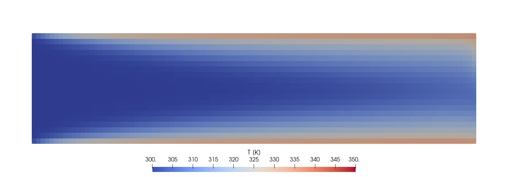
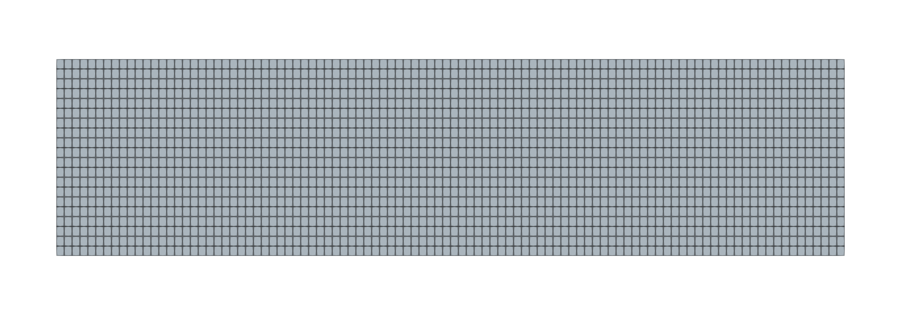
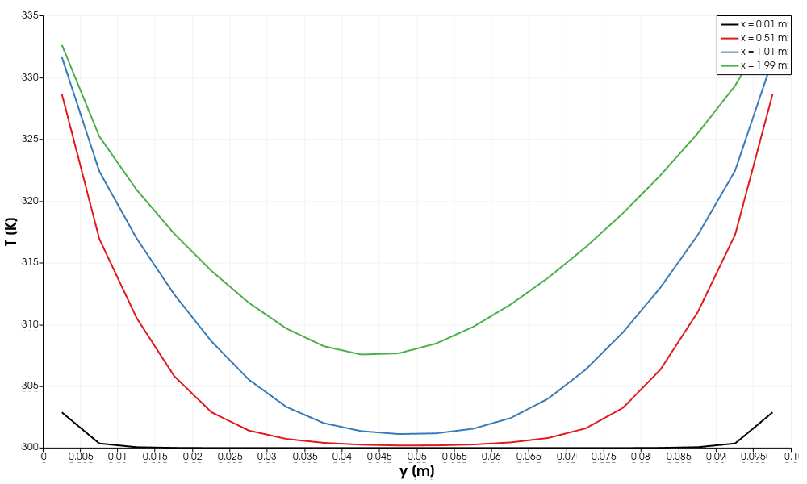
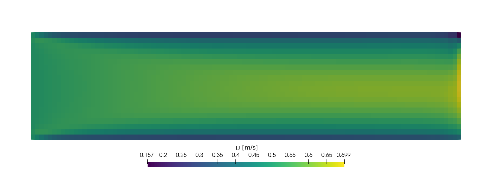
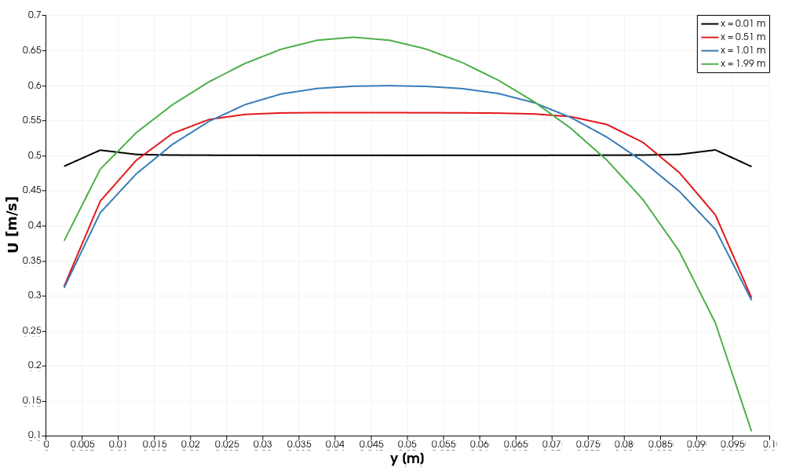
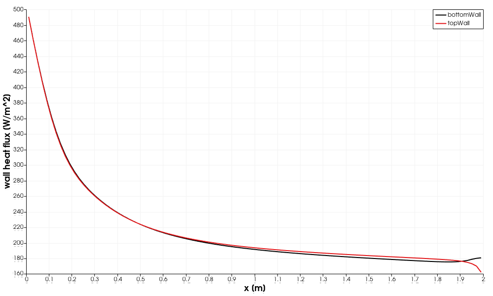

# 05 - Heated Pipe Flow (Heated Channel, Forced/Mixed Convection)

| Detail | Value |
|---|---|
| **Difficulty** | Intermediate |
| **Solver** | `buoyantSimpleFoam` (steady-state, buoyant, turbulent, compressible with energy equation) |
| **Algorithm** | SIMPLE |
| **Turbulence model** | k-epsilon (RAS) with wall functions |
| **Reynolds number** | Re $\approx$ 6400 at the inlet ($D_h = 2H = 0.2$ m, $\nu = 1.57 \times 10^{-5}$ $\mathrm{m}^{2}/\mathrm{s}$) |
| **Prandtl number** | Pr = 0.71 (air) |
| **OpenFOAM version** | 6 (run and verified with the `cfdengine/openfoam` image) |

---

## Goal

Learn how to set up and judge a steady, turbulent heat-transfer simulation with
`buoyantSimpleFoam`:

- what a compressible, buoyant solver needs that an incompressible one does not
  (`thermophysicalProperties`, `T`, `p`/`p_rgh`, `alphat`, gravity), and why the
  absolute pressure level of `p_rgh` matters;
- how a fixed-temperature wall turns into a developing thermal boundary layer, a wall
  heat flux that decays along the duct, and a rising bulk temperature;
- how to check a heat-transfer result with an energy balance and a dimensionless
  number (Nusselt) instead of only looking at contours;
- how inlet turbulence values and wall resolution ($y^+$) influence the result.

## Target

The case has no experimental or benchmark reference data. The target is therefore a
physically consistent, converged solution that satisfies these measurable conditions
(numbers are from the run documented below):

| Quantity | Target |
|---|---|
| Convergence | `SIMPLE solution converged` before `endTime` = 1000 (measured: 134 iterations) |
| Temperature range | all cells between 300 K (inlet) and 350 K (wall) |
| Mass flow | $\rho_{in} U_{in} H W = 5.87 \times 10^{-4}$ kg/s in, same out (within 0.1 %) |
| Energy balance | outlet bulk $\Delta T = Q_{wall} / (\dot m C_p) \approx 14.8$ K (within 2 %) |
| Heat transfer level | mean $Nu$ between 1 and 3 times the Dittus-Boelter value (about 22 for Re = 6400); measured about 40, see Section 8.4 |

The energy balance and mass balance are exact conservation statements and are the
primary targets. The Nusselt band is only a sanity check: no validated Nusselt number
exists for this coarse 2D setup.

## Verification Method

Run the case and the automatic check:

```bash
./run_docker.sh          # clean + blockMesh + checkMesh + buoyantSimpleFoam + verify.py
python3 verify.py        # re-run only the checks (reads log.*, time directories, postProcessing/)
```

`verify.py` uses the Python standard library only, reads files written by the run,
prints one line per check and exits with 0 only if all checks pass (1 on a failed check,
2 if results are missing).

| # | Check (`verify.py` name) | What it proves | Expected | Tolerance and justification | Measured |
|---|---|---|---|---|---|
| 1 | `checkMesh reports Mesh OK` | mesh is valid | `Mesh OK` | none | Mesh OK |
| 2 | `cell count` | `blockMeshDict` is the intended 100 x 20 x 1 mesh | 2000 | exact | 2000 |
| 3 | `solver finished cleanly` | no crash or floating point exception | log ends with `End`, no `FOAM FATAL`/`Floating point exception` | none | clean |
| 4 | `residualControl satisfied` | steady state reached before `endTime` | `SIMPLE solution converged` in fewer than 1000 iterations | no reference iteration count exists, so only "converged at all" is tested | 134 |
| 5 | `final initial residuals` | all equations are below the target | $\le 10^{-4}$ for `Ux`, `Uy`, `h`, `p_rgh`, `k`, `epsilon` | equal to `residualControl` in `fvSolution` | 9.5e-5 (largest) |
| 6 | `T within [T_in, T_wall]` | maximum principle: no heat source, so 300 K $\le T \le$ 350 K | 300 K ... 350 K | 0.01 K, covers linear-solver tolerance (`relTol` 0.1, `tolerance` 1e-6) | 300.000 ... 334.42 K |
| 7 | `inlet mass flow` | inlet flux equals $\rho_{in} U_{in} H W$ with $\rho_{in} = pM/(R T)$ | 5.870e-4 kg/s | 0.2 %: `p` at the inlet differs from 101325 Pa by about 0.2 Pa and $R$ is rounded | 5.8698e-4 kg/s |
| 8 | `mass balance in/out` | steady state, nothing accumulates | mass out = mass in | 0.1 %, far above the residual-level continuity error (`sum local` about 5e-6) | 2e-7 relative |
| 9 | `outlet bulk T rise (q_w / m cp)` | energy balance: wall heat integral = enthalpy gain of the stream | 14.80 K ($Q_w$ = 8.73 W, $\dot m C_p$ = 0.590 W/K) | 2 % of the rise (0.3 K): absorbs upwind face interpolation at the outlet and the 1e-4 residual level; kinetic energy change is below 1e-3 K and neglected | 14.79 K |
| 10 | `mean Nu / Dittus-Boelter` | heat transfer level is physically plausible (internal consistency only) | 1 ... 3 | sanity band, not a validation: entry-region Nu is not lower than the fully developed value (lower bound 1) and short ducts rarely exceed about 3 times it (upper bound) | 1.79 (Nu = 39.8, DB = 22.2) |

Checks 7-9 are conservation statements that hold independently of turbulence modelling,
so they test the setup (boundary conditions, pressure level, energy equation) and not
the physics model. Check 10 is the only physical-level check and has no validated
reference behind it.

Example output (all checks passing):

```
PASS  checkMesh reports Mesh OK      measured=Mesh OK  expected=Mesh OK
...
PASS  inlet mass flow                measured=5.8698e-04 kg/s  expected=5.8699e-04 +- 0.2%
PASS  mass balance in/out            measured=2.26e-07 rel. error  expected=<= 1e-3
PASS  outlet bulk T rise (q_w / m cp) measured=14.79 K  expected=14.80 K +- 2%
PASS  mean Nu / Dittus-Boelter       measured=1.79 (Nu=39.8, DB=22.2)  expected=1.0 .. 3.0 (sanity band)

10 of 10 checks passed (time directory 134)
RESULT: PASS
```

The checks can fail: check 7 caught a real inconsistency during development (with
`zeroGradient` for `p_rgh` at the inlet the mass flux was 5.855e-4 kg/s, 0.26 % below
the imposed value, see Section 5.3), and corrupting one cell of `T` to 420 K makes
check 6 fail with exit status 1.

**Manual checks** (not part of `verify.py`):

1. Open the case with `./open_paraview.sh` and compare with the figures in Section 8.
2. `grep "Solving for" log.buoyantSimpleFoam | tail -6` - residuals fall below 1e-4.
3. `grep -c "bounding" log.buoyantSimpleFoam` - should print 0 (no bounded variables).
4. `tail -2 postProcessing/yPlus/0/yPlus.dat` - $y^+$ about 1.5-3.8 on both walls, see Section 4.

---

## Table of Contents

1. [Problem Description](#1-problem-description)
2. [Physics and Theory](#2-physics-and-theory)
3. [Case Structure](#3-case-structure)
4. [Mesh Details](#4-mesh-details)
5. [Boundary Conditions](#5-boundary-conditions)
6. [Solver Configuration](#6-solver-configuration)
7. [How to Run](#7-how-to-run)
8. [Expected Results](#8-expected-results)
9. [Post-Processing Guide](#9-post-processing-guide)
10. [Exercises](#10-exercises)
11. [Troubleshooting](#11-troubleshooting)
12. [References and Further Reading](#12-references-and-further-reading)

---

## 1. Problem Description

This simulation models **forced convection heat transfer** inside a heated rectangular
duct. Cold air enters at 300 K and is heated by the hot walls (350 K) as it flows through
the 2 m long channel. This is a classic problem in thermal-fluid engineering, illustrating
how thermal boundary layers develop and how heat is transferred from a wall to a moving
fluid stream.

The case is two-dimensional: one cell in the third direction with `empty` patches
represents a plane channel between parallel plates, not a circular pipe. The walls are
imposed fixed-temperature boundaries; there is no solid region and no conduction inside
the wall, so this is a convective heat transfer problem and not a conjugate heat
transfer (CHT) problem.

### Why This Problem Matters

Heat exchangers, cooling channels, HVAC ducts and electronics cooling systems all involve
fluid flowing past heated or cooled surfaces. Understanding how temperature profiles
develop, how heat flux varies along the length, and how turbulence affects mixing is
fundamental to designing efficient thermal systems.

### Geometry and Setup

```
                      T_wall = 350 K (hot wall)   patch: topWall
  +-----------------------------------------------------------------------------+
  |/////////////////////////////////////////////////////////////////////////////|
  +-----------------------------------------------------------------------------+
  |                                                                             |
  |  T_in = 300 K  ->->->->->->->->  heated fluid  ->->->->->->->->  T_out > 300 K
  |  (cold air)                (warming up)                 (heated air)        |
  |                                                                             |
  |  patch: inlet               Thermal BL                  patch: outlet       |
  |  U_in = 0.5 m/s             develops                    p_rgh = 101325 Pa   |
  |  (uniform)                                                                  |
  +-----------------------------------------------------------------------------+
  |/////////////////////////////////////////////////////////////////////////////|
  +-----------------------------------------------------------------------------+
                      T_wall = 350 K (hot wall)   patch: bottomWall

  <------------------------------ L = 2.0 m ------------------------------------>

                         H = 0.1 m (duct height), depth 0.01 m (one cell, empty)
```

### Temperature Profile Development Along the Duct

Schematic of the expected behaviour (measured values are in Section 8):

```
  Inlet (x=0)          Mid-duct (x=1m)         Outlet (x=2m)
  -------------         -------------           -------------
  |           |         |    /--\    |          |   /----\   |
  |           |         |  /      \  |          |  /      \  |
  |  uniform  |   ->    |/  cold   \ |    ->    |/  warmer  \|
  |  T = 300K |         |\  core   / |          |\  core    /|
  |           |         |  \      /  |          |  \      /  |
  |           |         |    \--/    |          |   \----/   |
  -------------         -------------           -------------
  T_wall=350K           T_wall=350K             T_wall=350K

  Thin thermal BL       Growing thermal BL      Thick thermal BL
  High wall heat flux   Moderate heat flux      Lower heat flux
```



*Temperature in the converged solution (y stretched 5x). Look for the thermal layers
growing from both walls while the core stays near 300 K.*

---

## 2. Physics and Theory

### 2.1 Governing Equations

This problem solves the **Reynolds-averaged Navier-Stokes (RANS) equations** coupled with
the **energy equation** for a compressible (buoyant) flow:

**Continuity (mass conservation):**

$$\partial \rho / \partial t + \nabla \cdot (\rho U) = 0$$

**Momentum (Navier-Stokes):**

$$\partial (\rho U) / \partial t + \nabla \cdot (\rho U U) = -\nabla p + \nabla \cdot (\mu_{eff} \nabla U) + \rho g$$

**Energy (enthalpy form):**

$$\partial (\rho h) / \partial t + \nabla \cdot (\rho U h) = \nabla \cdot (\alpha_{eff} \nabla h) + \partial p / \partial t$$

where:
- $\rho$ = density (ideal gas law: $\rho = p/(RT)$)
- `U` = velocity vector
- `p` = pressure
- `h` = specific (sensible) enthalpy
- $\mu_{\mathrm{eff}}$ = effective (molecular + turbulent) viscosity
- $\alpha_{\mathrm{eff}}$ = effective thermal diffusivity, $\alpha + \alpha_t$ with $\alpha_t = \mu_t / Pr_t$
  and $Pr_t = 0.85$
- `g` = gravitational acceleration

`buoyantSimpleFoam` is a steady solver: the time derivatives are dropped, the pressure
work term $\partial p/\partial t$ vanishes, and the kinetic energy $K$ is added to the
enthalpy convection in the energy equation. The momentum equation is solved with the
reduced pressure $p_{rgh} = p - \rho g h$ and the buoyancy term is part of the
$p_{rgh}$ equation.

### 2.2 Material Properties

Set in `constant/thermophysicalProperties` (`hConst`, `perfectGas`, constant `mu`):

| Property | Value | Derived |
|---|---|---|
| Molar mass | 28.9 g/mol | $R = 287.7$ J/(kg K) |
| $C_p$ | 1005 J/(kg K) | |
| $\mu$ | $1.84 \times 10^{-5}$ Pa s | $\rho(300\,\mathrm{K}) = 1.17$ $\mathrm{kg}/\mathrm{m}^{3}$, $\nu \approx 1.57 \times 10^{-5}$ $\mathrm{m}^{2}/\mathrm{s}$ |
| Pr | 0.71 | $k = \mu C_p / Pr \approx 0.026$ W/(m K) |

$\mu$ is constant, so the kinematic viscosity changes with temperature only through the
density ($\nu \approx 1.8 \times 10^{-5}$ $\mathrm{m}^{2}/\mathrm{s}$ at 350 K).

### 2.3 Key Dimensionless Numbers

#### Reynolds Number (Re)

The Reynolds number characterizes the ratio of inertial to viscous forces:

$$Re = (U \times D_h) / \nu$$

For this case:
- U = 0.5 m/s (inlet velocity)
- $D_h$: for a rectangular duct $D_h = 2 H W/(H+W)$, which for the real cross-section
  0.1 m x 0.01 m would be about 0.018 m. The case is a 2D plane channel (infinite
  width), for which $D_h \to 2H = 0.2$ m. This value is used throughout.
- $\nu = \mu/\rho = 1.84 \times 10^{-5} / 1.174 = 1.57 \times 10^{-5}$ $\mathrm{m}^{2}/\mathrm{s}$ (air at 300 K)

$$Re = (0.5 \times 0.2) / (1.57 \times 10^{-5}) \approx 6400$$

This is above the transitional range for internal flow ($Re > 2300$ for pipe flow),
justifying the use of a turbulence model.

#### Prandtl Number (Pr)

The Prandtl number relates momentum diffusivity to thermal diffusivity:

$$Pr = (\mu \times C_p) / k_{thermal} = \nu / \alpha$$

For air: **Pr $\approx$ 0.71**. The thermal boundary layer is therefore slightly thicker
than the velocity boundary layer, characteristic of gases.

#### Nusselt Number (Nu)

The Nusselt number quantifies the enhancement of heat transfer due to convection over
pure conduction:

$$Nu = (h_{conv} \times D_h) / k_{thermal}$$

where:
- `h_conv` = convective heat transfer coefficient [$\mathrm{W}/(\mathrm{m}^{2}\cdot\mathrm{K})$]
- `k_thermal` = fluid thermal conductivity [W/(m·K)]

**Correlations for fully-developed turbulent pipe flow:**

Dittus-Boelter correlation (heating):

$$Nu = 0.023 \times Re^{0.8} \times Pr^{0.4}$$

For our case: $Nu \approx 0.023 \times 6400^{0.8} \times 0.71^{0.4} \approx$ **22**

Gnielinski correlation (more accurate for transitional flow):

$$Nu = (f/8)(Re - 1000)Pr / [1 + 12.7(f/8)^{0.5} (Pr^{2/3} - 1)]$$

where `f` is the Darcy friction factor (e.g. $f = (0.790 \ln Re - 1.64)^{-2}$ for smooth
pipes). These are circular-pipe correlations; they are a rough guide for a plane
channel.

### 2.4 Thermal Boundary Layer

When a fluid at uniform temperature enters a heated duct, a **thermal boundary layer**
develops at the walls:

1. **Entrance region (thermally developing):** The thermal boundary layer grows from
   the wall inward. Heat flux is highest here because the temperature gradient at the
   wall is steepest.

2. **Fully-developed region:** The thermal boundary layer fills the entire duct cross-
   section. The shape of the dimensionless temperature profile no longer changes with
   axial distance. The Nusselt number reaches a constant value.

The **thermal entry length** for laminar flow is approximately:

$$L_{thermal} \approx 0.05 \times Re \times Pr \times D_h$$

For turbulent flow the entry length is much shorter, typically 10-20 $D_h$. For our
case $L = 2$ m $= 10 D_h$, so the flow is **thermally developing over the whole
length**: the local Nusselt number varies along the duct and is higher near the inlet
(for comparison, the laminar formula would give about 45 m).

### 2.5 Forced vs Natural Convection

This simulation includes gravity and buoyancy effects (via `buoyantSimpleFoam`). The
relative importance of buoyancy is characterized by the Richardson number:

$$Ri = Gr / Re^2 = (g \times \beta \times \Delta T \times D_h^3) / (\nu^2 \times Re^2)$$

- If Ri << 1: forced convection dominates
- If Ri >> 1: natural convection dominates
- If Ri $\approx$ 1: mixed convection

With $\beta = 1/T_{film}$ ($T_{film} \approx 325$ K), $\Delta T = 50$ K, $D_h = 0.2$ m
and $\nu$ at the film temperature, $Gr\approx4\times10^7$ and $Re^2\approx4\times10^7$, so $Ri \approx 1$: the case is **mixed convection**, not purely forced
convection. Buoyancy is weak in the heat transfer result, but it is visible in the
solution as a small vertical velocity (up to about 0.07 m/s near the outlet) and a
slight top/bottom temperature asymmetry (Section 8.2).

### 2.6 Why buoyantSimpleFoam?

`buoyantSimpleFoam` is chosen because:

1. **Energy equation:** Unlike `simpleFoam`, it solves for temperature/enthalpy, which
   is essential for heat transfer problems.
2. **Buoyancy coupling:** Temperature differences cause density variations, which drive
   buoyant flows. With $Ri \approx 1$ these effects are not negligible here.
3. **Steady-state SIMPLE:** Appropriate when a converged steady-state solution is
   sought.
4. **Turbulence:** Supports RANS models (k-epsilon) with thermal wall functions.
5. **Compressible formulation:** Uses the ideal gas law to couple density to temperature,
   which is more physical than assuming constant density when temperature varies
   (density changes by about 15 % between 300 K and 350 K here).

---

## 3. Case Structure

```
05_heated_pipe_flow/
├── README.md                              <- This documentation file
├── Allrun                                 <- Run the simulation (blockMesh, checkMesh, solver)
├── Allclean                               <- Remove generated files
├── run_docker.sh                          <- Clean + Allrun in Docker, then verify.py
├── open_paraview.sh                       <- Create heated_pipe.foam and open ParaView
├── verify.py                              <- Automatic checks of a finished run
├── plot_results.py                        <- Generate the figures in images/ (pvbatch)
├── images/                                <- Figures used in this README
│
├── 0/                                     <- Initial & boundary conditions (t = 0)
│   ├── U                                  <- Velocity field [m/s]
│   ├── p                                  <- Absolute pressure [Pa]
│   ├── p_rgh                              <- Pressure minus hydrostatic [Pa]
│   ├── T                                  <- Temperature field [K]
│   ├── k                                  <- Turbulent kinetic energy [m^2/s^2]
│   ├── epsilon                            <- Turbulent dissipation rate [m^2/s^3]
│   ├── nut                                <- Turbulent kinematic viscosity [m^2/s]
│   └── alphat                             <- Turbulent thermal diffusivity [kg/(m s)]
│
├── constant/                              <- Time-invariant properties
│   ├── g                                  <- Gravitational acceleration
│   ├── thermophysicalProperties           <- Thermal and transport properties (air, ideal gas)
│   ├── turbulenceProperties               <- Turbulence model selection (k-epsilon)
│   └── polyMesh/                          <- Mesh (generated by blockMesh)
│
└── system/                                <- Solver & numerical settings
    ├── blockMeshDict                      <- Mesh generation dictionary
    ├── controlDict                        <- Simulation control parameters
    ├── fvSchemes                          <- Discretization schemes
    └── fvSolution                         <- Linear solvers & algorithm settings
```

### File Descriptions

| File | Purpose | Key Settings |
|---|---|---|
| `0/U` | Velocity boundary conditions | Inlet: 0.5 m/s, Walls: no-slip |
| `0/p_rgh` | Pressure minus hydrostatic part | Solved by the buoyant solver instead of `p`; outlet fixed at 101325 Pa, inlet and walls `fixedFluxPressure` |
| `0/p` | Absolute pressure | Calculated from `p_rgh` + $\rho$gh |
| `0/T` | Temperature field | Inlet: 300 K, Walls: 350 K |
| `0/k` | Turbulent kinetic energy | Inlet $9.4 \times 10^{-4}$ (5 % intensity), wall functions at walls |
| `0/epsilon` | Turbulent dissipation | Inlet $3.4 \times 10^{-4}$, wall functions at walls |
| `0/nut` | Turbulent viscosity | Wall functions at walls |
| `0/alphat` | Turbulent thermal diffusivity | alphatWallFunction at walls (Prt = 0.85) |
| `constant/g` | Gravity vector | (0, -9.81, 0) $\mathrm{m}/\mathrm{s}^{2}$ |
| `constant/thermophysicalProperties` | Gas properties | Air: molWeight 28.9, Cp = 1005, mu = 1.84e-5, Pr = 0.71 |
| `constant/turbulenceProperties` | Turbulence model | k-epsilon (RAS) |
| `system/blockMeshDict` | Mesh definition | 100$\times$20$\times$1 cells, 2m$\times$0.1m$\times$0.01m |
| `system/controlDict` | Run control | 1000 iterations max, write every 100; `wallHeatFlux`, `yPlus`, `residuals` function objects |
| `system/fvSchemes` | Discretization | Upwind for scalars, linearUpwind for U, linear for diffusion |
| `system/fvSolution` | Solvers & relaxation | GAMG for pressure, smoothSolver for the rest |

`buoyantSimpleFoam` takes viscosity and diffusivity from `thermophysicalProperties`
(`mu`, `Pr`). A `transportProperties` file is not read by this solver and is not part
of the case.

---

## 4. Mesh Details

### Domain Geometry

The domain is a **2D rectangular duct** (approximated by a thin 3D slab with `empty`
front/back boundaries):

```
  +----------------------------------------------------------+
  |                                                          | y = 0.1 m  (topWall)
  |              100 cells (x-direction)                     |
  |         <------------------------------>                 |
  |  inlet                                         outlet    |
  |  (x=0)                                         (x=2 m)   | 20 cells
  |                                                          | (y-direction)
  +----------------------------------------------------------+ y = 0      (bottomWall)
  x = 0                                                x = 2 m

  z-direction: 1 cell (0.01 m thick), frontAndBack patches are `empty`
```



*The 100 x 20 cell mesh, stretched 5x in y for display. Cells are 0.02 m x 0.005 m in
reality (aspect ratio 4).*

| Parameter | Value |
|---|---|
| Length (x) | 2.0 m |
| Height (y) | 0.1 m |
| Depth (z) | 0.01 m (single cell, 2D approximation) |
| Cells in x | 100 |
| Cells in y | 20 |
| Cells in z | 1 |
| **Total cells** | **2000** |
| Cell aspect ratio | 4:1 ($\Delta x$ = 0.02 m, $\Delta y$ = 0.005 m) |
| Grading | Uniform (1:1:1) |

### Mesh Quality Notes

- `checkMesh` reports "Mesh OK": non-orthogonality 0, maximum aspect ratio 4, skewness
  about 1e-13.
- The mesh is intentionally coarse for fast turnaround and learning purposes.
- **No grading** is applied. For production simulations you would use wall-normal
  clustering (grading in y) to resolve the boundary layer.
- **Wall resolution:** the first cell centre is 0.0025 m from the wall. For the
  converged solution `yPlus` reports $y^+ \approx 1.5$-$3.8$ on both walls, i.e. inside
  the viscous sublayer and below the range ($y^+ \approx 30$-$300$) for which standard
  wall functions are designed. OpenFOAM's `nutkWallFunction` and
  `compressible::alphatWallFunction` switch to laminar-sublayer behaviour at low $y^+$,
  so the run is stable, but the wall heat transfer is not mesh-converged. A consistent
  alternative is either to coarsen the wall cell to $y^+ > 30$ or to refine to
  $y^+ \approx 1$ and use a low-Reynolds model (Exercises 3-5).
- For higher accuracy increase the y-direction cells to 40-60 and add grading toward
  the walls.

---

## 5. Boundary Conditions

### 5.1 Patch Summary

| Patch | Type | Location | Description |
|---|---|---|---|
| `inlet` | `patch` | x = 0 plane | Left face, air enters here |
| `outlet` | `patch` | x = 2 m plane | Right face, air exits here |
| `topWall` | `wall` | y = 0.1 m plane | Upper heated wall |
| `bottomWall` | `wall` | y = 0 plane | Lower heated wall |
| `frontAndBack` | `empty` | z = 0, z = 0.01 m | 2D approximation (no flux in z) |

### 5.2 Boundary Conditions Table (All 8 Variables)

| Variable | `inlet` | `outlet` | `topWall` | `bottomWall` | `frontAndBack` |
|---|---|---|---|---|---|
| **U** | fixedValue (0.5 0 0) | zeroGradient | noSlip | noSlip | empty |
| **p_rgh** | fixedFluxPressure | fixedValue 101325 | fixedFluxPressure | fixedFluxPressure | empty |
| **p** | calculated | calculated | calculated | calculated | empty |
| **T** | fixedValue 300 | inletOutlet 300 | fixedValue 350 | fixedValue 350 | empty |
| **k** | fixedValue 9.4e-4 | zeroGradient | kqRWallFunction | kqRWallFunction | empty |
| **epsilon** | fixedValue 3.4e-4 | zeroGradient | epsilonWallFunction | epsilonWallFunction | empty |
| **nut** | calculated 0 | calculated 0 | nutkWallFunction | nutkWallFunction | empty |
| **alphat** | calculated 0 | calculated 0 | compressible::alphatWallFunction (Prt 0.85) | same | empty |

### 5.3 Boundary Condition Explanations

#### Velocity (U)
- **Inlet:** Uniform velocity of 0.5 m/s in the x-direction. This represents a plug
  flow profile entering the duct (not a developed profile).
- **Outlet:** `zeroGradient`: the velocity profile is extrapolated from the interior,
  appropriate for fully or partially developed flow exiting the domain.
- **Walls:** `noSlip`: the fluid velocity is zero at the wall surface, enforcing the
  viscous no-slip condition.

#### Pressure (p_rgh)
- `p_rgh` is the "reduced pressure", defined as $p_{rgh}=p-\rho gh$. This formulation
  removes the hydrostatic pressure from the solution, improving numerical stability for
  buoyant flows.
- **Absolute level:** the solver computes $\rho$ from the absolute pressure `p`, so
  `p_rgh` must be at the absolute level (101325 Pa), both as internal field and at the
  outlet. An outlet value of 0 gives zero absolute pressure at the outlet, the density
  collapses, and the solver stops with a floating point exception after about three
  iterations (this was the failure of the original setup).
- **Inlet:** `fixedFluxPressure`: the pressure gradient is set so that the flux matches
  the imposed inlet velocity. With `zeroGradient` the buoyancy term of the `p_rgh`
  equation also acts on the inlet faces and the near-wall inlet fluxes deviate from
  $\rho U$ (the inlet mass flow was 0.26 % too low in that setup).
- **Outlet:** `fixedValue 101325`: sets the reference pressure at the outlet.
- **Walls:** `fixedFluxPressure`: adjusts the pressure gradient at walls to satisfy the
  momentum equation (accounts for the gravity body force).

#### Temperature (T)
- **Inlet:** `fixedValue 300 K`: cold air enters the duct.
- **Outlet:** `inletOutlet`: behaves as `zeroGradient` for outflow but switches to
  `fixedValue 300 K` if reverse flow occurs (numerical safety).
- **Walls:** `fixedValue 350 K`: the walls are held at a constant elevated temperature,
  representing a heated surface (e.g. electrically heated or in contact with a hot
  medium).

#### Turbulence Variables (k, epsilon, nut, alphat)
- **Inlet:** 5 % turbulence intensity on 0.5 m/s gives
  $k = 1.5 (I U)^2 = 1.5 (0.05 \times 0.5)^2 \approx 9.4 \times 10^{-4}$ $\mathrm{m}^{2}/\mathrm{s}^{2}$.
  With turbulence length scale $l = 0.07 D_h = 0.014$ m,
  $\epsilon = C_\mu^{0.75} k^{1.5} / l \approx 3.4 \times 10^{-4}$ $\mathrm{m}^{2}/\mathrm{s}^{3}$. The
  resulting turbulent viscosity ratio $\nu_t/\nu$ stays below about 15 in the domain.
  (The original values k = 0.1, epsilon = 0.01 correspond to 52 % intensity and
  $\nu_t/\nu \approx 3000$, which suppresses the flow structure and prevents
  convergence.)
- **Outlet:** `zeroGradient`: turbulence is convected out of the domain.
- **Walls:** Wall functions bridge the viscous sublayer, allowing coarser meshes:
  - `kqRWallFunction`: near-wall treatment for k
  - `epsilonWallFunction`: calculates epsilon at the wall-adjacent cell
  - `nutkWallFunction`: calculates turbulent viscosity from k at near-wall cells
  - `compressible::alphatWallFunction`: wall function for turbulent thermal diffusivity
    with turbulent Prandtl number Prt = 0.85

> **Further reading on boundary conditions:**
> - [Boundary Conditions Guide](https://github.com/djeada/OpenFoam-Tutorials/blob/main/notes/05_boundary_conditions.md)
> - [Turbulence Models](https://github.com/djeada/OpenFoam-Tutorials/blob/main/notes/06_turbulence_models.md)

---

## 6. Solver Configuration

### 6.1 Discretization Schemes (fvSchemes)

| Category | Scheme | Rationale |
|---|---|---|
| `ddtSchemes` | `steadyState` | No time derivatives; the steady-state solution is sought |
| `gradSchemes` | `Gauss linear` | Second-order gradient evaluation using cell-face interpolation |
| `div(phi,U)` | `bounded Gauss linearUpwind grad(U)` | Second-order upwind for momentum: good accuracy with stability |
| `div(phi,h)` | `bounded Gauss upwind` | First-order upwind for enthalpy: robust for the energy equation |
| `div(phi,K)` | `bounded Gauss upwind` | First-order upwind for kinetic energy |
| `div(phi,k)` | `bounded Gauss upwind` | First-order upwind for turbulence: robustness over accuracy |
| `div(phi,epsilon)` | `bounded Gauss upwind` | First-order upwind for dissipation |
| `laplacianSchemes` | `Gauss linear corrected` | Second-order diffusion with non-orthogonal correction |
| `snGradSchemes` | `corrected` | Non-orthogonal correction for surface-normal gradients |

The `bounded` keyword subtracts the continuity error from the convection term, which
keeps steady-state SIMPLE solutions bounded while the flux field is not yet
divergence-free. First-order upwind adds numerical diffusion to the temperature field,
which affects the predicted thermal boundary layer.

### 6.2 Linear Solvers and Algorithm (fvSolution)

**Pressure solver (p_rgh):**
- **GAMG** (Geometric-Algebraic Multi-Grid) with Gauss-Seidel smoother
- Tolerance: $1 \times 10^{-6}$, relative tolerance: 0.01
- GAMG is well suited to pressure equations due to their elliptic nature

**Momentum, energy, turbulence (U, h, k, epsilon):**
- **smoothSolver** with symmetric Gauss-Seidel (symGaussSeidel) smoother
- Tolerance: $1 \times 10^{-6}$, relative tolerance: 0.1
- Efficient for convection-dominated transport equations

**SIMPLE algorithm settings:**
- No non-orthogonal corrections needed (orthogonal mesh)
- Relaxation factors balance convergence speed vs. stability:
  - p_rgh: 0.3 (conservative, pressure is sensitive)
  - U: 0.7, h: 0.7, k: 0.7, epsilon: 0.7 (moderate)
  - rho: 1.0 (no under-relaxation for density)

**Convergence criteria (`residualControl`):**
- The run stops when the initial residuals of `p_rgh`, `U`, `h`, `k` and `epsilon` are
  all below $1 \times 10^{-4}$.

> **Further reading on linear solvers:**
> - [Linear Solvers and Convergence](https://github.com/djeada/OpenFoam-Tutorials/blob/main/notes/09_linear_solvers.md)

### 6.3 Run Control (controlDict)

| Parameter | Value | Description |
|---|---|---|
| `application` | `buoyantSimpleFoam` | Steady-state buoyant flow solver with energy |
| `endTime` | 1000 | Maximum number of SIMPLE iterations |
| `deltaT` | 1 | Pseudo-time step (iteration counter for steady state) |
| `writeInterval` | 100 | Save results every 100 iterations (and at convergence) |
| `purgeWrite` | 3 | Keep only the last 3 saved time directories |
| `writeFormat` | ascii | Human-readable output |

Function objects (`functions` in `controlDict`):

- `wallHeatFlux`: wall heat flux field and per-patch min/max/integral in
  `postProcessing/wallHeatFlux/` (used by `verify.py`)
- `yPlus`: $y^+$ field and per-patch statistics in `postProcessing/yPlus/`
- `residuals`: residual history in `postProcessing/residuals/` (for `foamMonitor`)

The `fieldAverage` function object of the original setup was removed: for a SIMPLE
(steady) run it averaged over the iteration counter including the start-up transient,
which has no physical meaning.

---

## 7. How to Run

### Prerequisites

- OpenFOAM 6 (or compatible version) installed and sourced, or Docker with the
  `cfdengine/openfoam` image
- ParaView (optional, for visualization)

### Step-by-Step

#### Option A: Docker

```bash
cd projects/05_heated_pipe_flow
./run_docker.sh
```

This cleans the case, runs `Allrun` inside the container (the project directory is
mounted at `/case`) and finishes with `python3 verify.py`.

#### Option B: Using the Allrun Script

```bash
# Navigate to the case directory
cd projects/05_heated_pipe_flow

# Make the scripts executable (if not already)
chmod +x Allrun Allclean

# Run the entire simulation
./Allrun
```

`Allrun` runs `blockMesh`, `checkMesh` and `buoyantSimpleFoam`, writes `log.*` files and
exits with an error if the solver does not finish. Afterwards run `python3 verify.py`.

#### Option C: Manual Execution

```bash
# Navigate to the case directory
cd projects/05_heated_pipe_flow

# Step 1: Generate the mesh
blockMesh

# Step 2: Verify the mesh (optional but recommended)
checkMesh

# Step 3: Run the solver
buoyantSimpleFoam

# Step 4: Visualize results
./open_paraview.sh        # or: paraFoam
```

#### Cleaning the Case

To remove all generated data and start fresh:

```bash
./Allclean
```

### Monitoring Convergence

While the solver is running, you can monitor residuals in real time:

```bash
# In a separate terminal, plot residuals (requires gnuplot)
foamMonitor -l postProcessing/residuals/0/residuals.dat

# Or simply watch the log file
tail -f log.buoyantSimpleFoam
```

You should see residuals for `Ux`, `Uy`, `h`, `k`, `epsilon` and `p_rgh` decreasing
over the iterations. The simulation stops when all residuals fall below the target
values ($1 \times 10^{-4}$); the log then contains `SIMPLE solution converged in N
iterations`. If this line is missing, the solution did not converge within `endTime`.

---

## 8. Expected Results

Values below come from a serial run in the `cfdengine/openfoam` image (OpenFOAM 6).

### 8.1 Convergence Behavior

- The solution converges in **134 iterations** (about one second on one core).
- Initial residuals are high (order 1) in the first iterations, especially for pressure
  and energy, and drop to $O(10^{-4})$ at convergence.
- Density stays between 1.006 and 1.174 $\mathrm{kg}/\mathrm{m}^{3}$ (350 K and 300 K at 101325 Pa).
- No `bounding` messages and no floating point exceptions appear in the log.

### 8.2 Temperature Field

```
  Temperature profiles across the duct (cell values, measured):

  y                    y                    y
  ^  T=350K            ^  T=350K            ^  T=350K
  |--+                 |--.                 |---.
  |  |                 |   \                |    \
  |  |                 |    |               |     |
  |  |  T~300K         |    |  T~301K       |     |  T~308K
  |  |  (core)         |    |  (core)       |     |  (core)
  |  |                 |   /                |    /
  |--+                 |--'                 |---'
  |  T=350K            |  T=350K            |  T=350K
  +------> T           +------> T           +------> T
   x = 0 (inlet)       x = 1 m (mid)        x = 2 m (outlet)
```

Measured values (cell-centred, one column of cells):

| Position | Bulk T | Centre T | Wall-adjacent cell T |
|---|---|---|---|
| x = 0.01 m | 300 K | 300 K | 303 K |
| x = 1 m | 309 K | 301 K | 332 K |
| x = 2 m | 315 K | 309 K | 333 K |

Key observations:
- Near the **inlet**, the core temperature remains close to 300 K with thin hot layers
  near the walls.
- Moving **downstream**, the heated layer grows inward from both walls.
- At the **outlet**, the bulk temperature has increased by about 15 K; the core is
  still far from the wall temperature (about 309 K).
- The temperature profile is nearly, but not exactly, symmetric about the centerline
  (y = 0.05 m): at the outlet the wall-adjacent cells are 332.7 K (bottom) and
  334.4 K (top), because buoyancy lifts warmer air slightly toward the top wall.



*Cross-section temperature at four x positions: the heated wall layers thicken and the
core warms from 300 K (x = 0.01 m) to about 308 K (x = 1.99 m).*

### 8.3 Velocity Field

- The velocity develops from the uniform inlet profile toward a turbulent-like profile.
- Near walls, velocity decreases sharply toward zero (no-slip condition).
- The centerline velocity increases to about 0.6-0.67 m/s at x = 1-2 m. This follows
  from continuity (the near-wall deficit has to be compensated in the core) and from
  the density decrease in the heated near-wall layers.
- Buoyancy causes slight asymmetry (hot fluid rises, vertical velocity up to about
  0.07 m/s near the outlet), but the streamwise flow dominates.



*Velocity magnitude (y stretched 5x): the boundary layers thicken along the duct and the
core accelerates.*



*Velocity magnitude across the duct at four x positions: from the nearly flat inlet
profile to a peaked profile at the outlet.*

### 8.4 Heat Transfer Analysis

**Bulk temperature rise:**
The energy balance gives the outlet bulk temperature:

$$T_{out,bulk} = T_{in} + Q_{wall} / (\dot{m} \times C_p)$$

For the slab of depth 0.01 m, the `wallHeatFlux` integrals are 4.38 W (top wall) and
4.36 W (bottom wall); $\dot m=1.174\times0.5\times0.1\times0.01=5.87\times10^{-4}$ kg/s, so $\Delta T_{bulk}=8.73/(5.87\times10^{-4}\times1005)\approx14.8$ K. `verify.py` compares this with the outlet bulk temperature computed from the
face values of `T` and `phi`.

**Wall heat flux:**
The wall heat flux (positive = into the fluid) is highest near the inlet, about
490 $\mathrm{W}/\mathrm{m}^{2}$ in the first cell, where the temperature gradient is steepest. It falls to
about 190 $\mathrm{W}/\mathrm{m}^{2}$ at mid-length and 160-180 $\mathrm{W}/\mathrm{m}^{2}$ at the outlet as the fluid warms up
and the driving temperature difference between wall and fluid core diminishes.



*Heat flux into the fluid along both walls: steep decay in the entrance region.
The last cell at the outlet shows an outlet boundary effect.*

**Mean Nusselt number:**
From the run, the mean wall flux is about 220 $\mathrm{W}/\mathrm{m}^{2}$ and the log-mean temperature
difference about 42 K, so $h \approx 5.2$ W/($\mathrm{m}^{2}$ K) and
$Nu = h D_h / k \approx 40$. This is about 1.8 times the fully developed
Dittus-Boelter value (22). That is plausible for a thermally developing flow with
$L/D_h = 10$, but the mesh is coarse and the wall functions are used outside their
intended $y^+$ range, so treat it as an order-of-magnitude estimate, not a validated
result.

### 8.5 Turbulence Fields

- `k` grows from the inlet value of $9.4 \times 10^{-4}$ $\mathrm{m}^{2}/\mathrm{s}^{2}$ to about
  $7 \times 10^{-3}$ $\mathrm{m}^{2}/\mathrm{s}^{2}$ where velocity gradients are large (near the walls)
- `epsilon` peaks very close to the walls
- `nut` (turbulent viscosity) is at most about $2.3 \times 10^{-4}$ $\mathrm{m}^{2}/\mathrm{s}$ (viscosity
  ratio about 15) and reaches its maximum slightly away from the wall
- Turbulence enhances mixing, which increases heat transfer compared to laminar flow

---

## 9. Post-Processing Guide

### 9.1 Opening in ParaView

```bash
# From the case directory
./open_paraview.sh

# Or: paraFoam (local OpenFOAM installation)
# Or create a .foam file and open manually
touch heated_pipe.foam
paraview heated_pipe.foam
```

### 9.2 Temperature Contour Plot

1. Open the case in ParaView
2. Click **Apply** to load the data
3. Select the last time step
4. From the variable dropdown (top toolbar), select **T**
5. The color map shows the temperature distribution from 300 K (blue) to 350 K (red)
6. Adjust the color scale: **Edit > Rescale to Data Range**

### 9.3 Velocity Vector Plot

1. Apply a **Glyph** filter (Filters > Alphabetical > Glyph)
2. Set Glyph Type to **Arrow**
3. Orient by: **U**
4. Scale by: **U** magnitude
5. Apply to see velocity vectors showing the flow pattern

### 9.4 Temperature and Velocity Line Plots

To extract profiles at specific locations:

1. Apply a **Plot Over Line** filter
2. Set the line endpoints:
   - For a **cross-section at x = 1 m**: Point1 = (1, 0, 0.005), Point2 = (1, 0.1, 0.005)
   - For the **centerline**: Point1 = (0, 0.05, 0.005), Point2 = (2, 0.05, 0.005)
3. Select the variable(s) to plot (T, U magnitude, k, etc.)
4. Click **Apply**; a line chart will appear

### 9.5 Calculating Nusselt Number

The `wallHeatFlux` and `yPlus` function objects are part of the run (see Section 6.3).
To evaluate them on an existing result without re-running the solver, use the solver
binary in post-processing mode; the plain `postProcess` utility cannot find the
compressible turbulence model:

```bash
buoyantSimpleFoam -postProcess -func wallHeatFlux -latestTime
buoyantSimpleFoam -postProcess -func yPlus -latestTime
```

The local Nusselt number then follows from the wall heat flux:

$$Nu_{local}(x) = q_{wall}(x) \times D_h / (k_{thermal} \times (T_{wall} - T_{bulk}(x)))$$

### 9.6 Extracting Data with OpenFOAM Utilities

```bash
# Sample along a line (default sets of the singleGraph function object)
postProcess -func "singleGraph" -latestTime

# Wall heat flux and y+ (need the solver, see above)
buoyantSimpleFoam -postProcess -func wallHeatFlux -latestTime
buoyantSimpleFoam -postProcess -func yPlus -latestTime
```

`singleGraph` samples `p` and `U` along a default line; edit its settings (or add a
`sample` dictionary) to choose the line and fields. The figures of this README can be
regenerated with `pvbatch plot_results.py` after a run.

---

## 10. Exercises

These exercises progressively explore the physics and numerics of heated duct flow.
They are ordered from simple parameter changes to more significant modifications.
Exercises 1-5, 7 and 10 only change dictionary entries.

### Exercise 1: Vary Wall Temperature

**Goal:** Understand the effect of driving temperature difference on heat transfer.

- Change `T_wall` from 350 K to 400 K, 500 K and 600 K
- Edit both wall patches in `0/T`
- Compare temperature profiles at the outlet cross-section
- **Question:** How does the bulk outlet temperature change? Is it linear with $\Delta T$?
  (With strong density changes and growing buoyancy, it need not be.)

### Exercise 2: Change Inlet Velocity (Reynolds Number)

**Goal:** Explore the relationship between flow rate and heat transfer.

- Try U_in = 0.1, 0.5, 1.0 and 2.0 m/s (edit `0/U`)
- Remember to adjust `k` and `epsilon` inlet values for consistency:
  - $k = 1.5 (U \times I)^2$ where I is the turbulence intensity (e.g. 5 %)
  - $\epsilon = C_\mu^{0.75} k^{1.5} / l$, where l is the turbulence length scale
    (here $l = 0.07 D_h = 0.014$ m)
- Plot Nu vs Re and compare with the Dittus-Boelter correlation
- **Question:** At what velocity does the flow transition from laminar-like to
  turbulent, and when does buoyancy (Richardson number) stop being negligible?

### Exercise 3: Refine the Mesh

**Goal:** Perform a mesh sensitivity study.

- Change the mesh resolution in `system/blockMeshDict`:
  - Coarse: 50$\times$10$\times$1 (500 cells)
  - Medium: 100$\times$20$\times$1 (2000 cells) <- current
  - Fine: 200$\times$40$\times$1 (8000 cells)
  - Very fine: 400$\times$80$\times$1 (32000 cells)
- Add y-direction grading for better wall resolution:
  ```
  simpleGrading (1 ((0.5 0.5 0.25)(0.5 0.5 4)) 1)
  ```
- Compare outlet temperature profiles and wall heat flux across meshes
- **Question:** At what resolution do results become mesh-independent?

### Exercise 4: Add Wall Grading

**Goal:** Improve wall resolution for better heat transfer prediction.

- Modify `blockMeshDict` to use multi-grading in the y-direction:
  ```
  simpleGrading (1 ((0.3 0.4 0.2)(0.4 0.2 1)(0.3 0.4 5)) 1)
  ```
- Check $y^+$ using the `yPlus` function object (Section 9.5)
- Wall functions need $y^+ \approx 30$-$300$; resolving the viscous sublayer needs
  $y^+ < 1$ together with a low-Reynolds model. The baseline mesh is already at
  $y^+ \approx 3$, so wall grading pushes $y^+$ further below the wall-function
  range: pair it with a model that does not rely on wall functions, or compare
  with a coarser wall cell.
- **Question:** How much does the Nusselt number change with better wall resolution?

### Exercise 5: Compare Turbulence Models

**Goal:** Assess the sensitivity of heat transfer to turbulence modeling.

- Try different turbulence models by editing `constant/turbulenceProperties`:
  - `kEpsilon` (current)
  - `kOmegaSST` (requires `0/omega` instead of `0/epsilon`, with `omegaWallFunction`)
  - `RNGkEpsilon`
  - `realizableKE`
- Remember to update wall functions accordingly
- **Question:** Which model gives results closest to empirical correlations?

> See [Turbulence Models](https://github.com/djeada/OpenFoam-Tutorials/blob/main/notes/06_turbulence_models.md) for detailed guidance.

### Exercise 6: Non-Uniform Wall Temperature

**Goal:** Simulate a more realistic heating scenario.

- Replace the uniform wall temperature with a temperature profile using
  `codedFixedValue`:
  ```cpp
  topWall
  {
      type            codedFixedValue;
      value           uniform 300;
      name            linearWallTemp;
      code
      #{
          const vectorField& Cf = patch().Cf();
          scalarField& field = *this;
          forAll(Cf, i)
          {
              scalar x = Cf[i].x();
              field[i] = 300 + 25*x;  // Linear ramp from 300 K to 350 K
          }
      #};
  }
  ```
- `codedFixedValue` is compiled at run time and needs a working compiler/`wmake`
  environment. It did not compile in the `cfdengine/openfoam` image used for this
  project, so this exercise was not verified there.
- **Question:** How does the heat flux distribution change compared to uniform wall T?

### Exercise 7: Constant Heat Flux Wall

**Goal:** Compare constant-temperature vs constant-heat-flux boundary conditions.

- Change the wall BC from `fixedValue` (constant T) to `fixedGradient` (constant
  heat flux):
  ```cpp
  topWall
  {
      type            fixedGradient;
      gradient        uniform 8000;  // dT/dn in K/m at the wall
  }
  ```
- A gradient of 8000 K/m corresponds to a flux of about $k \times 8000 \approx 210$ $\mathrm{W}/\mathrm{m}^{2}$, close to the mean flux of the baseline (applied to both walls, a test run with the
  earlier `zeroGradient` inlet `p_rgh` converged in 130 iterations).
- **Question:** How does the wall temperature distribution differ? Which BC gives
  higher average heat transfer?

### Exercise 8: Longer Duct

**Goal:** Approach fully-developed conditions.

- Extend the duct to 10 m (change `blockMeshDict` vertex coordinates)
- Increase x-direction cells to 500 (maintaining $\Delta x \approx$ 0.02 m)
- Track the bulk temperature and Nusselt number along the length
- **Question:** Does the Nusselt number reach the fully-developed value?
  Compare with the theoretical value for constant wall temperature.

### Exercise 9: Parallel Execution

**Goal:** Learn domain decomposition and parallel simulation.

- Create `system/decomposeParDict` for 4 processors:
  ```cpp
  numberOfSubdomains 4;
  method scotch;
  ```
- Run in parallel:
  ```bash
  decomposePar
  mpirun -np 4 buoyantSimpleFoam -parallel
  reconstructPar
  ```
- **Question:** Is the result identical to the serial run? What is the speedup?
  (With 2000 cells the speedup will be small.)

> See [Parallelization Guide](https://github.com/djeada/OpenFoam-Tutorials/blob/main/notes/07_parallelization.md) for details.

### Exercise 10: Validate Against Analytical Solutions

**Goal:** Build confidence in the simulation by comparing with known results.

- For **laminar flow** (reduce Re by lowering the velocity to about 0.01 m/s and
  turning off turbulence: `simulationType laminar`):
  - Compare the velocity profile with the analytical parabolic Poiseuille profile
  - Compare the Nusselt number with $Nu = 7.54$ (constant wall T, parallel plates,
    fully developed, $D_h = 2H$). The laminar thermal entry length is about
    $0.05 \, Re \, Pr \, D_h$, so a much longer duct is needed.
- For **turbulent flow**:
  - Compare with the Dittus-Boelter and Gnielinski correlations
  - Plot Nu vs x/D_h and compare with correlations for the thermal entry region

---

## 11. Troubleshooting

### Common Issues

| Problem | Likely Cause | Solution |
|---|---|---|
| Floating point exception in the first iterations | `p_rgh` internal or outlet value left at 0, so absolute pressure and density are ~0 | Keep `p_rgh` at the absolute pressure level (101325 Pa) |
| Solver crashes immediately | Missing field files | Verify all 8 field files exist in `0/` |
| "No mesh" error | blockMesh not run | Run `blockMesh` before the solver |
| `Allrun` ends with "did not finish normally" | Solver crashed | Read the end of `log.buoyantSimpleFoam` |
| Divergence (residuals blow up) | Relaxation too aggressive | Reduce relaxation factors (p_rgh: 0.2, U: 0.5) |
| Very slow convergence or stalled residuals near 1e-3 | Unphysical inlet `k`/`epsilon` (very large $\nu_t/\nu$), or relaxation too conservative | Check the viscosity ratio at the inlet; increase relaxation factors slightly |
| Temperature exceeds 350 K | Numerical oscillations | Use `bounded` upwind schemes for energy |
| Negative k or epsilon | Turbulence instability | Ensure `bounded` in div schemes; check inlet values |
| Non-physical reverse flow | Pressure BC issue | Ensure outlet `p_rgh` is `fixedValue` at the absolute level |
| y+ too low for wall functions | Mesh too fine near walls | Either coarsen wall cells or switch to a low-Re model (this case: $y^+ \approx 3$) |

### Checking Mesh Quality

```bash
checkMesh
```

Look for:
- **Max aspect ratio** < 100 (ideally < 10)
- **Max non-orthogonality** < 70 degrees (ideally < 40)
- **Max skewness** < 4 (ideally < 1)
- **Mesh OK** message at the end

### Checking Convergence

After the solver finishes, examine the log file:

```bash
# Convergence message
grep "SIMPLE solution converged" log.buoyantSimpleFoam

# Check final residuals
grep "Solving for Ux" log.buoyantSimpleFoam | tail -5
grep "Solving for h"  log.buoyantSimpleFoam | tail -5
grep "Solving for p_rgh" log.buoyantSimpleFoam | tail -5
```

If residuals stagnate above the target, try:
1. Increasing `endTime` (more iterations)
2. Lowering the relaxation factors
3. Refining the mesh
4. Switching to second-order schemes gradually

---

## 12. References and Further Reading

### Theory and Correlations

- **Incropera, F.P. & DeWitt, D.P.**, *Fundamentals of Heat and Mass Transfer*, 7th Ed.
  Chapter 8: Internal Flow (pipe flow heat transfer, Nusselt correlations)
- **Cengel, Y.A. & Cimbala, J.M.**, *Fluid Mechanics: Fundamentals and Applications*
- **Bejan, A.**, *Convection Heat Transfer*, 4th Ed.

### OpenFOAM Documentation

- [OpenFOAM Wiki](https://openfoamwiki.net/index.php/Main_Page)
- [OpenFOAM-6 buoyantSimpleFoam tutorials](https://github.com/OpenFOAM/OpenFOAM-6/tree/master/tutorials/heatTransfer/buoyantSimpleFoam)

### Related Notes in This Repository

> These notes provide the theoretical foundation for concepts used in this project:

| Note | Relevance |
|---|---|
| [01 - Introduction to CFD](https://github.com/djeada/OpenFoam-Tutorials/blob/main/notes/01_short_intro_to_cfd.md) | Governing equations (continuity, momentum, energy) |
| [02 - OpenFOAM Cases](https://github.com/djeada/OpenFoam-Tutorials/blob/main/notes/02_openfoam_cases.md) | Case directory structure and file organization |
| [03 - OpenFOAM Dictionaries](https://github.com/djeada/OpenFoam-Tutorials/blob/main/notes/03_openfoam_dictionaries.md) | Dictionary format, FoamFile headers, syntax |
| [04 - Meshing](https://github.com/djeada/OpenFoam-Tutorials/blob/main/notes/04_meshing.md) | blockMesh usage, mesh quality, grading |
| [05 - Boundary Conditions](https://github.com/djeada/OpenFoam-Tutorials/blob/main/notes/05_boundary_conditions.md) | BC types used in this project (fixedValue, wall functions) |
| [06 - Turbulence Models](https://github.com/djeada/OpenFoam-Tutorials/blob/main/notes/06_turbulence_models.md) | k-epsilon model theory, wall functions, model selection |
| [07 - Parallelization](https://github.com/djeada/OpenFoam-Tutorials/blob/main/notes/07_parallelization.md) | Running cases in parallel (Exercise 9) |
| [08 - CFL Number](https://github.com/djeada/OpenFoam-Tutorials/blob/main/notes/08_cfl_number.md) | Stability and time stepping (relevant for transient extensions) |
| [09 - Linear Solvers](https://github.com/djeada/OpenFoam-Tutorials/blob/main/notes/09_linear_solvers.md) | GAMG, smoothSolver, convergence, residuals |

### Related Projects

| Project | What It Teaches | How It Connects |
|---|---|---|
| [01 - Lid-Driven Cavity](https://github.com/djeada/OpenFoam-Tutorials/tree/main/projects/01_lid_driven_cavity) | Basic CFD setup, icoFoam | Foundation for understanding BCs and mesh |
| [04 - NACA Airfoil](https://github.com/djeada/OpenFoam-Tutorials/tree/main/projects/04_naca_airfoil_analysis) | External aerodynamics, turbulence | Same k-epsilon model, different application |

---

*This project is part of the [OpenFOAM Tutorials](https://github.com/djeada/OpenFoam-Tutorials/blob/main/README.md) repository, a
hands-on learning path from CFD fundamentals to advanced simulations.*
