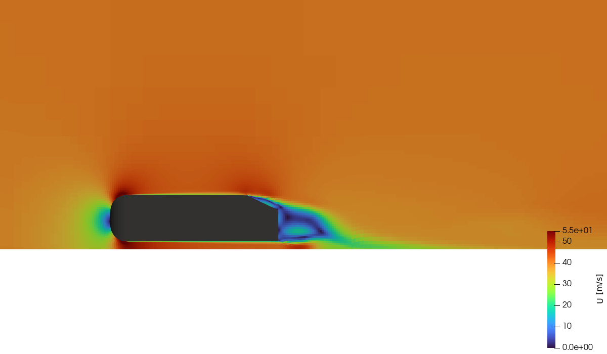
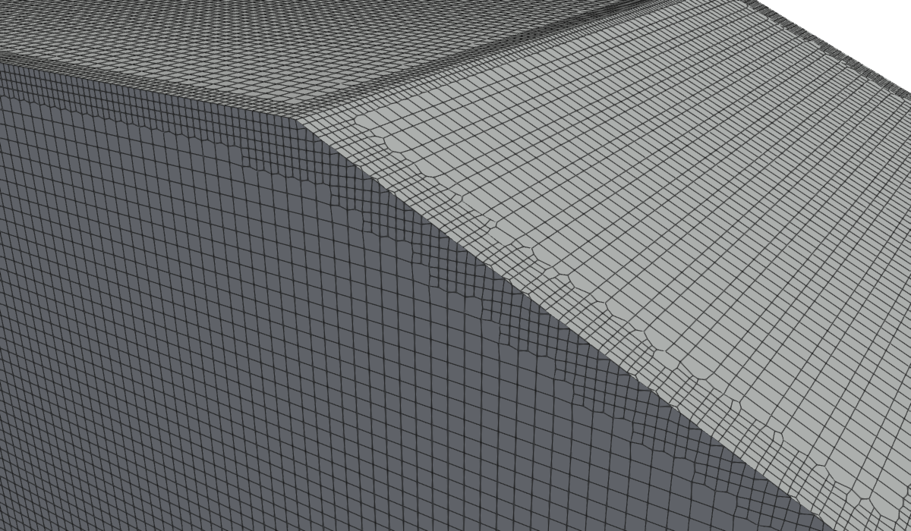
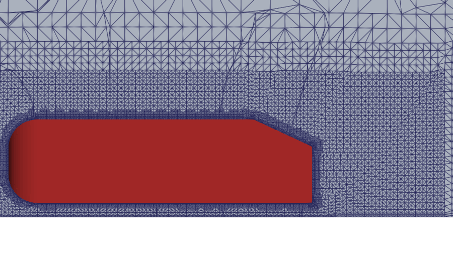
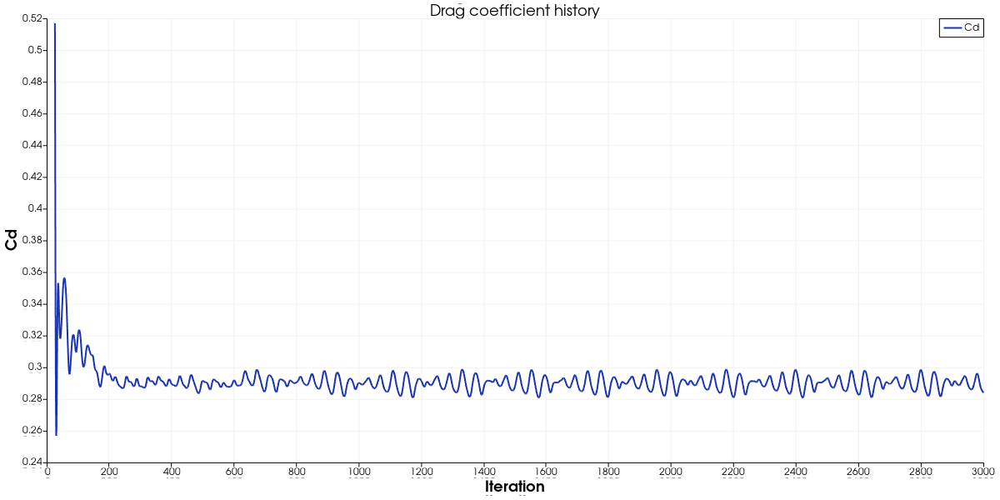
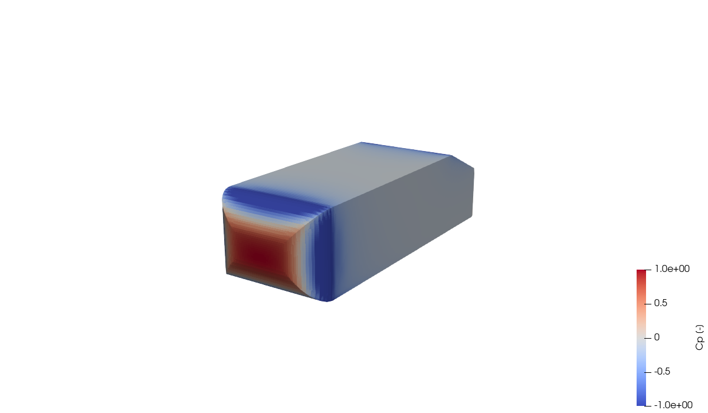
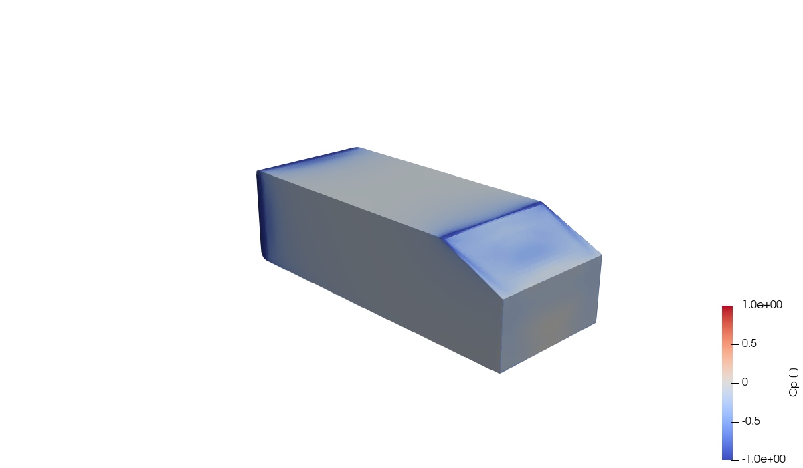

# Ahmed Body Aerodynamics


Steady-state RANS simulation of turbulent flow around the Ahmed
reference body (25° slant, without stilts) using **simpleFoam** with **k-$\omega$ SST** turbulence
modelling. The case covers the complete workflow of an external-aerodynamics
simulation: STL geometry, snappyHexMesh body-fitted meshing with boundary
layers, a parallel steady solve, and force-coefficient monitoring against the
classic automotive-aerodynamics benchmark.

The geometry is the **standard** Ahmed body (100 mm radius on the four front
edges, 25° rear slant) but **without the four stilts** that hold the
experimental model; the body floats 50 mm above the ground (see
[Geometry](#geometry--the-ahmed-body-stl)). In the dictionary listings below the OpenFOAM banner and `FoamFile` header are
omitted.



*Velocity magnitude in the centre plane y = 0 at iteration 3000 (25° slant, instantaneous state of a steady solve whose Cd oscillates by about 3 %, see [Expected Results](#expected-results)). Look at the attached flow over the rounded nose and roof, the accelerated flow under the body and the wake behind the slant and base.*

---

## Goal

After working through this case you should be able to:

- generate and place an STL body in a blockMesh background domain and refine it
  with `snappyHexMesh` (feature edges, surface and region refinement, boundary
  layers) in parallel;
- set up a steady incompressible RANS case with wall functions and derive the
  inlet `k` and `omega` from a turbulence intensity and length scale;
- monitor drag and lift with `forceCoeffs`, and choose `Aref`, `lRef`, `magUInf`
  and `CofR` consistently with the geometry and the inlet velocity;
- judge a result with mesh checks, residuals, $y^+$ and force-coefficient
  convergence instead of by eye.

---

## Target

| Quantity | Target | Basis |
|---|---|---|
| Flow condition | $U_\infty$ = 40 m/s, $\nu = 1.5 \times 10^{-5}$ m$^2$/s, $Re_L$ = 2.78e6, $Re_H$ = 7.68e5 | case files |
| Mesh | about 1.0 M cells, 5 prism layers on the body, max non-orthogonality < 65°, max skewness < 4, `checkMesh` reports `Mesh OK` | measured: 968,553 cells, 4.98 layers, 64.7°, 2.38 |
| Wall treatment | average $y^+$ on the body between 30 and 300 (wall functions) | measured: 61.5 (min 12.8, max 142.6) at iteration 3000 |
| Convergence | residuals of `p`, `U`, `k`, `omega` below 1e-5, or `Cd` constant within 1 % over the last 200 iterations (typically 1500-3000 iterations) | `residualControl` in `fvSolution`; **residual targets not reached** (the run used all 3000 iterations, `Uy`/`Uz` residuals stay near 1e-2); **Cd not constant within 1 %**: it oscillates with a period of about 40 iterations (5.6 % peak-to-peak over the last 200 iterations), but its mean is steady within 0.1 % |
| Drag coefficient, 25° slant | Cd = 0.285 $\pm$ 25 % (0.214 ... 0.356) | experiment, Ahmed et al. (1984) |
| Drag coefficient, 35° slant | Cd = 0.260 $\pm$ 25 % | commonly cited experimental value |

About the Cd target: 0.285 is the measured drag coefficient of the standard
25° Ahmed body (Ahmed, Ramm and Faltin 1984, as cited in the COMSOL Ahmed body
benchmark and ERCOFTAC test case AC1-05; it was not re-read from the original
paper here). The experiment was made at 60 m/s with stilts; this case runs at
40 m/s without stilts. RANS with wall functions typically lands within about
$\pm$ 20–30 % of the experiment, so the tolerance is set to 25 %.

**Status of this case:** the full 3000-iteration run was completed (4 ranks,
about 2.7 h) without errors; `verify.py` reports 22 PASS, 0 FAIL, 0 SKIP.
The convergence check compares window means, not instantaneous values. The
first version of the check required the instantaneous Cd to stay within 1 %
peak-to-peak over the last 200 iterations; it **failed** on this run (5.58 %),
and the check was changed because it measured the wrong thing for a
periodic limit cycle, not to hide a problem: after the start-up transient (about 200 iterations) Cd does not settle
at a constant value but oscillates periodically between 0.281 and 0.299 with a
period of about 40 iterations (5.6 % peak-to-peak over the last 200
iterations, standard deviation 0.004). The mean is steady: 0.2900 over the last
200 iterations and 0.2903 over the 200 before (0.1 % apart), and the means of
successive 500-iteration blocks from iteration 500 to 3000 are 0.2906, 0.2900,
0.2902, 0.2900 and 0.2901. The mean Cd of 0.290 is 1.8 % above the experimental
0.285 and inside the target band, so the physical result is usable. The
peak-to-peak spread is still printed by `verify.py` as an `INFO` line so the
oscillation stays visible. The residual targets of 1e-5 are not reached either (the
transverse momentum residuals `Uy`, `Uz` stay near 1e-2). The oscillation is
most likely the unsteady wake of the bluff body, which a steady SIMPLE
iteration with the second-order `linearUpwind` scheme resolves as a limit
cycle; this explanation was not tested here (for example with a first-order
`div(phi,U)` scheme or a transient run).

---

## Verification method

After `./run_docker.sh` (which calls it as its last step) or after `./Allrun`,
run

```bash
python3 verify.py                 # reads log.* and postProcessing/, no Docker needed
python3 verify.py --slant-angle 35
```

It prints one `PASS`, `FAIL` or `SKIP` line per check and exits with 0 only if
nothing failed (1 on a failed check, 2 if logs are missing). Checks that only
make sense for a finished run are `SKIP`ped when the solver was interrupted
before `endTime`/convergence, and the summary says so. For a finished run it
also prints an `INFO` line with the mean, standard deviation and range of Cd
over the last 200 iterations and the mean of the 200 before.

| Check | What it proves | Expected | Tolerance and reason | Measured |
|---|---|---|---|---|
| `stl_slant_angle` | STL has the requested slant | 25.0° | $\pm$ 0.05° (STL written with 7 digits) | 25.00° |
| `stl_watertight` | STL is a closed surface (each edge shared by two triangles with opposite orientation) | 0 open edges | exact | 0 open edges, 116 triangles |
| `stl_outward_positive_volume` | normals point outward (positive volume) and the volume is that of the rounded, slanted box | 0.102 ... 0.1133 m$^3$ | upper bound: box minus slant wedge; lower: 10 % below | 0.11074 m$^3$ |
| `Aref_equals_STL_frontal_area` | `Aref` in `forceCoeffs` is the projected frontal area of the STL | 0.112032 m$^2$ | 0.1 % (rounding) | 0.112032 m$^2$ |
| `stl_nose_radius` | the four front edges have R = 100 mm | 0.100 m | $\pm$ 1 mm | 0.1000 m |
| `lRef_equals_body_length` | `lRef` is the body length | 1.044 m | 0.1 % (rounding) | 1.0440 m |
| `magUInf_equals_inlet_velocity` | coefficients use the real inlet speed | 40 m/s | exact | 40.000 m/s |
| `CofR_at_body_centre` | moment centre at mid length/height, y = 0 | (0.522 0 0.194) | 1 % of L, H | (0.522 0.000 0.194) |
| `snappyHexMesh_finished` | meshing completed | "Finished meshing without any errors" | - | finished |
| `body_layers_added` | all requested layers were grown | 5 | $\pm$ 0.5 (average layers per face) | 4.98 |
| `body_layer_thickness_pct` | layers reach the requested thickness | $\geq$ 80 % | rule of thumb for acceptable layer coverage | 90 % |
| `cell_count` | mesh size is as designed | 1.0e6 | $\pm$ 15 % (different subdomain counts give slightly different snappy meshes) | 968,553 |
| `checkMesh_Mesh_OK` | serial `checkMesh` passes | `Mesh OK.` | - | Mesh OK |
| `max_non_orthogonality` | below the snappy `maxNonOrtho` limit | < 65° | = `meshQualityControls` | 64.7° |
| `max_skewness` | below the snappy `maxInternalSkewness` limit | < 4 | = `meshQualityControls` | 2.38 |
| `solver_no_fatal_error` | simpleFoam ran without `FOAM FATAL` | $\geq$ 1 iteration, no error | - | 3000 iterations, no error |
| `residual_drop_p`, `residual_drop_Ux` | SIMPLE is converging | final/max initial residual $\leq$ 0.1 | one decade is the minimum sign of convergence | 2.0e-4 / 3.1e-4 |
| `yPlus_body_average` | wall functions are used in their range | 30 ... 300 | log-law validity range | 61.5 (min 12.8, max 142.6) |
| `Cd_finite_positive` | force coefficients are written and sane | finite, > 0 | - | 0.2843 (iteration 3000, instantaneous) |
| `Cd_in_literature_band` (full run only) | drag agrees with the standard Ahmed body | 0.285 (25°) / 0.260 (35°) | $\pm$ 25 % (RANS wall-function scatter 20–30 %) | **PASS**, 0.2900 (mean of the last 200 iterations, +1.8 %) |
| `Cd_converged` (full run only) | the mean force coefficient is steady | mean of the last 200 iterations within 1 % of the mean of the 200 before | iterations 2801-3000 vs 2601-2800 | 0.10 % drift (the instantaneous Cd oscillates by 5.6 % peak-to-peak around that mean, printed as an `INFO` line; see Status) |

Manual (visual) checks, in addition:

- in ParaView the `ahmed_body` patch is a closed surface and the refinement is
  concentrated around the body and in the wake box (compare
  `images/mesh_centreplane.png`);
- in the centre plane the velocity is about 40 m/s ahead of the body, a
  stagnation point sits at the nose, and a low-velocity wake extends behind
  the vertical base;
- `Cp` is close to 1 on the front face and negative on the roof, sides and base
  (compare `images/cp_body_front.png`).

---

## Table of Contents

1. [Problem Description](#problem-description)
2. [Physics and Theory](#physics-and-theory)
3. [Case Directory Structure](#case-directory-structure)
4. [Geometry — the Ahmed Body STL](#geometry--the-ahmed-body-stl)
5. [Mesh Strategy](#mesh-strategy)
6. [Boundary Conditions](#boundary-conditions)
7. [Turbulence Setup — k-$\omega$ SST](#turbulence-setup--k-ω-sst)
8. [Solver Configuration](#solver-configuration)
9. [Parallel Decomposition](#parallel-decomposition)
10. [Force Coefficient Monitoring](#force-coefficient-monitoring)
11. [Running the Case](#running-the-case)
12. [Expected Results](#expected-results)
13. [Post-Processing Guide](#post-processing-guide)
14. [Exercises](#exercises)
15. [References](#references)
16. [Troubleshooting](#troubleshooting)

---

## Problem Description

The **Ahmed body** is a simplified, generic car shape introduced by Ahmed,
Ramm, and Faltin in 1984. It was designed to capture the essential aerodynamic
features of a road vehicle — particularly the rear-end flow separation and wake
structure — while being simple enough to manufacture accurately and simulate
reproducibly.

Side view (dimensions of the STL used in this case, all in mm, $z$ measured
from the ground):

```
                R 100            slant start x = 843
                 ╭───────────────────────────╲
      z = 338  ──╯                            ╲ slant: 25°, 222 mm long
                │                              ╲
                │              288              │  z = 194
                │                               │
      z = 50  ──╮                               │
                 ╰──────────────────────────────┘
      z = 0    ═══════════════════════════════════  ground (moving wall, 40 m/s)
               x = 0                        x = 1044
               (nose)                       (rear base)    flow ──────►
```

The front edges (top, bottom and both sides) have R = 100 mm, so the flat part
of the front face is 88 mm high and 189 mm wide. The roof/side edges and the
rear edges are sharp.

Front view (looking against the flow):

```
        ┌──────────┐ z = 338
        │          │
        │          │ 288 mm
        └──────────┘ z = 50   (50 mm ground clearance)
          389 mm
         y = -194.5 ... +194.5
```

### Standard Dimensions

| Parameter | Standard Ahmed body | This case's STL |
|---|---|---|
| Overall length | 1044 mm | 1044 mm |
| Width | 389 mm | 389 mm |
| Height | 288 mm | 288 mm |
| Ground clearance | 50 mm | 50 mm |
| Front-body radius | 100 mm | 100 mm (all four front edges) |
| Rear slant angle (baseline) | 25° | 25° (35° with `--slant 35`) |
| Slant length | 222 mm | 222 mm |
| Stilts | 4 cylindrical legs, Ø 30 mm | none (body floats above the ground) |

### Why the Ahmed Body Matters

The Ahmed body is a standard benchmark for automotive computational fluid
dynamics (CFD) validation. Many turbulence models, meshing strategies, and
solver settings used in vehicle aerodynamics have been tested against Ahmed
body data. Its value comes from:

- **Geometric simplicity** — the shape is fully defined by a handful of
  dimensions, so every research group is solving the same problem.
- **Rich flow physics** — despite the simple geometry, the flow contains
  separation, reattachment, longitudinal vortices, and a complex three-
  dimensional wake.
- **Extensive experimental database** — Ahmed et al. (1984) provided drag
  measurements across a range of slant angles, and Lienhart, Stoots, and
  Becker (2003) later added detailed LDA velocity profiles and Reynolds-stress
  measurements that are widely used for RANS validation.
- **Critical slant-angle sensitivity** — at approximately 30°, the rear-slant
  flow undergoes a dramatic topological change from an attached, vortex-
  dominated regime to a fully separated wake, providing a stringent test of
  turbulence-model accuracy.

---

## Physics and Theory

### Flow Regime

The test condition uses a freestream velocity of **$U_\infty$ = 40 m/s** in
air ($\nu = 1.5 \times 10^{-5}$ m$^2$/s). Based on the body height $H = 0.288$ m:

$$Re_H = U_\infty \cdot H / \nu = 40 \times 0.288 / (1.5 \times 10^{-5}) \approx 768{,}000$$

Based on the body length $L = 1.044$ m, $Re_L = U_\infty L/\nu \approx 2.78 \times 10^6$.
The flow is **fully turbulent external flow**. (Ahmed et al. measured at 60 m/s,
$Re_L \approx 4.3 \times 10^6$; the drag of this bluff body is only weakly
Reynolds-number dependent at these values.)

### Wake Structure

On the standard body the wake is dominated by three interacting vortex
systems:

1. **A-pillar vortices** — generated along the rounded front edges of the body,
   these are relatively weak and dissipate quickly.
2. **C-pillar (longitudinal) vortices** — the most prominent feature. These
   counter-rotating vortex pairs roll up from the lateral edges of the rear
   slant and trail far downstream. They are the dominant source of induced drag
   at slant angles below 30°.
3. **Recirculation zone** — a near-wake region of reversed flow immediately
   behind the vertical base. Its size and shape depend strongly on the slant
   angle.

### Drag Breakdown

Total aerodynamic drag on the Ahmed body comes from two contributions:

- **Pressure drag (form drag)** — dominates. Comes from the low-pressure wake
  behind the base and the suction on the rear slant. Commonly quoted: roughly
  70–80 % of the total (not computed by this case).
- **Skin-friction drag** — accounts for the remaining 20–30 % (same caveat).
  Due to the bluff shape, this is much smaller than for a streamlined body.

The split is not computed by this case's `forceCoeffs` output (which reports
total, front and rear contributions); use the `forces` function object if you
need the pressure/viscous split.

### The Critical Slant Angle

At slant angles below roughly 30°, the flow over the rear slant stays partially
attached. Strong C-pillar vortices form and actually help maintain attachment
through downwash. As the slant angle increases toward 30°, vortex strength
grows and drag increases.

At approximately **30°**, the rear-slant flow **separates completely**. The
C-pillar vortices collapse, and the wake transitions from a three-dimensional,
vortex-dominated topology to a quasi-two-dimensional, fully separated wake.
Drag drops abruptly.

This sharp transition is difficult for RANS turbulence models to capture
accurately, which is what makes the Ahmed body such a demanding validation
case.

### Ground Effect

The 50 mm ground clearance creates an accelerated flow passage underneath the
body. This under-body flow interacts with the wake, and the ground boundary
condition (stationary vs. moving wall) has a noticeable effect on the predicted
drag and wake symmetry. This case uses a moving ground (see
[Boundary Conditions](#boundary-conditions)).

### Turbulence Model Selection

**k-$\omega$ SST** (Menter 1994) is the recommended turbulence model for this case:

- Blends k-$\omega$ near walls (superior for adverse-pressure-gradient boundary layers)
  with k-$\varepsilon$ in the freestream (avoids the freestream sensitivity of standard k-$\omega$).
- Includes a shear-stress-transport limiter that prevents over-prediction of
  turbulent shear stress in adverse-pressure-gradient flows — important for
  predicting separation on the rear slant.
- Widely used and validated for external vehicle aerodynamics.
- **k-$\varepsilon$ models** are reported to over-predict the attachment on the slant
  (and so mis-predict drag) because they over-estimate turbulent mixing.

---

## Case Directory Structure

```
06_ahmed_body_aerodynamics/
├── 0/
│   ├── U                          # Velocity field
│   ├── p                          # Pressure field (kinematic)
│   ├── k                          # Turbulent kinetic energy
│   ├── omega                      # Specific dissipation rate
│   └── nut                        # Turbulent viscosity
├── constant/
│   ├── transportProperties        # Fluid properties (nu)
│   ├── turbulenceProperties       # RANS / k-omega SST selection
│   └── triSurface/
│       └── ahmed_body.stl         # Surface geometry for snappyHexMesh
├── system/
│   ├── controlDict                # Run control, includes forceCoeffs and yPlus
│   ├── forceCoeffs                # Drag/lift coefficient function object
│   ├── fvSchemes                  # Discretisation schemes
│   ├── fvSolution                 # Linear solvers & SIMPLE settings
│   ├── blockMeshDict              # Background hex mesh
│   ├── snappyHexMeshDict          # Body-fitted mesh with refinement
│   ├── surfaceFeatureExtractDict  # Feature-edge extraction
│   └── decomposeParDict           # Domain decomposition for MPI
├── generate_ahmed_body.py         # Writes constant/triSurface/ahmed_body.stl
├── Allrun / Allclean              # Run / clean the case (inside OpenFOAM)
├── run_docker.sh                  # Clean, generate STL, Allrun in Docker, verify
├── verify.py                      # Checks the logs and force coefficients
├── render_figures.py              # pvbatch script that made images/*.png
├── open_paraview.sh               # Opens the case in ParaView
└── images/                        # Figures used in this README
```

---

## Geometry — the Ahmed Body STL

The case needs an STL surface of the Ahmed body located in the computational
domain with the long axis along **x**, width along **y**, and height along **z**.

### Option 0 — Generator script (used by this case)

`generate_ahmed_body.py` (Python 3, standard library only) writes a
116-triangle ASCII STL of the standard body (without stilts) and
`run_docker.sh` calls it before every run:

```bash
python3 generate_ahmed_body.py                    # 25° slant (default)
python3 generate_ahmed_body.py --slant-angle 35   # 35° slant
python3 generate_ahmed_body.py --nose-radius 0    # sharp front edges
```

How it is built: every cross-section is a rectangle whose size depends only on
$x$. Over the first 100 mm the section shrinks on all four sides by
$R - \sqrt{R^2 - (R - x)^2}$ (a quarter circle in the side and plan views,
12 segments of 7.5° each), then stays 389 $\times$ 288 mm until the slant
starts at $x = 1.044 - 0.222 \cos 25° = 0.843$ m, where the roof descends at 25°.
This keeps the longitudinal and rear edges sharp, as on the real body. Where the
top and side fillets meet, the corner is the intersection of two cylinders
instead of a sphere octant; the deviation is below the mesh size. `verify.py`
checks the STL: closed surface (every edge shared by two triangles with
opposite orientation), positive volume (outward normals), a frontal area equal
to `Aref`, and the 100 mm front inset. Measured: 116 triangles, volume
0.110744 m$^3$, frontal area 0.112032 m$^2$.

The nose is at x = 0, the body is centred on y = 0 and its underside is at
z = 0.05 m. The stilts are omitted. The committed
`constant/triSurface/ahmed_body.stl` is the 25° output.

### Option 1 — Download

Several public repositories provide Ahmed body STL files:

- The original OpenFOAM tutorial collection on GitLab
- GrabCAD / Thingiverse (search "Ahmed body CFD")
- University course material repositories

Make sure the dimensions match the standard specification above and that the
body is oriented with the long axis along **x**, width along **y**, and height
along **z**.

### Option 2 — Create in FreeCAD

1. Open FreeCAD → Part workbench.
2. Create a box: 1044 $\times$ 389 $\times$ 288 mm.
3. Fillet the front face edges with radius = 100 mm.
4. Cut the rear-top edge at 25° to form the slant.
5. Add four cylindrical stilts (Ø 30 mm, length 50 mm).
6. Export as STL (binary, fine resolution).

### Option 3 — Parametric Script (OpenSCAD)

```openscad
// Ahmed body without stilts and without front radius (sharp front edges),
// dimensions in mm; add the 100 mm front radius in CAD or use the Python script
module ahmed_body() {
    difference() {
        cube([1044, 389, 288], center=false);
        // Rear slant cut at 25 degrees: the slant is 222 mm long, so it
        // starts 222*cos(25) = 201 mm in front of the rear face
        translate([1044 - 222*cos(25), 0, 288])
            rotate([0, 25, 0])
                cube([400, 389, 400], center=false);
    }
}
translate([0, 0, 50])  // Ground clearance
    ahmed_body();
```

Scale to metres (0.001) before export, and centre the body on y = 0
(`translate([0, -194.5, 50])`) if you use it with this case's domain.

### Positioning the STL

Place the body so that:

- The nose is at x = 0 and the domain starts 5 m (about 4.8 L) upstream, so the
  approach flow is undisturbed.
- The body is centred in y (symmetry plane at y = 0 if using a half-model).
- The underside of the body is at z = 0.05 m above the ground plane (z = 0).
  For a model with stilts, the bottom of the stilts sits on the ground plane.

---

## Mesh Strategy

Meshing is the single most important factor for accuracy in external automotive
CFD. The Ahmed body requires careful attention to:

- Adequate domain size
- Surface and volume refinement
- Boundary-layer resolution
- Wake refinement

### Domain Sizing

Use the body length L = 1.044 m as the reference:

| Boundary | Distance from body | Patch name / type |
|---|---|---|
| Inlet | 5.0 m (about 5 L) upstream of nose | `inlet` / patch |
| Outlet | 11.0 m (about 10 L) downstream of base | `outlet` / patch |
| Lateral walls | 5.0 m (about 5 L) from body centreline | `side_left`, `side_right` / symmetryPlane |
| Top | 5.0 m (about 5 L) above ground | `top` / symmetryPlane |
| Ground | z = 0 (coincides with floor) | `ground` / wall |
| Body | STL surface | `ahmed_body` / wall (created by snappyHexMesh) |

This gives a domain of:

- x: -5.0 m to +12.0 m (17 m total)
- y: -5.0 m to +5.0 m (10 m total)
- z: 0.0 m to 5.0 m (5 m total)

The blockage of the body ($0.112$ m$^2$ against $10 \times 5$ m$^2$) is 0.2 %.

```
 Side view (y = 0), not to scale

   top (symmetryPlane)  z = 5 m
  ┌──────────────────────────────────────────────────┐
  │                                                  │
  │ inlet               ┌────┐                outlet │
  │ U = 40 m/s  ──►     │body│   wake  ──►     p = 0 │
  │ k, omega fixed      └────┘                       │
  └──────────────────────────────────────────────────┘
   ground (wall, moving at 40 m/s)  z = 0
  x = -5 m             x = 0..1.044             x = 12 m
```

### blockMeshDict — Background Mesh

```cpp
scale   1;

vertices
(
    ( -5.0  -5.0   0.0 )   // 0
    ( 12.0  -5.0   0.0 )   // 1
    ( 12.0   5.0   0.0 )   // 2
    ( -5.0   5.0   0.0 )   // 3
    ( -5.0  -5.0   5.0 )   // 4
    ( 12.0  -5.0   5.0 )   // 5
    ( 12.0   5.0   5.0 )   // 6
    ( -5.0   5.0   5.0 )   // 7
);

blocks
(
    hex (0 1 2 3 4 5 6 7) (85 50 25) simpleGrading (1 1 1)
);

edges
(
);

boundary
(
    inlet
    {
        type patch;
        faces
        (
            (0 4 7 3)
        );
    }

    outlet
    {
        type patch;
        faces
        (
            (1 2 6 5)
        );
    }

    ground
    {
        type wall;
        faces
        (
            (0 3 2 1)
        );
    }

    top
    {
        type symmetryPlane;
        faces
        (
            (4 5 6 7)
        );
    }

    side_left
    {
        type symmetryPlane;
        faces
        (
            (0 1 5 4)
        );
    }

    side_right
    {
        type symmetryPlane;
        faces
        (
            (3 7 6 2)
        );
    }
);

mergePatchPairs
(
);
```

This gives a base mesh of 106,250 cells after snappyHexMesh's first step
(85 $\times$ 50 $\times$ 25 = 106,250). The cell size is 0.2 m, which
snappyHexMesh refines down to the required resolution.

### surfaceFeatureExtractDict

```cpp
ahmed_body.stl
{
    extractionMethod    extractFromSurface;

    extractFromSurfaceCoeffs
    {
        includedAngle   170;
    }

    writeObj            yes;
}
```

`includedAngle 170` extracts edges whose included angle between the adjacent
faces is below 170°. With the previous value 150 the edge where the roof meets
the 25° slant (included angle 155°) was missed, although it is where the flow
separates; 170 captures it (and all slants steeper than 10°). The 7.5° facets of
the nose fillets (included angle 172.5°) stay below the threshold, so the
fillets are not treated as feature edges. The log reports 57 external feature
edges: the sharp body edges plus the mitre curves where the top and side
fillets meet. Result: `constant/extendedFeatureEdgeMesh/ahmed_body.eMesh`, used
by `features` (level 6, 3 mm) in snappyHexMeshDict. The 100 mm fillets are
refined by `refinementSurfaces` level 5 (6.25 mm, 16 cells along each quarter
circle).

### snappyHexMeshDict

```cpp
castellatedMesh true;
snap            true;
addLayers       true;

geometry
{
    ahmed_body.stl
    {
        type triSurfaceMesh;
        name ahmed_body;
    }

    refinementBox_body
    {
        type searchableBox;
        min ( -0.5  -0.4   0.0 );
        max (  2.0   0.4   0.6 );
    }

    refinementBox_wake
    {
        type searchableBox;
        min (  1.0  -0.6   0.0 );
        max (  4.0   0.6   0.6 );
    }

    refinementBox_near
    {
        type searchableBox;
        min ( -0.2  -0.3   0.0 );
        max (  1.5   0.3   0.5 );
    }
}

castellatedMeshControls
{
    maxLocalCells       1000000;
    maxGlobalCells      5000000;
    minRefinementCells  10;
    maxLoadUnbalance    0.10;
    nCellsBetweenLevels 3;

    features
    (
        {
            file "ahmed_body.eMesh";
            level 6;
        }
    );

    refinementSurfaces
    {
        ahmed_body
        {
            level (5 6);

            patchInfo
            {
                type wall;
            }
        }
    }

    resolveFeatureAngle 30;

    refinementRegions
    {
        refinementBox_near
        {
            mode inside;
            levels ((1e15 4));
        }

        refinementBox_body
        {
            mode inside;
            levels ((1e15 3));
        }

        refinementBox_wake
        {
            mode inside;
            levels ((1e15 3));
        }
    }

    locationInMesh (3.0 0.0 2.5);

    allowFreeStandingZoneFaces true;
}

snapControls
{
    nSmoothPatch    3;
    tolerance       2.0;
    nSolveIter      100;
    nRelaxIter      5;

    nFeatureSnapIter 10;
    implicitFeatureSnap false;
    explicitFeatureSnap true;
    multiRegionFeatureSnap false;
}

addLayersControls
{
    relativeSizes   true;

    layers
    {
        "ahmed_body.*"
        {
            nSurfaceLayers 5;
        }
        ground
        {
            nSurfaceLayers 3;
        }
    }

    expansionRatio          1.2;
    finalLayerThickness     0.5;
    minThickness            0.1;
    nGrow                   0;
    featureAngle            130;
    slipFeatureAngle        30;
    nRelaxIter              5;
    nSmoothSurfaceNormals   1;
    nSmoothNormals          3;
    nSmoothThickness        10;
    maxFaceThicknessRatio   0.5;
    maxThicknessToMedialRatio 0.3;
    minMedialAxisAngle      90;
    nBufferCellsNoExtrude   0;
    nLayerIter              50;
}

meshQualityControls
{
    maxNonOrtho     65;
    maxBoundarySkewness 20;
    maxInternalSkewness 4;
    maxConcave      80;
    minVol          1e-13;
    minTetQuality   -1e30;
    minArea         -1;
    minTwist        0.02;
    minDeterminant  0.001;
    minFaceWeight   0.02;
    minVolRatio     0.01;
    minTriangleTwist -1;

    nSmoothScale    4;
    errorReduction  0.75;
}

writeFormat ascii;

mergeTolerance 1e-6;
```

Key entries:

| Entry | Meaning |
|---|---|
| `refinementSurfaces ... level (5 6)` | surface cells between level 5 (6.25 mm) and level 6 (3.1 mm); the maximum applies at feature edges and curvature |
| `features ... level 6` | feature edges refined to level 6 |
| `refinementBox_near` level 4 (12.5 mm) | fine region around the body |
| `refinementBox_body`, `refinementBox_wake` level 3 (25 mm) | body vicinity and wake |
| `nCellsBetweenLevels 3` | smooth transition between refinement levels |
| `locationInMesh (3 0 2.5)` | point in the fluid, outside the body |
| `patchInfo { type wall; }` | the STL becomes a `wall` patch named `ahmed_body` |
| `layers`: `ahmed_body` 5, `ground` 3 | prism layers on the body and on the floor |
| `relativeSizes true`, `expansionRatio 1.2`, `finalLayerThickness 0.5` | thickness of the outermost layer is 50 % of the local cell size |
| `maxNonOrtho 65`, `maxInternalSkewness 4` | mesh quality limits that the `verify.py` mesh checks reuse |
| `minTetQuality -1e30` | tet-quality criterion disabled (see the `checkMesh -allGeometry` note below) |

### Mesh Quality Targets

| Metric | Target | Measured in this case |
|---|---|---|
| y+ on body | ~30–300 (wall functions) or ~1 (resolved) | average 61.5, min 12.8, max 142.6 at iteration 3000 (ground: average 182, max 1840) |
| Surface refinement | Level 5–6 (~3–6 mm cells) | as set |
| Wake refinement | Level 3 (~25 mm cells) | as set |
| Boundary layers on body | 5 layers, expansion ratio 1.2 | 4.98 layers, 90 % of requested thickness |
| Total cell count | ~1 million | 968,553 |

`checkMesh -allGeometry -allTopology` is stricter than the checks that
snappyHexMesh applies (`minTetQuality` is disabled in `meshQualityControls`).
In an earlier run of the sharp-nose variant with 6 subdomains (996,610 cells) it reported 49
faces with low-quality decomposition tets and 27,893 concave cells (by the
face-plane criterion) in addition to 62.0° maximum non-orthogonality and 2.39
maximum skewness. The standard `checkMesh` run by `Allrun` reports `Mesh OK`.

The log of snappyHexMesh gives the overall layer thickness on the body: 0.00825 m
for five layers, i.e. a first layer of about 1.1 mm (estimated from the geometric series). For wall functions the first cell
centre should sit in the log layer ($y^+$ = 30–300); the five-layer stack relies on
`omegaWallFunction` and `kqRWallFunction`/`nutkWallFunction` for the
near-wall treatment. Resolving the viscous sublayer ($y^+ \approx 1$) would need a
first layer of roughly 0.01–0.02 mm and a different set of wall boundary
conditions.



*Surface mesh of the `ahmed_body` patch around the top of the slant (looking from the rear-left). Look at the cell size (3–6 mm), the finer cells along the slant edges and the layer of small cells next to the edges.*



*Mesh in the plane y = 0 (the cut is triangulated by ParaView). The body is the red block. Note the nested refinement boxes (levels 3 and 4) and the thin prism layers on the body. The coarse 0.2 m background cells are outside this view.*

---

## Boundary Conditions

```
 patch        U                  p              k / omega / nut
 inlet        fixedValue 40 0 0  zeroGradient   fixedValue (0.24 / 90) / calculated
 outlet       zeroGradient       fixedValue 0   zeroGradient / calculated
 ground       fixedValue 40 0 0  zeroGradient   wall functions (moving wall)
 ahmed_body   noSlip             zeroGradient   wall functions
 top, side_*  symmetryPlane (all fields)
```

The ground is a **moving wall** (`fixedValue (40 0 0)`): it simulates the road
moving with the free stream speed and avoids a ground boundary layer building
up under the body. Use `noSlip` instead for a stationary-ground simulation.

### Velocity — `0/U`

```cpp
dimensions      [0 1 -1 0 0 0 0];

internalField   uniform (40 0 0);

boundaryField
{
    inlet
    {
        type            fixedValue;
        value           uniform (40 0 0);
    }

    outlet
    {
        type            zeroGradient;
    }

    ground
    {
        type            fixedValue;
        value           uniform (40 0 0);
    }

    top
    {
        type            symmetryPlane;
    }

    side_left
    {
        type            symmetryPlane;
    }

    side_right
    {
        type            symmetryPlane;
    }

    ahmed_body
    {
        type            noSlip;
    }
}
```

### Pressure — `0/p`

```cpp
dimensions      [0 2 -2 0 0 0 0];

internalField   uniform 0;

boundaryField
{
    inlet
    {
        type            zeroGradient;
    }

    outlet
    {
        type            fixedValue;
        value           uniform 0;
    }

    ground
    {
        type            zeroGradient;
    }

    top
    {
        type            symmetryPlane;
    }

    side_left
    {
        type            symmetryPlane;
    }

    side_right
    {
        type            symmetryPlane;
    }

    ahmed_body
    {
        type            zeroGradient;
    }
}
```

### Turbulent Kinetic Energy — `0/k`

Inlet values are calculated from freestream turbulence intensity I = 1 % and
length scale l = 0.01 m:

$$k = 1.5 \cdot (U_\infty \cdot I)^2 = 1.5 \cdot (40 \cdot 0.01)^2 = 0.24 \text{ m}^2/\text{s}^2$$

```cpp
dimensions      [0 2 -2 0 0 0 0];

internalField   uniform 0.24;

boundaryField
{
    inlet
    {
        type            fixedValue;
        value           uniform 0.24;
    }

    outlet
    {
        type            zeroGradient;
    }

    ground
    {
        type            kqRWallFunction;
        value           uniform 0.24;
    }

    top
    {
        type            symmetryPlane;
    }

    side_left
    {
        type            symmetryPlane;
    }

    side_right
    {
        type            symmetryPlane;
    }

    ahmed_body
    {
        type            kqRWallFunction;
        value           uniform 0.24;
    }
}
```

### Specific Dissipation Rate — `0/omega`

$$\omega = k^{0.5} / (C_\mu^{0.25} \cdot l) = 0.24^{0.5} / (0.09^{0.25} \cdot 0.01) \approx 89.4 \text{ s}^{-1}$$

Rounding to **90 s$^{-1}$** for the inlet value.

```cpp
dimensions      [0 0 -1 0 0 0 0];

internalField   uniform 90;

boundaryField
{
    inlet
    {
        type            fixedValue;
        value           uniform 90;
    }

    outlet
    {
        type            zeroGradient;
    }

    ground
    {
        type            omegaWallFunction;
        value           uniform 90;
    }

    top
    {
        type            symmetryPlane;
    }

    side_left
    {
        type            symmetryPlane;
    }

    side_right
    {
        type            symmetryPlane;
    }

    ahmed_body
    {
        type            omegaWallFunction;
        value           uniform 90;
    }
}
```

### Turbulent Viscosity — `0/nut`

```cpp
dimensions      [0 2 -1 0 0 0 0];

internalField   uniform 0;

boundaryField
{
    inlet
    {
        type            calculated;
        value           uniform 0;
    }

    outlet
    {
        type            calculated;
        value           uniform 0;
    }

    ground
    {
        type            nutkWallFunction;
        value           uniform 0;
    }

    top
    {
        type            symmetryPlane;
    }

    side_left
    {
        type            symmetryPlane;
    }

    side_right
    {
        type            symmetryPlane;
    }

    ahmed_body
    {
        type            nutkWallFunction;
        value           uniform 0;
    }
}
```

### Boundary Condition Summary

| Patch | U | p | k | omega | nut |
|---|---|---|---|---|---|
| inlet | fixedValue (40 0 0) | zeroGradient | fixedValue 0.24 | fixedValue 90 | calculated |
| outlet | zeroGradient | fixedValue 0 | zeroGradient | zeroGradient | calculated |
| ground | fixedValue (40 0 0) | zeroGradient | kqRWallFunction | omegaWallFunction | nutkWallFunction |
| top | symmetryPlane | symmetryPlane | symmetryPlane | symmetryPlane | symmetryPlane |
| side_left | symmetryPlane | symmetryPlane | symmetryPlane | symmetryPlane | symmetryPlane |
| side_right | symmetryPlane | symmetryPlane | symmetryPlane | symmetryPlane | symmetryPlane |
| ahmed_body | noSlip | zeroGradient | kqRWallFunction | omegaWallFunction | nutkWallFunction |

The patch names in `0/` must match the patches created by blockMesh and
snappyHexMesh; in particular `ahmed_body` only exists after meshing, which is why
`Allrun` decomposes the fields after the mesh is built.

---

## Turbulence Setup — k-$\omega$ SST

### Why k-$\omega$ SST for External Aerodynamics

The Menter k-$\omega$ SST model is preferred over the standard k-$\varepsilon$ model for the
Ahmed body for several reasons:

1. **Adverse-pressure-gradient performance** — the shear-stress-transport
   limiter prevents the over-prediction of turbulent shear stress that causes
   k-$\varepsilon$ to delay separation on the rear slant.
2. **Near-wall treatment** — k-$\omega$ formulation in the inner boundary layer is
   more accurate than k-$\varepsilon$ wall functions for non-equilibrium boundary layers.
3. **Freestream behaviour** — the blending function switches to k-$\varepsilon$ in the
   outer flow, avoiding the known freestream sensitivity of the Wilcox k-$\omega$
   model.

### `constant/turbulenceProperties`

```cpp
simulationType  RAS;

RAS
{
    RASModel        kOmegaSST;
    turbulence      on;
    printCoeffs     on;
}
```

### `constant/transportProperties`

```cpp
transportModel  Newtonian;

nu              [0 2 -1 0 0 0 0] 1.5e-05;
```

### Inlet Turbulence Calculation

For freestream turbulence intensity I = 1 % and turbulent length scale
l = 0.01 m (about 3.5 % of body height):

| Quantity | Formula | Value |
|---|---|---|
| k | 1.5 $\times$ ($U_\infty$ $\times$ I)$^2$ | 0.24 m$^2$/s$^2$ |
| $\omega$ | $k^{0.5}$ / ($C_\mu^{0.25}$ $\times$ l) | $\approx$ 90 s$^{-1}$ |
| $\nu_t$ | k / $\omega$ | $\approx$ 2.7 $\times$ 10$^{-3}$ m$^2$/s |
| $\nu_t / \nu$ | — | $\approx$ 178 |

I and l are assumed values, not measurements. They give a turbulent viscosity
ratio of about 178, which is higher than the 1–10 usually quoted for a clean
wind-tunnel freestream; lower `omega` (larger l) would reduce it. Since the
inlet is five body lengths upstream, part of this freestream turbulence decays
before it reaches the body.

---

## Solver Configuration

### `system/controlDict`

```cpp
application     simpleFoam;

startFrom       startTime;

startTime       0;

stopAt          endTime;

endTime         3000;

deltaT          1;

writeControl    timeStep;

writeInterval   50;

purgeWrite      3;

writeFormat     binary;

writePrecision  8;

writeCompression off;

timeFormat      general;

timePrecision   6;

runTimeModifiable true;

functions
{
    #include "forceCoeffs"
    #includeFunc yPlus
}
```

Results are written every 50 iterations (binary), and `purgeWrite 3` keeps only
the last three result times. `forceCoeffs` and `yPlus` are evaluated every
iteration through `functions`.

### `system/fvSchemes`

```cpp
ddtSchemes
{
    default         steadyState;
}

gradSchemes
{
    default         Gauss linear;
    grad(U)         cellLimited Gauss linear 1;
    grad(k)         cellLimited Gauss linear 1;
    grad(omega)     cellLimited Gauss linear 1;
}

divSchemes
{
    default         none;

    div(phi,U)      bounded Gauss linearUpwind grad(U);
    div(phi,k)      bounded Gauss upwind;
    div(phi,omega)  bounded Gauss upwind;
    div((nuEff*dev2(T(grad(U))))) Gauss linear;
}

laplacianSchemes
{
    default         Gauss linear corrected;
}

interpolationSchemes
{
    default         linear;
}

snGradSchemes
{
    default         corrected;
}

wallDist
{
    method          meshWave;
}
```

### `system/fvSolution`

```cpp
solvers
{
    p
    {
        solver          GAMG;
        tolerance       1e-7;
        relTol          0.01;
        smoother        GaussSeidel;
        nPreSweeps      0;
        nPostSweeps     2;
        cacheAgglomeration on;
        agglomerator    faceAreaPair;
        nCellsInCoarsestLevel 200;
        mergeLevels     1;
    }

    "(U|k|omega)"
    {
        solver          smoothSolver;
        smoother        symGaussSeidel;
        tolerance       1e-8;
        relTol          0.01;
    }
}

SIMPLE
{
    nNonOrthogonalCorrectors 1;

    consistent      yes;

    residualControl
    {
        p               1e-5;
        U               1e-5;
        "(k|omega)"     1e-5;
    }
}

relaxationFactors
{
    equations
    {
        U               0.7;
        k               0.7;
        omega           0.7;
    }
    fields
    {
        p               0.3;
    }
}
```

### Solver Notes

- **SIMPLE** (Semi-Implicit Method for Pressure-Linked Equations) is the
  standard algorithm for steady-state incompressible flow.
- **SIMPLEC** (`consistent yes`) allows higher relaxation factors and faster
  convergence than standard SIMPLE.
- **GAMG** (Geometric Agglomerated Algebraic Multigrid) for pressure is much
  faster than Krylov solvers for this type of elliptic equation.
- **Relaxation factors**: 0.7 for momentum/turbulence and 0.3 for pressure are
  good starting values. Reduce if convergence is unstable. (With `consistent yes`
  a pressure factor of 1.0 is common; 0.3 is conservative.)
- **Residual targets**: $1 \times 10^{-5}$ for all fields should give well-converged
  force coefficients (< 1 % variation in last 200 iterations). The solver stops
  automatically when all residual targets are met.

---

## Parallel Decomposition

The Ahmed body mesh (about 1 million cells) is large enough that MPI-parallel
execution on 4–8 cores is strongly recommended. The case is set up for 4
subdomains.

### `system/decomposeParDict`

```cpp
numberOfSubdomains  4;

method          scotch;
```

**Scotch** is the recommended decomposition method because it automatically
determines the optimal partition without requiring user-specified direction
weights. It minimises the inter-processor communication surface area, which is
especially important for complex snappyHexMesh geometries.

### `Allrun` Script

```bash
#!/bin/bash
#------------------------------------------------------------------------------
# Allrun: Ahmed body, simpleFoam + kOmegaSST, snappyHexMesh, MPI parallel.
# The mesh is generated in parallel, reconstructed, checked in serial and then
# decomposed again together with the 0/ fields (the first decomposition only
# serves snappyHexMesh and does not know the ahmed_body patch).
#------------------------------------------------------------------------------
cd "${0%/*}" || exit
. ${WM_PROJECT_DIR:?}/bin/tools/RunFunctions

echo "Step 1: background mesh (blockMesh)"
runApplication blockMesh

echo "Step 2: feature edges (surfaceFeatureExtract)"
runApplication surfaceFeatureExtract

echo "Step 3: decompose background mesh"
runApplication decomposePar

echo "Step 4: snappyHexMesh (parallel)"
runParallel snappyHexMesh -overwrite

echo "Step 5: reconstruct mesh and check it (serial)"
runApplication reconstructParMesh -constant
rm -rf processor*
runApplication checkMesh

echo "Step 6: decompose mesh and fields, run $(getApplication) (parallel)"
mv log.decomposePar log.decomposePar.mesh
runApplication decomposePar
runParallel $(getApplication)

echo "Step 7: reconstruct last time"
runApplication reconstructPar -latestTime

echo "Done. Force coefficients: postProcessing/forceCoeffs/0/"
echo "Check results with: python3 verify.py"
```

Why the mesh is decomposed twice: the first `decomposePar` splits the empty
background mesh so that snappyHexMesh can run in parallel. The decomposed `0/`
fields written at this point do not have the `ahmed_body` patch, and the solver
would stop with `Cannot find patchField entry for ahmed_body`. `Allrun`
therefore reconstructs the final mesh, checks it in serial, deletes the
`processor*` directories and decomposes mesh and fields again.

### `Allclean` Script

```bash
#!/bin/bash
#------------------------------------------------------------------------------
# Allclean: remove generated mesh, results and logs.
# Tracked inputs (0/, system/, constant/triSurface/*.stl, images/, verify.py)
# are kept.
#------------------------------------------------------------------------------
cd "${0%/*}" || exit
. ${WM_PROJECT_DIR:?}/bin/tools/CleanFunctions

cleanCase
rm -rf processor*
rm -rf constant/extendedFeatureEdgeMesh
rm -f constant/triSurface/*.eMesh
rm -rf postProcessing
rm -f log.*
rm -f *.foam

echo "Case cleaned."
```

---

## Force Coefficient Monitoring

`system/forceCoeffs` is `#include`d from `controlDict`:

### `system/forceCoeffs`

```cpp
forceCoeffs
{
    type            forceCoeffs;
    libs            ("libforces.so");
    writeControl    timeStep;
    writeInterval   1;

    patches         (ahmed_body);

    rho             rhoInf;
    rhoInf          1.225;

    magUInf         40;

    // Reference length (body length)
    lRef            1.044;

    // Reference area (frontal area = width x height = 0.389 x 0.288)
    Aref            0.112032;

    dragDir         (1 0 0);
    liftDir         (0 0 1);
    pitchAxis       (0 1 0);

    CofR            (0.522 0 0.194);
}
```

| Entry | Value | Source |
|---|---|---|
| `libs` | `("libforces.so")` | OpenFOAM 6 needs the library file name; `(forces)` is rejected |
| `patches` | `ahmed_body` | patch created by snappyHexMesh |
| `rhoInf`, `magUInf` | 1.225 kg/m$^3$, 40 m/s | `p` is kinematic, so `rho rhoInf` converts to force; `magUInf` = inlet velocity |
| `Aref` | 0.112032 m$^2$ | frontal area W $\times$ H = 0.389 $\times$ 0.288 |
| `lRef` | 1.044 m | body length |
| `CofR` | (0.522 0 0.194) | mid-length, y = 0, mid-height |

`verify.py` checks all of these against the STL and `0/U`. The coefficients are
written to `postProcessing/forceCoeffs/0/forceCoeffs.dat` (columns `Time Cm Cd
Cl Cl(f) Cl(r)`).

### Expected Force Coefficients

| Source | Slant Angle | Cd |
|---|---|---|
| Ahmed et al. (1984) experiment | 25° | 0.285 |
| Ahmed et al. (1984) experiment | 35° | 0.260 |
| k-$\omega$ SST RANS (typical, standard body) | 25° | 0.28 – 0.30 |
| k-$\omega$ SST RANS (typical, standard body) | 35° | 0.25 – 0.27 |

The k-$\omega$ SST model typically predicts Cd within 5 % of the experimental value
for the 25° slant case on the standard body. Accuracy for the 35° case (fully
separated) depends heavily on mesh resolution in the wake. The table values are
literature values; this case gave a mean Cd of 0.290 for the 25° slant (+1.8 %
against the experiment, see [Expected Results](#expected-results)). The 35° case
has not been run here.

---

## Running the Case

### Prerequisites

- Docker with the `cfdengine/openfoam` image (OpenFOAM 6, Foundation), and
  Python 3 on the host (for the STL generator and `verify.py`); or a native
  OpenFOAM 6 installation with MPI. The dictionaries use OpenFOAM 6 syntax;
  other versions may need small changes (for example `libs`, see above).
- Several GB of RAM and 4 CPU cores for the ~1 M-cell mesh.

### One command (Docker)

```bash
./run_docker.sh              # 25° slant
./run_docker.sh --slant 35   # 35° slant
```

It cleans the case, generates the STL, runs `Allrun` in the container and
finishes with `python3 verify.py`.

### Step-by-Step (native OpenFOAM)

```bash
# 1. Source OpenFOAM environment
source /opt/openfoam6/etc/bashrc    # adjust path as needed

# 2. Navigate to the case directory and create the STL
cd 06_ahmed_body_aerodynamics
python3 generate_ahmed_body.py

# 3. Create background mesh
blockMesh

# 4. Extract surface features for snapping
surfaceFeatureExtract

# 5. Decompose for parallel meshing
decomposePar

# 6. Run snappyHexMesh in parallel
mpirun -np 4 snappyHexMesh -overwrite -parallel

# 7. Reconstruct the mesh, check it, and decompose mesh + fields again
reconstructParMesh -constant
rm -rf processor*
checkMesh
decomposePar

# 8. Run the solver
mpirun -np 4 simpleFoam -parallel | tee log.simpleFoam

# 9. Reconstruct for post-processing
reconstructPar -latestTime

# 10. Visualise
paraFoam
```

Or simply `./Allclean && ./Allrun` inside an OpenFOAM environment (make the
scripts executable first with `chmod +x Allrun Allclean`).

### Monitoring Convergence

During the run, you can monitor residuals and force coefficients:

```bash
# In a separate terminal: Cd while the solver runs
tail -f postProcessing/forceCoeffs/0/forceCoeffs.dat

# Or plot with gnuplot (Cd is column 3)
gnuplot -persist -e "
    set xlabel 'Iteration';
    set ylabel 'Cd';
    plot 'postProcessing/forceCoeffs/0/forceCoeffs.dat' using 1:3 with lines title 'Cd'
"
```

Convergence criteria:

- All residuals below $1 \times 10^{-5}$ (the solver then stops by itself)
- Force coefficients stable to within 1 % over the last 200 iterations
- Typically requires 1500–3000 iterations

In this case neither criterion was met: the run used all 3000 iterations and Cd
oscillates with a period of about 40 iterations (5.6 % peak-to-peak) around a
steady mean. When Cd oscillates like this, judge convergence by the mean over
one or more periods (for example the mean of the last 200 iterations against
the mean of the 200 before; `verify.py` prints both).

### Run time of the check run

Measured with `./run_docker.sh` (full run, 25° slant) on a 20-core host using
4 MPI ranks; the timings depend on the load of the host:

| Step | Result |
|---|---|
| `blockMesh`, `surfaceFeatureExtract`, `decomposePar` | seconds |
| `snappyHexMesh` (parallel) | 175 s, 968,553 cells |
| `simpleFoam` | 3000 iterations in 9442 s of execution time (about 3.1 s per iteration) |
| whole `./run_docker.sh` | about 9700 s (2.7 h) |

The solver ran all 3000 iterations up to `endTime`; the residual targets of
1e-5 were not reached (see [Expected Results](#expected-results)), so the
automatic stop did not trigger.

---

## Expected Results

### Results of the full run

The case was run as described above (25° slant, 4 ranks, 3000 iterations,
`./run_docker.sh`). The figures were produced by `render_figures.py` from the
reconstructed result at iteration 3000. Because Cd oscillates (see below),
the field in the figures is one instantaneous state of that cycle; the
quantities in the table are given both for the last iteration and as the mean
of the last 200 iterations.

| Quantity | Iteration 3000 | Mean of iterations 2801-3000 |
|---|---|---|
| Cd | 0.2843 | **0.2900** (std 0.0040, range 0.2817 ... 0.2979) |
| Cl | 0.2496 | 0.2030 |
| Cm | -0.1296 | -0.1141 |
| $y^+$ on `ahmed_body` | average 61.5, min 12.8, max 142.6 | - |
| Initial residuals | p 2.0e-4, Ux 3.1e-4, Uy 1.0e-2, Uz 8.1e-3, k 4.0e-4, omega 1.2e-5 | - |

Cd convergence: after the start-up transient the mean of successive
500-iteration blocks is 0.3224 (iterations 1-500, with the transient), 0.2906,
0.2900, 0.2902, 0.2900 and 0.2901, so the mean is converged. The instantaneous
Cd oscillates with a period of about 40 iterations and a peak-to-peak
amplitude of about 6 % of the mean (5.6 % over the last 200 iterations); this
is why `Cd_converged` judges the drift of the mean (0.10 %) and not the
instantaneous value. Cl and Cm oscillate as well (Cl between 0.12 and 0.29, Cm between
-0.14 and -0.09 over iterations 1001-3000) with a similar period.



*Cd against iteration (iterations 1-24 are left out because of the start-up transient). After about 200 iterations Cd oscillates regularly between 0.281 and 0.299 around a steady mean of 0.290, 1.8 % above the experimental 0.285.*



*Pressure coefficient $C_p = p/(0.5 U_\infty^2)$ seen from the front-left. Look at the stagnation region ($C_p \approx 1$) on the flat front face and the suction on the rounded edges and the roof.*



*Same quantity seen from the rear-right. Look at the base (negative $C_p$) and the suction band at the top edge of the slant.*

### Drag Coefficient

For a well-resolved mesh with k-$\omega$ SST the literature values for the
standard body are:

- **25° slant**: $C_d \approx 0.285 \pm 0.03$ (experimental: 0.285)
- **35° slant**: $C_d \approx 0.255 \pm 0.03$ (experimental: 0.260)

This case (standard body without stilts, 40 m/s) gave a mean Cd of 0.290 over
the last 200 of 3000 iterations (oscillating between 0.282 and 0.298), 1.8 %
above the experimental 0.285, i.e. within the 5 % that k-$\omega$ SST
typically reaches. Mesh sensitivity was not studied here (Exercise 2), and the
body has no stilts and runs at 40 instead of 60 m/s, so the close agreement
should not be read as a validation of the mesh. The experimental breakdown
cited by COMSOL for 25° is front 0.020, slant 0.140, base 0.070 and skin
friction 0.055 (total 0.285), i.e. skin friction is about 19 % of the drag; this
case does not compute the split.

### Wake Structure

The simulation should capture:

1. **C-pillar vortices** — a strong counter-rotating vortex pair trailing from
   the lateral edges of the rear slant. These are clearly visible in streamline
   plots and Q-criterion iso-surfaces.
2. **Recirculation zone** — a closed recirculation bubble on the rear vertical
   base, with a saddle point separating the upper (slant-influenced) and lower
   (under-body) recirculation regions.
3. **Horseshoe vortex** — at the junction of the body and the ground plane
   (visible primarily in fine-mesh simulations; this case has no stilts, so
   there is no horseshoe vortex around legs).

### Pressure Distribution

- **Slant surface**: strong suction (negative Cp) near the top edge of the
  slant, recovering toward ambient at the trailing edge.
- **Rear base**: large region of negative Cp (the primary source of pressure
  drag).
- **Front stagnation**: $C_p \approx 1.0$ at the nose centreline.

### Wall Shear Stress

The surface streamlines on the slant should show:

- Attachment line along the centreline (for 25° case)
- Separation lines curving outward toward the C-pillar vortex cores
- Complex 3D pattern on the rear base

---

## Post-Processing Guide

### ParaView Visualisation

Open the case in ParaView:

```bash
./open_paraview.sh        # creates ahmed_body.foam and starts paraview
# or
paraFoam
```

If the run was interrupted before `reconstructPar`, open the case with *Case
Type* set to *Decomposed Case* in the OpenFOAM reader. The figures in this
README were made with `pvbatch render_figures.py`.

#### Pressure Contours

1. Apply the `OpenFOAMReader` source.
2. Select the latest time step.
3. Color by `p` → select the "Cool to Warm" colour map.
4. Add a **Slice** filter at y = 0 (centreline) to see the symmetry-plane
   pressure field.

#### Streamlines

1. Add a **Stream Tracer** filter.
2. Set seed type to "Point Cloud" or "Line".
3. Place seeds upstream of the body and in the wake.
4. Color streamlines by velocity magnitude.

#### Vortex Identification (Q-Criterion)

1. Apply **Filters → Alphabetical → GradientOfUnstructuredDataSet** on `U`.
2. Use a **Calculator** to compute Q-criterion:

   $$Q = 0.5 \cdot (\|\Omega\|^2 - \|S\|^2)$$

   Or use the built-in `Q Criterion` filter if available.

3. Add a **Contour** filter on Q at a positive iso-value (e.g., Q = 5000).
4. Color the iso-surface by pressure to visualise the vortex cores.

#### Surface Cp Distribution

1. Apply an **ExtractBlock** filter to isolate the `ahmed_body` patch.
2. Use a **Calculator** to compute Cp:

   $$Cp = p / (0.5 \cdot 40 \cdot 40)$$

   (Note: OpenFOAM pressure `p` is kinematic, p/$\rho$, in m$^2$/s$^2$.)

3. Color the body surface by Cp.

### Extracting Force Coefficients from Log

```bash
# Cd, Cl ... as printed by the function object (every iteration)
grep "Cd" log.simpleFoam | tail -20

# Or read the time series directly
tail -20 postProcessing/forceCoeffs/0/forceCoeffs.dat

# y+ on the body
grep "patch ahmed_body y+" log.simpleFoam | tail -1
```

### Centreline Cp Extraction

Use the `sample` utility or ParaView's **Slice** and **Plot Over Line** filters:

1. Extract the `ahmed_body` patch, then apply a **Slice** at y = 0. The result is
   the closed outline of the body in the centre plane.
2. Plot Cp over $x$ along this outline (**Plot Data** or **Plot On Sorted
   Lines**) to see the stagnation peak, the roof suction and the slant/base
   pressure.
3. For wake profiles, apply **Plot Over Line** on the internal mesh along
   vertical lines in the y = 0 plane at stations behind the body (for example
   $x$ = 1.1 to 1.5 m, $z$ = 0 to 0.5 m) and compare $U_x$ with the LDA
   profiles of Lienhart et al. (2003).

---

## Exercises

### Exercise 1 — Slant Angle Study

Compare the aerodynamics of the Ahmed body at different rear slant angles:

1. Run the baseline 25° case as described above.
2. Generate a **35°** slant angle STL (`./run_docker.sh --slant 35`, or
   `python3 generate_ahmed_body.py --slant-angle 35`).
3. Run the same simulation with identical mesh settings and boundary conditions.
4. Compare:
   - Drag coefficient (Cd)
   - Wake structure (streamlines)
   - C-pillar vortex strength
   - Pressure distribution on the slant
5. You should observe a **drop** in Cd at 35° due to full flow separation
   on the slant and collapse of the C-pillar vortices.

### Exercise 2 — Mesh Sensitivity Study

Assess the influence of mesh resolution on the predicted drag:

1. Create three meshes with increasing refinement:
   - Coarse: reduce all refinement levels by 1
   - Medium: baseline settings above (about 1.0 M cells)
   - Fine: increase all refinement levels by 1
2. Run all three and compare Cd. (A one-level change reduces or increases the
   cell count of the refined regions by up to a factor 8; only the baseline
   count was measured here.)
3. Plot Cd vs. cell count and assess whether the solution is mesh-independent.

### Exercise 3 — Turbulence Model Comparison

Repeat the 25° simulation with different turbulence models:

1. **k-$\varepsilon$ (standard)** — `kEpsilon` in turbulenceProperties
2. **k-$\varepsilon$ (realizable)** — `realizableKE`
3. **k-$\omega$ SST** — baseline
4. **Spalart-Allmaras** — `SpalartAllmaras` (single-equation model)

Compare the predicted Cd, slant separation pattern, and wake structure. The
literature reports that k-$\varepsilon$ models tend to mis-predict the slant
separation, while k-$\omega$ SST gives better agreement with experiments.

> **Note**: When switching turbulence models, you must update the `0/` boundary
> condition files to match the new model's required fields (e.g., `epsilon`
> instead of `omega`, or `nuTilda` for Spalart-Allmaras).

### Exercise 4 — Ground Clearance Effect

Study how ground clearance affects the aerodynamics:

1. Run the baseline case (50 mm clearance, moving ground).
2. Modify to **25 mm** ground clearance (`GC` in `generate_ahmed_body.py`;
   adjust `CofR` z and the refinement boxes if needed).
3. Modify to **100 mm** ground clearance.
4. Compare the drag coefficient and under-body flow acceleration for each.
5. Also try a **stationary ground** (change ground BC in `0/U` to `noSlip`)
   and observe the ground boundary-layer effect.

### Exercise 5 — Half-Model Simulation

For faster turnaround, exploit the geometric symmetry:

1. Slice the domain and STL at y = 0.
2. Add a `symmetryPlane` boundary condition on the cut face.
3. Halve the number of processors.
4. Verify that the full-model and half-model Cd values agree (note that `Aref`
   must be halved for a half-model).

### Exercise 6 — Sharp Nose

Generate the body with sharp front edges
(`python3 generate_ahmed_body.py --nose-radius 0`, and `--nose-radius 0`
passed to `verify.py`) and rerun. In an earlier run of this case with sharp
edges the drag coefficient was 0.85 after 529 iterations (still decreasing),
about three times the rounded-nose value, because the full stagnation pressure
acts on the front face and the flow separates at the nose edges. Compare the
pressure on the roof and the wake.

---

## References

1. **Ahmed, S.R., Ramm, G., and Faltin, G.** (1984). "Some Salient Features
   of the Time-Averaged Ground Vehicle Wake." *SAE Technical Paper 840300*.
   DOI: [10.4271/840300](https://doi.org/10.4271/840300).
   — *The original paper defining the Ahmed body geometry and presenting drag
   measurements across slant angles from 0° to 40°.*

2. **Lienhart, H., Stoots, C., and Becker, S.** (2003). "Flow and Turbulence
   Structures in the Wake of a Simplified Car Model (Ahmed Model)." *New
   Results in Numerical and Experimental Fluid Mechanics III*, Notes on
   Numerical Fluid Mechanics, Vol. 77, Springer, pp. 323–330.
   DOI: [10.1007/978-3-540-45466-3_39](https://doi.org/10.1007/978-3-540-45466-3_39).
   — *Detailed LDA measurements of mean velocity and Reynolds stresses in the
   wake. A widely used dataset for RANS and LES validation.*

3. **Menter, F.R.** (1994). "Two-Equation Eddy-Viscosity Turbulence Models for
   Engineering Applications." *AIAA Journal*, 32(8), pp. 1598–1605.
   DOI: [10.2514/3.12149](https://doi.org/10.2514/3.12149).
   — *The paper introducing the k-$\omega$ SST turbulence model used in this tutorial.*

4. **Hinterberger, C., Garcia-Villalba, M., and Rodi, W.** (2004). "Large Eddy
   Simulation of Flow around the Ahmed Body." *The Aerodynamics of Heavy
   Vehicles: Trucks, Buses, and Trains*, Lecture Notes in Applied and
   Computational Mechanics, Vol. 19, Springer, pp. 77–87.
   — *LES reference showing the unsteady vortex dynamics not captured by RANS.*

5. **Guilmineau, E.** (2008). "Computational Study of Flow around a Simplified
   Car Body." *Journal of Wind Engineering and Industrial Aerodynamics*, 96(6–7),
   pp. 1207–1217.
   DOI: [10.1016/j.jweia.2007.06.041](https://doi.org/10.1016/j.jweia.2007.06.041).
   — *Systematic comparison of k-$\omega$ SST and k-$\varepsilon$ for the Ahmed body at 25° and
   35° slant angles.*

---

## Troubleshooting

### Run Errors

| Problem | Solution |
|---|---|
| `Cannot find patchField entry for ahmed_body` | Fields were decomposed before snappyHexMesh; reconstruct the mesh, remove `processor*` and run `decomposePar` again (as `Allrun` does) |
| `wrong token type - expected string, found ... the word 'forces'` | OpenFOAM 6 needs `libs ("libforces.so");` in `system/forceCoeffs` |
| `verify.py` reports missing logs | Run `./run_docker.sh` or `./Allrun` first |
| `Allrun` skips steps ("already run") and the solver fails | `runApplication` skips applications whose `log.*` exists; run `./Allclean` first |

### Mesh Issues

| Problem | Solution |
|---|---|
| snappyHexMesh crashes | Reduce `maxGlobalCells`, check STL is watertight |
| Poor layer addition | Increase `nRelaxIter`, reduce `featureAngle` |
| High non-orthogonality | Add `nNonOrthogonalCorrectors 2` in fvSolution |
| Cells inside the body | Check `locationInMesh` is outside the STL |
| `checkMesh -allGeometry` fails 2 checks | Low-quality face tets and concave cells, see [Mesh Strategy](#mesh-strategy); the standard `checkMesh` reports `Mesh OK` |

### Solver Divergence

| Problem | Solution |
|---|---|
| Pressure diverges early | Reduce relaxation factors (p → 0.2, U → 0.5) |
| k/omega blow up | Keep `bounded Gauss upwind` for turbulence, reduce relaxation factors |
| Oscillating Cd | Check that the mean over the last 200 iterations is steady (as in this case: period of about 40 iterations, steady mean 0.290); otherwise increase iterations and check mesh quality near separation |
| Very slow convergence | Use SIMPLEC (`consistent yes`), check mesh quality |

### Unexpected Cd Values

| Problem | Likely Cause |
|---|---|
| Cd too low (< 0.2) | Wrong `Aref`/`rhoInf`/`magUInf`, insufficient wake refinement, delayed separation |
| Cd above 0.35 on a body with rounded nose | Mesh too coarse on body surface, poor layer quality |
| Cd around 0.8–0.9 | Sharp front edges (`--nose-radius 0`); the standard body has R = 100 mm |
| Cd keeps changing | Not converged — run more iterations or check mesh |

---

*This tutorial is part of the [OpenFOAM Tutorials](https://github.com/djeada/OpenFoam-Tutorials/blob/main/README.md) collection.*
