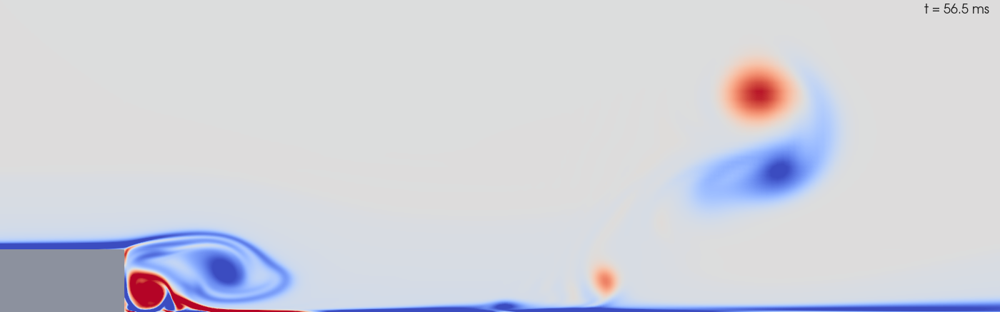
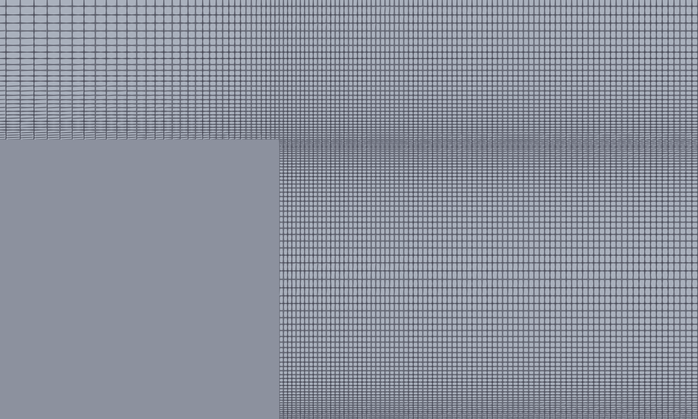
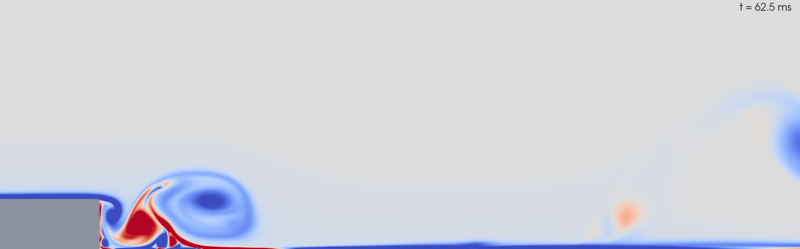
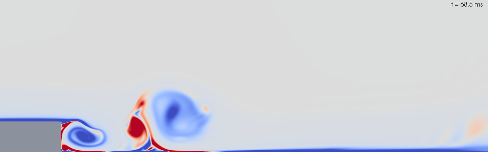
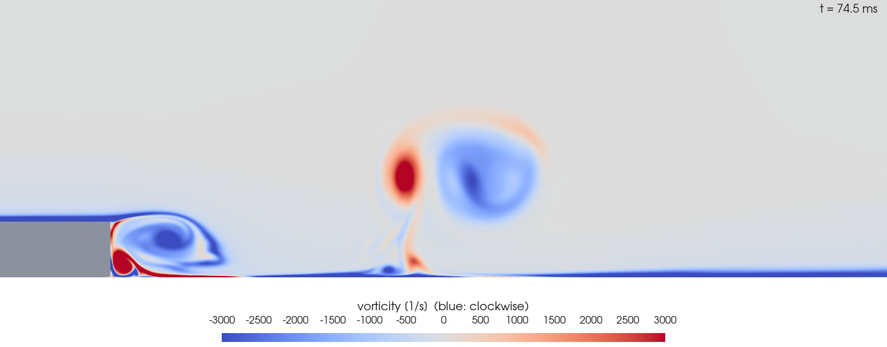
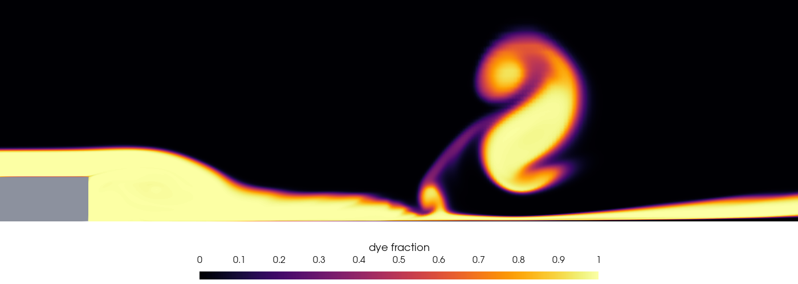
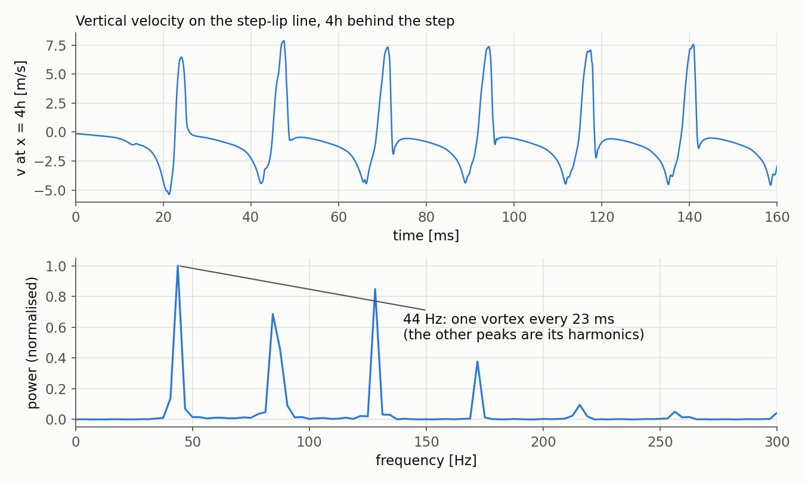
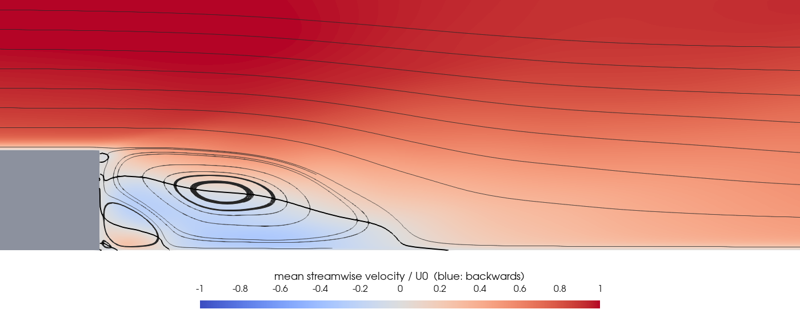
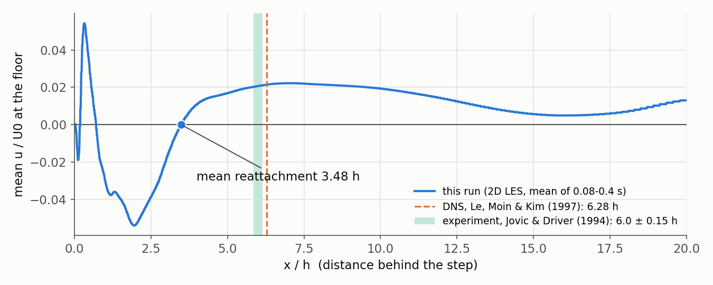

# Backward-Facing Step: Vortex Shedding

> **Level:** Advanced · **Solver:** `pimpleFoam` (transient, PISO mode) · **Flow:** incompressible, 2D large-eddy simulation (WALE) · **Tested with:** OpenFOAM 6 (`cfdengine/openfoam` image)



---

## Goal

Air flows along a channel and over a sudden step down. The flow cannot follow the
sharp corner: it separates, forms a shear layer, and the shear layer rolls up into
vortices that are shed downstream every few milliseconds. This project simulates
that unsteady flow in time and teaches you to:

- set up a **transient** incompressible case with `pimpleFoam`: adaptive time step
  from the Courant number, second-order time and space schemes;
- run a **large-eddy simulation (LES)** with the WALE subgrid model, and know what a
  2D LES can and cannot represent;
- impose a boundary-layer **inlet velocity profile** with `fixedProfile`, and carry a
  **passive dye** with the `scalarTransport` function object;
- run in **two stages** (dense output for animation, then sparse output while the
  statistics accumulate) and in **parallel** with `decomposePar` / `reconstructPar`;
- separate the **instantaneous** flow (vortices) from the **mean** flow
  (`fieldAverage`), and measure the mean **reattachment length** and the **shedding
  frequency** from probes;
- compare with the DNS of Le, Moin & Kim (1997) and the experiment of Jovic &
  Driver (1994), which use exactly this geometry and Reynolds number.

## Target

| Quantity                       | Target for this case                                                    |
|--------------------------------|-------------------------------------------------------------------------|
| Run completes without errors   | `checkMesh` reports `Mesh OK`; both `pimpleFoam` stages reach their end time |
| Courant number                 | ≤ 0.85 after the first steps (`maxCo 0.8`)                              |
| Mass conservation              | inlet and outlet flow rates cancel to < 1e-4 at every sample            |
| Unsteady flow                  | a clear shedding peak in the probe spectrum, one vortex every ~23 ms    |
| Mean flow                      | a recirculation bubble with a corner eddy; `Xr/h` = **3.48 ± 10 %** (regression value) |

About the reattachment length: the DNS of exactly this geometry and Reynolds number
gives **6.28 h** (experiment: 6.0 ± 0.15 h). This 2D run gives **3.48 h, 45 % shorter**.
That is not a tuning error but the main limitation of a 2D simulation of a turbulent
flow, explained in [What a 2D LES misses](#what-a-2d-les-misses). The target is
therefore the value this setup reproduces, and the DNS is shown next to it everywhere
so the gap stays visible. [Exercise 1](#12-exercises) describes the 3D LES needed to
close it.

## Verification method

After a run, one command checks the results (standard-library Python, reads only
logs and `postProcessing/`, needs no OpenFOAM):

```bash
./run_docker.sh          # clean, run in Docker, then run verify.py
python3 verify.py        # or: re-check an existing run
```

`verify.py` prints one `PASS`/`FAIL` line per check and exits with 0 only if all
checks pass (1 if a check fails, 2 if logs or results are missing). Measured values
are from a full run (OpenFOAM 6, 8 cores, about 22 minutes):

| Check                      | What it proves                                                     | Expected            | Tolerance / justification | Measured |
|----------------------------|--------------------------------------------------------------------|---------------------|---------------------------|----------|
| `no_fatal_error`           | no `FOAM FATAL`, FPE or segfault in any log                        | none                | -                         | none |
| `mesh_cell_count`          | `blockMeshDict` was meshed as described                            | 58,822              | exact (69·70 + 397·70 + 397·66) | 58,822 |
| `checkMesh_Mesh_OK`        | mesh passes `checkMesh`                                            | `Mesh OK.`          | -                         | yes |
| `reached_end_startup`      | stage 1 ran to 0.08 s                                              | 0.08 s              | 1e-6                      | 0.0800 s |
| `reached_end_statistics`   | stage 2 ran to 0.40 s                                              | 0.40 s              | 1e-6                      | 0.4000 s |
| `max_courant_after_start`  | the adaptive time step held the Courant number                     | ≤ 0.85              | `maxCo 0.8`, plus one step of lag | 0.804 |
| `mass_balance_max`         | outlet flow rate equals inlet flow rate at every sample            | 0                   | 1e-4 relative (pressure solver tolerance) | 1.6e-8 |
| `inlet_flow_rate`          | the `fixedProfile` table carries the intended flow rate, U0 (5h − δ/8) · 1h | 3.7103e-3 m³/s | 0.5 % (table is piecewise linear) | 3.7098e-3 m³/s |
| `reattachment_regression`  | mean bubble length, from the last − → + sign change of `UMean_x` in the first cell row above the floor | 3.48 h | ± 10 % (scatter of a 0.32 s average). Regression value, **not** validation: DNS 6.28 h | 3.48 h |
| `corner_eddy`              | forward mean flow in the step corner, then the main bubble starts  | 0.2h … `Xr`         | -                         | 0.70 h |
| `shedding_peak_clear`      | the flow is periodic, not noise: spectral peak / median            | > 20                | -                         | 684 |
| `shedding_strouhal_h`      | shedding frequency `f h / U0` at x = 4h (regression value)         | 0.056               | ± 0.01                    | 0.057 (43.7 Hz) |

Manual checks (visual):

1. `./open_paraview.sh`, colour by `U` or `s` and press Play: vortices form at the
   step lip, grow, and travel downstream along the floor, one every ~23 ms.
2. At the last time (0.4 s), colour by `UMean`: a closed recirculation bubble
   behind the step with a small counter-rotating eddy in the corner.

---

## Table of Contents

1. [Problem Description](#1-problem-description)
2. [Physics: Separation, Shear Layers and Shedding](#2-physics-separation-shear-layers-and-shedding)
3. [Why LES, and Why Only 2D Here](#3-why-les-and-why-only-2d-here)
4. [Case Structure](#4-case-structure)
5. [Mesh](#5-mesh)
6. [Boundary and Initial Conditions](#6-boundary-and-initial-conditions)
7. [Numerics: pimpleFoam in PISO Mode](#7-numerics-pimplefoam-in-piso-mode)
8. [Function Objects and the Two Run Stages](#8-function-objects-and-the-two-run-stages)
9. [How to Run](#9-how-to-run)
10. [Results](#10-results)
11. [Making the Reel](#11-making-the-reel)
12. [Exercises](#12-exercises)
13. [Troubleshooting](#13-troubleshooting)
14. [References](#14-references)

---

## 1. Problem Description

The geometry is the one used by **Le, Moin & Kim (1997)** for their direct numerical
simulation (DNS) and by **Jovic & Driver (1994)** for the matching experiment, so the
results can be compared with published numbers:

```
  y/h
   6 ┌──────────────────────────────────────────────────────────────┐  top: slip (free stream)
     │                                                              │
     │  inlet:              ~~~ shear layer ~~~>  vortices  ~~~>    │
     │  1/7 power-law  ───►  @@        @@@          @@@             │  outlet:
     │  boundary layer      @  @     @@  @@                         │  p = 0
   1 ├─────────────┐ ← step lip     ↺ recirculation bubble          │
     │   (solid)   │ ↻ corner eddy                                  │
   0 │             └────────────────────────────────────────────────┘  floor: no-slip
    -5             0            Xr (mean reattachment)             25    x/h
```

| Parameter                     | Value                    | Notes |
|-------------------------------|--------------------------|-------|
| Step height `h`               | 10 mm                    | all lengths below in units of `h` |
| Inlet channel height          | 5h                       | upstream of the step |
| Channel height after the step | 6h                       | expansion ratio 6/5 = **1.2** |
| Domain                        | x = -5h … 25h            | step at x = 0 |
| Free-stream speed `U0`        | 7.65 m/s                 | edge of the inlet boundary layer |
| Inlet boundary layer          | δ = 1.2h, 1/7 power law  | as in the DNS |
| Kinematic viscosity `ν`       | 1.5e-5 m²/s              | air |
| Reynolds number `Re_h = U0 h / ν` | **5100**             | DNS and experiment value |
| Depth (z)                     | 1h, one cell             | 2D |

Le, Moin & Kim found a mean reattachment length of **6.28 h**; Jovic & Driver
measured **6.0 ± 0.15 h**.

## 2. Physics: Separation, Shear Layers and Shedding

**Separation.** Upstream of the step the flow is an ordinary boundary layer. At the
lip the wall drops away; the fluid has too much momentum to turn the corner, so it
leaves the wall in a straight line. Below this line, behind the step, the fluid is
almost at rest.

**The shear layer.** Fast fluid above and slow fluid below are separated by a thin
layer with a large velocity jump. Such a layer is unstable (the Kelvin–Helmholtz
instability): any small wave in it grows, and the layer rolls up into discrete
vortices. Their rotation is clockwise when the flow goes left to right over a step
down, so they show up blue in the vorticity pictures (negative z-vorticity).

**Shedding and reattachment.** Each vortex grows by swallowing fluid from the slow
region below it, drifts downstream at roughly half the free-stream speed, and hits the
floor. The fluid it swallowed has to be replaced, so some flow runs *backwards* along
the floor towards the step: this is the recirculation bubble. Averaged over time, the
backward and forward flow at the floor meet at the **reattachment point** `Xr`.

**Instantaneous vs mean.** At any moment there is no clean bubble, only vortices
passing by. The bubble, its length `Xr` and the small corner eddy exist only in the
**time average**. That is why a steady RANS solver (as used in an earlier version of
this project) can only give the mean picture, and why this case keeps both: the
instantaneous fields every 0.25 ms for the animation, and `UMean` from `fieldAverage`.

**Frequency.** The shedding frequency `f` is reported as a Strouhal number. With the
step height, `St_h = f h / U0`; with the bubble length, `St_Xr = f Xr / U0`.
For the large vortices shed from a turbulent separation bubble, Kiya & Sasaki (1983)
measured `f Xr / U0 ≈ 0.6`.

## 3. Why LES, and Why Only 2D Here

**LES** computes the large, energy-carrying eddies directly and models only those
smaller than the mesh. The subgrid model here is **WALE** (Nicoud & Ducros 1999); its
eddy viscosity goes to zero at walls and in pure shear by itself, so no damping
functions or wall functions are needed. The filter width is the cell size
(`delta cubeRootVol`); on a 2D mesh OpenFOAM uses the square root of the cell area
and prints the warning `Case is 2D, LES is not strictly applicable`.

### What a 2D LES misses

Turbulence is three-dimensional: vortices stretch, tilt and break into smaller ones.
A 2D simulation cannot do that. Its vortices stay large, round and coherent, and they
pair up into even larger ones instead of breaking down. The consequences:

- the **qualitative** picture (separation, roll-up, shedding, a recirculation bubble,
  a corner eddy) is right;
- the shedding is much more **regular** than in reality: one dominant frequency
  instead of a broad band;
- the strong 2D vortices sweep fluid out of the bubble efficiently, which changes the
  **mean** bubble length: here 3.48h instead of the DNS value 6.28h.

OpenFOAM's own `pisoFoam/LES/pitzDaily` tutorial is also a 2D LES of a step for the
same reason: it runs in minutes. A real LES of this case needs a spanwise extent of
about 4h with periodic sides and a few million cells (Le, Moin & Kim used 4h; see
[Exercise 1](#12-exercises)).

## 4. Case Structure

```
07_backward_facing_step/
├── 0/
│   ├── U            fixedProfile inlet (1/7 power law), slip top, no-slip walls
│   ├── p            fixed at the outlet, zero gradient elsewhere
│   ├── nut          subgrid viscosity: 0 at walls (WALE needs no wall functions)
│   └── s            passive dye: 1 in the lowest 0.6h of the inlet, 0 elsewhere
├── constant/
│   ├── transportProperties    ν = 1.5e-5 m²/s
│   └── turbulenceProperties   LES, WALE, cubeRootVol filter
├── system/
│   ├── blockMeshDict          3 blocks, graded towards the step lip and the floor
│   ├── controlDict            pimpleFoam, adaptive Δt, dye, fieldAverage, probes, flow rates
│   ├── fvSchemes              backward in time, LUST for momentum
│   ├── fvSolution             PISO (1 outer, 2 pressure correctors), GAMG for p
│   ├── decomposeParDict       scotch, number of cores set by Allrun
│   └── sampleDict             UMean along the floor (used by verify.py)
├── Allrun / Allclean          run and clean (inside an OpenFOAM environment)
├── run_docker.sh              clean + Allrun in Docker + verify.py
├── verify.py                  PASS/FAIL checks (standard-library Python)
├── make_images.py             figures in images/ (pvpython)
├── reel.json                  settings for tools/make_reel.py (vertical videos)
└── open_paraview.sh           open the results in ParaView
```

## 5. Mesh

Three hexahedral blocks, one cell deep:

| Block | Region                      | Cells (x × y) | x spacing                    | y spacing |
|-------|-----------------------------|---------------|------------------------------|-----------|
| A     | inlet channel, x = -5…0, y = 1…6 | 69 × 70  | 0.20h at the inlet → 0.015h at the step | 0.008h at y = h → 0.25h at the top |
| C     | above the step line, x = 0…25    | 397 × 70 | 0.015h at the step → 0.05h at x = 8h → 0.3h at the outlet | same as A |
| B     | behind the step, y = 0…1         | 397 × 66 | same as C                    | 0.006h at the floor and at y = h, 0.03h in the middle |

Total **58,822 cells**. The finest cells (0.15 mm × 0.08 mm) sit at the step lip,
where the shear layer is thinnest. Multi-grading in `blockMeshDict` gives the two
x-zones after the step:

```cpp
xDown   ((8 275 3.333) (17 122 6));   // (length, cells, expansion) per zone
```



## 6. Boundary and Initial Conditions

| Patch          | `U`                              | `p`            | `nut`         | `s` (dye) |
|----------------|----------------------------------|----------------|---------------|-----------|
| `inlet`        | `fixedProfile` (1/7 power law)   | `zeroGradient` | `zeroGradient`| `fixedProfile`: 1 below 0.6h, 0 above |
| `outlet`       | `inletOutlet`                    | `fixedValue 0` | `zeroGradient`| `inletOutlet` |
| `top`          | `slip`                           | `slip`         | `slip`        | `zeroGradient` |
| `step`, `floor`| `noSlip`                         | `zeroGradient` | `fixedValue 0`| `zeroGradient` |
| `frontAndBack` | `empty`                          | `empty`        | `empty`       | `empty` |

**Inlet profile.** `fixedProfile` evaluates a table at the coordinate
`(direction · face centre) − origin`, here the height above the step top:

```cpp
inlet
{
    type            fixedProfile;
    profile         table
    (
        (0        (0.0000 0 0))
        (0.0012   (5.5056 0 0))     // y' = 0.1 delta
        ...
        (0.012    (7.6500 0 0))     // y' = delta: free stream
        (0.05     (7.6500 0 0))
    );
    direction       (0 1 0);
    origin          0.01;           // the step top is at y = h = 0.01 m
}
```

**Initial state.** The fluid starts at rest (`internalField uniform (0 0 0)`): the
inflow is switched on at t = 0. The animation therefore begins with the **starting
vortex**, a single large vortex that rolls up at the lip before the periodic
shedding sets in after about 0.03 s.

**Dye.** `s` is not part of the flow solution. It is carried by the velocity field
(`scalarTransport` function object, diffusivity 1e-9 m²/s) and only colours the fluid
that comes from the inlet boundary layer, so you can follow it into the vortices and
the bubble.

## 7. Numerics: pimpleFoam in PISO Mode

`pimpleFoam` with `nOuterCorrectors 1` is the PISO algorithm: one momentum predictor
and two pressure corrections per time step. Outer (PIMPLE) iterations are not needed
because the time step keeps the Courant number below one:

```cpp
adjustTimeStep  yes;
maxCo           0.8;
maxDeltaT       1e-4;
```

This gives Δt ≈ 7 µs, set by the small cells at the step lip. About 51,000 steps
cover the 0.4 s of flow time (10 flow-throughs of the 30h channel).

| Term            | Scheme                       | Why |
|-----------------|------------------------------|-----|
| time            | `backward`                   | second order; vortices keep their strength |
| `div(phi,U)`    | `Gauss LUST grad(U)`         | 75 % central, 25 % upwind: little numerical damping of the vortices, but stable |
| `div(phi,s)`    | `Gauss limitedLinear01 1`    | keeps the dye between 0 and 1 |
| gradients, Laplacians | `Gauss linear (corrected)` | orthogonal hexahedral mesh |

## 8. Function Objects and the Two Run Stages

All analysis happens while the solver runs, in `system/controlDict`:

| Function object | Type                | Output |
|-----------------|---------------------|--------|
| `dye`           | `scalarTransport`   | field `s` |
| `fieldAverage`  | `fieldAverage`, from t = 0.08 s | `UMean`, `UPrime2Mean`, `pMean` |
| `probes`        | `probes`, every step | `postProcessing/probes/*/U, p` at x = 2h, 4h, 6h, 10h |
| `flowRates`, `outletFlow` | `surfaceFieldValue` (sum of `phi`) | inlet and outlet flow rate |

`Allrun` runs `pimpleFoam` twice with the same dictionary, editing `endTime` and
`writeInterval` in between:

| Stage        | Time         | Written every | Purpose |
|--------------|--------------|---------------|---------|
| `startup`    | 0 → 0.08 s   | 0.25 ms (320 times) | start-up and the first shedding cycles, smooth enough to animate |
| `statistics` | 0.08 → 0.40 s| 0.08 s        | `fieldAverage` collects the mean over 0.32 s (about 14 shedding cycles) |

The animation times are only ever looked at, never restarted from, so `Allrun`
removes their old-time fields (`U_0`, `s_0`, `phi_0`) and `phi` afterwards; this
halves the output, to about 1 GB.

## 9. How to Run

```bash
cd projects/07_backward_facing_step

# Docker (recommended): clean, run, verify
./run_docker.sh                 # all cores, at most 8
NPROCS=4 ./run_docker.sh        # choose the number of cores

# Inside an OpenFOAM 6 environment
./Allclean && ./Allrun && python3 verify.py
```

Run time: about 22 minutes on 8 cores (4 for the start-up stage, 18 for the
statistics), 2–3 hours on one core. Progress:

```bash
tail -f log.pimpleFoam.startup      # then log.pimpleFoam.statistics
grep "^Time" log.pimpleFoam.statistics | tail -1
```

Outputs:

- `0.00025 … 0.08`: instantaneous fields for the animation (`U`, `p`, `nut`, `s`);
- `0.16 … 0.4`: also `UMean`, `UPrime2Mean`, `pMean`;
- `postProcessing/probes`, `flowRates`, `outletFlow`, `sampleDict`.

## 10. Results

### One shedding cycle






Four moments 6 ms apart, about a quarter of the shedding period each (vorticity,
blue = clockwise). The shear layer leaves the lip, rolls up into a vortex that grows
over the bubble, and the vortex is released and carried along the floor while the
next one starts at the lip.

### Dye



Dye from the inlet boundary layer is wound into each vortex and pulled down into the
recirculation bubble, where it lingers.

### Shedding frequency



The vertical velocity at x = 4h on the lip line swings by several m/s with one
dominant frequency of **43.7 Hz** (`St_h = f h / U0 = 0.057`). The signal is periodic
but far from a sine wave (each vortex passes as a sharp spike), so the spectrum also
shows the harmonics 2f, 3f, … The first 20 ms are the start-up: the starting vortex
reaches x = 4h after 22 ms.

Scaled with the bubble length, `f Xr / U0 = 0.20`, a third of the ≈ 0.6 measured for
the large vortices of real (3D) separation bubbles (Kiya & Sasaki 1983). In 2D,
neighbouring vortices merge instead of breaking up, so fewer and bigger vortices
leave the bubble.

### Mean flow





| Quantity                    | This case (2D LES) | DNS (Le, Moin & Kim 1997) | Experiment (Jovic & Driver 1994) |
|-----------------------------|--------------------|---------------------------|----------------------------------|
| Mean reattachment `Xr/h`    | **3.48**           | 6.28                      | 6.0 ± 0.15                       |
| Corner eddy ends at         | 0.70h              | -                         | -                                |
| Strongest mean backflow     | −0.31 U0 (x = 1.6h, y = 0.1h) | -              | -                                |

The mean flow has the right structure: a corner eddy, a main bubble with backflow
along the floor, and a dividing streamline that comes down to the floor. But the
bubble is 45 % too short. Each 2D vortex is a strong, coherent roller that reaches the
floor at x ≈ 3–4h and drives fluid forwards there; in the real flow the vortices
break down into 3D turbulence on the way and the shear layer reattaches further
downstream. The floor-velocity plot above marks the DNS and experimental values for
comparison.

## 11. Making the Reel

The repository's reel generator turns the 320 animation times into vertical (9:16)
videos with captions and music. Two reels are defined in `reel.json`:

```bash
pvbatch tools/make_reel.py projects/07_backward_facing_step                 # both
pvbatch tools/make_reel.py projects/07_backward_facing_step --reel dye      # one
```

- `vortex_shedding`: vorticity, following the vortices from the step downstream;
- `dye`: the dye being wound up and pulled into the bubble.

They are written to `output/artifacts/07_backward_facing_step/` (not tracked by git).
`"solid": true` paints the step block grey, `"skip_after": 0.08` limits them to the
densely written start-up stage, and `"camera"` keyframes pan along the channel.

## 12. Exercises

1. **Go 3D.** Extrude the mesh to a span of 4h with 40 cells (`zMin -2; zMax 2;` and
   40 cells in z in `blockMeshDict`), make `frontAndBack` a `cyclic` pair, and use
   `turbulentInlet` for `U`. The vortices now break up into smaller, three-dimensional
   eddies. Expect about 2.4 million cells and many hours on 8 cores; compare `Xr/h`
   (DNS: 6.28h) and the spectrum with the 2D run.
2. **Reynolds number.** Halve and double `U0` (scale the whole table in `0/U`). How
   do the shedding frequency in Hz and `St_h` change?
3. **Laminar inflow.** Replace the 1/7 profile by a uniform 7.65 m/s. The separating
   shear layer is now much thinner: how does the vortex size change?
4. **Numerical damping.** Change `div(phi,U)` to `Gauss linearUpwind grad(U)` and
   then `Gauss upwind`. Watch the vortices (and the shedding peak) fade.
5. **Steady RANS.** Run the same geometry with `simpleFoam` and k-ω SST. You get one
   picture of the mean bubble. Compare its `Xr/h` with the LES mean.

## 13. Troubleshooting

| Symptom | Cause | Fix |
|---------|-------|-----|
| `Case is 2D, LES is not strictly applicable` | expected warning | none needed (see [Section 3](#3-why-les-and-why-only-2d-here)) |
| Courant number grows, solver diverges | `maxCo` raised or mesh refined without lowering it | keep `maxCo` ≤ 0.8 for PISO |
| `verify.py`: missing `log.pimpleFoam.statistics` | stage 2 did not run | check `log.pimpleFoam.startup` for errors |
| `mpirun` refuses to run as root | Docker without `--user` | use `./run_docker.sh` (runs with your uid) |
| No `UMean` in the last time | run stopped before 0.08 s | rerun; `fieldAverage` starts at 0.08 s |
| ParaView shows only the last time | reconstructed case missing | `reconstructPar` (Allrun does it) or open the decomposed case |

## 14. References

1. **Le, H., Moin, P. & Kim, J.** (1997). "Direct numerical simulation of turbulent
   flow over a backward-facing step." *Journal of Fluid Mechanics*, 330, 349–374.
   The reference case: expansion ratio 1.2, `Re_h` = 5100, `Xr` = 6.28h.
2. **Jovic, S. & Driver, D.M.** (1994). "Backward-facing step measurements at low
   Reynolds number, Re_h = 5000." NASA Technical Memorandum 108807.
3. **Nicoud, F. & Ducros, F.** (1999). "Subgrid-scale stress modelling based on the
   square of the velocity gradient tensor." *Flow, Turbulence and Combustion*, 62,
   183–200. The WALE model.
4. **Kiya, M. & Sasaki, K.** (1983). "Structure of a turbulent separation bubble."
   *Journal of Fluid Mechanics*, 137, 83–113.
5. **Eaton, J.K. & Johnston, J.P.** (1981). "A review of research on subsonic
   turbulent flow reattachment." *AIAA Journal*, 19(9), 1093–1100.
6. OpenFOAM 6 tutorial `incompressible/pisoFoam/LES/pitzDaily`: a 2D LES of a step
   with the same function objects (`fieldAverage`, `probes`, `scalarTransport`).

Companion notes: [Turbulence models (LES)](../../notes/06_turbulence_models.md#6-large-eddy-simulation-les),
[CFL number](../../notes/08_cfl_number.md), [Parallelization](../../notes/07_parallelization.md),
[Meshing](../../notes/04_meshing.md).

---

*This case is part of the [OpenFOAM Tutorials](https://github.com/djeada/OpenFoam-Tutorials/blob/main/README.md) learning series.*
