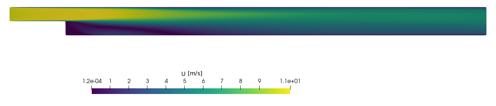
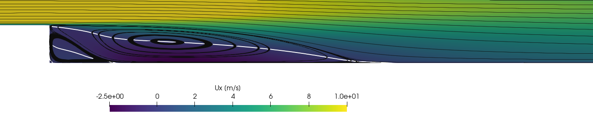
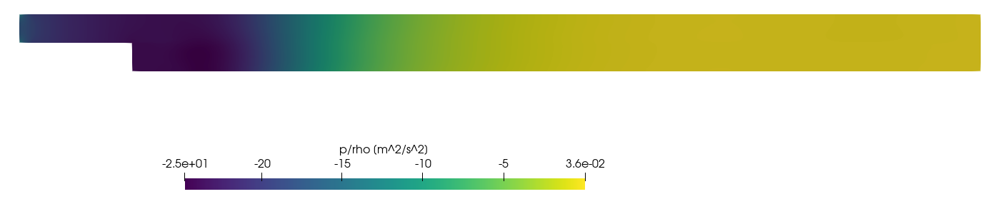
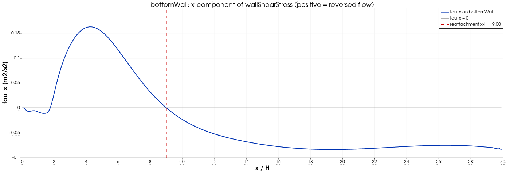

# Backward-Facing Step Flow

> **Level:** Intermediate · **Solver:** `simpleFoam` · **Flow:** Steady-state, incompressible, turbulent (RANS, k-$\omega$ SST) · **Tested with:** OpenFOAM 6 (`cfdengine/openfoam` image)

---

## Goal

Simulate the separated flow behind a backward-facing step with a steady RANS
solver and learn to:

- build a multi-block 2D mesh with `blockMesh` (three blocks, graded towards walls
  and towards the step edge);
- set up a k-$\omega$ SST case: inlet values of `k` and `omega`, wall functions for
  `k`, `omega` and `nut`;
- run `simpleFoam` to a residual-controlled steady state and judge convergence;
- locate the **reattachment point** from the sign change of the wall shear stress
  and read the recirculation bubble from streamlines, `Ux`, `p` and `k`;
- check `y+` to decide whether the mesh is wall-resolved or in the wall-function range.

## Target

| Quantity                          | Target for this case                                   |
|-----------------------------------|--------------------------------------------------------|
| Run completes without errors      | `checkMesh` reports `Mesh OK`; `simpleFoam` reports `SIMPLE solution converged` before `endTime` |
| Residuals at convergence          | p < 1e-4, U, k, omega < 1e-5 (the `residualControl` values) |
| Mass conservation                 | inlet and outlet flux balance to < 1e-3 (relative)     |
| Wall resolution                   | max y+ < 5 on all walls (mesh is wall-resolved)        |
| Reattachment length `Xr/H`        | **9.0 $\pm 0.5$** (regression value measured with this setup, see below) |

About the reattachment length: there is **no experiment with exactly this geometry
and inlet** (expansion ratio 2, uniform inlet, `Re_H` = 8,467), so there is no
experimental reference value to compare against. The classic benchmark values
(Driver & Seegmiller: `Xr/H` = 6.26 at expansion ratio 1.125, `Re_H` $\approx 37$,400; see
[references](#the-reattachment-length-xrh)) belong to a different geometry and Reynolds
number. The target above is therefore the value this case produces with OpenFOAM 6 on
the supplied mesh (9.0 H); the experiments only provide a plausibility band
(roughly 5-10 H). Earlier versions of this README stated `Xr/H ≈ 6`; this was not
what the case produces.

## Verification method

After a run, one command checks the results (standard-library Python, reads only
the logs and written fields, needs no OpenFOAM):

```bash
./run_docker.sh          # clean, run in Docker, then runs verify.py as the last step
python3 verify.py        # or: re-check an existing run
```

`verify.py` prints one `PASS`/`FAIL` line per check and exits with 0 only if all
checks pass (1 if a check fails, 2 if logs or results are missing). Measured values
are from a full run of this case (OpenFOAM 6, single core, about 250 s):

| Check                     | What it proves                                           | Expected           | Tolerance / justification | Measured |
|---------------------------|----------------------------------------------------------|--------------------|---------------------------|----------|
| `no_fatal_error`          | no `FOAM FATAL`, FPE or segfault in any log              | none               | -                         | none |
| `mesh_cell_count`         | blockMeshDict was meshed as described                    | 27,200             | exact (80·40 + 2·300·40)  | 27,200 |
| `checkMesh_Mesh_OK`       | mesh passes `checkMesh`                                  | `Mesh OK.`         | -                         | yes |
| `simple_converged`        | residualControl satisfied before `endTime`               | < 3000 iterations  | converged iteration < `endTime` | 1968 |
| `final_residual_p`        | pressure converged                                       | < 1e-4             | `residualControl` in `fvSolution` | 8.1e-6 |
| `final_residual_U`        | momentum converged (max of Ux, Uy)                       | < 1e-5             | same                      | 9.9e-6 |
| `final_residual_k`        | k converged                                              | < 1e-5             | same                      | 5.5e-6 |
| `final_residual_omega`    | omega converged                                          | < 1e-5             | same                      | 3.5e-7 |
| `max_yplus`               | near-wall mesh is in the viscous-sublayer range          | < 5                | usual limit for low-Re near-wall treatment | 1.53 |
| `inlet_flux`              | inlet flux equals U·H·depth (BC and geometry consistent) | 1.6129e-3 $\mathrm{m}^{3}/\mathrm{s}$    | 1e-6 relative (round-off) | 1.6129e-3 |
| `mass_balance`            | outlet flux balances inlet flux                          | 0                  | 1e-3 relative (converged steady state) | 7.5e-8 |
| `reattachment_regression` | `Xr/H` from the sign change of `tau_x` on `bottomWall`   | 9.0                | $\pm 0.5$ H (about 7 cells at x $\approx 9$H). Regression check on this mesh and model, **not** experimental validation | 9.00 |
| `reattachment_plausible`  | `Xr/H` lies in the range expected for turbulent step flow | 5 .. 10           | experiments with expansion ratio 1.1-2 give about 6-8 H, RANS scatter about $\pm 25$ %. Sanity band only | 9.00 |
| `reattachment_nearwall_Ux`| independent: `Ux` sign change in the first cell row (`system/sampleDict`) agrees with the `tau_x` result | `Xr/H` from `tau_x` | $\pm 0.2$ H (about 3 cells; face-centre vs cell-centre location) | 9.00 |

Manual checks (visual, secondary):

1. `./open_paraview.sh`: a closed recirculation bubble behind the step, with a small
   counter-rotating corner eddy next to the step face (see the figures below).
2. `Ux` is negative only inside the bubble; its zero line reaches the bottom wall at
   `x/H ≈ 9`.
3. `tau_x` on `bottomWall` changes sign three times (see the wall-shear plot).

---

## Table of Contents

1. [Problem Description](#problem-description)
2. [Physics & Theory](#physics--theory)
3. [Case Structure](#case-structure)
4. [Mesh Generation](#mesh-generation)
5. [Boundary Conditions](#boundary-conditions)
6. [Turbulence Setup](#turbulence-setup)
7. [Solver Configuration](#solver-configuration)
8. [How to Run](#how-to-run)
9. [Expected Results](#expected-results)
10. [Post-Processing Guide](#post-processing-guide)
11. [Exercises](#exercises)
12. [Troubleshooting](#troubleshooting)
13. [References](#references)

---

## Problem Description

This case simulates steady-state turbulent flow over a **backward-facing step**, one of
the most widely studied validation benchmarks in computational fluid dynamics. A sudden
expansion in a channel creates a region of separated flow downstream of the step,
followed by reattachment further along the bottom wall.

```
                          topWall (y = +H)
   ┌───────────────┬────────────────────────────────────────────────────┐ y = +H
   │               │                                                    │
 inlet  →→→→→→→→   │      free shear layer          →→→→→→→→→→→→→→→→→→  outlet
 U = 10 m/s        │   ╭──────────────────────╮                         │
   │  →→→→→→→→     │   │  recirculation       │  ←← reverse flow        │
   ├───────────────┤   │  bubble (primary eddy)                         │ y = 0
   │ step (top)    │   ╰────────┬─────────────╯                         │
   └───────────────┘ step face  │      Xr ≈ 9H (measured)               │
                    (vertical)  └──────────────────────────────────────┘ y = -H
     ← 4H = 50.8 mm →|←──────────── 30H = 381 mm ──────────────────────→
                                   bottomWall (y = -H)

   Step height H = 12.7 mm. Upstream channel height = H (y from 0 to +H),
   downstream channel height = 2H (y from -H to +H). Depth in z = H (one cell, empty).
```

The geometry is simple, but the flow physics is rich. The backward-facing step has
served as a test case for turbulence model validation for over four decades and
continues to challenge RANS models, LES approaches and DNS alike.

### Why This Case Matters

- **Separated-flow benchmark** - The reattachment length Xr/H is a widely used
  metric for model validation. Experimental data from Driver & Seegmiller (1985),
  Kim et al. (1980) and Armaly et al. (1983) are common comparison sets.
- **Turbulence model stress test** - Separation and reattachment involve adverse
  pressure gradients, streamline curvature and anisotropic turbulence that expose
  weaknesses in common RANS closures.
- **Mesh sensitivity showcase** - The recirculation zone is sensitive to
  near-wall resolution, making this a good case for learning about y+
  requirements, wall functions and grid convergence studies.
- **Practical relevance** - Sudden expansions appear in combustors, diffusers, HVAC
  ducts, electronic cooling channels and many other engineering applications.

### Key Parameters

| Parameter              | Symbol     | Value                                      |
|------------------------|------------|--------------------------------------------|
| Step height            | H          | 0.0127 m (12.7 mm)                         |
| Inlet velocity         | $U_\infty$ | 10 m/s (uniform)                           |
| Kinematic viscosity    | $\nu$      | $1.5 \times 10^{-5}$ $\mathrm{m}^{2}/\mathrm{s}$ (air)      |
| Reynolds number        | Re_H       | $\approx$ 8,467 (based on H and $U_\infty$) |
| Expansion ratio        | ER         | 2:1 (downstream height / upstream height)  |
| Upstream length        | L_up       | 4H = 0.0508 m                              |
| Downstream length      | L_down     | 30H = 0.381 m                              |
| Channel height (inlet) | h          | H = 0.0127 m (above step level)            |
| Channel height (outlet)| 2H         | 0.0254 m                                   |
| Domain depth (z)       | -          | H (single cell, `empty` patches)           |
| Reattachment length    | Xr/H       | 9.0 (measured with this case, see [Target](#target)) |

> **Note on Reynolds number:** Different researchers define Re using different
> reference lengths (step height H, hydraulic diameter, or upstream channel height).
> Based on step height, $Re_H = U_\infty H / \nu \approx 8{,}467$. Based on the
> downstream channel height 2H it is $Re \approx 16{,}933$. Values near 36,000-37,400
> quoted for the Driver & Seegmiller experiment use their reference velocity of
> about 44 m/s and the same step height; they do not apply to the 10 m/s used here.

---

## Physics & Theory

### Governing Equations

For steady-state, incompressible flow, the Reynolds-Averaged Navier-Stokes (RANS)
equations govern the mean flow:

**Continuity:**

$$\partial \bar{U}_i / \partial x_i = 0$$

**Momentum:**

```
Ūⱼ ∂Ūᵢ/∂xⱼ = -1/ρ ∂p̄/∂xᵢ + ∂/∂xⱼ [ν(∂Ūᵢ/∂xⱼ + ∂Ūⱼ/∂xᵢ) - u'ᵢu'ⱼ]
```

The Reynolds stress tensor `u'ᵢu'ⱼ` is modelled using the Boussinesq hypothesis:

```
-u'ᵢu'ⱼ = νₜ(∂Ūᵢ/∂xⱼ + ∂Ūⱼ/∂xᵢ) - 2/3 k δᵢⱼ
```

where $\nu_t$ is the turbulent eddy viscosity and k is the turbulent kinetic energy.
In OpenFOAM the pressure is kinematic (`p/ρ`, units $\mathrm{m}^{2}/\mathrm{s}^{2}$), which is why `0/p` has
dimensions `[0 2 -2 0 0 0 0]`.

### Flow Separation and Reattachment

When the flow encounters the sudden expansion at the step edge, the following physical
processes occur:

1. **Separation** - The flow cannot follow the abrupt geometry change. A free shear
   layer detaches from the step edge, with a strong inflection point in the velocity
   profile.

2. **Primary recirculation zone** - Below the shear layer and behind the step, a
   large clockwise (in the standard orientation, flow left to right) vortex forms. This
   is the primary recirculation bubble, bounded by the step face, the bottom wall and
   the shear layer. A smaller counter-rotating corner eddy sits in the corner between
   step face and bottom wall (about 1.7H long in this case).

3. **Shear layer development** - The free shear layer grows through Kelvin-Helmholtz
   type instability, entraining fluid from both the main flow above and the recirculation
   zone below. Turbulent mixing in this layer controls the reattachment process. (A RANS
   model represents this only through the eddy viscosity; the instability itself is not
   resolved.)

4. **Reattachment** - At a distance Xr downstream of the step, the shear layer
   impinges on the bottom wall. The reattachment point is defined as the location
   where the time-averaged wall shear stress changes sign.

5. **Recovery region** - Downstream of reattachment, the flow gradually recovers
   toward a fully developed channel flow profile. This recovery region extends for
   approximately 30-50H in general; here the outlet is at 30H, so only about 21H
   (30H - 9H) are available for recovery.

```
  Flow structure detail:

                 Free shear layer
            ╱╱╱╱╱╱╱╱╱╱╱╱╱╱╱╱╱╱╱╱╱╱╱╱╱
           ╱  Mixing & entrainment     ╱
          ╱╱╱╱╱╱╱╱╱╱╱╱╱╱╱╱╱╱╱╱╱╱╱╱╱╱╱
  ┌────┐
  │    │  ←←←←←←←←←  (reverse flow)
  │    │  ╭────────────────╮
  │    │  │   Primary      │
  │    │  │   recirculation│
  │    │  │   vortex       │     Reattachment
  │    ├──╰────────────────╯─────── ★ ────── Recovery →→→→
  │    │  Step                      Xr
  │    │
```

### The Reattachment Length (Xr/H)

The normalised reattachment length Xr/H is the most important validation
metric for backward-facing step simulations. Literature values are given below as
listed in the original version of this README; they come from different geometries
(expansion ratio, inlet boundary layer, definition of Re) and from memory, so
check the papers before citing them. **They are not a target for this case.**

| Study                       | Re        | Xr/H   | Method          |
|-----------------------------|-----------|--------|-----------------|
| Driver & Seegmiller (1985)  | 37,400    | 6.26   | Experiment      |
| Kim et al. (1980)           | 132,000   | 7.0    | Experiment      |
| Armaly et al. (1983)        | 8,000     | 6.0    | Experiment      |
| Adams & Johnston (1988)     | 38,000    | 6.4    | Experiment      |
| Menter (1994) k-$\omega$ SST      | 37,400    | 6.1    | RANS CFD        |
| Standard k-$\varepsilon$               | Various   | 4.5-5  | RANS CFD        |
| **This case** (k-$\omega$ SST, OpenFOAM 6) | 8,467 (Re_H) | **9.0** | RANS CFD, measured |

> **Key insight (literature):** Standard k-$\varepsilon$ is reported to under-predict the
> reattachment length by 15-25 %, while k-$\omega$ SST typically predicts Xr/H within
> 5-10 % of experimental values for the classic Driver & Seegmiller configuration. This
> is one of the reasons k-$\omega$ SST became widely used for separated flows.
>
> **Interpretation for this case:** the expansion ratio (2) and the uniform inlet with
> a thin boundary layer differ strongly from the Driver & Seegmiller configuration, so
> 9.0 H cannot be called an over- or under-prediction. A grid-convergence study
> ([Exercise 3](#exercise-3-mesh-refinement-study)) has not been done here.

### Why k-omega SST for This Problem

The k-$\omega$ SST (Shear Stress Transport) model by Menter (1994) was developed
to handle the weaknesses of existing two-equation models in separated flows:

1. **Near-wall behaviour** - Uses k-$\omega$ formulation in the inner boundary layer,
   avoiding the need for damping functions and providing good performance in
   adverse pressure gradient regions.

2. **Free-stream robustness** - Switches to k-$\varepsilon$ behaviour in the outer region and
   free shear layers, avoiding the sensitivity of k-$\omega$ to free-stream turbulence
   levels.

3. **Shear stress limiter** - The SST modification limits the eddy viscosity using
   Bradshaw's assumption that the principal turbulent shear stress is proportional
   to the turbulent kinetic energy: `τ = ρa₁k` where $a_1$ = 0.31. This prevents
   over-prediction of eddy viscosity in adverse pressure gradient flows, which is
   a main failure mode of standard k-$\varepsilon$ in separated flows.

4. **Blending function** - A smooth blending function $F_1$ transitions between the
   k-$\omega$ and k-$\varepsilon$ formulations based on wall distance, ensuring the right model is
   active in each region:

```
  F₁ = tanh(arg₁⁴)

  arg₁ = min[max(√k/(β*ωy), 500ν/(y²ω)), 4ρσ_ω₂k/(CD_kω y²)]
```

The transport equations for k and $\omega$ in the SST model are:

**Turbulent kinetic energy (k):**
```
∂(ρk)/∂t + ∂(ρUⱼk)/∂xⱼ = P̃k - β*ρkω + ∂/∂xⱼ[(μ + σk μt) ∂k/∂xⱼ]
```

**Specific dissipation rate ($\omega$):**
```
∂(ρω)/∂t + ∂(ρUⱼω)/∂xⱼ = αS² - βρω² + ∂/∂xⱼ[(μ + σω μt) ∂ω/∂xⱼ]
                             + 2(1-F₁)ρσ_ω₂ (1/ω) ∂k/∂xⱼ ∂ω/∂xⱼ
```

### Turbulent Inlet Conditions

The inlet turbulence quantities are estimated from the turbulence intensity (I) and
a turbulence length scale (l):

```
  k = 3/2 (U∞ · I)²  =  3/2 × (10 × 0.04)²  =  0.24 m²/s²      (I = 4 %)

  ω = k^0.5 / (C_μ^0.25 · l)  =  0.49 / (0.5477 × 0.0020)  ≈  440 s⁻¹

  where C_μ = 0.09 and l ≈ 0.0020 m (about 8 % of the downstream channel height 2H = 0.0254 m,
  or 0.16 H)
```

> The exact inlet values influence the reattachment length moderately. Literature
> studies of varying I from 1 % to 10 % report shifts of about $\pm 0.5$ in Xr/H; this was
> not re-measured for this case.

---

## Case Structure

```
07_backward_facing_step/
├── 0/                          ← Initial & boundary conditions
│   ├── U                       ← Velocity field
│   ├── p                       ← Pressure field (kinematic)
│   ├── k                       ← Turbulent kinetic energy
│   ├── omega                   ← Specific dissipation rate
│   └── nut                     ← Turbulent viscosity
├── constant/                   ← Physical properties
│   ├── transportProperties     ← Fluid properties (ν for air)
│   ├── turbulenceProperties    ← Turbulence model selection
│   └── polyMesh/               ← Mesh (generated by blockMesh)
├── system/                     ← Simulation controls
│   ├── blockMeshDict           ← Mesh definition
│   ├── controlDict             ← Time control & function objects
│   ├── fvSchemes               ← Discretisation schemes
│   ├── fvSolution              ← Linear solvers & SIMPLE
│   └── sampleDict              ← Near-wall velocity line (used by Allrun and verify.py)
├── images/                     ← Figures rendered from a real run (make_images.py)
├── Allrun                      ← Run script (blockMesh, checkMesh, simpleFoam, sample)
├── Allclean                    ← Clean script
├── run_docker.sh               ← Clean + run in Docker + verify
├── verify.py                   ← PASS/FAIL checks of a finished run
├── make_images.py              ← pvpython script that renders images/
├── open_paraview.sh            ← Opens the case in ParaView
└── README.md                   ← This file
```

### File Purposes

| File                   | Purpose                                                    |
|------------------------|------------------------------------------------------------|
| `0/U`                  | Velocity: uniform inlet, no-slip walls, empty for 2D      |
| `0/p`                  | Pressure: zero-gradient inlet, fixed outlet                |
| `0/k`                  | TKE: inlet value, wall functions on walls                  |
| `0/omega`              | Omega: inlet value, wall functions on walls                |
| `0/nut`                | Eddy viscosity: calculated at inlet/outlet, wall functions |
| `constant/transportProperties` | Newtonian fluid, $\nu$ = 1.5e-5 $\mathrm{m}^{2}/\mathrm{s}$ (air)      |
| `constant/turbulenceProperties` | RAS → k-omega SST selection                       |
| `system/blockMeshDict` | Multi-block structured mesh definition                     |
| `system/controlDict`   | up to 3000 iterations, write every 200, function objects (fieldAverage, wallShearStress, yPlus) |
| `system/fvSchemes`     | Steady-state, linear upwind for U, upwind for k/omega     |
| `system/fvSolution`    | SIMPLE (SIMPLEC), GAMG for p, relaxation factors           |
| `system/sampleDict`    | Line sample of U in the first cell row above `bottomWall`  |

---

## Mesh Generation

### Geometry Definition

The mesh is created using `blockMesh` with three structured hexahedral blocks. The
flow plane is x-y; z is the (single-cell) spanwise direction.

```
  Vertex numbering (back plane, z = -0.5H):

    v3 ─────────────── v4 ─────────────────────────── v5
    │                  │                               │
    │                  │                               │
    │    Block 0       │        Block 1                │
    │   (upstream)     │    (downstream top)           │
    │   80 × 40        │       300 × 40                │
    │                  │                               │
    v0 ─────────────── v1                              v2
                       │                               │
                       │        Block 2                │
                       │    (downstream bottom)        │
                       │       300 × 40                │
                       │                               │
                       v6 ────────────────────────── v7

  Coordinates (in units of H, convertToMeters = 0.0127):
    v0 = (-4, 0)    v1 = (0, 0)     v2 = (30, 0)
    v3 = (-4, 1)    v4 = (0, 1)     v5 = (30, 1)
    v6 = (0, -1)    v7 = (30, -1)
```

### Block Details

| Block | Region              | Size   | Cells     | Grading                     |
|-------|---------------------|--------|-----------|-----------------------------|
| 0     | Upstream channel    | 4H$\times$1H  | 80 $\times$ 40  | x: 0.25 (fine at step)     |
| 1     | Downstream top      | 30H$\times$1H | 300 $\times$ 40 | x: 4.0 (fine at step, coarser downstream) |
| 2     | Downstream bottom   | 30H$\times$1H | 300 $\times$ 40 | x: 4.0 (fine at step, coarser downstream) |

**Total cells:** 27,200 (2D, single cell in z-direction; 80·40 + 2·300·40).

### Grading Strategy

The mesh grading is designed to resolve critical flow features:

- **Near the step edge (x-direction):** Cells are compressed toward the step corner
  where separation occurs. The upstream block uses x-grading ratio 0.25 (cells get
  smaller toward the step). The downstream blocks use ratio 4.0 (fine near step,
  expanding downstream).

- **Near walls (y-direction):** Each block is split into two halves with grading
  ratios 4 and 0.25 (last/first cell size), so cells are finest at both bounding
  walls or planes of the block and coarsest in the middle.

- **Near the step edge plane (y = 0):** The junction between blocks 1 and 2 at y = 0
  places the finest y-cells at the shear layer location, exactly where resolution is
  most critical.

Measured with `checkMesh`: smallest cell height 1.46e-4 m (0.0115 H) at the walls,
maximum aspect ratio 16.1, non-orthogonality 0 (orthogonal block mesh).

### y+ Considerations

The y+ definition and the wall-function ranges:

```
  y+ = y · u_τ / ν          u_τ = √(τ_w/ρ)

  Wall functions:        y+ ≈ 30-100 (log layer)
  Low-Re (resolved):     y+ ≲ 1 (viscous sublayer)
```

**This mesh is wall-resolved, not in the wall-function range.** The first cell
centre is about 7e-5 m from the wall, and the `yPlus` function object measures
(final iteration, OpenFOAM 6):

| Patch        | y+ min   | y+ max | y+ average |
|--------------|----------|--------|------------|
| topWall      | 0.067    | 0.74   | 0.16       |
| bottomWall   | 0.00015  | 0.18   | 0.09       |
| step         | 0.0006   | 1.53   | 0.26       |

The case still uses `kqRWallFunction`, `omegaWallFunction` and `nutkWallFunction`;
these are valid at low y+ as well: `omegaWallFunction` blends the viscous and
logarithmic omega values, `nutkWallFunction` gives `nut = 0` where y+ is below the
laminar limit (about 11), and `kqRWallFunction` is a zero-gradient condition. To use
wall functions in their intended range, the first cell would need to be about
50-100 times thicker ([Exercise 4](#exercise-4-wall-treatment-study)). An estimate with
`u_τ ≈ 0.3-0.5 m/s` (the wall shear stress magnitude in this case is at most
0.16 $\mathrm{m}^{2}/\mathrm{s}^{2}$, so `u_τ = √τ ≤ 0.4 m/s`) gives `y+ = 30` at `y = 30 ν/u_τ ≈ 0.9-1.5 mm`
from the wall, about 7-12 % of the step height.

---

## Boundary Conditions

### Patch Overview

```
                         topWall
  ┌──────────────────────────────────────────────────────────┐
  │                                                          │
  │                                                          │
  inlet                                                  outlet
  │                                                          │
  │          step (top + vertical)                           │
  ├──────────┐                                               │
  │          │                                               │
  └──────────┘               bottomWall                      ┘

              frontAndBack: both z-planes (empty for 2D)
```

(Not to scale. The upstream channel is above the step; the `step` patch consists of the
horizontal face upstream of the step edge, which is the floor of the upstream channel,
and the vertical step face.)

### Velocity (U)

| Patch        | Type        | Value           | Notes                        |
|--------------|-------------|-----------------|------------------------------|
| inlet        | fixedValue  | (10 0 0) m/s    | Uniform inflow               |
| outlet       | zeroGradient| -               | Convective outflow           |
| topWall      | noSlip      | (0 0 0) m/s     | No-slip wall                 |
| bottomWall   | noSlip      | (0 0 0) m/s     | No-slip wall                 |
| step         | noSlip      | (0 0 0) m/s     | Step top face + vertical     |
| frontAndBack | empty       | -               | 2D constraint                |

### Pressure (p)

| Patch        | Type        | Value           | Notes                        |
|--------------|-------------|-----------------|------------------------------|
| inlet        | zeroGradient| -               | Pressure floats at inlet     |
| outlet       | fixedValue  | 0 $\mathrm{m}^{2}/\mathrm{s}^{2}$   | Reference pressure           |
| topWall      | zeroGradient| -               | Zero normal gradient         |
| bottomWall   | zeroGradient| -               | Zero normal gradient         |
| step         | zeroGradient| -               | Zero normal gradient         |
| frontAndBack | empty       | -               | 2D constraint                |

### Turbulent Kinetic Energy (k)

| Patch        | Type              | Value       | Notes                      |
|--------------|-------------------|-------------|----------------------------|
| inlet        | fixedValue        | 0.24 $\mathrm{m}^{2}/\mathrm{s}^{2}$  | 4 % turbulence intensity   |
| outlet       | zeroGradient      | -           | Convective outflow         |
| topWall      | kqRWallFunction   | 0.24        | Wall function for k        |
| bottomWall   | kqRWallFunction   | 0.24        | Wall function for k        |
| step         | kqRWallFunction   | 0.24        | Wall function for k        |
| frontAndBack | empty             | -           | 2D constraint              |

### Specific Dissipation Rate (omega)

| Patch        | Type                | Value       | Notes                    |
|--------------|---------------------|-------------|--------------------------|
| inlet        | fixedValue          | 440 $\mathrm{s}^{-1}$     | From k and length scale (see above) |
| outlet       | zeroGradient        | -           | Convective outflow       |
| topWall      | omegaWallFunction   | 440         | Automatic wall treatment |
| bottomWall   | omegaWallFunction   | 440         | Automatic wall treatment |
| step         | omegaWallFunction   | 440         | Automatic wall treatment |
| frontAndBack | empty               | -           | 2D constraint            |

### Turbulent Viscosity (nut)

| Patch        | Type              | Value     | Notes                       |
|--------------|-------------------|-----------|-----------------------------|
| inlet        | calculated        | 0         | Computed from k and omega   |
| outlet       | calculated        | 0         | Computed from k and omega   |
| topWall      | nutkWallFunction  | 0         | Standard wall function      |
| bottomWall   | nutkWallFunction  | 0         | Standard wall function      |
| step         | nutkWallFunction  | 0         | Standard wall function      |
| frontAndBack | empty             | -         | 2D constraint               |

### Wall Function Summary

The three wall function types work together to provide consistent near-wall modelling:

- **`kqRWallFunction`** - Provides a zero-gradient (Neumann) condition for k at the
  wall, which is appropriate because k is not set to zero at the wall in
  wall-function approaches. (In a low-Re approach k would be `fixedValue 0`.)

- **`omegaWallFunction`** - Sets omega in the wall-adjacent cell from the analytical
  near-wall solution, blending between the viscous and log-layer values. It is
  the critical wall function for the k-$\omega$ SST model.

- **`nutkWallFunction`** - Computes $\nu_t$ at the wall from `k` using the log-law,
  and gives zero where the local y+ is in the viscous sublayer. It therefore adapts
  automatically to the local y+ value.

---

## Turbulence Setup

### Model Selection

The turbulence model is configured in `constant/turbulenceProperties`:

```
simulationType  RAS;

RAS
{
    RASModel        kOmegaSST;
    turbulence      on;
    printCoeffs     on;
}
```

Setting `printCoeffs on` writes the model coefficients to the log file at startup,
allowing verification of default values (`grep -A 20 "RASModel" log.simpleFoam`).
The values below are those printed in the log of this case:

| Coefficient (OpenFOAM name) | Value  | Description                    |
|-------------|--------|--------------------------------|
| alphaK1         | 0.85   | $\sigma_k$ in k-$\omega$ region               |
| alphaK2         | 1.0    | $\sigma_k$ in k-$\varepsilon$ region               |
| alphaOmega1     | 0.5    | $\sigma_\omega$ in k-$\omega$ region               |
| alphaOmega2     | 0.856  | $\sigma_\omega$ in k-$\varepsilon$ region               |
| beta1           | 0.075  | $\beta$ in k-$\omega$ region                |
| beta2           | 0.0828 | $\beta$ in k-$\varepsilon$ region                |
| betaStar        | 0.09   | $\beta^*$ (= C$_\mu$)                      |
| gamma1          | 5/9    | $\gamma$ in k-$\omega$ region                |
| gamma2          | 0.44   | $\gamma$ in k-$\varepsilon$ region                |
| a1          | 0.31   | Bradshaw's constant            |
| b1          | 1.0    | Blending parameter             |
| c1          | 10.0   | Blending parameter             |

### Fluid Properties

Configured in `constant/transportProperties`:

```
transportModel  Newtonian;
nu              nu [0 2 -1 0 0 0 0] 1.5e-05;
```

This corresponds to air at approximately 20 °C and atmospheric pressure:

| Property              | Value              |
|-----------------------|--------------------|
| Kinematic viscosity $\nu$ | $1.5 \times 10^{-5}$ $\mathrm{m}^{2}/\mathrm{s}$  |
| Density $\rho$ (implicit)  | ~1.2 $\mathrm{kg}/\mathrm{m}^{3}$ (not used by the solver, which works with kinematic quantities) |
| Temperature           | ~20 °C             |
| Fluid                 | Air                |

---

## Solver Configuration

### SIMPLE Algorithm

This case uses the **SIMPLE** (Semi-Implicit Method for Pressure-Linked Equations)
algorithm for steady-state pressure-velocity coupling. The `consistent yes` option
enables the SIMPLEC variant:

```
SIMPLE
{
    nNonOrthogonalCorrectors 0;
    consistent      yes;

    residualControl
    {
        p               1e-4;
        U               1e-5;
        k               1e-5;
        omega           1e-5;
    }
}
```

When all initial residuals of one iteration fall below these values the run stops
with `SIMPLE solution converged in N iterations`. `endTime` (3000) is only a safety
limit; this case converges at iteration 1968. `nNonOrthogonalCorrectors 0` is fine
because the block mesh is orthogonal.

### Linear Solvers

| Field | Solver       | Smoother       | Tolerance | relTol | Notes                      |
|-------|-------------|----------------|-----------|--------|----------------------------|
| p     | GAMG        | GaussSeidel    | 1e-6      | 0.1    | Multigrid for pressure     |
| U     | smoothSolver| symGaussSeidel | 1e-7      | 0.1    | Symmetric Gauss-Seidel     |
| k     | smoothSolver| symGaussSeidel | 1e-7      | 0.1    | Same as U                  |
| omega | smoothSolver| symGaussSeidel | 1e-7      | 0.1    | Same as U                  |

> **GAMG** (Geometric-Algebraic Multi-Grid) is highly efficient for the pressure
> equation because it handles the elliptic nature of the Poisson-type equation well.
> For convection-dominated equations (U, k, $\omega$), smoothSolver is more appropriate.

### Relaxation Factors

| Field/Equation | Factor | Notes                                           |
|----------------|--------|-------------------------------------------------|
| p              | 0.3    | Conservative for pressure stability             |
| U              | 0.7    | Standard for momentum                           |
| k              | 0.7    | Standard for turbulence                         |
| omega          | 0.7    | Standard for turbulence                         |

Lower relaxation factors improve stability but slow convergence. If the solution
diverges, try reducing p to 0.2 and U/k/omega to 0.5. With `consistent yes` (SIMPLEC)
larger factors are usually possible (for example p 1.0, U/k/omega 0.9), which should
converge in fewer iterations; this has not been tested for this case.

### Discretisation Schemes

| Term           | Scheme                            | Notes                       |
|----------------|-----------------------------------|-----------------------------|
| ddt            | steadyState                       | No time derivative          |
| grad           | Gauss linear                      | Second-order gradients      |
| grad(U)        | cellLimited Gauss linear 1        | Limited gradient used by linearUpwind |
| div(phi,U)     | bounded Gauss linearUpwind grad(U)| Second-order, bounded       |
| div(phi,k)     | bounded Gauss upwind              | First-order for stability   |
| div(phi,omega) | bounded Gauss upwind              | First-order for stability   |
| div((nuEff\*dev2(T(grad(U))))) | Gauss linear      | Deviatoric stress term      |
| laplacian      | Gauss linear corrected            | Second-order with correction|
| wallDist       | meshWave                          | Wall distance for SST       |

> **Why linearUpwind for U but upwind for k/omega?** The velocity field benefits
> from second-order accuracy to resolve the separation point and shear layer
> accurately. The turbulence equations are more prone to unboundedness, so first-order
> upwind provides the necessary stability. This is a common combination
> for industrial RANS simulations. The first-order turbulence transport adds numerical
> diffusion; switching to `bounded Gauss limitedLinear 1` for k and omega is a
> simple experiment.

---

## How to Run

### Prerequisites

- **Docker route (recommended):** Docker with the `cfdengine/openfoam` image
  (OpenFOAM 6), and `python3` on the host for `verify.py`.
- **Native route:** OpenFOAM (tested with OpenFOAM 6; the dictionaries use only
  keywords available in current ESI and Foundation versions) installed and sourced.
- ParaView (optional, for `open_paraview.sh` and `make_images.py`).

### Running the Case

**Option 1: Docker (recommended)**

```bash
cd projects/07_backward_facing_step
./run_docker.sh
```

This cleans the case, runs `Allrun` inside the container (files are written with
your user id) and finishes with `python3 verify.py`. Run time was about 250 s
single-core on a desktop CPU.

**Option 2: Allrun with a local OpenFOAM installation**

```bash
cd projects/07_backward_facing_step
./Allrun
python3 verify.py
```

`Allrun` will:
1. Generate the mesh with `blockMesh`
2. Check mesh quality with `checkMesh`
3. Run the solver with `simpleFoam`
4. Sample the near-wall velocity with `postProcess -func sampleDict`

Each step writes `log.<application>`; the script stops at the first failing step.

**Option 3: Step by step**

```bash
cd projects/07_backward_facing_step

# Generate mesh
blockMesh

# Verify mesh quality
checkMesh

# Run solver
simpleFoam

# Near-wall velocity (optional, used by verify.py)
postProcess -func sampleDict -latestTime
```

**Option 4: Parallel execution (for larger meshes)**

This 27,200-cell case does not need it. It requires a `system/decomposeParDict`,
which is not part of the case; for example `simple` with 4 subdomains:

```bash
# Decompose
decomposePar

# Run in parallel (e.g., 4 cores)
mpirun -np 4 simpleFoam -parallel

# Reconstruct
reconstructPar
```

### Cleaning Up

```bash
./Allclean
```

Removes the mesh, time directories, logs, `postProcessing/` and
`backward_step.foam`. `0/`, `constant/*Properties`, `system/`, `images/` and
`verify.py` are kept.

### Monitoring Convergence

The case has no `residuals` function object, so monitor the log:

```bash
# Last residuals of the running solver
grep "Solving for Ux" log.simpleFoam | tail -20

# Extract all residuals into logs/ (Ux_0, p_0, k_0, ...) and plot with gnuplot
foamLog log.simpleFoam
gnuplot -e "set logscale y; plot 'logs/p_0' with lines, 'logs/Ux_0' with lines; pause -1"
```

---

## Expected Results

All numbers below are measured from a run of this case (OpenFOAM 6, 27,200 cells).

### Convergence Behaviour

The simulation converges (all initial residuals below the `residualControl` values)
after **1968 iterations**, about 250 s. The residual history:

| Phase          | Iterations | Behaviour                                       |
|----------------|------------|-------------------------------------------------|
| Initial        | 0-50       | Rapid drop of all residuals to about 1e-2 (Ux), p about 0.2 |
| Plateau        | 50-600     | Ux about 1e-2, Uy about 2e-2, p about 0.1, k about 1e-2: the bubble is still growing |
| Convergence    | 600-1950   | Steady decay; Ux < 1e-3 after about 1140, < 1e-4 after about 1720 |
| Converged      | 1968       | Ux, Uy, k < 1e-5, p < 1e-4, omega < 1e-5       |

Only about 1.6 % margin would remain at `endTime` 2000, which is why `endTime` is
set to 3000; the run stops by itself at convergence.

### Reattachment Length

The primary validation metric is the reattachment length, taken from the sign change
of `wallShearStress` on `bottomWall`:

```
  Measured (this case):     Xr/H = 9.0   (tau_x changes sign between x/H = 8.95 and 9.04)
  Corner eddy ends at:      x/H ≈ 1.7    (tau_x sign change between 1.72 and 1.78)
```

Both the wall shear stress and `Ux` in the first cell row give the same positions
(`verify.py` compares them: 9.00 from both). For comparison with experiments, see
[The Reattachment Length](#the-reattachment-length-xrh): no reference exists for this
geometry and the classic benchmark is a different configuration.

OpenFOAM's `wallShearStress` is the stress exerted on the fluid (kinematic, $\mathrm{m}^{2}/\mathrm{s}^{2}$),
so with the flow in +x it is **negative where the near-wall flow is attached** and
**positive where it is reversed**. Along `bottomWall`:

| x / H range | tau_x sign | Near-wall flow | Region                          |
|-------------|------------|----------------|---------------------------------|
| 0 - 0.07    | +          | reversed       | tiny sliver (about one cell) next to the step face |
| 0.07 - 1.7  | -          | forward        | counter-rotating corner eddy    |
| 1.7 - 9.0   | +          | reversed       | primary recirculation bubble    |
| > 9.0       | -          | forward        | reattached boundary layer       |

### Flow Field Features

After convergence, you should observe:

1. **Recirculation bubble** - A closed streamline pattern behind the step, visible
   in velocity vectors or streamlines (figure below).

2. **Negative velocity region** - The x-velocity is negative (reverse flow) in the
   recirculation zone; the minimum `Ux` in the domain is about -2.4 m/s (24 % of the
   inlet velocity).

3. **Pressure recovery** - Kinematic pressure drops to a minimum of about -24 $\mathrm{m}^{2}/\mathrm{s}^{2}$ inside
   the corner-eddy and bubble region (x/H $\approx 2.3$), then rises through the
   expansion to the outlet reference value 0; pressure along the lower wall is about
   -23 at x/H = 1, -17 at 5, -5 at 9 and +0.3 at 25.

4. **Turbulent kinetic energy peak** - Maximum k (about 5.2 $\mathrm{m}^{2}/\mathrm{s}^{2}$) occurs in the free
   shear layer, at about x/H = 4.8 downstream of the step edge, y/H = -0.25.

5. **Wall shear stress sign change** - On the bottom wall, the wall shear stress
   (OpenFOAM sign convention) changes from positive (reverse flow in the bubble) to
   negative (attached flow) at reattachment.

6. **Mass conservation** - Outlet flux balances the inlet flux
   (1.6129e-3 $\mathrm{m}^{3}/\mathrm{s}$ for the 1H-deep slab) to better than 1e-6 relative.

### Figures

All figures are rendered from the final time (iteration 1968) of a run with
`make_images.py` (ParaView `pvpython`); `x` and `y` are in units of the step height H.

**Mesh near the step** (`x/H` from -2 to 4): cells are clustered at the step edge and
towards the walls.


**Velocity magnitude** over the whole domain: the jet from the narrow upstream channel
expands into the 2H channel; low speed in the bubble below.



**Recirculation zone**: `Ux` (colour), streamlines (black), and the white `Ux = 0` line. Look at
the closed bubble and the small corner eddy, and where the zero line meets the bottom wall.



**Pressure** (kinematic): low pressure in the separated region, recovery downstream.



**Turbulent kinetic energy**: maximum in the free shear layer above the bubble.


**Wall shear stress on the bottom wall**: look at the sign changes; the dashed red line
marks the reattachment point.



---

## Post-Processing Guide

### Viewing Results

```bash
# Open in ParaView (creates backward_step.foam)
./open_paraview.sh

# Or by hand
touch backward_step.foam
paraview backward_step.foam

# Re-render the figures of this README (needs pvpython on PATH, after a run)
pvpython make_images.py
```

### Finding the Reattachment Length

The reattachment point is where the wall shear stress on the bottom wall changes sign.
Several methods:

**Method 1: Wall shear stress (most accurate)**

The `wallShearStress` function object (configured in controlDict) writes the wall
shear stress at each write time. In ParaView:

1. Load the case and advance to the final time step
2. Apply "Extract Block" to select the `bottomWall` patch
3. Plot `wallShearStress_X` along the x-axis
4. The last zero-crossing from positive to negative is the reattachment point

`verify.py` does the same from the written fields.

**Method 2: Velocity sign change**

`system/sampleDict` is included in the case (set type `lineUniform` in OpenFOAM 6;
older versions call it `uniform`). It samples `U` on a line inside the first
cell row above `bottomWall`:

```bash
postProcess -func sampleDict -latestTime
# result: postProcessing/sampleDict/<time>/nearWall_U.xy  (columns: x Ux Uy Uz)
```

The reattachment point is the x where `Ux` changes from negative to positive for the
last time.

**Method 3: Streamlines**

In ParaView, create streamlines seeded near the step edge. The reattachment point
is visible as the location where the lowest streamline contacts the bottom wall.

### Velocity Profiles

Plot velocity profiles at key x/H locations (for comparison with experimental
data, if available for your configuration):

| Station | x/H  | Description                                          |
|---------|------|------------------------------------------------------|
| 1       | 1    | Corner eddy region                                   |
| 2       | 4    | Mid-recirculation                                    |
| 3       | 9    | Reattachment (this case)                             |
| 4       | 12   | Just after reattachment                              |
| 5       | 20   | Recovery region                                      |
| 6       | 28   | Close to the outlet (30H)                            |

(The original station list 1, 4, 6, 8, 15, 25 was chosen for Xr/H $\approx 6$; the stations
above are shifted for the Xr/H = 9 of this case. Use 6 for an Xr/H = 6 configuration.)

### Skin Friction Coefficient

The skin friction coefficient on the bottom wall (OpenFOAM's `wallShearStress` is
kinematic, so no density appears):

```
Cf = τ_w / (0.5 U∞²)        (kinematic τ_w from wallShearStress, U∞ = 10 m/s)
```

Plot $C_f$ vs $x/H$. The reattachment point is at $C_f = 0$ (last crossing). With
the OpenFOAM sign convention reverse flow gives positive `tau_x`; multiply by -1 to
get the conventional sign (negative Cf = reverse flow).

### Pressure Coefficient

```
Cp = (p - p_ref) / (0.5 U∞²)        (kinematic p, p_ref = 0 at the outlet)
```

Plot Cp along the top and bottom walls to visualise the pressure recovery through
the expansion.

### Checking y+

The `yPlus` function object writes y+ values at each write time and prints the
per-patch range in the log:

```bash
# Per-patch y+ range at the final iteration
grep "y+" log.simpleFoam | tail -3

# Or recompute at the latest time
postProcess -func yPlus -latestTime
```

Target values:
- Wall functions: y+ = 30-300 (acceptable), y+ = 30-100 (ideal)
- Low-Re wall treatment: y+ < 1 (this case: max 1.5 at the step face)

---

## Exercises

### Exercise 1: Turbulence Model Comparison

Compare k-$\omega$ SST with standard k-$\varepsilon$:

1. Copy the case directory
2. Change `constant/turbulenceProperties`:
   ```
   RASModel    kEpsilon;
   ```
3. Replace `0/omega` with `0/epsilon`:
   ```
   dimensions      [0 2 -3 0 0 0 0];
   internalField   uniform 9.5;   // ε = Cμ^0.75 k^1.5 / l = Cμ k ω (k = 0.24, ω = 440)
   // inlet: fixedValue 9.5; outlet: zeroGradient; walls: epsilonWallFunction
   ```
4. In `system/fvSchemes` add `div(phi,epsilon) bounded Gauss upwind;`, in `system/fvSolution`
   add an `epsilon` solver and relaxation factor (copy the `omega` entries).
5. At y+ < 1 the `epsilonWallFunction` is outside its intended range
   ([Exercise 4](#exercise-4-wall-treatment-study)), so compare on a coarser wall mesh as well.
6. Run and compare reattachment lengths

Expected result (literature): k-$\varepsilon$ predicts a shorter reattachment length than
k-$\omega$ SST (4.5-5.0 in the classic configuration). Not run for this case.

### Exercise 2: Reynolds Number Sensitivity

Run the case at different Reynolds numbers by changing the inlet velocity in `0/U`
(`internalField` and `inlet`):

| Case | $U_\infty$ (m/s) | Re_H    | Xr/H |
|------|----------|---------|----------------|
| A    | 2        | ~1,700  | not measured (original estimate ~5.0) |
| B    | 5        | ~4,200  | not measured (original estimate ~5.5) |
| C    | 10       | ~8,500  | **9.0 (measured, this case)** |
| D    | 20       | ~17,000 | not measured (original estimate ~6.5) |
| E    | 50       | ~42,000 | not measured (original estimate ~6.5) |

The "original estimate" values are the rough numbers of the earlier README; case C
shows they are not reliable for this geometry. Keep the inlet `k` at 4 % intensity
(`k = 1.5 (0.04 U)²`) and scale `omega` with `sqrt(k)`. Note: at low Re (< 400), the
flow is laminar and the reattachment length depends strongly on Re. At high Re, the
reattachment length becomes nearly independent of Re. The turbulence model assumes
fully turbulent flow; for cases A and B, which are transitional at best, results should be
interpreted with care.

### Exercise 3: Mesh Refinement Study

Perform a systematic grid convergence study. The y-cell count of block 0 and block 1
must be equal (they share the face at x = 0, 0 < y < H):

| Level  | Upstream     | Downstream    | Total cells | Purpose           |
|--------|-------------|---------------|-------------|-------------------|
| Coarse | 40 $\times$ 20    | 150 $\times$ 20      | 6,800       | Quick test        |
| Medium | 80 $\times$ 40    | 300 $\times$ 40      | 27,200      | Baseline (this)   |
| Fine   | 160 $\times$ 80   | 600 $\times$ 80      | 108,800     | Grid convergence  |
| V.Fine | 320 $\times$ 160  | 1200 $\times$ 160    | 435,200     | Reference         |

(Original table used $150 \times 30$ for the coarse level, which does not match the 20 cells
of the upstream block and fails in `blockMesh`; corrected to $150 \times 20$, 6,800 cells.)

Plot Xr/H vs total cell count. The solution should become grid-independent at the
Fine or Very Fine level. Remember `endTime` and `residualControl` for the finer meshes.

### Exercise 4: Wall Treatment Study

The supplied mesh is wall-resolved (max y+ $\approx 1.5$). Two directions to explore:

**Wall-function regime (y+ $\approx 30$-100):** reduce the wall-normal cell counts and
the wall grading so that the first cell centre is 1-3 mm from the wall (y+ $\approx 30$-100,
see the estimate in [y+ Considerations](#y-considerations)), and check
`grep "y+" log.simpleFoam`. Compare Xr/H with the resolved-wall result.

**Resolved boundary layers (y+ < 1, as supplied):** the supplied mesh already does
this. To go further:

1. Increase wall-normal cell count or grading to achieve y+ $\approx 0.5$
2. Change wall functions if desired:
   - `k`: `fixedValue uniform 0` (k = 0 at wall)
   - `omega`: `omegaWallFunction` (handles both low-Re and wall-function)
   - `nut`: `nutLowReWallFunction` or keep `nutkWallFunction` (auto-adapts)

### Exercise 5: Expansion Ratio Study

Investigate the effect of expansion ratio on reattachment length:

| ER  | Downstream height | Xr/H |
|-----|-------------------|----------------|
| 1.2 | 1.2H              | not measured (original estimate ~4) |
| 1.5 | 1.5H              | not measured (original estimate ~5) |
| 2.0 | 2.0H (this case)  | **9.0 (measured)** |
| 3.0 | 3.0H              | not measured (original estimate ~8) |

Modify `system/blockMeshDict` to change the downstream channel height (vertices 6, 7,
14, 15 and the cell count of blocks 2 in y). Expect Xr/H to increase with ER.

### Exercise 6: Inlet Profile Effects

Replace the uniform inlet velocity with a fully developed turbulent channel profile:

1. Run a separate precursor channel flow simulation
2. Map the outlet of the precursor to the inlet of the step case using `mapFields`
3. Compare results with the uniform inlet case

---

## Troubleshooting

| Symptom | Cause / fix |
|---------|-------------|
| `FOAM FATAL IO ERROR: wrong token type - expected string, found ... fieldFunctionObjects` right after `Starting time loop` | In OpenFOAM 6 `libs` entries must be quoted file names: `libs ("libfieldFunctionObjects.so");` (fixed in `system/controlDict`) |
| `Unknown sample set type uniform` in `log.postProcess.nearWall` (exit code 0, no sample file) | In OpenFOAM 6 the set type is `lineUniform` (fixed in `system/sampleDict`); `verify.py` reports the missing `nearWall_U.xy` |
| `Allrun` ends but `log.simpleFoam` shows a crash | Check `tail log.simpleFoam`; `Allrun` now stops with an error message if any step fails |
| Run stops at `endTime` without `SIMPLE solution converged` | Residuals not yet below `residualControl`; raise `endTime` or relax the criteria (the flow will be unchanged within the tolerance) |
| `verify.py` reports `missing file ...` (exit 2) | No finished run in this directory; run `./run_docker.sh` first |
| `pvpython make_images.py` finds no time directory | Run the case first; `make_images.py` reads the latest time directory |
| Generated files owned by root | Use `./run_docker.sh` (runs the container with your uid); fix ownership with `sudo chown -R $USER .` and run `./Allclean` again |

---

## References

### Primary Experimental References

1. **Driver, D.M. & Seegmiller, H.L.** (1985). "Features of a reattaching turbulent
   shear layer in divergent channel flow." *AIAA Journal*, 23(2), pp.163-171.
   - Detailed experimental study. Provides velocity profiles, turbulence statistics
   and skin friction measurements at $Re_H \approx 37{,}400$ (step height 12.7 mm, expansion
   ratio 1.125).

2. **Kim, J., Kline, S.J. & Johnston, J.P.** (1980). "Investigation of a reattaching
   turbulent shear layer: flow over a backward-facing step." *Journal of Fluids
   Engineering*, 102(3), pp.302-308.
   - Early comprehensive experimental study with extensive flow visualisation.

3. **Armaly, B.F., Durst, F., Pereira, J.C.F. & Schönung, B.** (1983). "Experimental
   and theoretical investigation of backward-facing step flow." *Journal of Fluid
   Mechanics*, 127, pp.473-496.
   - Covers a wide range of Reynolds numbers from laminar to turbulent; the expansion
     ratio of about 1.94 is the closest of the three to this case.

### Turbulence Modelling References

4. **Menter, F.R.** (1994). "Two-equation eddy-viscosity turbulence models for
   engineering applications." *AIAA Journal*, 32(8), pp.1598-1605.
   - Original k-$\omega$ SST paper. Includes the backward-facing step among its test
     cases for separated flows.

5. **Wilcox, D.C.** (2006). *Turbulence Modeling for CFD*. 3rd edition, DCW
   Industries.
   - Comprehensive reference on turbulence modelling, including discussion
     of the backward-facing step as a validation case.

6. **Pope, S.B.** (2000). *Turbulent Flows*. Cambridge University Press.
   - Fundamental reference on turbulence physics, shear layers, and recirculating
     flows.

### Computational References

7. **Le, H., Moin, P. & Kim, J.** (1997). "Direct numerical simulation of turbulent
   flow over a backward-facing step." *Journal of Fluid Mechanics*, 330, pp.349-374.
   - DNS data providing a reference for turbulence model validation.

8. **Patel, V.C., Rodi, W. & Scheuerer, G.** (1985). "Turbulence models for
   near-wall and low Reynolds number flows: a review." *AIAA Journal*, 23(9),
   pp.1308-1319.
   - Review of near-wall modelling approaches relevant to step flow.

### Cross-References to Tutorial Notes

For deeper understanding of the concepts used in this case, refer to the companion
notes in the `notes/` directory:

| Topic                  | Notes File                           | Relevant Sections            |
|------------------------|--------------------------------------|------------------------------|
| CFD fundamentals       | `notes/01_short_intro_to_cfd.md`     | Governing equations, FVM     |
| Case structure         | `notes/02_openfoam_cases.md`         | Directory layout, file types |
| Dictionary syntax      | `notes/03_openfoam_dictionaries.md`  | FoamFile headers, keywords   |
| Meshing strategies     | `notes/04_meshing.md`                | blockMesh, grading, quality  |
| Boundary conditions    | `notes/05_boundary_conditions.md`    | Wall functions, inlet/outlet |
| Turbulence models      | `notes/06_turbulence_models.md`      | k-$\omega$ SST, wall treatment     |
| Linear solvers         | `notes/09_linear_solvers.md`         | GAMG, smoothSolver, SIMPLE   |

---

*This case is part of the [OpenFOAM Tutorials](https://github.com/djeada/OpenFoam-Tutorials/blob/main/README.md) learning series.*
