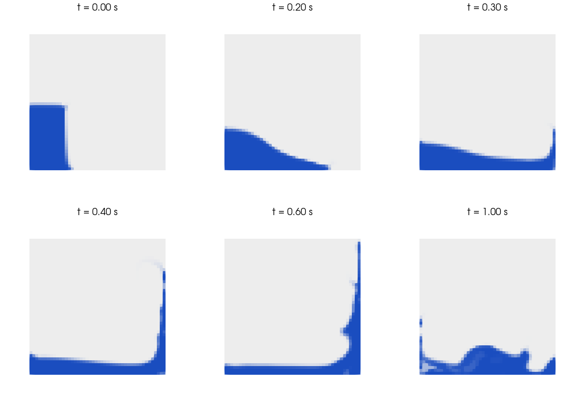
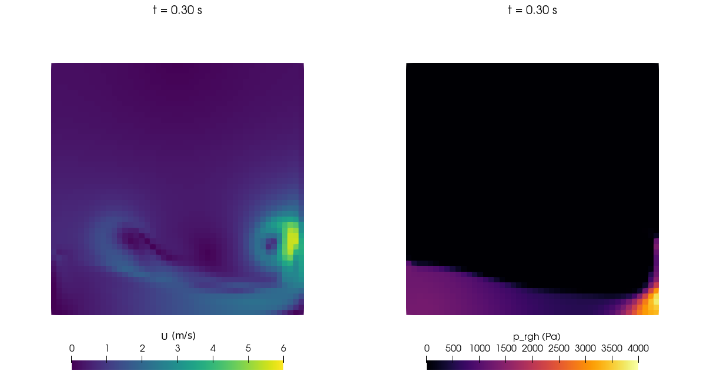

# 08 - Dam Break

| Property        | Value                                                            |
|-----------------|------------------------------------------------------------------|
| **Difficulty**  | Intermediate                                                     |
| **Solver**      | `interFoam` (transient, incompressible, VOF)                     |
| **Physics**     | Two-phase flow (water + air), free surface                       |
| **Turbulence**  | Laminar                                                          |
| **Mesh**        | `blockMesh`, structured, 2D (46 x 46 x 1 cells)                  |
| **Key concept** | Volume of Fluid (VOF) method                                     |
| **OpenFOAM**    | 6 (run with the `cfdengine/openfoam` Docker image)               |
| **Run time**    | Seconds: 764 time steps, about 4 s of solver time on one core    |

---

## Goal

Learn how a free surface is captured with the VOF method in OpenFOAM:

- how a non-uniform initial field (the water column) is created with `setFields`
  from a uniform template in `0.orig`;
- how `alpha.water`, `p_rgh` and the `fixedFluxPressure` / `totalPressure` /
  `inletOutlet` boundary conditions work together in `interFoam`;
- how adjustable time stepping with `maxCo` and `maxAlphaCo` keeps the interface
  advection stable;
- how to judge a VOF run from its log: boundedness of `alpha.water`, water volume
  balance and Courant numbers.

## Target

What a correct run produces (all numbers are from the reference run, OpenFOAM 6,
single core; see the verification table below for the checks and tolerances):

- The solver reaches t = 1 s in 764 time steps with no warnings, 20 write times
  (every 0.05 s) plus the initial time.
- The water column collapses, the front reaches the right wall at about
  t = 0.3 s, a jet climbs the right wall and comes within two cells of the top of the
  tank at about t = 0.5 s, then falls back and sloshes.
- `alpha.water` stays within about 3e-4 of the interval [0, 1]; the water volume
  fraction starts at 0.1304 and stays constant until the jet reaches the open top,
  then drops to 0.1272 (2.5 % of the water leaves through `atmosphere`).
- Max Courant number 0.55, max interface Courant number 0.50 (limits are 0.5).

There is no analytical solution and no tabulated reference data for this exact
geometry (no obstacle, laminar, 46 x 46 mesh), so the target is internal
consistency plus the qualitative behaviour of the Martin and Moyce (1952)
experiments, not a quantitative match.

## Verification method

The checks are implemented in `verify.py` (Python 3, standard library only). It only
reads results that `Allrun` already produced (logs, `system/`, `0/alpha.water` and
the written time directories), so it needs neither Docker nor OpenFOAM:

```bash
./run_docker.sh          # runs Allclean, Allrun and then verify.py
python3 verify.py        # re-check an existing run; exit code 0 = all PASS
```

It prints one line per check, `PASS|FAIL  <name>  measured=<value>  expected=<value>`,
a summary, and exits non-zero if any check fails or if results are missing (exit
code 2). Each tolerance is explained in a comment next to the check in `verify.py`;
none was adjusted to make a check pass.

| Check | What it proves | Expected / tolerance | Measured (reference run) |
|-------|----------------|----------------------|--------------------------|
| mesh cells | `blockMesh` produced the intended 46 x 46 x 1 mesh | 2116, exact | 2116 |
| checkMesh | mesh topology and geometry are valid | `Mesh OK.` | Mesh OK (non-orthogonality 0, skewness 3e-14, aspect ratio 1) |
| fatal errors/warnings in logs | no `FOAM FATAL`, `FOAM Warning`, floating point exception | 0, exact | 0 |
| solver finished | `interFoam` ended normally | log ends with `End` | yes |
| end time reached | whole simulated second was computed | `endTime` = 1 s (+- 1e-6, print resolution) | 1 |
| max Courant number | time stepping respects `maxCo` | <= 0.60 (1.2 x `maxCo`: `interFoam` evaluates Co before it changes the step, and the step may grow by up to 20 % per step) | 0.552 |
| max interface Courant | time stepping respects `maxAlphaCo` | <= 0.60 (1.2 x `maxAlphaCo`, same reason) | 0.502 |
| time step range | adjustable stepping behaves plausibly | 1e-4 s .. `maxDeltaT` (0.01 s); 1e-4 s would need \|U\| ~ 60 m/s at Co = 0.5 | 4.6e-4 .. 4.7e-3 s |
| min(alpha.water) | boundedness (MULES) | >= -1e-3 (0.1 % of the range, negligible effect on density) | -1.7e-4 |
| max(alpha.water) | boundedness (MULES) | <= 1.001 | 1.00026 |
| p_rgh final residual | pressure solve converges in every step | <= `tolerance` in `fvSolution` (1e-7) | 9.997e-8 (max over all steps) |
| initial water fraction = wet cells / cells | `setFields` applied to the right cells | 276/2116 = 0.130435, +- 1e-6 | 0.130435 |
| initial water fraction vs exact geometry | the cell-snapped column matches the specified box | 0.1461 x 0.292 / 0.584^2 = 0.1251, +- 0.01 (at most half a cell layer around the column perimeter, about 0.008) | 0.1304 |
| water fraction never increases | no spurious water source | <= initial + 1e-5 (6 significant digits in the log) | 0.130435 |
| written time directories | write control works | 21 incl. 0 (`endTime / writeInterval` + 1), exact | 21 |
| water conserved while top row dry | volume conservation while no water can leave | deviation <= 1e-5 for all steps up to the last write time before the top cell row contains water (0.40 s) | 0 |
| water lost through atmosphere | loss over the run is small and caused by the open top | 0 .. 5 % (plausibility bound, no reference) | 2.5 % |
| front reaches right wall | wall-impact time is physically plausible | 0.13 .. 0.5 s; lower bound is the frictionless dry-bed (Ritter) front speed 2 sqrt(g H) = 3.4 m/s over 0.438 m, upper bound is plausibility only; resolution is the 0.05 s write interval | 0.3 s |

The front-arrival time is only bounded, not compared with the Martin and Moyce data:
those experiments have a different initial geometry and scaling, so they are a
qualitative guide only.

Manual / visual checks (not part of `verify.py`):

1. Open the case in ParaView (`./open_paraview.sh`) and animate `alpha.water`. The
   column should collapse to the right, hit the wall, climb it as a thin jet and
   fall back (compare with the images in section 11).
2. The interface should be about 1 to 3 cells wide, with no isolated blobs
   (floating water droplets of one cell are expected in the splash).
3. In `p_rgh`, the pressure should peak where the front hits the right wall.
4. After the run, `log.checkMesh` should report zero non-orthogonality and
   aspect ratio 1.

---

## Table of Contents

1. [Problem Description](#1-problem-description)
2. [Physics and Theory](#2-physics-and-theory)
3. [The Volume of Fluid (VOF) Method](#3-the-volume-of-fluid-vof-method)
4. [Case Structure](#4-case-structure)
5. [Mesh Generation](#5-mesh-generation)
6. [Initial Conditions and setFields](#6-initial-conditions-and-setfields)
7. [Boundary Conditions](#7-boundary-conditions)
8. [Solver Configuration](#8-solver-configuration)
9. [Numerical Schemes](#9-numerical-schemes)
10. [How to Run](#10-how-to-run)
11. [Expected Results](#11-expected-results)
12. [Post-Processing](#12-post-processing)
13. [Exercises](#13-exercises)
14. [References](#14-references)

---

## 1. Problem Description

The **dam break** problem is a classic benchmark for testing free-surface and
multiphase flow solvers. A column of water, initially held in place at one end of a
rectangular tank, is instantaneously released and collapses under gravity. The water
surges across the tank floor, impacts the far wall, and climbs it as a jet that falls
back and sloshes.

This tutorial covers:

- The **Volume of Fluid (VOF)** method for tracking fluid interfaces
- **Multiphase flow** simulation with two immiscible fluids (water and air)
- **Transient free-surface dynamics** with large interface deformations
- **Adjustable time stepping** controlled by the Courant number
- The `setFields` utility for initializing non-uniform fields

### Problem Setup

```
                    atmosphere (open top boundary)
    +---------------------------------------------------------+
    |                                                         |
    |              AIR  (alpha.water = 0)                     |
    |              rho = 1 kg/m^3                             |
    |              nu  = 1.48e-5 m^2/s                        |
    |                                                         |
    |   0.292 m                                               | 0.584 m
    |   +------+                                              |
    |   |######|                                              |
    |   |######|  WATER  (alpha.water = 1)                    |
    |   |######|  rho = 1000 kg/m^3                           |
    |   |######|  nu  = 1e-6 m^2/s                            |
    |   |######|                                              |
    +---+------+----------------------------------------------+
    ^   0.146 m                                               ^
 leftWall              lowerWall (no-slip)               rightWall
                         0.584 m
```

The domain is 0.01 m deep with one cell in z; `frontAndBack` is `empty`, so the
problem is two-dimensional. (The 0.146 m column width is the 0.1461 m box edge in
`setFieldsDict`.)

### Physical Parameters

| Parameter           | Value                | Units  | File                              |
|---------------------|----------------------|--------|-----------------------------------|
| Domain width        | 0.584                | m      | `system/blockMeshDict`            |
| Domain height       | 0.584                | m      | `system/blockMeshDict`            |
| Domain depth        | 0.01                 | m      | `system/blockMeshDict`            |
| Water column width  | 0.146 (box edge 0.1461) | m   | `system/setFieldsDict`            |
| Water column height | 0.292                | m      | `system/setFieldsDict`            |
| Water density       | 1000                 | kg/m^3 | `constant/transportProperties`    |
| Air density         | 1                    | kg/m^3 | `constant/transportProperties`    |
| Water viscosity (kinematic) | 1e-6         | m^2/s  | `constant/transportProperties`    |
| Air viscosity (kinematic)   | 1.48e-5      | m^2/s  | `constant/transportProperties`    |
| Surface tension     | 0.07                 | N/m    | `constant/transportProperties`    |
| Gravity             | 9.81 (downward, -y)  | m/s^2  | `constant/g`                      |

### Time Evolution

The six frames below are drawn from the `alpha.water` fields written by the reference
run (each character is a block of 2 x 4 cells: `#` water, `.` interface or spray,
blank air). The tank is 0.584 m wide and high.

```
  t = 0 s                      t = 0.2 s                    t = 0.3 s
  +-----------------------+    +-----------------------+    +-----------------------+
  |                       |    |                       |    |                       |
  |                       |    |                       |    |                       |
  |                       |    |                       |    |                       |
  |                       |    |                       |    |                       |
  |                       |    |                       |    |                       |
  |                       |    |                       |    |                       |
  |######                 |    |                       |    |                       |
  |######                 |    |                       |    |                       |
  |######                 |    |#....                  |    |                      .|
  |######                 |    |#######.               |    |.....                 .|
  |######                 |    |##########..           |    |#########.....       .#|
  |######                 |    |################..     |    |#######################|
  +-----------------------+    +-----------------------+    +-----------------------+

  t = 0.4 s                    t = 0.6 s                    t = 1 s
  +-----------------------+    +-----------------------+    +-----------------------+
  |                       |    |                      .|    |                       |
  |                       |    |                      .|    |                       |
  |                       |    |                      .|    |                       |
  |                      .|    |                      .|    |                       |
  |                      .|    |                     .#|    |                       |
  |                      .|    |                     .#|    |                       |
  |                      #|    |                     .#|    |                       |
  |                      #|    |                    .##|    |.                      |
  |                     .#|    |                   .###|    |.                      |
  |                     .#|    |                     ##|    |.       ......   .     |
  |#............       .##|    |                  ..###|    |#...   .##########.   .|
  |#######################|    |#######################|    |##################...##|
  +-----------------------+    +-----------------------+    +-----------------------+
```



*alpha.water (blue = water, grey = air) at t = 0, 0.2, 0.3, 0.4, 0.6 and 1.0 s from
the reference run. Look for the front reaching the right wall at about 0.3 s and the
thin jet climbing the wall at 0.4 to 0.6 s.*

---

## 2. Physics and Theory

### Governing Equations

The dam break involves two immiscible, incompressible Newtonian fluids (water and
air) sharing a computational domain. The flow is governed by a **single-fluid
Navier-Stokes system** where the fluid properties vary with the local volume
fraction:

**Continuity equation:**

```
div(U) = 0
```

**Momentum equation:**

```
d(rho U)/dt + div(rho U U) = -grad(p_rgh) - (g . x) grad(rho) + div(mu grad(U)) + sigma kappa grad(alpha)
```

where:
- `rho` - mixture density (varies with alpha)
- `U` - velocity field (shared by both phases)
- `p_rgh` - modified pressure, `p - rho g . x`, which removes the hydrostatic component
- `g` - gravitational acceleration vector (0, -9.81, 0) m/s^2
- `mu` - mixture dynamic viscosity
- `sigma` - surface tension coefficient
- `kappa` - interface curvature
- `alpha` - volume fraction (`alpha.water`)

### Mixture Properties

The fluid properties at any point are volume-weighted averages of the two phases:

```
rho = alpha * rho_water + (1 - alpha) * rho_air
    = alpha * 1000      + (1 - alpha) * 1

mu  = alpha * mu_water  + (1 - alpha) * mu_air
```

### Modified Pressure (p_rgh)

OpenFOAM's multiphase solvers use the **modified pressure** `p_rgh` instead of the
absolute pressure `p`:

```
p_rgh = p - rho g . x
```

(In the code `p = p_rgh + rho*gh`, with `gh = g . (x - hRef)` and `hRef = 0` here.)
This removes the hydrostatic pressure gradient from the momentum equation, which
improves accuracy for gravity-dominated flows where the hydrostatic pressure is much
larger than the dynamic pressure variations. In still water `p_rgh` is uniform: in the
written fields at t = 0.05 s it is about 2.5 kPa in the water column, close to
rho g H = 1000 x 9.81 x 0.292 = 2.9 kPa.

### Why Laminar?

This small-scale dam break (0.584 m domain) is run with `simulationType laminar`
(`constant/turbulenceProperties`). Turbulence in the splash and jet is therefore not
modelled; at this mesh resolution (dx = 0.0127 m) the small scales of a turbulent
splash could not be resolved anyway. This keeps the case focused on the VOF method
itself. For larger-scale dam breaks, or for a study of the breaking flow,
turbulence modelling (for example k-epsilon, k-omega SST or LES) would be appropriate.

See also: [Turbulence Models](../../notes/06_turbulence_models.md)

---

## 3. The Volume of Fluid (VOF) Method

### Overview

The **Volume of Fluid** method, introduced by Hirt and Nichols (1981), is among the
most widely used techniques for simulating flows with sharp interfaces between
immiscible fluids. The key idea:

> Track the **volume fraction** of each fluid in every cell, rather than
> explicitly tracking the interface geometry.

### The Alpha Field

The volume fraction field `alpha.water` (denoted alpha) represents the fraction of
each computational cell occupied by water:

```
  alpha = 1       alpha ~ 0.5      alpha = 0
  +----------+    +----------+    +----------+
  |##########|    |######    |    |          |
  |##########|    |######    |    |          |
  |##########|    |####      |    |          |
  |##########|    |####      |    |          |
  |##########|    |##        |    |          |
  +----------+    +----------+    +----------+
   Pure water      Interface       Pure air
                   cell
```

| Value of alpha | Meaning                     |
|----------------|-----------------------------|
| alpha = 1      | Cell is fully water         |
| alpha = 0      | Cell is fully air           |
| 0 < alpha < 1  | Cell contains the interface |

### Transport Equation for Alpha

The volume fraction is advected by the flow velocity:

```
d(alpha)/dt + div(U alpha) + div(U_r alpha (1 - alpha)) = 0
```

The last term `div(U_r alpha (1 - alpha))` is the **interface compression** term used
in OpenFOAM's VOF implementation. `U_r` is an artificial compression velocity that
acts only at the interface (where `alpha (1 - alpha) != 0`) to keep the interface
sharp and prevent numerical diffusion from smearing it out.

The `cAlpha` parameter in `fvSolution` controls the strength of this compression:

| cAlpha | Effect                                           |
|--------|--------------------------------------------------|
| 0      | No compression (interface will smear)            |
| 1      | Conservative compression (used here)             |
| > 1    | Enhanced compression (sharper but may oscillate) |

### MULES: Maintaining Boundedness

A critical requirement for VOF is that alpha remains bounded between 0 and 1.
OpenFOAM uses the **MULES** (Multidimensional Universal Limiter with Explicit
Solution) algorithm to limit the alpha fluxes, preventing overshoots and undershoots
that would produce negative volume fractions or fractions above unity. This case
uses `MULESCorr yes` (a semi-implicit predictor followed by MULES correction),
`nAlphaCorr 2` and `nLimiterIter 3`.

```
  Without limiting:               With MULES:
  alpha can exceed bounds         alpha stays (nearly) bounded

  1.2 - - - - - - - - -          1.0 ------------------
                  / \                           +-----
  1.0 ----------/   \            0.8           /
               /     \           0.6          /
  0.5         /       \          0.4         /
             /         \         0.2        /
  0.0 ------/           \----    0.0 -------+
       -0.1                         (bounded 0 to 1)
```

The limiting is not exact: in the reference run `Min(alpha.water)` reaches about
-1.7e-4 and `Max(alpha.water)` about 1.00026.

### Surface Tension: The Continuum Surface Force (CSF) Model

Surface tension is modelled using the **Brackbill CSF method** (Brackbill et al.,
1992). Instead of applying a force at the discrete interface, the surface tension is
converted to a volume force distributed across the interface cells:

```
F_sigma = sigma kappa grad(alpha)
```

where:
- `sigma` = surface tension coefficient (0.07 N/m for water-air)
- `kappa` = interface curvature, `kappa = -div(n)` with `n = grad(alpha) / |grad(alpha)|`
- `grad(alpha)` = gradient of volume fraction (non-zero only at the interface)

```
  Surface tension force at the interface:

  Air  (alpha = 0)
  ---------------------------------
                                        F_sigma acts normal to the
    <- <- <- F_sigma -> -> ->           interface, towards the centre
                                        of curvature
  ---------------------------------
  Water (alpha = 1)
```

For this dam break, surface tension is expected to be minor compared with gravity and
inertia at the scale of the column (0.146 m wide); it is included for completeness
(Exercise 6 varies it).

---

## 4. Case Structure

```
08_dam_break/
├── 0.orig/                         # Initial-condition templates
│   ├── U                           #   Velocity field
│   ├── p_rgh                       #   Modified pressure
│   └── alpha.water                 #   Volume fraction (water phase), uniform 0
├── 0/                              # Created by Allrun (copy of 0.orig + setFields)
├── constant/                       # Physical properties and mesh
│   ├── g                           #   Gravitational acceleration
│   ├── transportProperties         #   Phase properties (water, air), sigma
│   ├── turbulenceProperties        #   Turbulence model (laminar)
│   └── polyMesh/                   #   Mesh (generated by blockMesh)
├── system/                         # Solver and discretization settings
│   ├── blockMeshDict               #   Mesh generation dictionary
│   ├── controlDict                 #   Run control parameters
│   ├── fvSchemes                   #   Discretization schemes
│   ├── fvSolution                  #   Linear solver settings
│   └── setFieldsDict               #   Field initialization (water column)
├── images/                         # Screenshots used in this README
├── Allrun                          # blockMesh -> checkMesh -> setFields -> interFoam
├── Allclean                        # Remove generated files
├── run_docker.sh                   # Allclean + Allrun in Docker, then verify.py
├── verify.py                       # Result checks (see "Verification method")
├── make_images.py                  # Re-create the images with ParaView (pvbatch)
├── open_paraview.sh                # Open the case in ParaView
└── README.md                       # This file
```

`setFields` modifies `0/alpha.water` in place, so the unmodified fields are kept in
`0.orig/` and `Allrun` copies them to `0/` before every run. `Allclean` removes `0/`.

### Key Files Explained

| File                           | Purpose                                                      |
|--------------------------------|--------------------------------------------------------------|
| `0.orig/alpha.water`           | Volume fraction - **the defining field** of VOF simulations  |
| `0.orig/p_rgh`                 | Modified pressure (not absolute pressure)                    |
| `0.orig/U`                     | Shared velocity field for both phases                        |
| `constant/g`                   | Gravity vector - drives the entire flow                      |
| `constant/transportProperties` | Density and viscosity of each phase; surface tension         |
| `system/setFieldsDict`         | Defines where water starts (the "dam")                       |
| `system/controlDict`           | Adjustable time stepping with Courant-number control         |

See also: [OpenFOAM Case Structure](../../notes/02_openfoam_cases.md),
[OpenFOAM Dictionaries](../../notes/03_openfoam_dictionaries.md)

---

## 5. Mesh Generation

The mesh is generated with `blockMesh` as a single rectangular block subdivided into
a uniform structured grid.

### Domain and Resolution

```
                      0.584 m
    +-----------------------------------------+
    |                                         |
    |     46 cells across (dx = 0.0127 m)     |
    |                                         |
    |     46 cells high   (dy = 0.0127 m)     |  0.584 m
    |                                         |
    |     1 cell deep     (dz = 0.01 m)       |
    |                                         |
    +-----------------------------------------+
    Total cells: 46 x 46 x 1 = 2116

    Cell aspect ratio in the x-y plane: 1.0 (square cells)
```

`checkMesh` (run by `Allrun`, output in `log.checkMesh`) reports 2116 cells, 8556
faces, max aspect ratio 1, non-orthogonality 0 and `Mesh OK`.

### Vertex Numbering

The block is defined by 8 vertices forming a single hexahedral block:

```
           7 ----------- 6          y
          /|            /|          |  z
         / |           / |          | /
        4 ----------- 5  |          |/
        |  |          |  |          +----- x
        |  3 ---------|- 2
        | /           | /
        |/            |/
        0 ----------- 1

    Back face  (z = 0):    0, 1, 2, 3
    Front face (z = 0.01): 4, 5, 6, 7
```

Vertex coordinates (see `system/blockMeshDict`): 0 = (0 0 0), 1 = (0.584 0 0),
2 = (0.584 0.584 0), 3 = (0 0.584 0), and 4 to 7 are the same points at z = 0.01.

### Boundary Patches

| Patch          | Type    | Face Vertices    | Physical Meaning                    |
|----------------|---------|------------------|-------------------------------------|
| `leftWall`     | `wall`  | (0 4 7 3)        | Left solid wall                     |
| `rightWall`    | `wall`  | (1 2 6 5)        | Right solid wall                    |
| `lowerWall`    | `wall`  | (0 1 5 4)        | Bottom solid wall (floor)           |
| `atmosphere`   | `patch` | (3 7 6 2)        | Open top (atmospheric)              |
| `frontAndBack` | `empty` | (0 3 2 1) (4 5 6 7) | 2D constraint (no solution in z) |

The `empty` type on `frontAndBack` tells OpenFOAM this is a 2D simulation: no
equations are solved in the z-direction. Every face of the block belongs to one of
these patches, so the mesh has no `defaultFaces` patch.

See also: [Meshing](../../notes/04_meshing.md)

---

## 6. Initial Conditions and setFields

### The Problem: Non-Uniform Initial Fields

Unlike most OpenFOAM simulations where initial fields are uniform, the dam break
needs **spatially varying initial conditions**: the water column occupies only a part
of the domain. The template `0.orig/alpha.water` sets the default (air everywhere):

```
internalField   uniform 0;   // Everything starts as air
```

### The setFields Utility

`setFields` modifies field values within specified geometric regions **after** the
mesh is created. Here it sets `alpha.water = 1` inside a box corresponding to the
water column:

```
  setFieldsDict defines:

  +----------------------------------------------------------+
  |                                                          |
  |   alpha.water = 0 (air) everywhere by default            |
  |                                                          |
  |   +--------+                                             |
  |   |########| <- boxToCell region:                        |
  |   |########|    box (0 0 -1) (0.1461 0.292 1)            |
  |   |########|    alpha.water = 1 (water)                  |
  |   |########|                                             |
  |   +--------+                                             |
  +----------------------------------------------------------+
```

The z-bounds (-1, 1) extend well beyond the mesh depth (0 to 0.01 m) so that all
cells in z are captured.

Because `setFields` selects whole cells by their centre, the water column is
12 x 23 cells (about 0.152 m x 0.292 m) and the initial water fraction is
276 / 2116 = 0.1304, while the exact geometric value would be 0.125.

### How setFields Works

1. Reads the mesh from `constant/polyMesh/`
2. Reads `system/setFieldsDict`
3. For each region, finds cells whose **centre** falls within the specified geometry
4. Overwrites the field values for those cells
5. Writes the modified field back to the `0/` directory

> **Important:** `setFields` modifies the field files in place. You must run
> `blockMesh` before `setFields` (the mesh must exist). Re-running `setFields` on an
> already initialised `0/` simply sets the same cells again; to change the water
> region, edit `setFieldsDict` and copy `0.orig` to `0` again (`Allrun` does this).

---

## 7. Boundary Conditions

### Velocity (U)

| Patch          | BC Type                       | Value           | Meaning                                         |
|----------------|-------------------------------|-----------------|-------------------------------------------------|
| `leftWall`     | `noSlip`                      | -               | Zero velocity at wall                           |
| `rightWall`    | `noSlip`                      | -               | Zero velocity at wall                           |
| `lowerWall`    | `noSlip`                      | -               | Zero velocity at wall                           |
| `atmosphere`   | `pressureInletOutletVelocity` | uniform (0 0 0) | Free outflow; zero gradient for outgoing flow, velocity from the flux for inflow |
| `frontAndBack` | `empty`                       | -               | 2D constraint                                   |

### Pressure (p_rgh)

| Patch          | BC Type              | Value        | Meaning                                         |
|----------------|----------------------|--------------|-------------------------------------------------|
| `leftWall`     | `fixedFluxPressure`  | uniform 0    | Adjusts pressure gradient to match velocity BC  |
| `rightWall`    | `fixedFluxPressure`  | uniform 0    | Same as above                                   |
| `lowerWall`    | `fixedFluxPressure`  | uniform 0    | Same as above                                   |
| `atmosphere`   | `totalPressure`      | p0 = 0       | Total (static + dynamic) pressure fixed at 0    |
| `frontAndBack` | `empty`              | -            | 2D constraint                                   |

### Volume Fraction (alpha.water)

| Patch          | BC Type        | Value              | Meaning                                |
|----------------|----------------|--------------------|----------------------------------------|
| `leftWall`     | `zeroGradient` | -                  | No flux of alpha through wall          |
| `rightWall`    | `zeroGradient` | -                  | No flux of alpha through wall          |
| `lowerWall`    | `zeroGradient` | -                  | No flux of alpha through wall          |
| `atmosphere`   | `inletOutlet`  | inletValue = 0     | Water leaves freely; air enters if flow reverses inward |
| `frontAndBack` | `empty`        | -                  | 2D constraint                          |

### Why fixedFluxPressure?

The `fixedFluxPressure` BC is designed for flows with body forces (gravity, surface
tension) next to walls. With `zeroGradient` on `p_rgh`, the wall-normal pressure
gradient would not balance those body-force terms, which would drive a spurious
flux through the wall. `fixedFluxPressure` sets the gradient so that the flux through
the wall matches the velocity boundary condition (zero for a no-slip wall).

See also: [Boundary Conditions](../../notes/05_boundary_conditions.md)

---

## 8. Solver Configuration

### controlDict - Time Control

The dam break uses **adjustable time stepping**, which is important for VOF
simulations:

```
deltaT          0.001;          // Initial time step
adjustTimeStep  yes;            // Let OpenFOAM adjust dt
maxCo           0.5;            // Maximum Courant number
maxAlphaCo      0.5;            // Maximum Courant number for alpha transport
maxDeltaT       0.01;           // Upper limit for the time step
endTime         1;              // Simulate 1 second
writeInterval   0.05;           // Write output every 0.05 s (20 write times)
```

### Why Adjustable Time Stepping?

The flow speed changes strongly during the run. Peak velocity magnitude in the
domain (air included) at the written times of the reference run:

| t (s) | 0.05 | 0.1 | 0.2 | 0.3 | 0.4 | 0.5 | 0.6 | 0.8 | 1.0 |
|-------|------|-----|-----|-----|-----|-----|-----|-----|-----|
| max \|U\| (m/s) | 1.5 | 2.2 | 2.8 | 5.5 | 7.0 | 5.4 | 3.0 | 3.7 | 4.2 |

The speed rises when the front hits the wall (t = 0.25 to 0.3 s) and during the jet.
A fixed time step small enough for the fastest phase would waste computation during
the slow initial collapse, so the step follows the Courant limit instead: it ranged
from 0.00046 s to 0.0047 s in the reference run (initial step 0.001 s, `maxDeltaT`
0.01 s was never reached).

### The Alpha Courant Number

For VOF simulations, **two** Courant numbers matter:

```
Standard Courant:     Co = |U| * dt / dx

Alpha Courant:        Co_alpha = |U_interface| * dt / dx
```

The alpha Courant number is based on the velocity in the interface cells (cells with
0 < alpha < 1). Because the interface advection requires high accuracy,
`maxAlphaCo` is often set equal to or lower than `maxCo`. Here both are 0.5.

The time step is changed after the Courant numbers of the current step are computed
and may grow by at most 20 % per step, so the printed Courant number can briefly
exceed the limit (0.55 in the reference run).

See also: [CFL Number](../../notes/08_cfl_number.md)

### fvSolution - PIMPLE Algorithm

```
PIMPLE
{
    momentumPredictor   no;
    nOuterCorrectors    1;      // 1 = PISO mode
    nCorrectors         3;      // Pressure correction loops
    nNonOrthogonalCorrectors 0; // Not needed for an orthogonal mesh
}
```

With `nOuterCorrectors 1`, PIMPLE reduces to the **PISO** algorithm (the log prints
"Operating solver in PISO mode"), which is standard for transient VOF simulations.
The three corrector steps help the pressure-velocity coupling.

### Linear Solvers

| Field         | Solver        | Smoother / preconditioner | Tolerance | relTol | Purpose                   |
|---------------|---------------|---------------------------|-----------|--------|---------------------------|
| alpha.water   | smoothSolver  | symGaussSeidel            | 1e-8      | 0      | Volume fraction (tight)   |
| pcorr         | PCG           | DIC                       | 1e-5      | 0      | Flux correction at start  |
| p_rgh         | PCG           | DIC                       | 1e-7      | 0.05 (`p_rghFinal`: 0) | Pressure (most expensive) |
| U             | smoothSolver  | symGaussSeidel            | 1e-6      | 0      | Velocity (`momentumPredictor no`, so not used in the reference run) |

The alpha solver uses a tight tolerance (1e-8) because small errors in the volume
fraction field lead to mass conservation errors and interface smearing.

See also: [Linear Solvers](../../notes/09_linear_solvers.md)

---

## 9. Numerical Schemes

### fvSchemes - Discretization

| Category               | Scheme                        | Reason                                           |
|------------------------|-------------------------------|--------------------------------------------------|
| `ddtSchemes`           | `Euler`                       | First-order implicit time; robust for VOF        |
| `gradSchemes`          | `Gauss linear`                | Second-order gradient (standard)                 |
| `div(rhoPhi,U)`        | `Gauss linearUpwind grad(U)`  | Upwind-biased for momentum; stable and accurate  |
| `div(phi,alpha)`       | `Gauss vanLeer`               | TVD limiter for alpha; prevents overshoots       |
| `div(phirb,alpha)`     | `Gauss linear`                | Interface compression term                       |
| `div(((rho*nuEff)*dev2(T(grad(U)))))` | `Gauss linear` | Stress term of the viscous model            |
| `laplacianSchemes`     | `Gauss linear corrected`      | Second-order diffusion with non-orthogonal correction |
| `interpolationSchemes` | `linear`                      | Default face interpolation                       |
| `snGradSchemes`        | `corrected`                   | Consistent with the laplacian scheme             |

### Why vanLeer for Alpha?

The volume fraction transport needs special care. Common choices behave as follows:

- **Upwind:** excessive numerical diffusion, the interface smears
- **Central / linear:** oscillations, alpha goes below 0 or above 1
- **vanLeer (TVD):** bounded, sharper interface with little diffusion

```
  Interface profile across the interface (schematic):

  alpha
  1.0 ------+                  +--- exact (step)
            |                  |
            |  \              /|    central: oscillates around the step
  0.5       |   \    /\      / |    upwind:  too diffuse
            |    \--/  \----/  |    vanLeer: close to the step
  0.0       +                  +---
         interface location
```

The `div(phirb,alpha)` term handles the interface compression velocity `U_r`, which
is how OpenFOAM keeps the interface sharp without geometric reconstruction.

---

## 10. How to Run

### Prerequisites

- OpenFOAM 6 (or compatible) installed and sourced, or Docker with the
  `cfdengine/openfoam` image
- `blockMesh`, `checkMesh`, `setFields` and `interFoam` available in `$PATH`
  (native run)
- Python 3 for `verify.py`

### Quick Start

Docker (OpenFOAM 6 inside the image, project mounted at `/case`):

```bash
cd projects/08_dam_break
./run_docker.sh        # Allclean, Allrun, then python3 verify.py
```

Native OpenFOAM:

```bash
source /opt/openfoam6/etc/bashrc     # adjust to your installation
cd projects/08_dam_break
./Allrun
python3 verify.py
```

### Step-by-Step

```bash
# 0. Create the initial fields from the templates
cp -r 0.orig 0

# 1. Generate the mesh
blockMesh

# 2. (optional) Check the mesh
checkMesh

# 3. Initialize the water column
setFields

# 4. Run the simulation
interFoam

# 5. Visualize results
./open_paraview.sh        # or: paraFoam
```

### What Each Step Does

```
  blockMesh:                  setFields:                  interFoam:
  Creates mesh                Sets alpha.water = 1        Solves the
  in polyMesh/                in the water column         multiphase flow

  +-+-+-+-+-+-+-+-+          +---+-------------+         +-----------------+
  | | | | | | | | |          |###|             |         |                 |
  +-+-+-+-+-+-+-+-+          |###|             |         | ~~              |
  | | | | | | | | |          |###|             |         | ####~           |
  +-+-+-+-+-+-+-+-+          |###|             |         | ########~       |
  | | | | | | | | |          |###|             |         | ##############  |
  +-+-+-+-+-+-+-+-+          +---+-------------+         +-----------------+
  Empty grid                  Water initialised           Flow solved
```

### Monitoring Progress

While `interFoam` runs (or afterwards), inspect the log:

```bash
# Courant numbers and time step
tail -f log.interFoam | grep "Courant"

# Current time
tail -f log.interFoam | grep "^Time ="

# Interface boundedness and water volume fraction
tail -f log.interFoam | grep "Phase-1"
```

### Cleaning Up

To remove all generated files (`0/`, time directories, mesh, logs):

```bash
./Allclean
```

`0.orig/`, `images/` and `verify.py` are kept.

---

## 11. Expected Results

### Console Output

During the run `log.interFoam` contains blocks like this (reference run, near the end):

```
Courant Number mean: 0.0823004 max: 0.436785
Interface Courant Number mean: 0.0131452 max: 0.398613
deltaT = 0.00127687
Time = 0.998723

smoothSolver:  Solving for alpha.water, Initial residual = 0.00444407, Final residual = 5.34375e-10, No Iterations 3
Phase-1 volume fraction = 0.127178  Min(alpha.water) = -1.81828e-09  Max(alpha.water) = 1
MULES: Correcting alpha.water
MULES: Correcting alpha.water
Phase-1 volume fraction = 0.127178  Min(alpha.water) = -9.97692e-06  Max(alpha.water) = 1
DICPCG:  Solving for p_rgh, Initial residual = 0.0307932, Final residual = 0.00127661, No Iterations 1
...
```

### Key Things to Verify

| Check                    | Observed in the reference run                           | Concern if wrong                     |
|--------------------------|---------------------------------------------------------|--------------------------------------|
| Min(alpha.water)         | -1.7e-4 at worst (not exactly 0)                        | Large negative values: boundedness problem |
| Max(alpha.water)         | 1.00026 at worst                                        | Much above 1: MULES not limiting     |
| Phase-1 volume fraction  | 0.130435 constant until about t = 0.42 s, 0.127178 after t = 0.65 s | Changing before the jet reaches the top: mass not conserved |
| Courant number (max)     | 0.55 (limit 0.5, brief overshoot expected)              | Much higher: reduce `maxCo`          |
| Interface Courant (max)  | 0.50                                                    | Much higher: reduce `maxAlphaCo`     |
| Time step                | 0.00046 to 0.0047 s                                     | Very small: possible mesh problem    |

`python3 verify.py` evaluates these automatically (see "Verification method").

### Water leaves through the top

The water fraction is constant at 0.1304 until the jet reaches the open top boundary
at about t = 0.42 s. Between 0.42 s and 0.65 s it falls to 0.1272, i.e. about 2.5 %
of the water leaves through `atmosphere`. This follows from the tank being 0.584 m
high with an open top; it is not a conservation error.

### Physical Behavior Timeline

Measured on the written `alpha.water` fields (cells with alpha > 0.5; front position
along the floor, highest water cell anywhere):

| Time (s) | Event                                                   | Measurement                                  |
|----------|---------------------------------------------------------|----------------------------------------------|
| 0.0      | Water column released                                   | 12 x 23 cells of water                       |
| 0.05     | Column collapses, base surges right                     | front x = 0.18 m, top of water y = 0.28 m    |
| 0.2      | Water front crosses the tank floor                      | front x = 0.44 m, top y = 0.18 m             |
| 0.25     | Front about to hit the right wall                       | front x = 0.56 m                             |
| 0.3      | Front reaches the right wall                            | front x = 0.584 m                            |
| 0.45     | Jet climbs the right wall                               | top of water y = 0.52 m                      |
| 0.5      | Jet reaches the top of the tank (within two cells), water has started to leave | top of water y = 0.57 m                      |
| 0.65     | Jet falls back                                          | top of water y = 0.56 m                      |
| 0.9      | Water falls back along the wall                         | top of water y = 0.15 m                      |
| 1.0      | Sloshing continues                                      | max \|U\| 4.2 m/s                            |

The exact timings depend on mesh and schemes; use them as a sanity check, not as
reference data.



*Velocity magnitude (left) and p_rgh (right) at t = 0.3 s, when the front hits the
right wall. Look for the highest speed in the corner at the right wall and the p_rgh
maximum on the floor next to the wall. The velocity field covers both phases, so the
air above the water also moves.*

---

## 12. Post-Processing

### ParaView Visualization

```bash
# Open the case in ParaView (creates dam_break.foam if it does not exist)
./open_paraview.sh
# Or, with a native OpenFOAM installation
paraFoam
# Or, manually
touch case.foam
paraview case.foam
```

### Recommended Visualizations

#### 1. Alpha Contour Animation (Primary Result)

- Select `alpha.water` as the display variable
- Set colour range: 0 to 1
- Use a blue-white-red or blue-red colour map
- Press Play to animate the dam break

#### 2. Velocity Magnitude

- Display `mag(U)` to see how the water accelerates
- Overlay velocity vectors (Glyph filter) to visualize flow direction
- Note the high velocities at the wave front and during wall impact

#### 3. Pressure Field

- Display `p_rgh` to see the modified pressure distribution
- Observe the pressure rise during wall impact (peak about 5 kPa at 0.45 to 0.5 s)
- In still water `p_rgh` is uniform, not hydrostatic (the hydrostatic part is
  removed by the definition of `p_rgh`)

#### 4. Interface Sharpness

- Plot alpha along a horizontal line (Plot Over Line filter)
- A sharp interface shows a step from 0 to 1 over 1 to 3 cells
- A smeared interface indicates excessive numerical diffusion

#### 5. Re-creating the README images

```bash
pvbatch make_images.py     # writes images/alpha_snapshots.png and images/velocity_pressure.png
```

### Quantitative Post-Processing

#### Wave Front Position vs Time

Extract the alpha profile along the floor at every write time by adding a `sets`
function object to `system/controlDict` (it writes
`postProcessing/floorProfile/<time>/floor_alpha.water.xy`):

```
functions
{
    floorProfile
    {
        type            sets;
        libs            ("libsampling.so");
        writeControl    writeTime;
        interpolationScheme cell;
        setFormat       raw;
        fields          (alpha.water);
        sets
        (
            floor
            {
                type    lineUniform;
                axis    x;
                start   (0 0.0064 0.005);
                end     (0.584 0.0064 0.005);
                nPoints 46;
            }
        );
    }
}
```

The leading edge is the largest `x` in each file where `alpha.water > 0.5`. The
sampling line lies in the first cell row (cell centres at y = 0.00635 m).

#### Validation Against Experiment

The dam break has been studied experimentally by Martin and Moyce (1952). Results
are reported as the non-dimensional front position `Z/a` against a non-dimensional
time based on `sqrt(g/a)`, where `a` is the initial column width (here a = 0.146 m).
This case does not reproduce their experimental geometry, and no experimental data
are included in this repository, so a comparison would be qualitative at best: sample
the front position as described above and non-dimensionalise it with `a` and
`sqrt(g/a)`.

---

## 13. Exercises

### Exercise 1: Add an Obstacle

Add a small rectangular obstacle on the tank floor to study wave-structure
interaction (the classic OpenFOAM `damBreak` has one). Modify `blockMeshDict` to
include an obstacle at x = 0.292 m with dimensions 0.024 x 0.048 m. This requires
splitting the domain into multiple blocks and adding a wall patch for the obstacle.

```
  +------------------------------------------------------+
  |                                                      |
  |   WATER  |     AIR                                   |
  |   COLUMN |                                           |
  |          |              +----+                       |
  |          |              | OB |  <- 0.024 x 0.048 m   |
  +----------+--------------+----+------------------------+
```

### Exercise 2: Change Water Column Size

Experiment with different initial water column aspect ratios by changing the box in
`setFieldsDict`:

| Case | Width (m) | Height (m) | Aspect Ratio | Expected Behavior            |
|------|-----------|------------|--------------|------------------------------|
| A    | 0.146     | 0.292      | 1:2          | This tutorial                |
| B    | 0.146     | 0.146      | 1:1          | Less water, lower head       |
| C    | 0.292     | 0.292      | 1:1          | More water, stronger impact  |
| D    | 0.146     | 0.438      | 1:3          | Taller column, more energetic splash |

Compare the wall-impact time and how much water leaves through the top.

### Exercise 3: Mesh Refinement Study

Test the sensitivity of the results to mesh resolution:

| Mesh   | Cells       | dx (m)   | Expected Outcome                       |
|--------|-------------|----------|----------------------------------------|
| Coarse | 23 x 23     | 0.0254   | Fast, more diffused interface          |
| Medium | 46 x 46     | 0.0127   | This tutorial                          |
| Fine   | 92 x 92     | 0.0063   | Sharper interface, slower              |
| VFine  | 184 x 184   | 0.0032   | More splashing detail resolved         |

Modify the cell counts in `blockMeshDict` and compare interface sharpness and the
initial water fraction (the cell-snapped column converges to 0.125 as the mesh is
refined).

### Exercise 4: 3D Extension

Convert this 2D case to a full 3D simulation:

1. Change `frontAndBack` from `empty` to `wall` in `blockMeshDict`
2. Increase the z-depth and z-cells, e.g. 0.146 m with 12 cells
3. Change the `frontAndBack` boundary conditions from `empty` to
   `noSlip` / `fixedFluxPressure` / `zeroGradient` in `0.orig`
4. Consider parallel decomposition for the larger mesh

See also: [Parallelization](../../notes/07_parallelization.md)

### Exercise 5: Turbulence Model

For higher Reynolds number dam breaks, add turbulence modelling:

1. Change `turbulenceProperties` to use `RAS` with `kOmegaSST`
2. Add `0.orig/k`, `0.orig/omega` and `0.orig/nut` initial condition files
3. Set appropriate wall functions on the boundaries

See also: [Turbulence Models](../../notes/06_turbulence_models.md)

### Exercise 6: Surface Tension Effects

Study the effect of surface tension by varying `sigma` in `transportProperties`:

| sigma (N/m) | Physical Meaning                 | Expected effect                       |
|-------------|----------------------------------|---------------------------------------|
| 0.0         | No surface tension               | No surface tension force; the interface is regularised only numerically |
| 0.07        | Water-air (this tutorial)        | Reference                             |
| 0.7         | 10 x enhanced                    | Thin jets and droplets are rounded    |
| 7.0         | 100 x enhanced                   | Surface tension dominates small features; may need a smaller time step |

---

## 14. References

### Experimental Validation

1. **Martin, J.C. and Moyce, W.J.** (1952). "Part IV. An Experimental Study of the
   Collapse of Liquid Columns on a Rigid Horizontal Plane." *Philosophical
   Transactions of the Royal Society of London. Series A, Mathematical and Physical
   Sciences*, 244(882), pp. 312-324.
   - The classic experimental benchmark for dam break validation
   - Provides non-dimensional front position and column height data

### VOF Method

2. **Hirt, C.W. and Nichols, B.D.** (1981). "Volume of Fluid (VOF) Method for the
   Dynamics of Free Boundaries." *Journal of Computational Physics*, 39(1),
   pp. 201-225.
   - The original VOF paper introducing the method
   - Describes the concept of volume fraction tracking

### Surface Tension Model

3. **Brackbill, J.U., Kothe, D.B. and Zemach, C.** (1992). "A Continuum Method for
   Modeling Surface Tension." *Journal of Computational Physics*, 100(2),
   pp. 335-354.
   - The Continuum Surface Force (CSF) model used in OpenFOAM
   - Converts surface tension to a volume force using grad(alpha)

### OpenFOAM Documentation

4. **OpenFOAM User Guide** - chapter on multiphase flows and the `interFoam` solver:
   [https://www.openfoam.com/documentation/user-guide](https://www.openfoam.com/documentation/user-guide)
5. **OpenFOAM Wiki - InterFoam:**
   [https://openfoamwiki.net/index.php/InterFoam](https://openfoamwiki.net/index.php/InterFoam)
6. OpenFOAM `damBreak` tutorial
   (`$FOAM_TUTORIALS/multiphase/interFoam/laminar/damBreak`): same tank and water
   column, with an obstacle on the floor.

### Related Notes in This Repository

- [Introduction to CFD](../../notes/01_short_intro_to_cfd.md) - Fundamental CFD concepts
- [OpenFOAM Cases](../../notes/02_openfoam_cases.md) - Case directory structure
- [OpenFOAM Dictionaries](../../notes/03_openfoam_dictionaries.md) - Dictionary syntax
- [Meshing](../../notes/04_meshing.md) - Mesh generation with blockMesh
- [Boundary Conditions](../../notes/05_boundary_conditions.md) - BC types and usage
- [Turbulence Models](../../notes/06_turbulence_models.md) - For Exercise 5
- [Parallelization](../../notes/07_parallelization.md) - For Exercise 4 (3D)
- [CFL Number](../../notes/08_cfl_number.md) - Time step control and stability
- [Linear Solvers](../../notes/09_linear_solvers.md) - Solver algorithms
- [Multiphase Flows](../../notes/12_multiphase_flows.md) - VOF and interFoam background

---

*This tutorial is part of the [OpenFOAM Tutorials](../../README.md) repository.*
