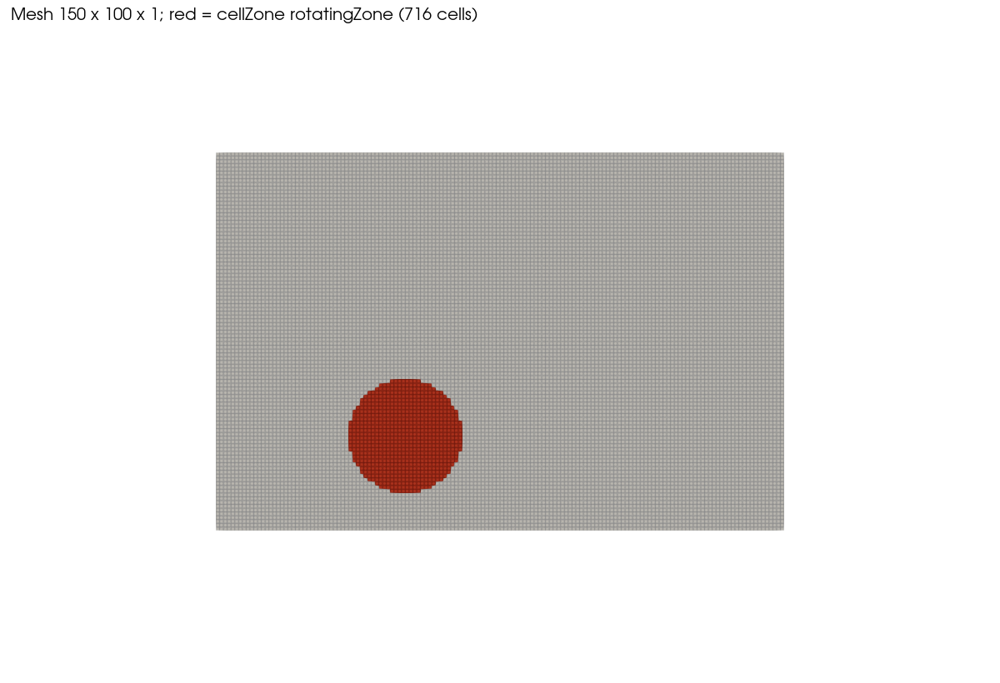
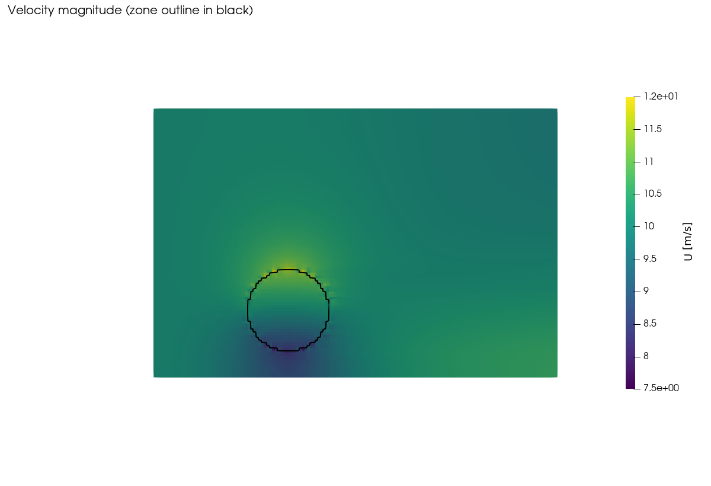
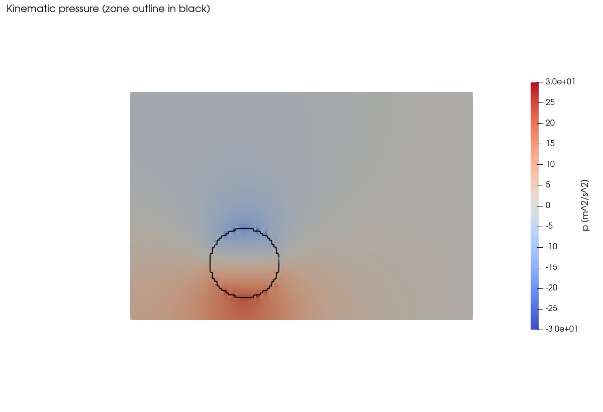
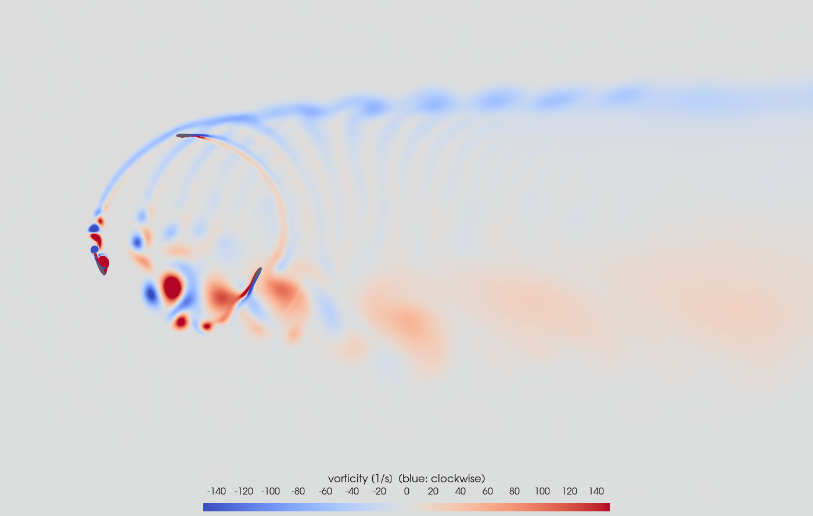

# Tutorial 09: Wind Turbine Blade Simulation with MRF

**Difficulty:** ★★★★☆ Advanced
**Solver:** `simpleFoam` (steady-state, incompressible, turbulent with MRF)
**Turbulence Model:** k-epsilon (RAS)
**Approach:** Multiple Reference Frame (Frozen Rotor)
**Tested with:** OpenFOAM 6 (`cfdengine/openfoam` Docker image)
**Run time:** about 6 s on a workstation (124 iterations, 15,000 cells)

---

## Goal

Learn how a rotating region is set up and solved with the **Multiple Reference Frame
(MRF)** technique in OpenFOAM, using the smallest possible case:

- how a `cellZone` is created with `topoSet` and referenced from `constant/MRFProperties`;
- how `omega`, `origin` and `axis` define the rotation, and how RPM relates to rad/s
  and to the tip-speed ratio;
- what MRF does to a steady `simpleFoam` solution (extra Coriolis and centrifugal
  terms inside the zone, no mesh motion);
- how to check a run with logs, `checkMesh` and a script (`verify.py`).

The case is a **teaching case, not a turbine model**. The rotating zone is an empty
disc: it contains **no blade geometry and no wall**, so no torque or power is produced
and nothing is extracted from the wind. A real rotor case needs a 3D mesh with the
blade surface inside the zone (see [Section 5](#5-mesh-generation--blockmesh)).

## Target

What a correct run must produce (measured with OpenFOAM 6; no literature or
experimental reference exists for this simplified case, so the targets are
self-consistency checks plus the values of one reference run):

| Quantity                          | Target                                              |
|-----------------------------------|-----------------------------------------------------|
| Mesh                              | 15,000 hex cells, `checkMesh` reports `Mesh OK`     |
| MRF zone                          | `rotatingZone` with 716 cells (analytic pi r^2/dx^2 = 707, within 5 %) |
| Convergence                       | `SIMPLE solution converged` before `endTime` 1000 (measured: 124 iterations), initial residuals < 1e-4 |
| Mass balance                      | inlet flux = -U H depth = -2.0 m^3/s, outlet flux balances to 0.5 % |
| Velocity range                    | min 7.9 m/s, max 11.8 m/s (+-10 %)                  |
| Kinematic pressure range          | -26.6 to +28.6 m^2/s^2 (+-15 %)                     |
| Rotation-induced asymmetry        | mean p over the upper half of the zone is lower than over the lower half (sign opposite to `omega`); measured difference -14.4 m^2/s^2 |
| Torque / power                    | none: no blades or walls in the zone                |

## Verification method

After `./run_docker.sh` (which runs `verify.py` as its last step), or after `./Allrun`
in a local OpenFOAM shell:

```bash
python3 verify.py            # reads logs and fields only, needs no OpenFOAM
echo $?                      # 0 = all checks passed, 1 = a check failed, 2 = results missing
```

`verify.py` prints one line per check (`PASS|FAIL name measured=... expected=... +- tol`)
and exits non-zero on any failure. Checks and the values measured in the reference run:

| Check | What it proves | Expected | Tolerance | Measured |
|-------|----------------|----------|-----------|----------|
| no FATAL ERROR in logs | all four steps ran | none | exact | none |
| mesh cell count | blockMesh matches `blockMeshDict` (150 x 100 x 1) | 15000 | 0 | 15000 |
| checkMesh `Mesh OK` | mesh quality is acceptable | `Mesh OK` | exact | `Mesh OK` |
| number of cell zones | the zone exists exactly once | 1 | 0 | 1 |
| cells in `rotatingZone` | `topoSet` selected a disc of radius 0.3 m | 706.9 (pi r^2 / dx dy) | 5 % | 716 |
| `cellZones` file vs log | zone stored in the mesh equals the topoSet result | 716 | 0 | 716 |
| MRF zone created | solver found zone `MRF1` | `MRF1` | exact | `MRF1` |
| omega vs README RPM | `omega` = RPM x 2 pi / 60 | 10.472 rad/s | 1e-3 | 10.472 |
| omega vs README value | README and dictionary agree | 10.472 rad/s | 1e-3 | 10.472 |
| tip-speed ratio vs README | omega R / U = 0.31 as stated here | 0.31 | 0.005 | 0.3142 |
| MRF origin vs topoSet axis | rotation centre = zone centre | 0 m offset | 1e-9 | 0 |
| SIMPLE converged | steady solution reached | < endTime (1000) | n/a | 124 |
| final initial residuals | below `residualControl` (1e-4) | < 1e-4 | n/a | 9.6e-5 (p, the largest) |
| latest time dir | the written time equals the converged iteration | 124 | 0 | 124 |
| minimum / maximum `|U|` | flow stays near 10 m/s with a local speed-up/slow-down | 7.93 / 11.80 m/s | 10 % | 7.93 / 11.80 |
| minimum / maximum `p` | size of the rotation-induced pressure field | -26.6 / +28.6 m^2/s^2 | 15 % | -26.6 / +28.6 |
| inlet flux | `phi` on the inlet = -U H depth | -2.0 m^3/s | 1e-6 | -2.0 |
| outlet + inlet flux | mass is conserved | 0 | 0.5 % of inlet | -2e-6 |
| zone p asymmetry sign | rotation produces a lateral pressure difference with the expected sign | upper - lower has the sign opposite to `omega` | n/a | -14.4 |
| zone p asymmetry magnitude | difference is of the order of the Coriolis scale 2 omega U D = 126 m^2/s^2 | 6.3 to 126 m^2/s^2 | 0.05x to 1x scale | 14.4 |

Notes on the tolerances:

- Velocity and pressure bands are the value of **one** reference run plus an allowance
  (10 % and 15 %) for other OpenFOAM versions and linear-solver details. They are not
  derived from measured run-to-run scatter, which was not measured.
- The 5 % zone-size band allows for the discretisation of the circle on the 0.02 m grid.
- The asymmetry magnitude is an order-of-magnitude check against the Coriolis scale, not
  an accuracy claim.
- Torque and power cannot be verified: the zone has no blades or walls.

Manual checks (not scripted):

1. **Zero rotation.** Set `omega 0;` in `constant/MRFProperties` and re-run
   `simpleFoam`. Measured (800 iterations): `|U|` = 10.0 m/s everywhere, `|p|` < 3e-13,
   `|Uy|` < 5e-15. The case then has a uniform solution. (The solver does not print
   `converged` for this run because the normalised residual of `Ux` does not fall for
   a uniform field; it simply keeps iterating to `endTime`.)
2. **Reversed rotation.** Set `omega -10.472;`. Measured: pressure maximum moves to the
   upper side (+20.7 m^2/s^2 at x = 0.91, y = 0.79) and the minimum to the lower side
   (-36.4 m^2/s^2 at x = 0.91, y = 0.21). The magnitudes are not exactly mirrored.
3. **Images.** Compare your `U`, `p` and vorticity plots with the figures in
   [Section 12](#12-expected-results).

---

## Table of Contents

1. [Problem Description](#1-problem-description)
2. [Physical Background — MRF Theory](#2-physical-background--mrf-theory)
3. [MRF vs AMI: Choosing the Right Approach](#3-mrf-vs-ami-choosing-the-right-approach)
4. [Case Structure](#4-case-structure)
5. [Mesh Generation — blockMesh](#5-mesh-generation--blockmesh)
6. [Cell Zone Creation — topoSet](#6-cell-zone-creation--toposet)
7. [MRFProperties — The Key Configuration](#7-mrfproperties--the-key-configuration)
8. [Boundary Conditions](#8-boundary-conditions)
9. [Turbulence Setup](#9-turbulence-setup)
10. [Solver Configuration](#10-solver-configuration)
11. [How to Run](#11-how-to-run)
12. [Expected Results](#12-expected-results)
13. [Post-Processing](#13-post-processing)
14. [Exercises](#14-exercises)
15. [Industrial Applications](#15-industrial-applications)
16. [Troubleshooting](#16-troubleshooting)
17. [References](#17-references)
18. [Cross-References](#18-cross-references)

---

## 1. Problem Description

This tutorial demonstrates the **Multiple Reference Frame (MRF)** technique in OpenFOAM,
a fundamental approach for simulating rotating machinery. Instead of physically rotating
the mesh (which is computationally expensive and requires transient solvers), MRF adds
source terms to the governing equations that approximate the effect of rotation.

We simulate wind flowing past a circular **rotating zone** that represents a simplified
turbine rotor disk. The MRF approach treats this zone as if it were spinning at 100 RPM,
which deflects the flow and creates a lateral pressure asymmetry without any mesh motion.

> **Scope.** The zone is an empty disc of fluid: no blades, no walls. The rotation
> therefore only enters through the Coriolis and centrifugal terms. The case does not
> extract energy from the wind and has no torque, power coefficient or wake deficit.
> See [Section 5](#5-mesh-generation--blockmesh) for what a real blade case adds.

### Domain Layout

The zone is centred at (1.0, 0.5), so it sits in the lower part of the channel and
spans y = 0.2 m to 0.8 m.

```
                         3.0 m
  ◄─────────────────────────────────────────────────►

  ▲  ┌──────────────────────────────────────────────┐  ▲
  │  │              topAndBottom (slip)             │  │
  │  │                                              │  │
  │  │                                              │  │
  │  │                                              │  │
  │  │                                              │  │
     │                                              │
 2.0 │  →→→→→→                            →→→→→→    │  2.0 m
  m  │  →→→→→→     ╭──────────────╮       →→→→→→    │
     │  →→→→→→    ╱                ╲      →→→→→→    │
  │  │  →→→→→→   │    Rotating      │     →→→→→→    │  │
  │  │  →→→→→→   │    MRF Zone      │     →→→→→→    │  │
  │  │            │  ω = 100 RPM ↺   │                │  │
  │  │             ╲   r = 0.3 m    ╱                │  │
  │  │              ╰──────────────╯                 │  │
  │  │            center: (1.0, 0.5)                 │  │
  ▼  └──────────────────────────────────────────────┘  ▼
         inlet        topAndBottom (slip)        outlet
         U = 10 m/s                              p = 0
```

(↺ = counter-clockwise, i.e. positive `omega` about +z.)

### Domain Specifications

```
  ┌──────────────────────────────────────────────────────────┐
  │  Physical Domain:  3.0 m × 2.0 m × 0.1 m (quasi-2D)      │
  │  MRF Zone Center:  (1.0, 0.5, 0.0)                        │
  │  MRF Zone Radius:  0.3 m (diameter 0.6 m)                 │
  │  MRF Zone Shape:   Cylinder (z-axis aligned), 716 cells   │
  │  Rotation Speed:   100 RPM = 10.472 rad/s                 │
  │  Rotation Axis:    z-axis (0, 0, 1)                       │
  │  Zone tip speed:   ω R = 10.472 × 0.3 = 3.14 m/s          │
  │  Tip-speed ratio:  ω R / U = 3.14 / 10 = 0.31             │
  │  Inlet Velocity:   10 m/s (uniform, x-direction)          │
  │  Mesh Resolution:  150 × 100 × 1 cells (dx = dy = 0.02 m) │
  │  Reynolds Number:  U D / ν = 10 × 0.6 / 1.5e-5 = 4e5      │
  └──────────────────────────────────────────────────────────┘
```

This zone therefore has a tip-speed ratio of 0.31. A real turbine runs at roughly 5 to 9,
so this zone rotates far more slowly relative to the wind than a real rotor; see
Exercise 1 to vary it.

### Flow Physics Overview

```
  Upstream          MRF Zone                  Downstream
  (Undisturbed)     (Rotation Effects)        (Deflected flow)

     →→→→          ╭───╮                     →→→↘
     →→→→   ↗     ╱  ↺  ╲                    →→→→→
     →→→→  ───►  │  ω    │  ───►             →→→↘
     →→→→         ╲     ╱                    →→→→→
     →→→→          ╰───╯                     →→→↘

  Uniform flow   Coriolis + centrifugal      Flow deflected upward before
  U = 10 m/s     source terms applied        and downward behind the zone
                  inside this region         (u_y of a few tenths of m/s)
```

---

## 2. Physical Background — MRF Theory

### What is MRF (Multiple Reference Frame)?

The **Multiple Reference Frame** method is a steady-state approximation for simulating
rotating machinery. Rather than physically rotating the mesh, MRF modifies the governing
equations inside a designated zone by adding source terms that account for the rotational
effects.

#### The Concept

In a rotating reference frame, an observer spinning with the rotor sees the flow as
steady (or approximately steady). The transformation between the inertial (stationary)
frame and the rotating frame introduces two additional body forces:

```
  ┌─────────────────────────────────────────────────────────────────┐
  │                                                                 │
  │  Navier-Stokes in Rotating Frame:                               │
  │                                                                 │
  │  ∂U_r                                                           │
  │  ──── + (U_r · ∇)U_r = -∇p/ρ + ν∇²U_r                          │
  │   ∂t                                                            │
  │                         - 2ω × U_r        ← Coriolis           │
  │                         - ω × (ω × r)     ← Centrifugal        │
  │                                                                 │
  │  where:                                                         │
  │    U_r  = velocity in the rotating frame                        │
  │    ω    = angular velocity vector                               │
  │    r    = position vector from rotation axis                    │
  │                                                                 │
  └─────────────────────────────────────────────────────────────────┘
```

In OpenFOAM the solver keeps the absolute velocity as the unknown in the zone and adds
the `ω × U` term to the momentum equation, with the convecting flux taken relative to
the rotating frame (see `MRFZone.C`). The physical content is the same two forces.

#### Coriolis Force: `-2ω × U_r`

The Coriolis force acts perpendicular to both the rotation axis and the relative velocity.
It is responsible for deflecting the flow and creating the swirling motion that is
characteristic of rotating machinery. For this case ($\omega$ along +z, U along +x) the force
per unit mass points in the **-y** direction, which is why pressure builds up on the
lower side of the zone.

```
  Rotation axis (ω, out of page, +z)
        ⊙
                    y
                    ▲
                    │
        U_r ───────►│          Coriolis force -2ω × U_r
        (+x)        │          points toward -y
                    ▼
```

#### Centrifugal Acceleration: `-ω × (ω × r)`

The centrifugal term always points radially **outward** from the rotation axis with
magnitude $\omega^{2}$ r. In a closed rotating frame it is balanced by a radial pressure gradient.

```
                    ω (rotation axis, out of page)
                    ⊙

         centrifugal         centrifugal
          ◄──────  ●  ──────►
                 center

    Points radially OUTWARD from the rotation axis
```

#### Frozen Rotor Approximation

The "frozen rotor" name comes from the fact that the rotor geometry (if present) remains
**frozen** in one angular position. The MRF approach does NOT:

- Move or rotate any mesh cells
- Account for transient rotor-stator interaction
- Capture unsteady wake effects or vortex shedding from blades

The MRF approach DOES:

- Add Coriolis and centrifugal source terms inside the rotating zone
- Produce a time-averaged (steady-state) flow field
- Provide, for a case that contains blades, a good initial estimate of performance
  (pressure rise, torque)
- Run much faster than transient sliding-mesh simulations

#### Tip-speed ratio

The rotor speed is usually quoted as the tip-speed ratio

The tip-speed ratio and angular velocity are

$$
\lambda=\frac{\omega R}{U_\infty},\qquad
\omega=\frac{\mathrm{RPM}\cdot2\pi}{60}\quad[\mathrm{rad/s}].
$$

For this case:

$$
\lambda=\frac{10.472\cdot0.3}{10}\approx0.31.
$$

Horizontal-axis wind turbines are typically designed for $\lambda$ of about 5 to 9. To reach a
turbine-like $\lambda$ = 7 with $U_\infty$ = 10 m/s and R = 0.3 m this zone would have to rotate at
$\omega = \lambda U_\infty / R = 233\,\mathrm{rad/s}$ (about 2,200 RPM).

### When to Use MRF

MRF is appropriate when:
- The flow is approximately steady in the rotating frame
- Rotor-stator spacing is large relative to blade pitch
- You need a quick estimate of machine performance
- You want to initialize a transient AMI simulation

MRF is NOT appropriate when:
- Strong unsteady rotor-stator interaction exists
- You need accurate wake dynamics or vortex shedding
- Blade passing frequency effects are important
- The geometry has large circumferential non-uniformity near the interface

---

## 3. MRF vs AMI: Choosing the Right Approach

OpenFOAM provides two main methods for simulating rotating machinery:

```
  ┌─────────────────────┐              ┌─────────────────────┐
  │                     │              │                     │
  │   MRF (Frozen       │              │   AMI (Arbitrary    │
  │   Rotor)            │              │   Mesh Interface)   │
  │                     │              │                     │
  │  ┌───┐              │              │  ┌───┐ → ┌───┐      │
  │  │ ● │  No mesh     │              │  │ ↺ │   │   │      │
  │  │   │  motion      │              │  │   │   │   │      │
  │  └───┘              │              │  └───┘   └───┘      │
  │                     │              │  Mesh actually      │
  │  Source terms only  │              │  slides/rotates     │
  │                     │              │                     │
  └─────────────────────┘              └─────────────────────┘
```

### Comparison Table

| Feature                  | MRF (This Tutorial)      | AMI (Sliding Mesh)        |
|--------------------------|--------------------------|---------------------------|
| **Type**                 | Steady-state             | Transient                 |
| **Mesh Motion**          | None                     | Actual rotation           |
| **Solver**               | `simpleFoam`             | `pimpleFoam`              |
| **Computational Cost**   | Low (★★☆☆☆)              | High (★★★★★)              |
| **Setup Complexity**     | Moderate                 | Complex (AMI interfaces)  |
| **Physical Accuracy**    | Moderate                 | High                      |
| **Rotor-Stator Effects** | Not captured             | Fully captured            |
| **Blade Wake**           | Time-averaged            | Resolved per time step    |
| **Typical Use**          | Initial design, screening| Detailed analysis         |
| **Run Time**             | Minutes                  | Hours to days             |
| **Interface Treatment**  | cellZone (no interface)  | AMI patch pair            |
| **Multiple Zones**       | Yes (multiple MRF zones) | Yes (multiple AMI zones)  |

(Relative cost and run-time entries are general guidance; this case itself runs in seconds.)

### Decision Flowchart

```
  Start
    │
    ▼
  Is the flow approximately ──── Yes ───► Use MRF
  steady in the rotating frame?            (simpleFoam)
    │
    No
    │
    ▼
  Do you need unsteady ──── Yes ───► Use AMI
  rotor-stator effects?               (pimpleFoam)
    │
    No
    │
    ▼
  Is this an initial ──── Yes ───► Use MRF first,
  design study?                     then AMI for final
    │
    No
    │
    ▼
  Use AMI for detailed analysis
```

---

## 4. Case Structure

```
09_wind_turbine_blade/
├── 0/                          ◄── Initial & boundary conditions
│   ├── U                       ◄── Velocity field
│   ├── p                       ◄── Pressure field (kinematic)
│   ├── k                       ◄── Turbulent kinetic energy
│   ├── epsilon                 ◄── Turbulent dissipation rate
│   └── nut                     ◄── Turbulent viscosity
├── constant/                   ◄── Physical properties
│   ├── transportProperties     ◄── Fluid properties (air)
│   ├── turbulenceProperties    ◄── Turbulence model selection
│   ├── MRFProperties           ◄── ★ MRF zone definition ★
│   └── polyMesh/               ◄── Mesh (generated by blockMesh)
├── system/                     ◄── Solver & numerics configuration
│   ├── blockMeshDict           ◄── Background mesh definition
│   ├── topoSetDict             ◄── Cell zone creation for MRF
│   ├── controlDict             ◄── Run control (endTime 1000, write every 100)
│   ├── fvSchemes               ◄── Discretisation schemes
│   └── fvSolution              ◄── Solver & SIMPLE settings
├── Allrun                      ◄── Run script (local OpenFOAM)
├── Allclean                    ◄── Clean script
├── run_docker.sh               ◄── Clean + run + verify in the Docker image
├── verify.py                   ◄── Result checks (reads logs and fields only)
├── make_images.py              ◄── Renders images/ with pvpython
├── open_paraview.sh            ◄── Opens the case in ParaView
├── images/                     ◄── Figures used in this README
└── README.md                   ◄── This file
```

---

## 5. Mesh Generation — blockMesh

The mesh is a simple rectangular domain created with `blockMesh`. This is intentionally
simplified — a real wind turbine simulation would use `snappyHexMesh` with an actual
blade STL geometry. The purpose here is to demonstrate the MRF concept.

### Domain Geometry

```
  z = 0.1  ┌──────────────────────────────────────────┐
           │                                          │  Patch: frontAndBack
           │  150 × 100 × 1 cells                     │  (empty — 2D)
           │                                          │
  z = 0    └──────────────────────────────────────────┘

           x = 0                                x = 3
           y = 0                                y = 2

           y
           ▲
       2.0 ┤ ╔══════════════════════════════════════╗
           │ ║            topAndBottom              ║
           │ ║                                      ║
       1.0 ┤ ║                                      ║
           │ ║          ╭──────╮                    ║
       0.8 ┤ ║          │ MRF  │                    ║
           │ ║i         │ zone │               out  ║
       0.5 ┤ ║n    ─────┤ r=0.3│               let  ║
           │ ║l         │      │                    ║
       0.2 ┤ ║e         ╰──────╯                    ║
           │ ║t        center:(1,0.5)               ║
           │ ║            topAndBottom              ║
       0.0 ┤ ╚══════════════════════════════════════╝
           └──┬─────────┬─────────┬─────────┬───────►x
             0.0       1.0       2.0       3.0
```

### Mesh and zone



*Figure 1: the 150 x 100 background mesh; the red cells are `cellZone rotatingZone`
(716 cells, radius 0.3 m, centre (1.0, 0.5)).*

### blockMeshDict Key Parameters

| Parameter       | Value                          | Purpose                      |
|-----------------|--------------------------------|------------------------------|
| Domain size     | $3.0 \times 2.0 \times 0.1$ m              | Rectangular, quasi-2D        |
| Cell count      | $150 \times 100 \times 1$                  | 15,000 cells total           |
| Cell size (dx)  | 0.02 m                         | Uniform spacing              |
| Cell size (dy)  | 0.02 m                         | Uniform spacing              |
| Grading         | (1 1 1) — uniform              | No stretching                |

### Patch Definitions

| Patch Name     | Type   | Location        | Face Vertices  |
|----------------|--------|-----------------|----------------|
| `inlet`        | patch  | x = 0 plane     | (0 4 7 3)      |
| `outlet`       | patch  | x = 3 plane     | (1 2 6 5)      |
| `topAndBottom` | patch  | y = 0, y = 2    | Top + bottom   |
| `frontAndBack` | empty  | z = 0, z = 0.1  | Front + back   |

### What a real blade case would add

This case stops at the rotating zone. A case with actual blades differs as follows
(these items are not part of this tutorial's files):

- **Geometry and mesh:** a 3D domain with the blade (and hub) surface as an STL,
  meshed with `snappyHexMesh`; the MRF `cellZone` can be created by `snappyHexMesh`
  or with `topoSet` around the rotor disc.
- **Walls in the zone:** blade and hub patches inside the zone are walls with a
  no-slip condition; the MRF treatment moves them with the zone. Patches inside the
  zone that must stay stationary are listed in `nonRotatingPatches`.
- **Wall treatment:** wall functions or a resolved boundary layer (`nut`, `k`,
  `epsilon` wall boundary conditions) replace the `calculated`/`slip` setup here.
- **Axis and origin:** `origin` and `axis` must match the real rotor axis; the sign of
  `omega` follows the right-hand rule about `axis`.
- **Performance output:** torque and thrust are obtained by integrating pressure and
  viscous forces over the blade patches (e.g. the `forces` function object with the
  rotation centre `CofR` set to `origin`); power is torque times omega, and the power
  coefficient follows from the free-stream power available over the swept area.
- **Operating point:** `omega` is chosen from the target tip-speed ratio
  (omega = $\lambda$ $U_\infty$ / R); several values give the performance curve.

---

## 6. Cell Zone Creation — topoSet

The `topoSet` utility creates cell sets and cell zones from geometric primitives.
For MRF, we need a **cellZone** (not just a cellSet) because the MRF framework
references zones by name.

### topoSet Workflow

```
  ┌──────────────────────────────────────────────────────────────┐
  │                                                              │
  │  Step 1: cylinderToCell                                      │
  │  ─────────────────────                                       │
  │  Select all cells whose centers fall inside a cylinder:      │
  │                                                              │
  │    • Center axis: from (1.0, 0.5, -1) to (1.0, 0.5, 1)       │
  │    • Radius: 0.3 m                                           │
  │    • Result: cellSet "rotatingZone" (716 cells)              │
  │                                                              │
  │             ╭───────╮                                        │
  │            ╱         ╲       All cells with centers          │
  │           │  selected │      inside this cylinder            │
  │           │   cells   │      are marked                      │
  │            ╲         ╱                                       │
  │             ╰───────╯                                        │
  │                                                              │
  │  Step 2: setToCellZone                                       │
  │  ────────────────────                                        │
  │  Convert the cellSet to a cellZone:                          │
  │                                                              │
  │    cellSet "rotatingZone" ──► cellZone "rotatingZone"        │
  │                                                              │
  │  The cellZone is stored in the mesh and can be referenced    │
  │  by MRFProperties.                                           │
  │                                                              │
  └──────────────────────────────────────────────────────────────┘
```

The cylinder end points at z = -1 and z = 1 lie outside the domain (depth 0.1 m), so
the selection spans the full depth.

### Why Two Steps?

OpenFOAM distinguishes between:

- **cellSet**: A simple collection of cell indices (used for selection/manipulation)
- **cellZone**: A mesh topology entity that solvers can reference by name

MRF requires a `cellZone`, so we first select cells with `cylinderToCell` (creating a
cellSet), then convert it to a cellZone with `setToCellZone`.

### topoSet Source Types

| Source Type         | Description                               |
|---------------------|-------------------------------------------|
| `cylinderToCell`    | Cells inside a cylinder (used here)       |
| `sphereToCell`      | Cells inside a sphere                     |
| `boxToCell`         | Cells inside a bounding box               |
| `surfaceToCell`     | Cells near/inside an STL surface          |
| `zoneToCell`        | Cells from an existing zone               |
| `regionToCell`      | Connected region of cells                 |

---

## 7. MRFProperties — The Key Configuration

The `constant/MRFProperties` file is what makes this an MRF simulation. When
`simpleFoam` reads this file, it adds rotational source terms to the momentum
equation inside the specified cell zone.

### MRFProperties Dictionary Breakdown

```
MRF1                            // Name for this MRF zone (arbitrary)
{
    cellZone    rotatingZone;   // Must match the cellZone from topoSet
    active      yes;            // Enable/disable this MRF zone

    nonRotatingPatches ();      // Patches INSIDE the zone that don't rotate
                                // (e.g., stator blades). Empty = all rotate.

    origin      (1.0 0.5 0);    // Point on the rotation axis (zone centre)
    axis        (0 0 1);        // Rotation axis direction (z-axis here)
    omega       10.472;         // Angular velocity in rad/s (100 RPM)
}
```

### Angular Velocity Conversion

```
  RPM to rad/s:   ω = RPM × 2π / 60

  ┌──────────────────────────────────────┐
  │  100 RPM × 2π / 60 = 10.472 rad/s    │
  │   50 RPM × 2π / 60 =  5.236 rad/s    │
  │  200 RPM × 2π / 60 = 20.944 rad/s    │
  │  500 RPM × 2π / 60 = 52.360 rad/s    │
  │ 1000 RPM × 2π / 60 = 104.72 rad/s    │
  │ 1500 RPM × 2π / 60 = 157.08 rad/s    │
  │ 3000 RPM × 2π / 60 = 314.16 rad/s    │
  └──────────────────────────────────────┘
```

With `R = 0.3 m` and `U = 10 m/s`, the tip-speed ratio `λ = ω R / U` is 0.31 for
100 RPM and scales linearly with `omega` (200 RPM gives 0.63, 500 RPM gives 1.57).

### Multiple MRF Zones

You can define multiple MRF zones (e.g., for a multi-stage compressor):

```
// Example: Two counter-rotating rotors
MRF1
{
    cellZone    rotor1Zone;
    origin      (1.0 0.5 0);
    axis        (0 0 1);
    omega       10.472;   // Forward rotation
}

MRF2
{
    cellZone    rotor2Zone;
    origin      (2.0 0.5 0);
    axis        (0 0 1);
    omega       -10.472;  // Counter-rotation
}
```

---

## 8. Boundary Conditions

### Boundary Condition Summary Table

| Field       | Inlet                 | Outlet          | topAndBottom | frontAndBack |
|-------------|-----------------------|-----------------|--------------|--------------|
| **U**       | fixedValue (10 0 0)   | zeroGradient    | slip         | empty        |
| **p**       | zeroGradient          | fixedValue 0    | slip         | empty        |
| **k**       | fixedValue 0.375      | zeroGradient    | slip         | empty        |
| **epsilon** | fixedValue 0.898      | zeroGradient    | slip         | empty        |
| **nut**     | calculated            | calculated      | calculated   | empty        |

### Boundary Condition Rationale

```
  ┌─────────────────────────────────────────────────────────────────┐
  │                                                                 │
  │  INLET (x = 0):                                                 │
  │  ├─ U:       fixedValue — prescribe incoming wind speed         │
  │  ├─ p:       zeroGradient — pressure floats at inlet            │
  │  ├─ k:       fixedValue — set turbulence level                  │
  │  ├─ epsilon: fixedValue — set dissipation rate                  │
  │  └─ nut:     calculated — computed from k and epsilon           │
  │                                                                 │
  │  OUTLET (x = 3):                                                │
  │  ├─ U:       zeroGradient — flow exits freely                   │
  │  ├─ p:       fixedValue 0 — reference pressure                  │
  │  ├─ k:       zeroGradient — turbulence exits freely             │
  │  ├─ epsilon: zeroGradient — dissipation exits freely            │
  │  └─ nut:     calculated — computed from k and epsilon           │
  │                                                                 │
  │  TOP & BOTTOM (y = 0, y = 2):                                   │
  │  ├─ All:     slip — free-slip, no friction (far-field approx.)  │
  │  └─ nut:     calculated                                         │
  │                                                                 │
  │  FRONT & BACK (z = 0, z = 0.1):                                 │
  │  └─ All:     empty — 2D simulation (no variation in z)          │
  │                                                                 │
  └─────────────────────────────────────────────────────────────────┘
```

`p` is the kinematic pressure (static pressure divided by density), in $\mathrm{m}^{2}/\mathrm{s}^{2}$.

---

## 9. Turbulence Setup

### k-epsilon Model

The standard k-epsilon model is used with two transport equations:

```
  ┌──────────────────────────────────────────────────────────────┐
  │                                                              │
  │  Turbulent kinetic energy (k):                               │
  │                                                              │
  │  ∂k         ∂k        ∂   ⎡        ν_t  ∂k ⎤                 │
  │  ── + U_j ─── = ──── ⎢(ν + ───) ──── ⎥ + P_k - ε             │
  │  ∂t        ∂x_j     ∂x_j ⎣        σ_k  ∂x_j⎦                 │
  │                                                              │
  │                                                              │
  │  Turbulent dissipation rate (ε):                             │
  │                                                              │
  │  ∂ε         ∂ε        ∂   ⎡        ν_t  ∂ε ⎤    ε           │
  │  ── + U_j ─── = ──── ⎢(ν + ───) ──── ⎥ + ─ (C₁P_k - C₂ε)    │
  │  ∂t        ∂x_j     ∂x_j ⎣        σ_ε  ∂x_j⎦    k           │
  │                                                              │
  └──────────────────────────────────────────────────────────────┘
```

OpenFOAM's coefficients (printed in `log.simpleFoam`): Cmu = 0.09, C1 = 1.44,
C2 = 1.92, sigmak = 1, sigmaEps = 1.3.

### Inlet Turbulence Estimation

Given $U_{\mathrm{inlet}}=10\ \mathrm{m/s}$, turbulence intensity $I=0.05$ and length scale $l=0.042\ \mathrm m$ (approximately $0.07D_{\mathrm{MRF}}$):

**Turbulent kinetic energy:**

$$
k=\tfrac32(UI)^2=\tfrac32(10\cdot0.05)^2=0.375\ \mathrm{m}^2/\mathrm{s}^2
$$

**Turbulent dissipation:**

$$
\varepsilon=\frac{C_\mu^{0.75}k^{1.5}}l=\frac{0.09^{0.75}\cdot0.375^{1.5}}{0.042}\approx0.898\ \mathrm{m}^2/\mathrm{s}^3
$$

**Turbulent viscosity:**

$$
\nu_t=\frac{C_\mu k^2}{\varepsilon}=\frac{0.09\cdot0.375^2}{0.898}\approx1.41\times10^{-2}\ \mathrm{m}^2/\mathrm{s},\qquad\nu_t/\nu\approx940
$$

---

## 10. Solver Configuration

### SIMPLE Algorithm

This case uses the **SIMPLE** (Semi-Implicit Method for Pressure-Linked Equations)
algorithm, which is standard for steady-state incompressible flow:

```
  ┌─────────────────────────────────────────────────────┐
  │                                                     │
  │  SIMPLE Iteration Loop:                             │
  │                                                     │
  │  1. Solve momentum (U) with guessed pressure;       │
  │     the MRF source terms are part of this equation  │
  │  2. Solve pressure correction equation              │
  │  3. Correct velocity with pressure correction       │
  │  4. Solve turbulence equations (k, ε)               │
  │  5. Update turbulent viscosity (ν_t)                │
  │  6. Check convergence → if not converged, go to 1   │
  │                                                     │
  │  ┌───┐  ┌───┐  ┌───┐  ┌─────┐  ┌─────┐             │
  │  │ U │→│ p │→│ U │→│ k,ε │→│ ν_t │→ Repeat      │
  │  └───┘  └───┘  └───┘  └─────┘  └─────┘             │
  │                                                     │
  └─────────────────────────────────────────────────────┘
```

Convergence is declared when the initial residuals of `p`, `U` and `k|epsilon` are all
below `residualControl` (1e-4 in `fvSolution`).

### Linear Solver Settings

| Field     | Solver         | Smoother         | Tolerance | relTol |
|-----------|----------------|------------------|-----------|--------|
| p         | GAMG           | GaussSeidel      | 1e-6      | 0.1    |
| U         | smoothSolver   | symGaussSeidel   | 1e-6      | 0.1    |
| k         | smoothSolver   | symGaussSeidel   | 1e-6      | 0.1    |
| epsilon   | smoothSolver   | symGaussSeidel   | 1e-6      | 0.1    |

### Relaxation Factors

| Field/Equation | Factor | Purpose                                    |
|----------------|--------|--------------------------------------------|
| p (field)      | 0.3    | Pressure under-relaxation (stabilizes)     |
| U (equation)   | 0.7    | Velocity equation relaxation               |
| k (equation)   | 0.7    | Turbulent KE equation relaxation           |
| epsilon (eq.)  | 0.7    | Dissipation equation relaxation            |

### Discretisation Schemes

| Term             | Scheme                            | Properties          |
|------------------|-----------------------------------|---------------------|
| Time             | steadyState                       | No time derivative  |
| Gradient         | Gauss linear                      | 2nd order accurate  |
| grad(U)          | cellLimited Gauss linear 1        | Limited gradient    |
| div(phi,U)       | bounded Gauss linearUpwind grad(U)| 2nd order, bounded  |
| div(phi,k)       | bounded Gauss upwind              | 1st order, stable   |
| div(phi,epsilon) | bounded Gauss upwind              | 1st order, stable   |
| Laplacian        | Gauss linear corrected            | 2nd order           |

The solver also uses `consistent yes` (SIMPLEC) in the `SIMPLE` dictionary of
`fvSolution`.

---

## 11. How to Run

### Prerequisites

- Either Docker with the `cfdengine/openfoam` image (OpenFOAM 6), used by `run_docker.sh`,
  or a local OpenFOAM installation sourced in the shell. The dictionaries were tested
  with OpenFOAM 6 only; other versions may need small changes (for example function
  object syntax).
- `python3` (standard library only) for `verify.py`.
- `blockMesh`, `topoSet`, `checkMesh` and `simpleFoam` in `$PATH` for a local run.

### Step-by-Step Execution

```bash
# Navigate to the case directory
cd projects/09_wind_turbine_blade

# Option 1: Docker (cleans, runs Allrun, then runs verify.py)
./run_docker.sh

# Option 2: local OpenFOAM, run everything with the Allrun script
./Allrun
python3 verify.py

# Option 3: run each step manually
blockMesh          # Generate the rectangular mesh
topoSet            # Create the cylindrical MRF cell zone
checkMesh          # Mesh quality report
simpleFoam         # Run the solver

# Clean all generated files (mesh, time directories, logs)
./Allclean
```

### What Each Step Does

```
  ┌─────────────┐   ┌─────────────┐   ┌─────────────┐   ┌──────────────┐
  │  blockMesh  │──►│   topoSet   │──►│  checkMesh  │──►│  simpleFoam  │
  │             │   │             │   │             │   │              │
  │ Creates the │   │ Selects     │   │ Reports     │   │ Solves N-S   │
  │ rectangular │   │ cylindrical │   │ mesh        │   │ with MRF     │
  │ background  │   │ cell zone   │   │ quality and │   │ source terms │
  │ mesh        │   │ for MRF     │   │ zone count  │   │              │
  │             │   │             │   │             │   │ Iterates     │
  │ 150×100×1   │   │ r=0.3m at   │   │             │   │ until        │
  │ = 15,000    │   │ (1.0,0.5)   │   │             │   │ convergence  │
  │ cells       │   │ 716 cells   │   │             │   │              │
  └─────────────┘   └─────────────┘   └─────────────┘   └──────────────┘
```

### Monitoring Convergence

Residuals are printed in `log.simpleFoam`. To plot them:

```bash
# Extract residual histories from the log into logs/ (p_0, Ux_0, Uy_0, k_0, epsilon_0)
foamLog log.simpleFoam

# Plot with gnuplot
gnuplot -e "set logscale y; plot 'logs/Ux_0' w l, 'logs/Uy_0' w l, 'logs/p_0' w l; pause -1"
```

---

## 12. Expected Results

The numbers and figures below come from a run of this case as shipped (OpenFOAM 6).
`simpleFoam` stops with `SIMPLE solution converged in 124 iterations` and writes time
directories `100` and `124`.

### Flow Field Description

```
  ┌──────────────────────────────────────────────────────────────┐
  │                                                              │
  │  What you should observe:                                    │
  │                                                              │
  │  1. UPSTREAM: Close to uniform flow at 10 m/s in x           │
  │     (small upward component, u_y up to +0.26 m/s at x = 0.5) │
  │                                                              │
  │  2. MRF ZONE: The Coriolis term deflects the flow:           │
  │     • Speed ranges from 7.9 m/s (lower side, y ≈ 0.21)       │
  │       to 11.8 m/s (upper side, y ≈ 0.79) near x = 1.1        │
  │     • Velocity magnitude is largest near the zone edge       │
  │     • |u_y| reaches 1.6 m/s inside the zone                  │
  │     • z-vorticity is about -9.5 1/s inside the zone          │
  │       (mean for r < 0.25 m), about +0.3 1/s elsewhere        │
  │                                                              │
  │  3. DOWNSTREAM:                                              │
  │     • Flow is deflected downward (u_y = -0.37 m/s at x = 1.5)│
  │     • The deflection decays to about -0.09 m/s at the outlet │
  │     • No pronounced velocity deficit: the zone has no blades │
  │       or walls and extracts no momentum                      │
  │                                                              │
  │  4. PRESSURE FIELD (kinematic):                              │
  │     • Maximum +28.6 m²/s² on the lower side (x ≈ 0.9)        │
  │     • Minimum -26.6 m²/s² on the upper side (x ≈ 0.9)        │
  │     • Dipole-like asymmetry across the zone (rotation effect)│
  │                                                              │
  └──────────────────────────────────────────────────────────────┘
```

With `omega` negated the asymmetry reverses: the pressure maximum moves to the upper
side (y = 0.79) and the minimum to the lower side (y = 0.21).

### Qualitative Flow Pattern (schematic of the measured trend)

```
  Inlet                MRF Zone                   Outlet
  ─────                ────────                   ──────

  →→→→→→→→→        ╭───────────╮           →→→→→→→→
  →→→→→→→→→       ╱    fast    ╲          →→→→→→→→
  →→→→→→→→→      │      ↺       │         →→→↘→→→→
  →→→→→→→→→      │     slow     │         →→→→→→→→
  →→→→→→→→→       ╲            ╱          →→→→→→→→
  →→→→→→→→→        ╰───────────╯           →→→→→→→→

  Near-uniform      Fast side above,        Weak downward
  freestream        slow side below         deflection
```

### Figures



*Figure 2: `|U|` at the converged state. Look for the speed-up on the upper edge and
the slow-down on the lower edge of the black zone outline.*



*Figure 3: kinematic pressure. Look for the positive region on the lower side and the
negative region on the upper side of the zone (the asymmetry that `verify.py` checks).*



*Figure 4: z-component of vorticity of the velocity field (colour scale clipped at
+-10 1/s; the minimum is about -16 1/s). Look for the nearly uniform negative
(clockwise) vorticity inside the zone, about -9.5 1/s on average for r < 0.25 m against
+0.3 1/s elsewhere, and the streaks of the opposite sign leaving the zone downstream.
The sign is a property of the solved (absolute-velocity) field and is the measured
result of this run.*

### Convergence Expectations

- The first iterations have large residuals (the first `Ux` solve needs up to 1000
  linear iterations) and then fall.
- The 1e-4 target on `p`, `U`, `k` and `epsilon` is reached after 124 iterations in the
  reference run; `endTime` is 1000.
- If residuals oscillate in a modified case, reduce the relaxation factors.

---

## 13. Post-Processing

### ParaView Visualization

```bash
# Create wind_turbine.foam and open the case in ParaView
./open_paraview.sh

# Or, inside an OpenFOAM shell
paraFoam

# Or create a .foam file manually for recent ParaView versions
touch case.foam
paraview case.foam
```

To regenerate the figures of this README (offscreen, from a finished run):

```bash
pvpython --force-offscreen-rendering make_images.py
```

### Recommended Visualizations

1. **Velocity Magnitude Contour**
   - Shows the speed-up and slow-down at the zone edges

2. **Streamlines**
   - Seed from the inlet
   - Shows how flow is deflected by the rotating zone

3. **Pressure Contour**
   - Lower-side high pressure and upper-side low pressure around the zone

4. **Velocity Vectors (Glyph filter)**
   - Inside the MRF zone: shows the tangential component

5. **Vorticity**
   - Apply the `curl(U)` calculator, or use the command-line tool below
   - Strongest at the boundary of the MRF zone

6. **Zone cells**
   - In the ParaView reader, enable `cellZone/rotatingZone` under Mesh Regions

### Command-Line Post-Processing

```bash
# Calculate vorticity field (written to the latest time directory)
simpleFoam -postProcess -func vorticity -latestTime

# Calculate Q-criterion
simpleFoam -postProcess -func Q -latestTime
```

To sample along a line through the zone centre, create a `system/sampleDict` (see
`$FOAM_ETC/caseDicts/postProcessing/graphs/sampleDict.cfg`) with a `lineUniform` set
from `(0 0.5 0.05)` to `(3 0.5 0.05)` for the fields `U` and `p`, or use ParaView's
`Plot Over Line` filter on the same line.

---

## 14. Exercises

### Exercise 1: Vary the Rotation Speed

Modify `constant/MRFProperties` to test different RPMs:

```
omega   5.236;    // 50 RPM — mild rotation
omega   10.472;   // 100 RPM — baseline (current)
omega   20.944;   // 200 RPM — strong rotation
omega   52.360;   // 500 RPM — very strong rotation (may need lower relaxation)
```

Observe how the pressure asymmetry and flow deflection change with RPM, and compute the
tip-speed ratio for each. Only `simpleFoam` needs to be re-run.

### Exercise 2: Change the MRF Zone Size

Modify `system/topoSetDict` to change the cylinder radius:

```
radius  0.15;    // Smaller rotor zone
radius  0.30;    // Baseline (current)
radius  0.50;    // Larger rotor zone
radius  0.80;    // Very large zone (check domain size!)
```

Re-run `topoSet` and `simpleFoam` after changing. How does the zone size affect the
flow? (Note that the centre is at y = 0.5, so r = 0.5 touches the bottom boundary and
r = 0.8 extends beyond it.)

### Exercise 3: Move the MRF Zone

Change the MRF zone position to see how upstream/downstream distance affects results:

```
// In topoSetDict:
p1 (0.5 0.5 -1);  p2 (0.5 0.5 1);   // Closer to inlet
p1 (1.0 0.5 -1);  p2 (1.0 0.5 1);   // Default position
p1 (2.0 0.5 -1);  p2 (2.0 0.5 1);   // Closer to outlet

// Don't forget to update MRFProperties origin to match!
```

### Exercise 4: Add a Second MRF Zone (Counter-Rotating)

Add a second rotor zone downstream to simulate a counter-rotating turbine:

```
// In topoSetDict — add a second cylinder:
{
    name    rotatingZone2;
    type    cellSet;
    action  new;
    source  cylinderToCell;
    sourceInfo { p1 (2.0 0.5 -1); p2 (2.0 0.5 1); radius 0.3; }
}
{
    name    rotatingZone2;
    type    cellZoneSet;
    action  new;
    source  setToCellZone;
    sourceInfo { set rotatingZone2; }
}

// In MRFProperties — add counter-rotating zone:
MRF2
{
    cellZone    rotatingZone2;
    active      yes;
    nonRotatingPatches ();
    origin      (2.0 0.5 0);
    axis        (0 0 1);
    omega       -10.472;  // Counter-rotation (negative)
}
```

### Exercise 5: Refine the Mesh

Test mesh sensitivity by modifying `system/blockMeshDict`:

```
// Coarse:  75 × 50 × 1 = 3,750 cells
// Medium: 150 × 100 × 1 = 15,000 cells (current)
// Fine:   300 × 200 × 1 = 60,000 cells
// Very fine: 450 × 300 × 1 = 135,000 cells
```

Compare velocity profiles through the MRF zone center for each mesh. (`verify.py`
reads the cell counts from `blockMeshDict`, but its velocity and pressure bands refer
to the baseline mesh.)

### Exercise 6: Try k-omega SST Turbulence Model

Replace k-epsilon with k-omega SST:

1. Change `constant/turbulenceProperties`:
   ```
   RASModel    kOmegaSST;
   ```
2. Replace `0/epsilon` with `0/omega` (dimensions `[0 0 -1 0 0 0 0]`) and set the
   `omega` boundary conditions; add `omega` entries to `fvSchemes` and `fvSolution`
3. Adjust inlet values for omega:
$$
\omega=\frac{\varepsilon}{C_\mu k}=\frac{0.898}{0.09\cdot0.375}\approx26.6\ \mathrm{s}^{-1}
$$

### Exercise 7: Transition to AMI (Advanced)

For a more accurate simulation, convert this case to use the AMI sliding mesh approach:

1. Create a cylindrical mesh region with `snappyHexMesh` or `cfMesh`
2. Define AMI patch pairs at the interface
3. Switch to `pimpleFoam` (transient solver)
4. Add `dynamicMeshDict` with rotation
5. Use much smaller time steps (Courant number < 1)

This is significantly more complex but physically more accurate.

---

## 15. Industrial Applications

The MRF technique demonstrated here is widely used in industry:

```
  ┌──────────────────────────────────────────────────────────┐
  │                                                          │
  │  WIND TURBINES                                           │
  │  ┌───┐                                                   │
  │  │ ╱ │  • Rotor performance prediction                   │
  │  │╱  │  • Annual energy production estimates             │
  │  │╲  │  • Wake interaction studies                       │
  │  │ ╲ │  • Yaw misalignment effects                       │
  │  └───┘                                                   │
  │                                                          │
  │  CENTRIFUGAL PUMPS & FANS                                │
  │  ╭───╮                                                   │
  │  │ ↺ │  • Impeller performance curves                    │
  │  ╰───╯  • Head-flow characteristics                      │
  │         • Efficiency optimization                        │
  │                                                          │
  │  AXIAL COMPRESSORS                                       │
  │  ═══╪═══  • Stage performance matching                   │
  │     │     • Surge/stall prediction                       │
  │           • Multi-stage interactions                     │
  │                                                          │
  │  MIXING VESSELS                                          │
  │  ┌─┬─┐                                                   │
  │  │ │ │  • Impeller mixing efficiency                     │
  │  │ ↺ │  • Power consumption prediction                   │
  │  └───┘  • Blending time estimates                        │
  │                                                          │
  │  MARINE PROPELLERS                                       │
  │  ───╤───  • Thrust and torque prediction                 │
  │     │     • Cavitation onset                             │
  │           • Hull-propeller interaction                   │
  │                                                          │
  │  HELICOPTER ROTORS                                       │
  │  ──┼──    • Hover performance                            │
  │    │      • Forward flight approximation                 │
  │           • Ground effect studies                        │
  │                                                          │
  └──────────────────────────────────────────────────────────┘
```

These are typical uses of MRF in general; each requires a model with the real blade or
impeller geometry, which this tutorial does not include. Cavitation and free-surface
effects in particular need models beyond the single-phase `simpleFoam` used here.

---

## 16. Troubleshooting

### Common Issues

| Problem                          | Cause                          | Solution                       |
|----------------------------------|--------------------------------|--------------------------------|
| `cellZone not found`             | topoSet not run or failed      | Run `topoSet` before solver    |
| Divergence at startup            | RPM too high, relaxation too high | Reduce omega, reduce relaxation |
| Residuals plateau high           | Mesh too coarse                | Refine mesh near MRF zone      |
| `empty` patch error              | Wrong face assignment          | Check blockMeshDict faces      |
| No rotation effect visible       | MRF zone too small or omega=0, or `active no` | Check MRFProperties settings |
| Oscillating residuals            | Pressure-velocity coupling too aggressive | Reduce p relaxation to 0.2 |
| `Unknown function type`          | Function object not available in this OpenFOAM version (e.g. `solverInfo`, `MRF` in OpenFOAM 6) | Remove it or use the syntax of your version; read residuals from `log.simpleFoam` |
| `wrong token type ... libs`      | `libs (name)` written unquoted | Use `libs ("libfieldFunctionObjects.so");` |

### Debugging Tips

```bash
# Check mesh quality and the number of cell zones
checkMesh -allGeometry -allTopology

# Check that the cellZone was created and how many cells it has
grep "cellZoneSet" log.topoSet

# Check that MRF is being read by the solver
grep -i "MRF" log.simpleFoam

# Visualize just the MRF zone cells
paraFoam   # enable "cellZone/rotatingZone" under Mesh Regions in the reader
```

---

## 17. References

1. **OpenFOAM User Guide — MRF**
   - Section on Multiple Reference Frame zones
   - `$WM_PROJECT_DIR/doc/` or https://www.openfoam.com/documentation/guides

2. **OpenFOAM Tutorial: Mixer (MRF)**
   - `$FOAM_TUTORIALS/incompressible/simpleFoam/mixerVessel2D`
   - Standard MRF tutorial case included with OpenFOAM (checked present in OpenFOAM 6)

3. **Luo, J.Y., Issa, R.I., Gosman, A.D. (1994)**
   - "Prediction of Impeller-Induced Flows in Mixing Vessels Using
     Multiple Frames of Reference"
   - Institution of Chemical Engineers Symposium Series, 136, pp. 549-556

4. **Tabor, G., Gosman, A.D., Issa, R.I. (1996)**
   - "Numerical Simulation of the Flow in a Mixing Vessel Stirred by
     a Rushton Turbine"
   - Institution of Chemical Engineers Symposium Series, 140, pp. 25-34
   - (The original README listed a wind-engineering conference proceedings as the
     venue; that was a citation error. Please check the volume and pages in the
     publisher's record before citing.)

5. **Jasak, H. (1996)**
   - "Error Analysis and Estimation for the Finite Volume Method with
     Applications to Fluid Flows"
   - PhD Thesis, Imperial College London
   - (General reference for the finite volume discretisation used in OpenFOAM,
     not specific to MRF)

6. **OpenFOAM Source Code**
   - `src/finiteVolume/cfdTools/general/MRF/` — MRF implementation
   - `src/finiteVolume/cfdTools/general/MRF/MRFZone.C` — Source term calculation

---

## 18. Cross-References

### Related Tutorials in This Repository

- `01_lid_driven_cavity`: basic `blockMesh` case structure and a first solver run
  (`icoFoam`)
- `04_naca_airfoil_analysis`, `06_ahmed_body_aerodynamics`, `07_backward_facing_step`:
  other steady `simpleFoam` cases with RAS turbulence modelling
- See the `notes/` directory for additional learning materials (meshing, boundary
  conditions, turbulence models, linear solvers)

### Related OpenFOAM Utilities

| Utility          | Purpose                                      |
|------------------|----------------------------------------------|
| `blockMesh`      | Structured mesh generation                   |
| `topoSet`        | Cell/face/point set and zone manipulation    |
| `checkMesh`      | Mesh quality analysis                        |
| `simpleFoam`     | Steady-state incompressible solver           |
| `pimpleFoam`     | Transient incompressible solver (for AMI)    |
| `foamToVTK`      | Convert results to VTK format                |
| `foamLog`        | Extract residual histories from a solver log |
| `postProcess`    | Run function objects on existing results     |
| `paraFoam`       | Launch ParaView with OpenFOAM reader         |

### OpenFOAM Keyword Reference

| Keyword in This Case  | File                    | Purpose                    |
|-----------------------|-------------------------|----------------------------|
| `MRF1`                | MRFProperties           | MRF zone definition        |
| `cellZone`            | MRFProperties           | Zone name reference        |
| `omega`               | MRFProperties           | Angular velocity (rad/s)   |
| `cylinderToCell`      | topoSetDict             | Cylinder cell selection    |
| `setToCellZone`       | topoSetDict             | Convert set to zone        |
| `steadyState`         | fvSchemes               | No time derivative         |
| `SIMPLE`              | fvSolution              | Pressure-velocity coupling |
| `GAMG`                | fvSolution              | Geometric agglomeration    |
| `linearUpwind`        | fvSchemes               | 2nd order bounded scheme   |

---

*This tutorial is part of the OpenFoam-Tutorials repository.*
*For questions or improvements, please open an issue or pull request.*
