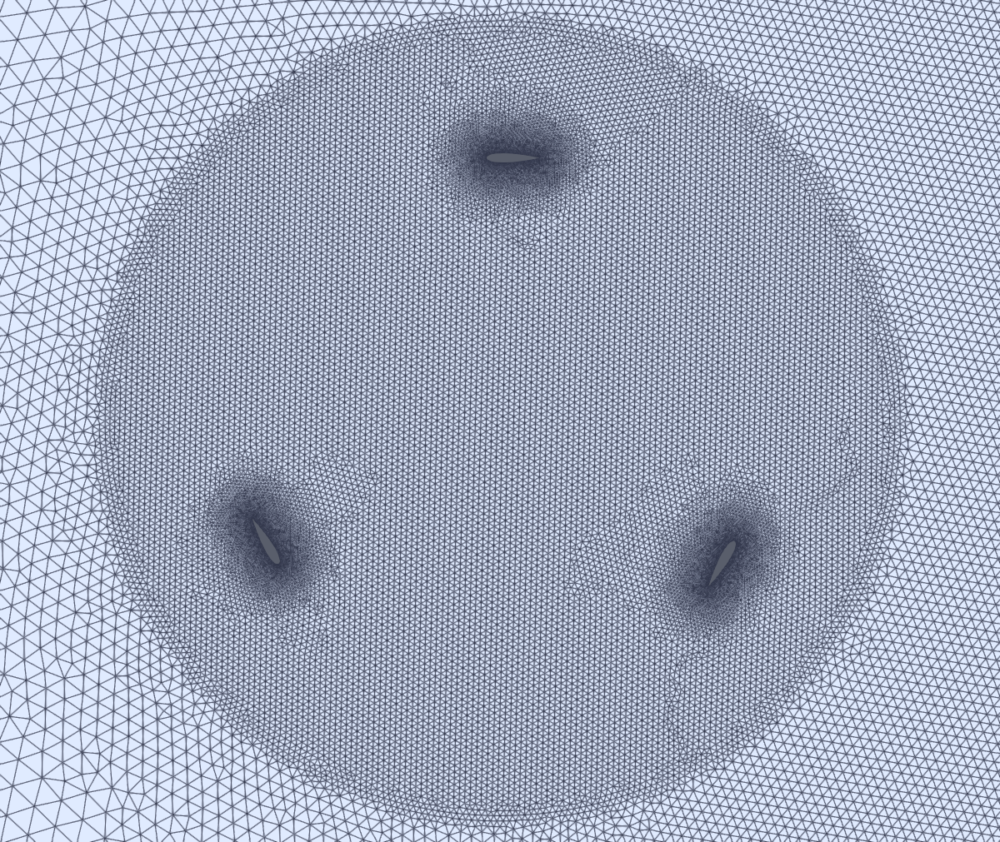
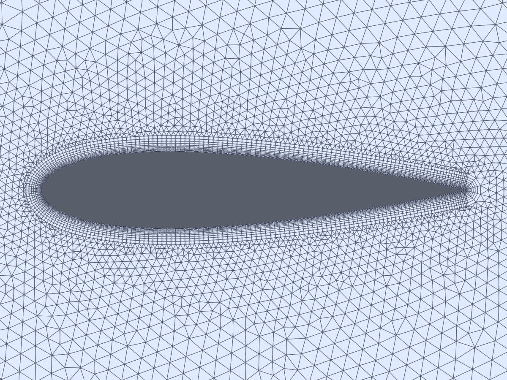
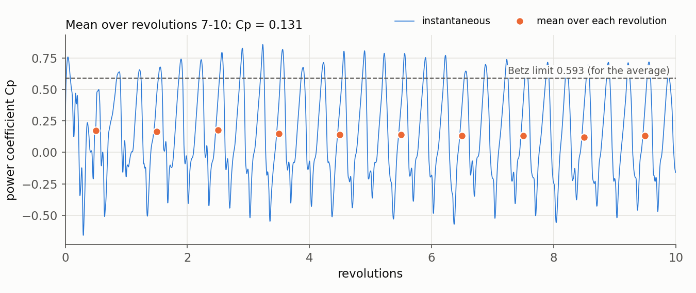
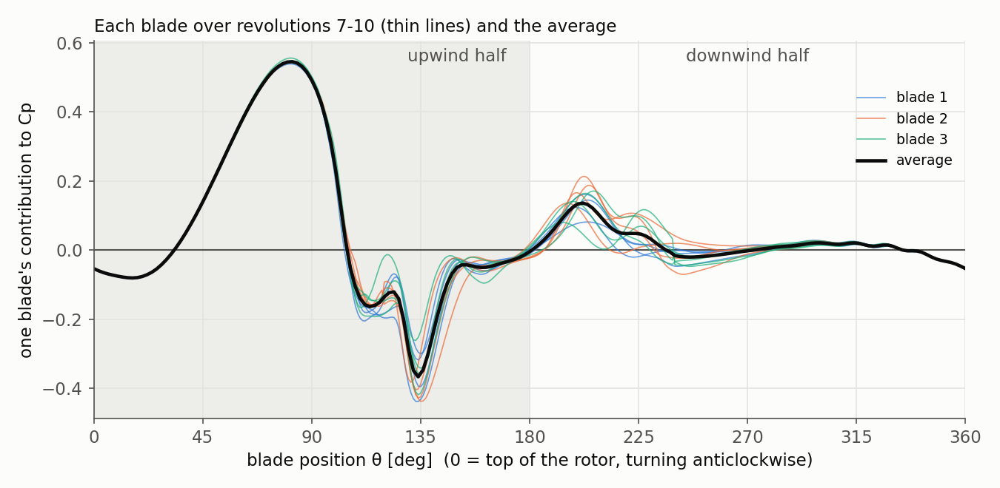
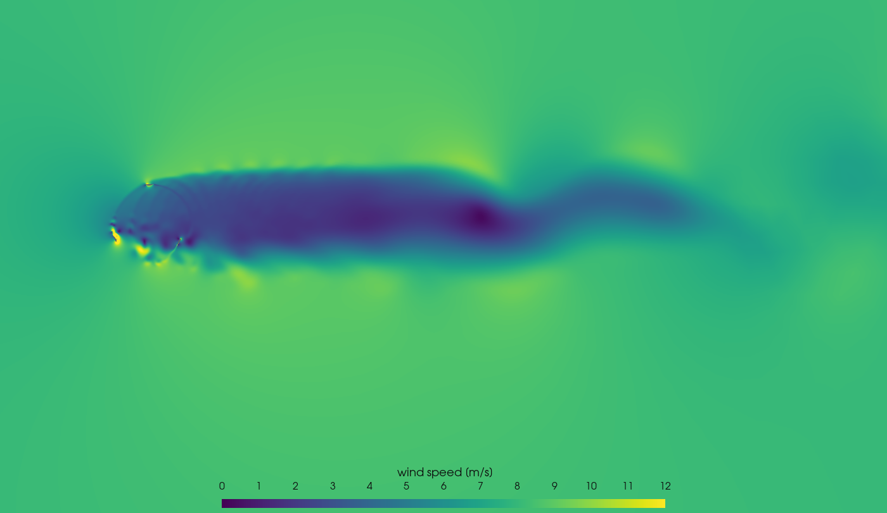

# Tutorial 09: Vertical-Axis Wind Turbine on a Rotating Mesh

**Difficulty:** ★★★★☆ Advanced
**Solver:** `pimpleFoam` with a dynamic mesh (transient, incompressible)
**Turbulence model:** k-ω SST (unsteady RANS)
**Rotation:** solid-body rotation of a mesh zone, sliding interface (`cyclicAMI`)
**Tested with:** OpenFOAM 6 (`cfdengine/openfoam` Docker image), Gmsh 4.12.1
**Run time:** about 70 minutes on 8 cores (10 revolutions, 18,000 time steps)


---

## Goal

Simulate a real rotor: a three-blade **vertical-axis wind turbine** (an H-type
Darrieus rotor) turning in the wind, with the blades and their wakes resolved in
time. You will learn to:

- script a 2D rotor mesh in **Gmsh**: three NACA 0018 blades with boundary-layer
  cells, inside a disc that will rotate, inside a fixed wind tunnel;
- turn the disc with `dynamicMeshDict` (`solidBody` motion, `rotatingMotion`) and
  couple it to the fixed mesh with a **sliding interface** (`cyclicAMI`);
- set boundary conditions on moving walls (`movingWallVelocity`) and use wall
  functions that work at any y+;
- measure the **torque of each blade** with the `forces` function object and turn it
  into a **power coefficient** `Cp`;
- decide when a rotor simulation has settled (and why it never repeats exactly), and
  read the torque curve of one blade over a revolution (upwind and downwind halves,
  dynamic stall);
- know why the steady **MRF** shortcut (the previous version of this project) cannot
  give any of this.

## Target

| Quantity                  | Target |
|---------------------------|--------|
| Mesh                      | about 110,000 cells, `checkMesh`: `Mesh OK`, rotor and stator are 2 separate regions |
| Sliding interface         | AMI weights sum to 1 within 1e-3 on both sides, every time step |
| Run                       | both stages reach their end time (8 and 10 revolutions) |
| Power                     | `0 < Cp <` Betz limit 16/27 = 0.593; reference run: **Cp = 0.131** (mean of revolutions 7-10) |
| Settled state             | mean `Cp` of revolutions 9-10 within 10 % of revolutions 7-8 |
| Physics                   | torque pulses 3× per revolution; the three blades share the work equally (within 15 % over 4 revolutions); most of it is done in the upwind half |

There is no experiment for exactly this rotor in 2D, so the targets are physical
limits and self-consistency checks plus the value of the reference run.
[Section 11](#how-good-is-the-number) discusses how far the number can be trusted.

## Verification method

```bash
./run_docker.sh          # mesh on the host, run in Docker, then verify.py
python3 verify.py        # or: re-check an existing run
```

`verify.py` reads only logs and `postProcessing/` (standard-library Python, no
OpenFOAM needed) and prints one `PASS`/`FAIL` line per check; the exit code is 0 only
if all checks pass. Measured values are from the reference run (8 cores, about 70 minutes):

| Check                     | What it proves | Expected | Tolerance / justification | Measured |
|---------------------------|----------------|----------|---------------------------|----------|
| `no_fatal_error`          | no `FOAM FATAL`, FPE or segfault in any log | none | - | none |
| `mesh_cell_count`         | the Gmsh script meshed as intended | 100,000-130,000 | range: the count changes slightly between Gmsh versions | 109,050 |
| `checkMesh_Mesh_OK`       | mesh quality | `Mesh OK.` | - | yes |
| `two_mesh_regions`        | rotor and stator are separate meshes, touching only through AMI | 2 | exact | 2 |
| `AMI_weights`             | each face of each interface side is fully covered by the other side, at every step | sum = 1 | 1e-3 (the 10 µm gap and polygonal faces give ~1e-5) | max \|sum − 1\| = 2.2e-5 |
| `reached_end_spinup`      | 8 revolutions completed | 1.2566 s | 1e-4 s | 1.2566 s |
| `reached_end_record`      | 10 revolutions completed | 1.5708 s | 1e-4 s | 1.5708 s |
| `power_coefficient`       | the rotor extracts power, less than the Betz limit (mean of revolutions 7-10) | 0 < Cp < 0.593 | physical bounds | 0.131 |
| `power_coefficient_regression` | same result as the reference run | 0.131 | ± 0.015 (single revolutions scatter ± 5 %, see [Results](#11-results)) | 0.131 |
| `settled_last_revs`       | the wake has developed: mean Cp of revolutions 9-10 vs 7-8 | < 10 % | revolutions 3-6 still gave 15 % more than 7-10 | 0.135 → 0.127 (5.7 %) |
| `blades_share_equally`    | three identical blades do the same work, revolutions 7-10 | spread < 15 % | rotational symmetry; single revolutions scatter ± 15 % per blade | 11.7 % |
| `torque_pulses_3_per_rev` | the rotor torque pulses once per blade pass | 19.1 Hz | ± 1 frequency bin (1.6 Hz) | 19.1 Hz |
| `upwind_half_dominates`   | blades do most of their work in the upwind half (θ = 0-180°), revolutions 7-10 | > 60 % | the downwind half sees wind already slowed by the rotor | 78 % |

---

## Table of Contents

1. [The Rotor](#1-the-rotor)
2. [Physics: How a Darrieus Rotor Makes Power](#2-physics-how-a-darrieus-rotor-makes-power)
3. [Moving Meshes: MRF vs Sliding Mesh](#3-moving-meshes-mrf-vs-sliding-mesh)
4. [Case Structure](#4-case-structure)
5. [Mesh Generation with Gmsh](#5-mesh-generation-with-gmsh)
6. [The Rotating Zone and the AMI Interface](#6-the-rotating-zone-and-the-ami-interface)
7. [Boundary Conditions](#7-boundary-conditions)
8. [Solver Settings](#8-solver-settings)
9. [Function Objects and Run Stages](#9-function-objects-and-run-stages)
10. [How to Run](#10-how-to-run)
11. [Results](#11-results)
12. [Making the Reel](#12-making-the-reel)
13. [Exercises](#13-exercises)
14. [Troubleshooting](#14-troubleshooting)
15. [References](#15-references)

---

## 1. The Rotor

```
                       y
                       ▲            blade 1 (θ = 0): moving into the wind
                       │               ◄══════
        wind           │        .  -  ‾  -  .
      8 m/s    ─►    .'            │          '.     rotor disc, R_AMI = 0.75 m
      ─►            /     blades on R = 0.5 m   \    (turns anticlockwise,
      ─►           │               ●──────────── │ ─► x     40 rad/s)
      ─►            \             axis          /
                     '.                       .'      blades 2 and 3 at
                        '  -  _  _  _  -  '           θ = 120° and 240°
```

| Parameter                  | Value | Notes |
|----------------------------|-------|-------|
| Blades                     | 3 × NACA 0018, chord c = 0.1 m | symmetric, zero pitch, quarter chord on the circle |
| Rotor radius `R`           | 0.5 m (diameter D = 1 m) | |
| Solidity `σ = N c / (2R)`  | 0.3 | |
| Wind speed `U`             | 8 m/s | uniform, 1 % turbulence intensity |
| Rotor speed `ω`            | 40 rad/s (382 rpm) | one revolution every 0.157 s |
| Tip-speed ratio `λ = ωR/U` | **2.5** | blade speed is 2.5 × the wind speed |
| Blade Reynolds number `λ U c / ν` | 1.3 × 10⁵ | |
| Domain                     | x = -6 … 16 m, y = ±7.5 m | 6D upstream, 16D downstream, blockage 1/15 |
| Depth                      | 1 m, one cell | forces are per metre of blade |

The blade angle θ is measured from the top of the rotor in the direction of rotation:
at θ = 0 a blade moves straight into the wind, at θ = 90° it is furthest upwind,
at θ = 270° furthest downwind. θ = 0-180° is the **upwind half**.

## 2. Physics: How a Darrieus Rotor Makes Power

A blade moving at `ωR` through wind `U` feels the **relative wind** `W`, the vector
difference of the two. Ignoring the slowing of the wind by the rotor, its direction
relative to the chord, the **angle of attack**, is

$$
\alpha(\theta) = \arctan\frac{\sin\theta}{\lambda + \cos\theta}.
$$

It swings from 0 at θ = 0 to a maximum of $\arctan(1/\sqrt{\lambda^2-1})$ = 23.6° (at
λ = 2.5) and back, once per revolution, on alternating sides of the blade. The lift on
the blade is roughly perpendicular to `W`; because `W` is tilted forward, the lift has a
component **in the direction of motion**, which drives the rotor. That is why a
symmetric, un-pitched blade still produces torque.

**Dynamic stall.** A NACA 0018 at this Reynolds number stalls around 10-14° in steady
flow. On the rotor the angle of attack rises past that within a few hundredths of a
second, faster than the separation can develop: lift keeps rising, a strong vortex forms
at the leading edge, runs along the blade, and is shed. The torque then drops sharply.
These shed vortices are the dark spots in the [vorticity pictures](#11-results).

**Upwind vs downwind.** The blades take energy from the wind in the upwind half, so in
the downwind half they meet slower wind, and their own wakes. The downwind half
produces much less torque.

**Power coefficient.** The power of the wind through the rotor's frontal area
`A = D × span` is ½ρU³A. The rotor extracts `P = M ω`, so

$$
C_p = \frac{M\,\omega}{\tfrac12 \rho U^3 D\,L}.
$$

No turbine can exceed the **Betz limit** 16/27 = 0.593.

**Torque ripple.** Each blade's torque peaks once per revolution, so the rotor torque
pulses three times per revolution: 3 × 40/(2π) = **19.1 Hz**.

## 3. Moving Meshes: MRF vs Sliding Mesh

| | MRF (frozen rotor) | Sliding mesh (this project) |
|---|---|---|
| Mesh | fixed; extra Coriolis and centrifugal terms in the rotating zone | the rotor zone really turns |
| Time | steady (`simpleFoam`) | transient (`pimpleFoam`) |
| Blade positions | frozen in one position | all positions, every time step |
| Blade-wake interaction, dynamic stall | not captured | captured |
| Torque | one value for one frozen position | full history, ripple, per-blade curves |
| Cost | minutes | about an hour here |

MRF is useful when the flow seen in the rotating frame is nearly steady: a fan in a
duct, a mixer impeller far from the baffles. A vertical-axis turbine is the opposite
case: every blade sees its angle of attack change by ±24° on every revolution and passes
through the wakes of the others. The previous version of this project used MRF on an
empty disc (no blades) and therefore produced no torque at all.

## 4. Case Structure

```
09_wind_turbine_blade/
├── generate_vawt_geo.py      Gmsh geometry script: blades, rotor disc, wind tunnel, mesh sizes
├── 0/
│   ├── U, p                  inlet 8 m/s, outlet p = 0, moving walls on the blades
│   └── k, omega, nut         k-ω SST with wall functions on the blades
├── constant/
│   ├── dynamicMeshDict       solid-body rotation of cellZone "rotor", 40 rad/s about z
│   ├── transportProperties   ν = 1.5e-5 m²/s
│   └── turbulenceProperties  RAS, kOmegaSST
├── system/
│   ├── changeDictionaryDict  patch types: cyclicAMI pair, walls, symmetry, empty
│   ├── controlDict           Δt = 0.2° of rotation, forces per blade, probes, y+, Courant
│   ├── fvSchemes, fvSolution PIMPLE (2 outer × 2 pressure correctors)
│   └── decomposeParDict      scotch, cores set by Allrun
├── Allrun / Allclean         run / clean inside an OpenFOAM environment
├── run_docker.sh             Gmsh on the host + Allrun in Docker + verify.py
├── verify.py                 PASS/FAIL checks
├── make_images.py            figures in images/ (pvpython)
├── reel.json                 settings for tools/make_reel.py
└── open_paraview.sh          open the results in ParaView
```

## 5. Mesh Generation with Gmsh

`generate_vawt_geo.py` writes `constant/vawt.geo`; Gmsh meshes it and `gmshToFoam`
imports it. All dimensions and mesh sizes are constants at the top of the script.

**Blades.** Each NACA 0018 profile is two splines (upper and lower side) through 80
points, with 121 mesh nodes per side clustered at the leading and trailing edges
(`Transfinite Curve ... Using Bump 0.2`). A `BoundaryLayer` field puts ~14 layers of thin
quadrilaterals around each blade: first cell 80 µm, growth 1.2, 4 mm thick. At the sharp
trailing edges the layers fan around the corner (`FanPointsList`).

**Mesh size fields** (the smallest one wins):

| Region | Cell size |
|--------|-----------|
| within 12 cm of a blade, outside the quad layers | 1.5 mm → 12 mm |
| rest of the rotor disc | 12 mm |
| near wake (x < 2.5 m, \|y\| < 0.9 m) | 20 mm |
| far wake (x < 8 m, \|y\| < 1.5 m) | 45 mm |
| everywhere else | growing from 20 mm at the interface to 0.35 m |

**Two meshes in one.** The rotor disc and the wind tunnel around it are separate Gmsh
surfaces, each with its own copy of the interface circle, so they share no nodes. Gmsh
merges points that coincide, so the stator's circle is 10 µm larger. After extrusion
(one cell, 1 m deep) and import, the result has about 109,000 cells (mostly prisms,
hexahedra in the blade layers) and two cell zones, `rotor` and `stator`, from the
physical volumes.





`checkMesh` reports `Number of regions: 2` with an asterisk. For an AMI mesh that is
expected: the two regions are joined only through the interface.

## 6. The Rotating Zone and the AMI Interface

`constant/dynamicMeshDict` turns every point of the cell zone `rotor` as a rigid body:

```cpp
dynamicFvMesh   dynamicMotionSolverFvMesh;
motionSolverLibs ("libfvMotionSolvers.so");
motionSolver    solidBody;
cellZone        rotor;                       // physical volume "rotor" from Gmsh
solidBodyMotionFunction rotatingMotion;
origin          (0 0 0);
axis            (0 0 1);                     // anticlockwise seen from +z
omega           40;                          // rad/s
```

The rotor's outer boundary `AMI_rotor` slides along the stator's inner boundary
`AMI_stator`. `system/changeDictionaryDict` makes them a `cyclicAMI` pair:

```cpp
AMI_rotor  { type cyclicAMI; neighbourPatch AMI_stator; transform noOrdering; }
AMI_stator { type cyclicAMI; neighbourPatch AMI_rotor;  transform noOrdering; }
```

At every time step OpenFOAM intersects the faces of the two sides and computes
**weights**: which fraction of each face overlaps which faces on the other side. Fluxes
are interpolated with these weights, so the faces need not match. The log prints, for
each step:

```
AMI: Patch source sum(weights) min/max/average = 1.0000116, 1.0000116, 1.0000116
AMI: Patch target sum(weights) min/max/average = 0.99999828, 0.99999828, 0.99999828
```

A sum of 1 means every face is fully covered; values far from 1 point to a gap or
overlap between the two sides (check the radii and the `rotor` zone). `verify.py`
checks every one of these lines.

## 7. Boundary Conditions

| Patch | `U` | `p` | `k` | `omega` | `nut` |
|-------|-----|-----|-----|---------|-------|
| `inlet` | `fixedValue (8 0 0)` | `zeroGradient` | `fixedValue 0.0096` | `fixedValue 64` | `calculated` |
| `outlet` | `inletOutlet` | `fixedValue 0` | `inletOutlet` | `inletOutlet` | `calculated` |
| `sides` | `symmetry` | `symmetry` | `symmetry` | `symmetry` | `symmetry` |
| `blade1..3` | `movingWallVelocity` | `zeroGradient` | `kqRWallFunction` | `omegaWallFunction` | `nutUSpaldingWallFunction` |
| `AMI_rotor`, `AMI_stator` | `cyclicAMI` | `cyclicAMI` | `cyclicAMI` | `cyclicAMI` | `cyclicAMI` |
| `frontAndBack` | `empty` | `empty` | `empty` | `empty` | `empty` |

- `movingWallVelocity` gives the fluid at the wall the velocity of the moving wall
  (no slip relative to the blade), computed from the mesh motion.
- The inlet turbulence is 1 % intensity, `k = 1.5 (0.01 U)²`, with an eddy viscosity of
  10 ν, `omega = k / (10 ν)`.
- **Wall treatment.** The first cell is 80 µm high, giving y+ between 0.4 and 8 on the
  blades (about 3 on average; the `yPlus` lines in the log).
  `nutUSpaldingWallFunction` uses Spalding's single formula for the viscous sublayer,
  buffer layer and log layer, and `omegaWallFunction` blends the sublayer and log-layer
  values, so the treatment is valid at any y+.

## 8. Solver Settings

**Time step.** Fixed at 0.2° of rotation per step, `Δt = 2π/(40·1800)` = 87.3 µs, 1800
steps per revolution. The blades move 1.7 mm per step, and the interface slides by
2.6 mm, a quarter of an interface face (1.2 cm).

**Courant number.** Below 1 in almost all the domain, but much larger in the few tiny
cells of the trailing-edge fans, where 80 µm cells meet 25 m/s relative flow: the
largest value per step is typically about 40 and peaks at about 110. `pimpleFoam` is
implicit, so this does not make it unstable, but it needs:

- **two outer (PIMPLE) iterations with two pressure correctors** per step, so pressure
  and velocity are coupled in those cells;
- **first-order upwind convection for k and ω**: with a higher-order scheme ω became
  negative in the trailing-edge cells within two steps and the run diverged (try it, see
  [Troubleshooting](#14-troubleshooting)). `U` uses `linearUpwind`.

| Setting | Value | Why |
|---------|-------|-----|
| `ddtSchemes` | `backward` | second order in time |
| `div(phi,U)` | `Gauss linearUpwind grad(U)` | second order, bounded gradients (`cellLimited`) |
| `div(phi,k)`, `div(phi,omega)` | `Gauss upwind` | keeps k and ω positive |
| `p` solver | GAMG, `cacheAgglomeration no` | the AMI coupling changes as the rotor turns |
| `correctPhi` | `no` | solid-body rotation does not change cell volumes |
| `wallDist` | `meshWave` | wall distance for SST, updated as the blades move |

## 9. Function Objects and Run Stages

| Function object | Output |
|-----------------|--------|
| `rotor` (`forces`, all three blades) | `postProcessing/rotor/*/forces.dat`: force and moment, every 1° |
| `blade1`, `blade2`, `blade3` | the same for each blade |
| `wakeProbes` | velocity 1 m and 3 m behind the axis |
| `yPlus`, `courant` | fields `yPlus` and `Co` at write times; y+ also in the log |

The moment about the z axis through the origin is column 12 (pressure) + column 15
(viscous) of `forces.dat` after removing the brackets.

`Allrun` runs `pimpleFoam` twice with the same dictionary:

| Stage | Revolutions | Written | Purpose |
|-------|-------------|---------|---------|
| `spinup` | 0 → 8 | once per revolution | the wake develops and the torque settles |
| `record` | 8 → 10 | every 4° (180 times) | analysis (`verify.py`) and animation (`make_reel.py`) |

Because the mesh moves, every written time also contains `polyMesh/points`, which is
how ParaView shows the rotor turning.

## 10. How to Run

```bash
cd projects/09_wind_turbine_blade

# Docker (recommended): Gmsh on the host, OpenFOAM in the container, then verify.py
./run_docker.sh                 # all cores, at most 8
NPROCS=4 ./run_docker.sh

# Inside an OpenFOAM 6 environment with gmsh installed
./Allclean && ./Allrun && python3 verify.py
```

Steps: Gmsh mesh → `gmshToFoam` → `changeDictionary` (patch types) → `checkMesh` →
`decomposePar` → `pimpleFoam` (spin-up) → `pimpleFoam` (record) → `reconstructPar`.

Run time: about 70 minutes on 8 cores (0.2-0.25 s per time step), 6-8 hours on one core.
Follow it with:

```bash
grep "^Time" log.pimpleFoam.spinup | tail -1        # current time; 0.157 s per revolution
tail -3 postProcessing/rotor/0/forces.dat            # latest forces and moments
```

## 11. Results

### Power over the run



During the first revolutions the rotor turns in undisturbed wind and gives Cp ≈ 0.17.
As the wake behind it builds up, the wind through the rotor slows and the power drops,
levelling off from revolution 7 at **Cp ≈ 0.13** (mean of revolutions 7-10: 0.131,
that is 1.03 N·m and 41 W per metre of blade). Single revolutions still differ by about
± 5 % (0.122-0.135): the stall vortices are never shed in exactly the same way twice,
so an unsteady RANS simulation of a stalling rotor does not settle into a perfectly
repeating cycle. That is why the checks use averages over several revolutions.

The instantaneous Cp swings between about −0.5 and +0.8 three times per revolution.
It can briefly exceed the Betz limit, which applies to the average power only.

### One blade over one revolution



All three blades follow the same curve:

- **θ = 0-80°:** moving from the top into the upwind half, the blade's angle of attack
  grows and its lift pulls it forwards; its share of Cp peaks at about 0.55 at θ ≈ 80°.
- **θ ≈ 95-175°:** the blade **stalls**: lift collapses, drag rises, and for about 70° of
  every turn the blade brakes the rotor (down to −0.4 at θ ≈ 135°). The stall vortex is
  shed here.
- **θ = 180-360°:** in the downwind half the blade meets wind already slowed by the
  rotor and the wakes of the other blades, and adds little (a small peak near 200°).

Over revolutions 7-10 the upwind half delivers **78 %** of the work. Up to the stall the
twelve curves (3 blades × 4 revolutions) lie on top of each other; after it they scatter,
which is where the revolution-to-revolution variation of the power comes from. The stall
loss is also why Cp is low at this tip-speed ratio: a faster rotor sees a smaller
angle-of-attack swing ([Exercise 1](#13-exercises)).

### Flow field


Each blade trails a thin sheet of vorticity along its path (the curved arcs). On the
upwind side, the stalling blades shed pairs of strong vortices (red and blue spots) that
are carried through the middle of the rotor and out into the wake, where they merge
into larger, weaker structures.



Behind the rotor the wind is slowed to a few m/s over a band about one rotor diameter
wide. The rotor holds back the air with a mean thrust of 37 N per metre of blade
(thrust coefficient 0.95): a large force for little power, as expected when the blades
spend part of every turn stalled and much of the force is drag. The wake is also
shifted towards +y, the side where the blades move against the wind: on average the air
pushes the rotor sideways with 8 N/m towards −y, so the rotor pushes the air towards +y.
(Mean forces over revolutions 7-10, from `postProcessing/rotor/*/forces.dat`.)

### How good is the number?

There is no measurement for this exact 2D rotor, so Cp = 0.13 is a reference value of
this setup, not a validated prediction. Keep in mind:

1. A 2D simulation is an infinitely long rotor: it has no blade-tip vortices, struts or
   shaft, all of which cost power on a real turbine.
2. Unsteady RANS reproduces dynamic stall only roughly. The size and timing of the stall
   vortex, which dominate the power here, depend on the turbulence model and on the
   near-wall mesh (y+ ≈ 3 with wall functions here).
3. The result comes from one mesh and one time step. [Exercise 4](#13-exercises) tests
   the time step; a mesh study would refine the blade surfaces and the rotor disc.

What is robust is the shape of the result: the upwind peak, the stall loss, the weak
downwind half and the three-per-revolution torque ripple.

## 12. Making the Reel

```bash
pvbatch tools/make_reel.py projects/09_wind_turbine_blade
```

writes `output/artifacts/09_wind_turbine_blade/rotor_wake.mp4`: the last two
revolutions in slow motion, coloured by vorticity, with the live power coefficient read
from `postProcessing/rotor/*/forces.dat` (`"overlay"` in `reel.json`, columns 12 + 15
scaled by ω / (½ρU³D)). The camera starts on the rotor and pans into the wake. The
reel tool interpolates the moving mesh points between written times (every 4°), so the
rotor turns smoothly at 30 frames per second. `"solid": true` paints the blades grey; the
10 µm gap of the sliding interface lets a little of that grey through, which shows up as
a faint dotted circle: the edge of the rotating mesh, pointed out in the captions.

## 13. Exercises

1. **Tip-speed ratio.** Change `omega` in `constant/dynamicMeshDict` to 32 (λ = 2) and
   56 (λ = 3.5); keep 1800 steps per revolution by scaling `deltaT` and the stage end
   times in `Allrun` (one revolution is 2π/ω). Plot `Cp` against λ: where is the peak?
2. **Dynamic stall.** At λ = 2 the angle of attack reaches 35°. Compare the vorticity
   pictures and the blade torque curve with λ = 2.5.
3. **Solidity.** Use two blades (`N_BLADES = 2` in `generate_vawt_geo.py`) or a chord
   of 0.15 m. How do `Cp`, the ripple frequency and the optimal λ change?
4. **Time step.** Halve `deltaT` (0.1° per step, 3600 steps per revolution) and compare
   `Cp`. How much does it change?
5. **MRF.** Freeze the rotor (`dynamicFvMesh staticFvMesh;`), add
   `constant/MRFProperties` for the `rotor` zone and run `simpleFoam`. Compare its torque
   with the cycle average here, for two different frozen blade positions.

## 14. Troubleshooting

| Symptom | Cause | Fix |
|---------|-------|-----|
| `bounding omega, min: -5e4` in the first steps, then divergence | higher-order convection of ω at high Courant number in the trailing-edge cells | keep `div(phi,omega) Gauss upwind` (and for k) |
| Courant number grows to 100s at the start | impulsive start: the flow around the sharp trailing edge is nearly singular in the first step | keep 2 outer correctors; do not enlarge `deltaT` |
| AMI weights far from 1 | gap or overlap between the two circles | check `R_AMI` and `AMI_GAP` in the script and that `gmshToFoam` made both zones |
| `Could not match gmsh face` in `log.gmshToFoam`, patches with 0 faces | Gmsh did not merge extruded points (for example `Geometry.AutoCoherence = 0`) | keep Gmsh's default point merging |
| `gmsh: command not found` inside Docker | the image has no Gmsh | use `./run_docker.sh` (meshes on the host) |
| The rotor jumps between frames in an animation | results written too rarely for the moving mesh | keep the `record` stage writing every 4° or less (`writeInterval 20` steps); `make_reel.py` interpolates the mesh points linearly between written times |

## 15. References

1. **Paraschivoiu, I.** (2002). *Wind Turbine Design: With Emphasis on Darrieus
   Concept*. Polytechnic International Press. Aerodynamics of Darrieus rotors, angle of
   attack and dynamic stall.
2. **Betz, A.** (1920). "Das Maximum der theoretisch möglichen Ausnützung des Windes
   durch Windmotoren." *Zeitschrift für das gesamte Turbinenwesen*, 26, 307-309.
3. **Menter, F.R.** (1994). "Two-equation eddy-viscosity turbulence models for
   engineering applications." *AIAA Journal*, 32(8), 1598-1605. k-ω SST.
4. **Spalding, D.B.** (1961). "A single formula for the law of the wall." *Journal of
   Applied Mechanics*, 28(3), 455-458.
5. **Farrell, P.E. & Maddison, J.R.** (2011). "Conservative interpolation between
   volume meshes by local Galerkin projection." *Computer Methods in Applied Mechanics
   and Engineering*, 200, 89-100. The method behind OpenFOAM's AMI weights.
6. OpenFOAM 6 tutorial `incompressible/pimpleFoam/RAS/propeller`: a 3D rotating AMI case
   with the same `dynamicMeshDict` and PIMPLE settings.

Companion notes: [Meshing](../../notes/04_meshing.md),
[Boundary conditions](../../notes/05_boundary_conditions.md),
[Turbulence models](../../notes/06_turbulence_models.md),
[CFL number](../../notes/08_cfl_number.md), [Parallelization](../../notes/07_parallelization.md).

---

*This case is part of the [OpenFOAM Tutorials](https://github.com/djeada/OpenFoam-Tutorials/blob/main/README.md) learning series.*
