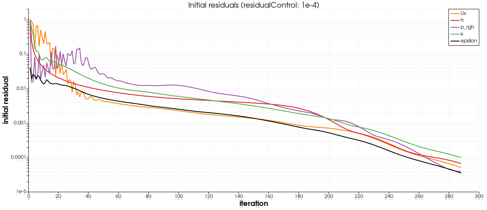
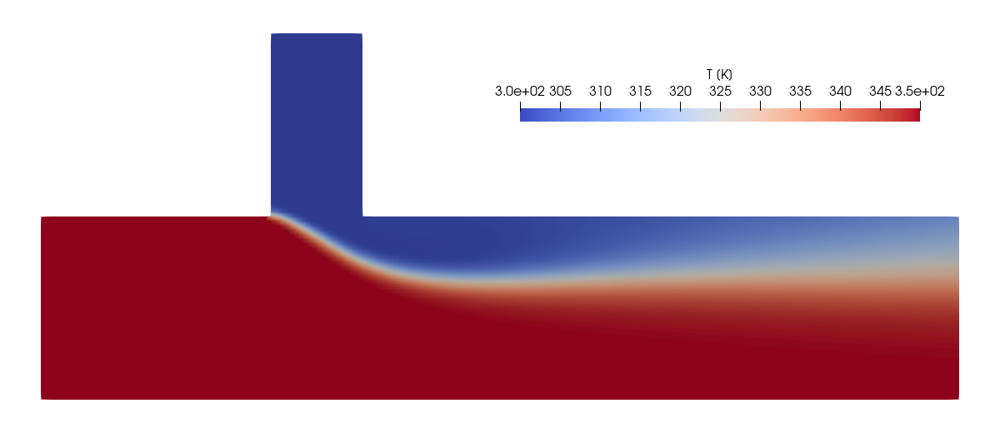
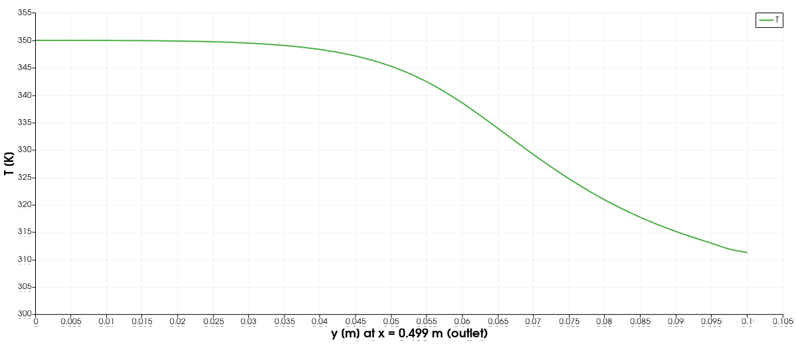
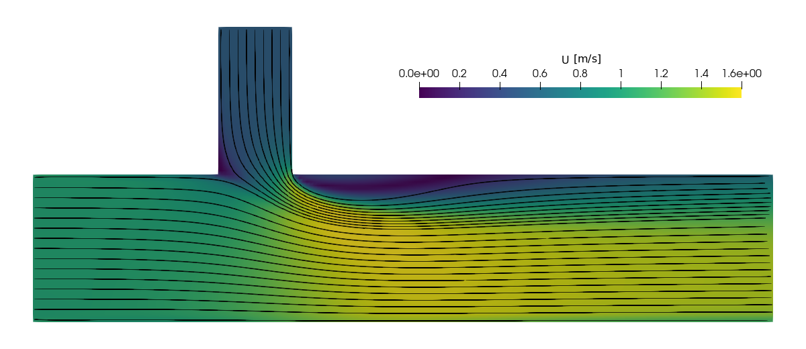
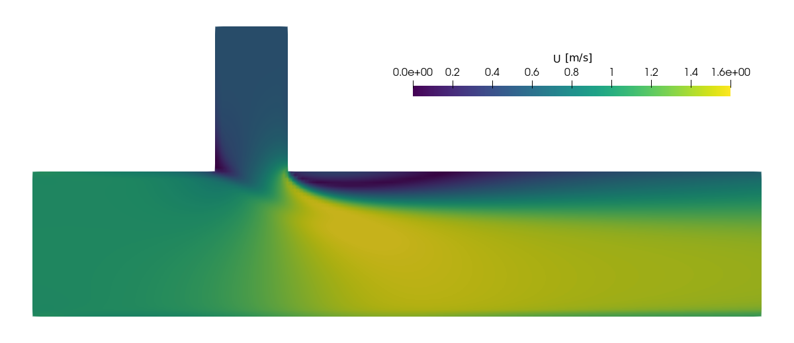
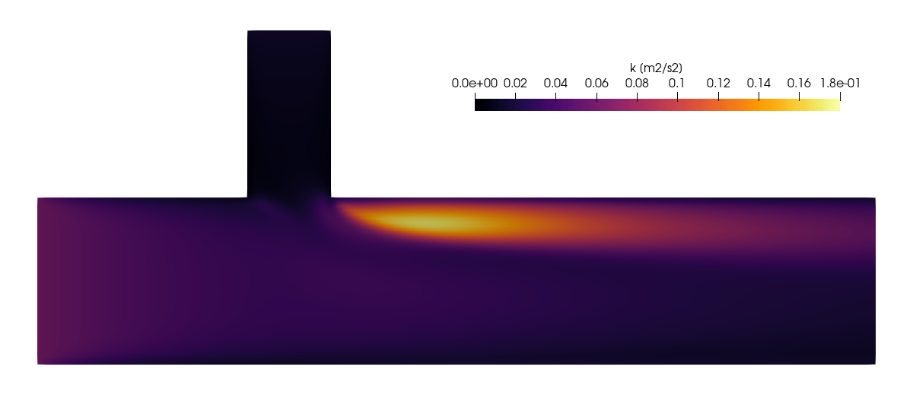

# Mixing T-Junction — Hot/Cold Water Thermal Mixing

| Detail | Value |
|---|---|
| **Difficulty** | ⭐⭐⭐ Intermediate–Advanced |
| **Solver** | `buoyantSimpleFoam` (steady-state, buoyant, compressible formulation with energy equation) |
| **Algorithm** | SIMPLE |
| **Turbulence** | k-$\varepsilon$ (RAS) with standard wall functions |
| **Mesh** | `blockMesh` (multi-block structured T-shape, 8,800 cells, 2D) |
| **Physics** | Forced convection, scalar (heat) transport, weak buoyancy |
| **Key Learning** | Temperature field, mixing and stratification, multi-block meshing |
| **OpenFOAM Version** | Tested with OpenFOAM 6 (`cfdengine/openfoam` Docker image); other versions not tested |

---

## Table of Contents

1. [Goal, Target and Verification](#goal-target-and-verification)
2. [Problem Description](#problem-description)
3. [Physics and Theory](#physics-and-theory)
4. [Practical Relevance](#practical-relevance)
5. [Case Structure](#case-structure)
6. [Geometry and Mesh](#geometry-and-mesh)
7. [Boundary Conditions](#boundary-conditions)
8. [Fluid and Thermophysical Properties](#fluid-and-thermophysical-properties)
9. [Turbulence Setup](#turbulence-setup)
10. [Numerical Schemes and Solver Settings](#numerical-schemes-and-solver-settings)
11. [How to Run](#how-to-run)
12. [Expected Results](#expected-results)
13. [Post-Processing Guide](#post-processing-guide)
14. [Exercises and Experiments](#exercises-and-experiments)
15. [Limitations](#limitations)
16. [References](#references)
17. [Related Notes in This Repository](#related-notes-in-this-repository)

---

## Goal, Target and Verification

### Goal

Show how a steady RANS solver with an energy equation handles two streams of
different temperature that merge at a T-junction, and what a learner should
take away from it:

- how temperature is solved as an active scalar (`h`/`T`) together with
  momentum, pressure (`p_rgh`) and turbulence;
- how buoyancy enters through `g`, `p_rgh` and the density model;
- how a T-shaped domain is assembled from four `blockMesh` blocks;
- how to check a thermal simulation with an overall energy and mass balance
  instead of only looking at colour plots.

### Target

There is no experimental or benchmark reference for this exact 2D setup, so
the target is physical consistency, not agreement with a published number.
The run should produce:

| Quantity | Target | Basis |
|---|---|---|
| Mesh | 8,800 cells, `checkMesh` reports `Mesh OK` | `blockMeshDict` |
| Convergence | residuals below 1e-4 before iteration 2000 (measured: 288) | `residualControl` |
| Inlet mass flows | $\rho(T)\,U\,A$ at both inlets (0.9789 kg/s main, 0.2503 kg/s branch for a 0.01 m deep slice) | fixed `U`, `T`, density model |
| Mass balance | outlet flow equals sum of inlet flows | continuity |
| Mixed temperature | mass-flux-weighted outlet temperature equal to the inlet-flux-weighted mean, about 340 K | energy balance, adiabatic walls, constant $C_p$ |
| Boundedness | $T$ stays within 300-350 K up to a small numerical overshoot | no heat sources |
| Flow pattern | cold stream stays near the top wall, hot stream near the bottom wall, outlet not fully mixed | momentum ratio of the streams |

### Verification method

After a run (`./run_docker.sh`, which calls it as its last step, or
`./Allrun` natively) check the results with

```bash
python3 verify.py          # reads log.*, the latest time directory, constant/polyMesh
```

The script uses only the Python standard library, needs no OpenFOAM and no
Docker, prints one `PASS`/`FAIL` line per check, and exits with 0 only if all
checks pass (1 if a check fails, 2 if the results are missing). The measured
values below come from the real run documented in this README (OpenFOAM 6,
converged at iteration 288).

| # | Check | What it proves | Expected | Tolerance and reason | Measured |
|---|---|---|---|---|---|
| 1 | `mesh-cell-count` | blockMesh produced the intended mesh | 8,800 cells | exact | 8,800 |
| 2 | `checkMesh-ok` | mesh quality acceptable | `Mesh OK.` in `log.checkMesh` | exact | Mesh OK |
| 3 | `solver-finished` | solver ended without abort | log ends with `End`, no `FOAM exiting`/`aborting` | exact (the `FOAM FATAL IO ERROR: Radiation model not active` text in the log is a harmless message from the radiation library) | End |
| 4 | `converged-before-endTime` | SIMPLE converged | `SIMPLE solution converged in N iterations`, N < `endTime` (2000) | exact | N = 288 |
| 5 | `final-initial-residuals` | all residuals met `residualControl` in the last iteration | all initial residuals $\le$ 1e-4 | the `residualControl` value in `fvSolution` | 9.9e-05 |
| 6 | `mass-flow-mainInlet` | inlet flux is $\rho(350\,K)\,U A$ | 0.978863 kg/s | 1e-4 relative: $U$ and $T$ are fixed, only the 8-digit write precision can differ | 0.978862 kg/s |
| 7 | `mass-flow-branchInlet` | inlet flux is $\rho(300\,K)\,U A$ | 0.250284 kg/s | 1e-4 relative, as above | 0.250284 kg/s |
| 8 | `mass-balance` | inflow equals outflow | 0 | 1e-4 relative: the `p_rgh` equation is converged to 1e-4 | 9e-09 |
| 9 | `outlet-temperature-energy-balance` | energy is conserved (adiabatic walls, constant $C_p$) | $T_{mix}$ = 339.82 K | 0.5 K (1 % of the 50 K inlet difference): `residualControl` does not bound the global enthalpy imbalance of a steady SIMPLE solution, so this is an acceptance level, not a derived bound | 340.15 K |
| 10 | `temperature-bounded` | no spurious sources | 300 .. 350 K | 1.0 K (2 % of the inlet difference): `linearUpwind` is not bounded and may overshoot slightly | 299.79 .. 350.59 K |
| 11 | `outlet-stratification` | cold stream on top, hot on bottom, not fully mixed | T(bottom) > $T_{mix}$ > T(top) | exact (ordering) | 350.0 K / 311.3 K |

Check 9 is an internal-consistency check: the expected value is computed from
the measured inlet mass fluxes and the inlet temperatures of the same run, not
from an external reference. The 0.33 K difference seen here is 0.7 % of the
inlet temperature difference.

`verify.py` was also run against a scratch copy of the results in which the
`Mesh OK.` line and a temperature value were altered; it reported `FAIL` for
`checkMesh-ok` and `temperature-bounded` and exited with code 1.

Manual (visual) checks, secondary:

1. Open `T` in ParaView with range 300-350 K: the cold stream bends into the
   main flow and hugs the top wall (see [Expected Results](#expected-results)).
2. Open `U`: low-velocity (recirculating) region under the top wall behind
   the branch.
3. `buoyantSimpleFoam -postProcess -latestTime -func yPlus`: wall $y^+$ in
   the wall-function range (measured 31-160).

---

## Problem Description

This tutorial simulates the mixing of **hot and cold water streams** in a
T-junction pipe. Hot water enters through the main horizontal pipe, and cold
water enters from a vertical branch pipe on the top side. The two streams
meet at the junction and mix as they flow toward the outlet. The domain is
two-dimensional (one cell in z, `empty` front and back patches), so the
"pipe" is a plane channel and results are per unit depth.

```
                     Cold water (300 K)
                          ↓ ↓ ↓
                     branchInlet (0.5 m/s, -y)
                    ┌─────────────┐  y = 0.2
                    │             │
                    │ Branch pipe │  0.05 m wide
                    │             │  0.1 m long
  y = 0.1  ┌────────┘             └───────────────────────────────┐
           │                                                      │
           │  Hot water      Junction       Mixed flow region     │
 mainInlet │  (350 K)                                             │ outlet
 (x = 0)   │  →→→ (1.0 m/s)                                       │ (x = 0.5)
           │                                                      │  mixed T
  y = 0    └──────────────────────────────────────────────────────┘
           x = 0          x=0.125  x=0.175                      x = 0.5
```

### Key Features of This Flow

```
  Side view of the T-junction flow (qualitative, from the converged solution):
  ==========================================================================

         Cold (300 K)
           ↓ ↓ ↓
      ┌────┴───┴────┐
      │  ↓   ↓   ↓  │
  ────┘             └─────────────────────────────────  top wall
  →→→→→→→↘   ↓   ↙  ↺ recirculation under the top wall
  →→→ Hot →→→↘ ↓ ↙→→→→→→  mixing layer  →→→→→→→→→→→→→→→
  →→→→→→→→→→→→→→→→→→→→→→→→→→→→→→→→→→→→→→→→→→→→→→→→→→→
  ─────────────────────────────────────────────────────  bottom wall

  Outlet (x = 0.5 m) temperature, cell-centre values:

  Top:     ≈311 K  (cold stream stays along the top wall)
  Middle:  ≈340 K  (mixing layer)
  Bottom:  ≈350 K  (hot stream along the bottom wall)

  Mass-flux-weighted outlet mean = 340 K (energy balance)
```

- **Thermal mixing**: Two streams at different temperatures interact and
  exchange heat through convective transport and turbulent diffusion
- **Incomplete mixing**: The cold stream is deflected by the main flow and
  stays close to the top wall; at the outlet, 0.325 m (3.25 channel heights)
  downstream of the junction, a temperature difference of about 40 K across
  the channel remains
- **Recirculation zone**: A recirculation develops downstream of the
  branch on the top wall, where the branch flow deflects the main flow
  (151 of the 8,800 cells have negative $u_x$, minimum $-0.41$ m/s)
- **Temperature gradients**: Sharp thermal gradients near the junction
  that smooth out further downstream

### Why Study T-Junction Mixing?

T-junctions are among the most common piping geometries in engineering.
Understanding how temperature, velocity, and turbulence interact at the
junction is essential for:

- Predicting **outlet temperature** (energy balance)
- Assessing **thermal fatigue** risk from temperature fluctuations
- Designing **mixing devices** for chemical processes
- Evaluating **HVAC system** performance

---

## Physics and Theory

### Governing Equations

`buoyantSimpleFoam` solves the steady-state Reynolds-Averaged Navier-Stokes
(RANS) equations with the energy equation for a fluid whose density depends
on temperature:

**Continuity (mass conservation):**

```
∇·(ρU) = 0
```

**Momentum (RANS):**

```
∇·(ρUU) = -∇p + ∇·(μ_eff ∇U) + ρg   (+ transposed-gradient term)

where μ_eff = μ + μ_t  (molecular + turbulent viscosity)
```

**Energy (enthalpy form, dominant terms):**

```
∇·(ρUh) = ∇·(α_eff ∇h)

where α_eff = μ/Pr + μ_t/Pr_t  (effective thermal diffusivity)
      h = Cp × T               (sensible enthalpy, hConst)
```

The solver also includes kinetic-energy and pressure-work terms in the
enthalpy equation; they are not listed here. (The transient term
$\partial p/\partial t$ that appears in the unsteady equation is absent in
the steady solver.)

**Buoyancy coupling:**

```
p_rgh = p - ρ g·h

where p_rgh is the pressure minus the hydrostatic component
      g     is the gravitational acceleration vector
      h     is the height g·(r - hRef), computed by the solver (field gh)
```

The momentum equation is solved with `-∇p_rgh - (g·h)∇ρ` in place of
`-∇p + ρg`, so a uniform density produces no spurious force.

### Reynolds Number

For the main pipe:

```
Re_main = U_main × H / ν
        = 1.0 × 0.1 / 1e-6
        = 100,000

where U_main = 1.0 m/s       (main inlet velocity)
      H      = 0.1 m         (channel height, used as length scale)
      ν      = μ/ρ ≈ 1e-6 m²/s   (1e-3 Pa s / ~990 kg/m³)
```

The hydraulic diameter of a plane channel is $2H$; the channel height is
used here as the characteristic length. For the branch pipe:

```
Re_branch = U_branch × W / ν
          = 0.5 × 0.05 / 1e-6
          = 25,000

where U_branch = 0.5 m/s     (branch inlet velocity)
      W        = 0.05 m      (branch width)
```

Both Reynolds numbers are well above the laminar-turbulent transition
(Re $\approx$ 2300 for pipe flow), justifying the use of a turbulence model.

### Thermal Mixing Theory

**Energy balance at the junction:**

```
T_mixed = (ṁ_main × Cp × T_main + ṁ_branch × Cp × T_branch) /
          (ṁ_main × Cp + ṁ_branch × Cp)

For equal Cp:
T_mixed = (ṁ_main × T_main + ṁ_branch × T_branch) / (ṁ_main + ṁ_branch)
```

**Mass flow rates (per unit depth for 2D):**

```
ṁ_main   = ρ × U_main   × A_main   = ρ × 1.0 × 0.1   = 0.1ρ
ṁ_branch = ρ × U_branch × A_branch = ρ × 0.5 × 0.05  = 0.025ρ

Flow ratio R = ṁ_branch / ṁ_main = 0.025 / 0.1 = 0.25
```

**Ideal mixed temperature (equal densities):**

```
T_mixed = (0.1 × 350 + 0.025 × 300) / (0.1 + 0.025)
        = (35 + 7.5) / 0.125
        = 42.5 / 0.125
        = 340 K
```

With the actual densities of the Boussinesq model (978.9 $\mathrm{kg}/\mathrm{m}^{3}$ at 350 K,
1001.1 $\mathrm{kg}/\mathrm{m}^{3}$ at 300 K) the mass flows are 97.9 and 25.0 kg/(s m), giving
339.8 K. The solver result is 340.2 K (mass-flux-weighted at the outlet).

### Mixing Quality Metrics

**Mixing coefficient (0 = unmixed, 1 = perfectly mixed):**

```
η_mix = 1 - σ_T / σ_T,unmixed

where σ_T         = standard deviation of T across a cross-section
      σ_T,unmixed = std dev of the unmixed two-level profile
                    (maximum non-uniformity, = ΔT/2 for a 50/50 split)
```

**Temperature variance decay:**

```
σ²_T(x) ∝ exp(-x / L_mix)

where L_mix is the characteristic mixing length
```

$L_{mix}$ depends on the flow ratio, turbulence level and geometry; it is
not computed in this tutorial. The measured $\eta_{mix}$ along the channel
is given in the [post-processing guide](#mixing-quality-assessment).

### Turbulent Prandtl Number

The turbulent thermal diffusivity is modelled as:

```
α_t = ρ ν_t / Pr_t

where Pr_t = 1.0   (bulk, OpenFOAM 6 EddyDiffusivity default)
      Pr_t = 0.85  (alphatWallFunction default at walls)
      ν_t          (turbulent kinematic viscosity from k-ε model)
```

With $Pr_t \approx 1$ turbulent heat transport is of similar strength as
turbulent momentum transport. The k-$\varepsilon$ model provides $\nu$_t,
and `alphat` stores the turbulent thermal diffusivity, with a wall function
applied at the walls.

---

## Practical Relevance

### Nuclear Piping — Thermal Fatigue

T-junctions in nuclear power plant piping carry coolant at different
temperatures. Temperature fluctuations at the junction wall cause cyclic
thermal stresses, leading to **thermal fatigue** and potential pipe failure.
The Civaux-1 incident (1998, France) involved cracking in a residual heat
removal line T-junction, motivating extensive research into thermal
mixing and striping phenomena.

```
  Nuclear thermal fatigue mechanism:
  ┌──────────────────────────────────────────┐
  │  Pipe wall                               │
  │  ▓▓▓▓▓▓▓▓▓▓▓▓▓▓▓▓▓▓▓▓▓▓▓▓▓▓▓▓▓▓▓▓▓▓▓▓ │
  │  ───── T fluctuations ──────────────     │
  │  ░hot░ ▒cold▒ ░hot░ ▒cold▒ ░hot░        │  ← thermal striping
  │  ▓▓▓▓▓▓▓▓▓▓▓▓▓▓▓▓▓▓▓▓▓▓▓▓▓▓▓▓▓▓▓▓▓▓▓▓ │
  │  Pipe wall                               │
  │                                          │
  │  Cyclic ΔT → thermal stress → fatigue    │
  │  crack initiation → propagation → leak   │
  └──────────────────────────────────────────┘
```

This steady RANS tutorial gives the mean temperature field only; it cannot
reproduce the fluctuations themselves (see [Limitations](#limitations) and
Exercise 5).

### HVAC Systems

In heating, ventilation, and air conditioning systems, hot and cold air
streams mix at T-junctions in ductwork. Understanding mixing quality
and temperature uniformity at downstream locations is critical for
occupant comfort and energy efficiency.

### Chemical Process Mixing

Chemical reactors and mixing vessels often use T-junction configurations
to combine reactants. The mixing quality directly affects reaction
rates, selectivity, and product quality. Poor mixing can lead to
hot spots, side reactions, and safety hazards.

---

## Case Structure

```
10_mixing_t_junction/
├── 0/                              ← Initial & boundary conditions
│   ├── U                           ← Velocity field
│   ├── p                           ← Pressure (total, absolute)
│   ├── p_rgh                       ← Pressure (minus hydrostatic)
│   ├── T                           ← Temperature field ★ KEY FIELD
│   ├── k                           ← Turbulent kinetic energy
│   ├── epsilon                     ← Turbulent dissipation rate
│   ├── nut                         ← Turbulent viscosity
│   └── alphat                      ← Turbulent thermal diffusivity
├── constant/                       ← Physical properties
│   ├── g                           ← Gravitational acceleration
│   ├── thermophysicalProperties    ← Thermo model, density model & fluid properties
│   ├── turbulenceProperties        ← Turbulence model selection
│   └── polyMesh/                   ← Mesh (generated by blockMesh)
├── system/                         ← Solver & numerical settings
│   ├── blockMeshDict               ← Mesh definition (T-shape)
│   ├── controlDict                 ← Run control
│   ├── fvSchemes                   ← Discretization schemes
│   └── fvSolution                  ← Linear solvers & SIMPLE
├── Allrun                          ← Run script (stops on the first failing step)
├── Allclean                        ← Clean script
├── run_docker.sh                   ← Clean, run in Docker, verify
├── open_paraview.sh                ← Open the case in ParaView
├── verify.py                       ← Result checks (PASS/FAIL, exit code)
├── make_images.py                  ← Renders images/ with pvbatch
├── images/                         ← Figures used in this README
└── README.md                       ← This file
```

### What Makes This Case Special

Compared to simpler tutorials (e.g., lid-driven cavity, backward-facing
step), this case introduces:

1. **Temperature as an active scalar**: The energy equation is solved,
   and temperature affects fluid density (through the equation of state)
2. **Buoyancy**: `buoyantSimpleFoam` couples the energy and momentum
   equations through the density-dependent body force term; here the
   `Boussinesq` equation of state gives a linear $\rho(T)$
3. **Multi-block mesh**: The T-shape requires 4 separate hex blocks
   that share common faces — a key skill for complex geometries
4. **Turbulent heat transfer**: The `alphat` field and turbulent Prandtl
   number model provide turbulent thermal diffusivity

---

## Geometry and Mesh

### Domain Geometry

```
  y
  ↑
  |
  0.2        v16────────v17
              │          │
              │  branch  │  branch pipe
              │  inlet   │  width:  0.05 m (x: 0.125 → 0.175)
              │          │  height: 0.1 m  (y: 0.1 → 0.2)
              │ Block 3  │
              │ (branch) │
  0.1  v8────v9──────────v10────────────────────v11
       │      │           │                      │
       │Block │  Block 1  │      Block 2         │
       │  0   │ (junction)│   (right section)    │
       │(left)│           │                      │
       │      │           │                      │
  0.0  v0────v1──────────v2────────────────────v3──→ x
       |      |           |                      |
       0    0.125       0.175                   0.5
```


*Mesh: 8,800 uniform 2.5 mm cells. Look at the three main-channel blocks and the branch sharing their interfaces without any visible discontinuity.*

### Vertex Numbering

The mesh uses 20 vertices (10 on the front face z=0, 10 on the back face
z=0.01):

| Vertex | x | y | z | Description |
|---|---|---|---|---|
| 0 | 0.0 | 0.0 | 0.0 | Main pipe, bottom-left, front |
| 1 | 0.125 | 0.0 | 0.0 | Junction left edge, bottom, front |
| 2 | 0.175 | 0.0 | 0.0 | Junction right edge, bottom, front |
| 3 | 0.5 | 0.0 | 0.0 | Main pipe, bottom-right, front |
| 4–7 | — | — | 0.01 | Back-face mirrors of vertices 0–3 |
| 8 | 0.0 | 0.1 | 0.0 | Main pipe, top-left, front |
| 9 | 0.125 | 0.1 | 0.0 | Junction top-left / branch bottom-left |
| 10 | 0.175 | 0.1 | 0.0 | Junction top-right / branch bottom-right |
| 11 | 0.5 | 0.1 | 0.0 | Main pipe, top-right, front |
| 12–15 | — | — | 0.01 | Back-face mirrors of vertices 8–11 |
| 16 | 0.125 | 0.2 | 0.0 | Branch pipe, top-left, front |
| 17 | 0.175 | 0.2 | 0.0 | Branch pipe, top-right, front |
| 18–19 | — | — | 0.01 | Back-face mirrors of vertices 16–17 |

### Block Decomposition

```
  ┌────────────────────────────────────────────────────────┐
  │  Block Layout (4 hex blocks forming a T-shape)         │
  │                                                        │
  │           ┌───────────┐                                │
  │           │  Block 3  │  20 × 40 × 1 cells             │
  │           │  (branch) │  branch pipe                   │
  │  ┌────────┼───────────┼────────────────────────┐       │
  │  │Block 0 │  Block 1  │       Block 2          │       │
  │  │ (left) │(junction) │      (right)           │       │
  │  │50×40×1 │ 20×40×1   │    130×40×1            │       │
  │  └────────┴───────────┴────────────────────────┘       │
  └────────────────────────────────────────────────────────┘
```

| Block | Region | Cells (x $\times$ y $\times$ z) | Dimensions (m) |
|---|---|---|---|
| 0 | Main pipe, left of junction | 50 $\times$ 40 $\times$ 1 | 0.125 $\times$ 0.1 $\times$ 0.01 |
| 1 | Main pipe, junction zone | 20 $\times$ 40 $\times$ 1 | 0.05 $\times$ 0.1 $\times$ 0.01 |
| 2 | Main pipe, right of junction | 130 $\times$ 40 $\times$ 1 | 0.325 $\times$ 0.1 $\times$ 0.01 |
| 3 | Branch pipe | 20 $\times$ 40 $\times$ 1 | 0.05 $\times$ 0.1 $\times$ 0.01 |

**Total cells:** 50$\times$40 + 20$\times$40 + 130$\times$40 + 20$\times$40 = 2000 + 800 + 5200 + 800
= **8,800 cells**, all 2.5 mm $\times$ 2.5 mm (uniform grading, aspect
ratio 1). `checkMesh` reports zero non-orthogonality and `Mesh OK`.

### Multi-Block Connectivity

The key to a multi-block mesh is **shared vertices** at block interfaces.
OpenFOAM automatically merges faces that share the same vertex coordinates:

```
  Block 0 right face  ←→  Block 1 left face   (vertices 1,9,5,13)
  Block 1 right face  ←→  Block 2 left face   (vertices 2,10,6,14)
  Block 1 top face    ←→  Block 3 bottom face (vertices 9,10,13,14)
```

> **Note:** The `frontAndBack` faces are set to `empty` type, making this
> effectively a 2D simulation in the x-y plane.

---

## Boundary Conditions

### Patch Summary

| Patch | Type | Location | Description |
|---|---|---|---|
| `mainInlet` | `patch` | x = 0 face | Hot water inlet (350 K) |
| `branchInlet` | `patch` | y = 0.2 face (branch top) | Cold water inlet (300 K) |
| `outlet` | `patch` | x = 0.5 face | Pipe exit |
| `walls` | `wall` | All solid surfaces | No-slip, adiabatic walls |
| `frontAndBack` | `empty` | z = 0 and z = 0.01 faces | 2D constraint |

### Velocity (`U`)

| Patch | Type | Value | Notes |
|---|---|---|---|
| `mainInlet` | `fixedValue` | `(1 0 0)` | 1 m/s in x-direction |
| `branchInlet` | `fixedValue` | `(0 -0.5 0)` | 0.5 m/s downward (-y) |
| `outlet` | `zeroGradient` | — | Fully developed outflow |
| `walls` | `noSlip` | `(0 0 0)` | No-slip condition |
| `frontAndBack` | `empty` | — | 2D constraint |

### Pressure (`p_rgh`) — Buoyant Pressure

`p_rgh` has the dimensions of a pressure `[1 -1 -2 0 0 0 0]` and is an
absolute value in Pa (initialised to 1e5 Pa).

| Patch | Type | Value | Notes |
|---|---|---|---|
| `mainInlet` | `zeroGradient` | — | Pressure adjusts to match flow |
| `branchInlet` | `zeroGradient` | — | Pressure adjusts to match flow |
| `outlet` | `fixedValue` | `1e5` | Reference pressure at outlet |
| `walls` | `fixedFluxPressure` | `1e5` | Consistent with body forces |
| `frontAndBack` | `empty` | — | 2D constraint |

> **Why `fixedFluxPressure`?** This BC adjusts the pressure gradient at
> walls to be consistent with the specified velocity (no-slip) and body
> force (gravity). It is required when buoyancy is active.

### Pressure (`p`) — Total Pressure

| Patch | Type | Value | Notes |
|---|---|---|---|
| All patches | `calculated` | `1e5` | Derived from `p_rgh` + $\rho$gh |
| `frontAndBack` | `empty` | — | 2D constraint |

### Temperature (`T`) — ★ The Key Field

| Patch | Type | Value | Notes |
|---|---|---|---|
| `mainInlet` | `fixedValue` | `350` K | Hot stream |
| `branchInlet` | `fixedValue` | `300` K | Cold stream |
| `outlet` | `zeroGradient` | — | Temperature exits freely |
| `walls` | `zeroGradient` | — | Adiabatic (no heat flux) |
| `frontAndBack` | `empty` | — | 2D constraint |

The internal field is initialised to 325 K.

> **Why adiabatic walls?** We assume the pipe is perfectly insulated, so
> all temperature changes come from mixing, not heat loss through walls.
> This isolates the mixing physics for study.

### Turbulent Kinetic Energy (`k`)

| Patch | Type | Value | Notes |
|---|---|---|---|
| `mainInlet` | `fixedValue` | `0.06` $\mathrm{m}^{2}/\mathrm{s}^{2}$ | TI = 20 % at 1.0 m/s |
| `branchInlet` | `fixedValue` | `0.015` $\mathrm{m}^{2}/\mathrm{s}^{2}$ | TI = 20 % at 0.5 m/s |
| `outlet` | `zeroGradient` | — | Free outflow |
| `walls` | `kqRWallFunction` | `0.06` | Wall function for k |
| `frontAndBack` | `empty` | — | 2D constraint |

**Turbulence intensity calculation:**

```
k = 1.5 × (U × TI)²

Main:   k = 1.5 × (1.0 × 0.05)²  ≈ 0.00375  (using TI=5%)
        k = 1.5 × (1.0 × 0.2)²   = 0.06     (using TI=20% — as specified)
Branch: k = 1.5 × (0.5 × 0.2)²   = 0.015    (using TI=20%)
```

> **Note:** A turbulence intensity of 20 % is high for developed pipe flow
> (3–5 % is typical); it represents a strongly disturbed inflow. It gives
> an inlet eddy-viscosity ratio $\nu_t/\nu$ of about 940 at the main inlet,
> so turbulent mixing is strong. Exercise 3 repeats the case with 5 %.

### Turbulent Dissipation Rate (`epsilon`)

| Patch | Type | Value | Notes |
|---|---|---|---|
| `mainInlet` | `fixedValue` | `0.345` $\mathrm{m}^{2}/\mathrm{s}^{3}$ | From k and l = 0.07 H |
| `branchInlet` | `fixedValue` | `0.0863` $\mathrm{m}^{2}/\mathrm{s}^{3}$ | From k and l = 0.07 W |
| `outlet` | `zeroGradient` | — | Free outflow |
| `walls` | `epsilonWallFunction` | `0.345` | Wall function for $\varepsilon$ |
| `frontAndBack` | `empty` | — | 2D constraint |

**Dissipation rate estimation:**

```
ε = Cμ^0.75 × k^1.5 / l

where Cμ = 0.09
      l  = 0.07 × D   (mixing length ≈ 7% of the inlet width)

Main:   l = 0.07 × 0.1 = 0.007 m
        ε = 0.09^0.75 × 0.06^1.5 / 0.007 ≈ 0.345 m²/s³

Branch: l = 0.07 × 0.05 = 0.0035 m
        ε = 0.09^0.75 × 0.015^1.5 / 0.0035 ≈ 0.0863 m²/s³
```

> The earlier version of this tutorial used 0.0495 and 0.00877, which do
> not follow from this formula; the values above are the formula results.

### Turbulent Viscosity (`nut`)

| Patch | Type | Value | Notes |
|---|---|---|---|
| `mainInlet` | `calculated` | `0` | Computed from k and $\varepsilon$ |
| `branchInlet` | `calculated` | `0` | Computed from k and $\varepsilon$ |
| `outlet` | `calculated` | `0` | Computed from k and $\varepsilon$ |
| `walls` | `nutkWallFunction` | `0` | Standard wall function for $\nu$_t |
| `frontAndBack` | `empty` | — | 2D constraint |

### Turbulent Thermal Diffusivity (`alphat`)

| Patch | Type | Value | Notes |
|---|---|---|---|
| `mainInlet` | `calculated` | `0` | Computed from $\nu$_t and Pr_t |
| `branchInlet` | `calculated` | `0` | Computed from $\nu$_t and Pr_t |
| `outlet` | `calculated` | `0` | Computed from $\nu$_t and Pr_t |
| `walls` | `compressible::alphatWallFunction` | `0` | Wall function for $\alpha$_t |
| `frontAndBack` | `empty` | — | 2D constraint |

> **Why `compressible::alphatWallFunction`?** Since `buoyantSimpleFoam`
> uses a compressible formulation, the turbulent thermal diffusivity BC
> must also be from the compressible namespace.

---

## Fluid and Thermophysical Properties

### Thermophysical Model

The `thermophysicalProperties` dictionary configures the thermodynamic
model used by `buoyantSimpleFoam`:

| Setting | Value | Description |
|---|---|---|
| `type` | `heRhoThermo` | Enthalpy-based, density-calculating thermo |
| `mixture` | `pureMixture` | Single-component fluid |
| `transport` | `const` | Constant transport properties |
| `thermo` | `hConst` | Constant specific heat capacity |
| `equationOfState` | `Boussinesq` | $\rho = \rho_0 (1 - \beta (T - T_0))$ |
| `specie` | `specie` | Basic species model |
| `energy` | `sensibleEnthalpy` | Energy variable is sensible enthalpy |

> **Note on equation of state:** The original version of this tutorial used
> `perfectGas`, which gives water the density of steam
> ($\rho = pW/(RT) \approx 0.7$ $\mathrm{kg}/\mathrm{m}^{3}$ with $M = 18$ g/mol) and therefore
> $\nu \approx 1.5\times10^{-3}$ $\mathrm{m}^{2}/\mathrm{s}$, inconsistent with the Reynolds
> numbers above. `Boussinesq` gives a liquid-like density with a realistic
> temperature dependence. `rhoConst`, `icoPolynomial` or `perfectFluid`
> are alternatives.

| Equation-of-state parameter | Symbol | Value | Units |
|---|---|---|---|
| Reference density | $\rho_0$ | 990 | $\mathrm{kg}/\mathrm{m}^{3}$ |
| Reference temperature | $T_0$ | 325 | K |
| Thermal expansion coefficient | $\beta$ | 4.5e-4 | 1/K |

The density then ranges from 978.9 $\mathrm{kg}/\mathrm{m}^{3}$ at 350 K to 1001.1 $\mathrm{kg}/\mathrm{m}^{3}$ at
300 K (about $\pm$1 %).

### Mixture Properties

| Property | Symbol | Value | Units |
|---|---|---|---|
| Molecular weight | M | 18.0 | g/mol (required by `specie`, not used by Boussinesq) |
| Specific heat capacity | Cp | 4182 | J/(kg·K) |
| Heat of formation | Hf | 0 | J/kg |
| Dynamic viscosity | $\mu$ | $1 \times 10^{-3}$ | Pa·s |
| Prandtl number | Pr | 7.0 | — |

### Transport Properties

`buoyantSimpleFoam` reads viscosity and Prandtl number from the thermo
package (`mu`, `Pr` above); a `constant/transportProperties` file is not
read by this solver and has been removed. The equivalent kinematic
viscosity is $\nu = \mu/\rho \approx 1\times10^{-6}$ $\mathrm{m}^{2}/\mathrm{s}$, the value used
in the Reynolds numbers.

### Gravity

| Component | Value | Units |
|---|---|---|
| g_x | 0 | $\mathrm{m}/\mathrm{s}^{2}$ |
| g_y | -9.81 | $\mathrm{m}/\mathrm{s}^{2}$ |
| g_z | 0 | $\mathrm{m}/\mathrm{s}^{2}$ |

The cold, denser stream enters at the top, so the stratification is
statically unstable; at these velocities inertia dominates and buoyancy
only slightly modifies the flow (Exercise 2 increases the effect).

---

## Turbulence Setup

### Model Selection

| Setting | Value |
|---|---|
| Simulation type | RAS |
| RAS model | kEpsilon |
| Turbulence | on |
| Print coefficients | on |

### k-$\varepsilon$ Model Constants (Defaults)

| Constant | Value | Description |
|---|---|---|
| C$\mu$ | 0.09 | Eddy viscosity coefficient |
| C1 | 1.44 | Production coefficient |
| C2 | 1.92 | Destruction coefficient |
| $\sigma$_k | 1.0 | Turbulent Prandtl number for k |
| $\sigma$_$\varepsilon$ | 1.3 | Turbulent Prandtl number for $\varepsilon$ |

### Wall Treatment

The k-$\varepsilon$ model uses **standard wall functions** for near-wall treatment:

- `kqRWallFunction` — applies the equilibrium assumption for k at walls
- `epsilonWallFunction` — computes $\varepsilon$ from the equilibrium log-law
- `nutkWallFunction` — computes $\nu$_t from k and the wall distance
- `compressible::alphatWallFunction` — wall function for $\alpha$_t

> **Important:** Wall functions require the first cell centre to be in
> the log-law region (30 < y$^+$ < 300). For this mesh the computed wall
> y$^+$ is 31–160 (average 93), i.e. inside that range. For production work,
> verify y$^+$ values and consider using `kOmegaSST` with wall-resolved
> meshes.

---

## Numerical Schemes and Solver Settings

### controlDict — Run Control

| Parameter | Value | Description |
|---|---|---|
| `application` | `buoyantSimpleFoam` | Steady-state buoyant solver |
| `startFrom` | `startTime` | Start from t=0 |
| `endTime` | `2000` | Maximum 2000 iterations |
| `deltaT` | `1` | Pseudo-time step = 1 |
| `writeControl` | `timeStep` | Write at fixed iteration intervals |
| `writeInterval` | `200` | Write every 200 iterations |
| `purgeWrite` | `3` | Keep only last 3 time directories |

A time-averaging function object (`fieldAverage`) that was present in the
original `controlDict` has been removed: averaging pseudo-time iterations of
a steady solver has no physical meaning.

### fvSchemes — Discretization

| Category | Scheme | Notes |
|---|---|---|
| `ddtSchemes` | `steadyState` | No time derivative (SIMPLE) |
| `gradSchemes` | `Gauss linear` | Second-order gradient |
| `div(phi,U)` | `bounded Gauss linearUpwind grad(U)` | Second-order upwind-biased for velocity |
| `div(phi,h)` | `bounded Gauss linearUpwind grad(h)` | Second-order upwind-biased for enthalpy |
| `div(phi,K)` | `bounded Gauss linearUpwind grad(K)` | Kinetic energy term in the enthalpy equation (required by the solver) |
| `div(phi,k)` | `bounded Gauss upwind` | First-order for stability |
| `div(phi,epsilon)` | `bounded Gauss upwind` | First-order for stability |
| `laplacianSchemes` | `Gauss linear corrected` | Second-order Laplacian |
| `interpolationSchemes` | `linear` | Linear interpolation |
| `snGradSchemes` | `corrected` | Non-orthogonal correction |

> **Why `bounded` schemes?** The `bounded` keyword ensures that the
> divergence schemes account for the continuity error, preventing
> unbounded behaviour in steady-state simulations.

### fvSolution — Linear Solvers and SIMPLE

**Linear solvers:**

| Field | Solver | Preconditioner / smoother | Tolerance | Relative Tolerance |
|---|---|---|---|---|
| `p_rgh` | `GAMG` | `GaussSeidel` (smoother) | $1 \times 10^{-7}$ | 0.01 |
| `U`, `h`, `k`, `epsilon` | `PBiCGStab` | `DILU` | $1 \times 10^{-7}$ | 0.1 |

**SIMPLE algorithm settings:**

| Parameter | Value |
|---|---|
| Non-orthogonal correctors | 0 |

(`pRefCell`/`pRefValue` are not set: `p_rgh` is fixed at the outlet, so no
pressure reference cell is needed.)

**Under-relaxation factors:**

| Field/Equation | Factor | Notes |
|---|---|---|
| `p_rgh` (field) | 0.3 | Conservative for pressure stability |
| `U` | 0.7 | Standard for SIMPLE |
| `h` | 0.7 | Enthalpy (temperature) |
| `k` | 0.7 | Turbulent kinetic energy |
| `epsilon` | 0.7 | Dissipation rate |

**Residual control:**

All fields converge to $1 \times 10^{-4}$. The solver stops when all residuals drop
below these thresholds, even before reaching `endTime`.

---

## How to Run

### Prerequisites

- OpenFOAM 6 (tested) installed and sourced, or Docker with the
  `cfdengine/openfoam` image
- `buoyantSimpleFoam` available in your path
- Python 3 (for `verify.py`)

### Step-by-Step

**1. Navigate to the case directory:**

```bash
cd projects/10_mixing_t_junction
```

**2. Run the complete simulation:**

```bash
./Allrun
```

This executes:
1. `blockMesh` — generates the T-junction mesh
2. `checkMesh` — validates mesh quality
3. `buoyantSimpleFoam` — runs the steady-state simulation

Each step writes `log.<application>`; `Allrun` stops with an error message
if a step fails.

**3. Or run each step manually:**

```bash
# Generate the mesh
blockMesh

# Verify mesh quality
checkMesh

# Run the solver
buoyantSimpleFoam
```

**4. In Docker (no local OpenFOAM):**

```bash
./run_docker.sh      # cleans, runs Allrun in the container, then runs verify.py
```

**5. Check the results:**

```bash
python3 verify.py
```

**6. Monitor convergence:**

```bash
# Watch residuals in real-time
tail -f log.buoyantSimpleFoam | grep "Solving for"
```

(`foamMonitor` needs a `residuals` function object, which this case does
not define; use `foamLog` after the run, see
[Residual Monitoring](#residual-monitoring).)

**7. Post-process:**

```bash
# Open in ParaView (creates t_junction.foam and starts paraview)
./open_paraview.sh        # or: paraFoam

# Or convert to VTK format
foamToVTK
```

**8. Clean up and start fresh:**

```bash
./Allclean
```

### Expected Runtime

Single core, 8,800 cells:
- `blockMesh`: < 1 second
- `buoyantSimpleFoam`: about 10 seconds (288 iterations)
- Total, including Docker start-up: about 15 seconds

---

## Expected Results

### Convergence

The simulation converges (all initial residuals below 1e-4) after
**288 iterations**; the exact count may differ slightly with other
OpenFOAM versions or compilers. If residuals oscillate or diverge, reduce
the under-relaxation factors (especially `p_rgh`).



*Initial residuals per iteration from `log.buoyantSimpleFoam`: look for the monotonic drop of all fields below the 1e-4 threshold (`residualControl`).*

### Temperature Field



*Temperature on the mid-plane: look for the cold branch stream (blue) being turned by the main flow and following the top wall, and the hot stream (red) staying along the bottom wall.*

**Key observations:**

1. **At the junction:** Sharp temperature interface where hot and cold
   streams meet. The cold stream is deflected by the main flow.

2. **Downstream mixing zone:** Temperature gradients gradually smooth
   out due to turbulent diffusion. The cold stream hugs the top wall
   (carried by its downward momentum and the main flow).

3. **At the outlet:** The mass-flux-weighted temperature is
   **340 K** (the mass-flow-weighted average of the inlets), but the
   streams are not fully mixed: cell-centre temperatures range from
   about 311 K at the top wall to 350 K at the bottom wall.

4. **Thermal stratification:** Near the junction, a clear temperature
   gradient exists from bottom (hot) to top (cold). It persists to
   the outlet, 3.25 channel heights downstream.



*Temperature across the outlet (x = 0.499 m, cell-centre data): look for the monotonic decrease from 350 K at the bottom wall (y = 0) to about 311 K at the top wall (y = 0.1).*

### Velocity Field



*Velocity magnitude with streamlines from the main inlet and the branch: look for the deflection of the branch flow and the slow, recirculating region under the top wall behind the branch.*

- The main flow accelerates at the junction as the branch flow adds mass
  (maximum $|U|$ = 1.6 m/s)
- A recirculation zone forms just downstream of the branch entry on the
  upper wall (151 cells with $u_x < 0$, minimum $u_x$ = -0.41 m/s)
- The combined flow moves into the lower part of the channel, with a
  velocity maximum near the bottom half of the outlet



*Velocity magnitude without streamlines: look for the high-speed core below the branch and the low-speed layer along the top wall.*

### Turbulence



*Turbulent kinetic energy `k`: look for the maximum (about 0.17 $\mathrm{m}^{2}/\mathrm{s}^{2}$) in the shear layer and recirculation region behind the branch, above the inlet value of 0.06 $\mathrm{m}^{2}/\mathrm{s}^{2}$ on the main inlet (0.015 $\mathrm{m}^{2}/\mathrm{s}^{2}$ on the branch inlet).*

The eddy-viscosity ratio $\nu_t/\nu$ reaches about 970 (maximum `nut` =
9.7e-4 $\mathrm{m}^{2}/\mathrm{s}$).

### Bulk Quantities

| Quantity | Value (measured) |
|---|---|
| Outlet bulk temperature (mass-flux-weighted) | 340.2 K (energy balance: 339.8 K) |
| Area-averaged outlet temperature | 337.7 K |
| Temperature range at outlet (cell centres) | 311–350 K (not fully mixed) |
| Mean outlet $u_x$ | 1.25 m/s (= 0.125 $\mathrm{m}^{2}/\mathrm{s}$ inflow / 0.1 m height) |
| Maximum $|U|$ in the domain | 1.6 m/s |
| Temperature range in the domain | 299.8–350.6 K |
| Density range | 978.6–1001.2 $\mathrm{kg}/\mathrm{m}^{3}$ |
| Mass flow, main inlet / branch inlet / outlet | 0.979 / 0.250 / 1.229 kg/s (0.01 m deep slice) |
| Wall $y^+$ (min / max / mean) | 31 / 160 / 93 |

---

## Post-Processing Guide

### Temperature Contours (ParaView)

1. Open the case: `./open_paraview.sh` (or `paraFoam`)
2. Select the `T` field
3. Apply a colour map (e.g., "Cool to Warm" with range 300–350K)
4. This reveals the mixing pattern and thermal stratification

`make_images.py` renders all figures of this README with `pvbatch` from a
finished run:

```bash
pvbatch make_images.py
```

### Velocity Vectors at Junction

1. In ParaView, apply the **Glyph** filter to `U`
2. Set glyph type to "Arrow"
3. Scale by magnitude
4. Focus on the junction region to see flow deflection

### Temperature Profile at Outlet

Extract the temperature distribution across the outlet to quantify mixing
quality. Save as `system/sampleDict` (tested with OpenFOAM 6; note
`lineUniform`, the older name `uniform` is rejected):

```
type            sets;
libs            ("libsampling.so");
interpolationScheme cellPoint;
setFormat       raw;
sets
(
    outletLine
    {
        type    lineUniform;
        axis    y;
        start   (0.499 0.0005 0.005);
        end     (0.499 0.0995 0.005);
        nPoints 20;
    }
    junctionLine
    {
        type    lineUniform;
        axis    y;
        start   (0.2 0.0005 0.005);
        end     (0.2 0.0995 0.005);
        nPoints 20;
    }
);
fields (T U);
```

then run

```bash
postProcess -func sampleDict -latestTime
```

Output is written to `postProcessing/sampleDict/<time>/outletLine_T.xy`,
`outletLine_U.xy` (and the same for `junctionLine`).

Mass-flux-weighted outlet temperature (the energy-balance check), by saving
the following as `system/outletTemperature`:

```
type            surfaceFieldValue;
libs            ("libfieldFunctionObjects.so");
writeControl    writeTime;
writeFields     no;
log             yes;
regionType      patch;
name            outlet;
operation       weightedAreaAverage;
weightField     phi;
fields          (T);
```

and running `postProcess -latestTime -fields "(T phi)" -func outletTemperature`
(measured: 340.15 K).

Mass flow through a patch (kg/s, sign: negative = inflow):

```bash
postProcess -latestTime -fields "(phi)" -func "patchIntegrate(name=outlet,operation=sum,fields=(phi))"
```

### Mixing Quality Assessment

Calculate the mixing coefficient at different downstream positions:

```
η_mix(x) = 1 - 2 σ_T(x) / (T_hot - T_cold)

where σ_T(x) is the standard deviation of temperature at position x

η_mix → 0:  completely unmixed (separate hot/cold streams)
η_mix → 1:  perfectly mixed (uniform temperature)
```

Values computed from the converged solution (standard deviation over the
40 cells of the cross-section, cell-centre data):

| x (m) | Distance downstream of the branch edge x = 0.175 m (channel heights) | $\sigma_T$ (K) | $\eta_{mix}$ |
|---|---|---|---|
| 0.20 | 0.25 | 21.9 | 0.13 |
| 0.30 | 1.25 | 19.8 | 0.21 |
| 0.40 | 2.25 | 16.2 | 0.35 |
| 0.50 | 3.25 | 13.8 | 0.45 |

```
  η_mix
  1.0  ─┐                              ····· fully mixed
        │
  0.8  ─│
        │
  0.6  ─│
        │                          ●  0.45 (x = 0.5 m)
  0.4  ─│                  ●  0.35 (x = 0.4 m)
        │          ●  0.21
  0.2  ─│   ●  0.13
        │
  0.0  ─●─────────────────────────────────
        junction   1 H   2 H   3 H
              Distance downstream (H = 0.1 m)
```

The mixing improves steadily but the streams are far from fully mixed within
3.25 channel heights of the junction.

### Residual Monitoring

```bash
# Plot residuals using gnuplot
foamLog log.buoyantSimpleFoam
cd logs/
gnuplot
> set logscale y
> plot "p_rgh_0" w l, "Ux_0" w l, "h_0" w l, "k_0" w l, "epsilon_0" w l
```

### Wall y$^+$

```bash
buoyantSimpleFoam -postProcess -latestTime -func yPlus
```

---

## Exercises and Experiments

### Exercise 1: Vary the Flow Ratio

Change the branch inlet velocity to study different mixing scenarios
(expected $T_{out}$ from the energy balance with equal densities; the
density variation shifts the values by less than 0.5 K):

| Case | U_branch (m/s) | Flow ratio R | Expected T_out (K) |
|---|---|---|---|
| Baseline | 0.5 | 0.25 | 340 |
| Low branch | 0.2 | 0.10 | 345 |
| Equal flows | 1.0 | 0.50 | 333 |
| High branch | 2.0 | 1.00 | 325 |

Modify `0/U`:
```
branchInlet
{
    type    fixedValue;
    value   uniform (0 -1.0 0);   // change velocity here
}
```

**Question:** How does the flow ratio affect mixing length and thermal
stratification? (`verify.py` needs no changes for this exercise: it
recomputes the expected inlet mass flows and the energy balance from
`0/U`, `0/T` and `thermophysicalProperties`; the inlet areas are set at the
top of the script.)

### Exercise 2: Change Temperature Difference

Keep velocities fixed but vary the temperature difference:

| Case | T_main (K) | T_branch (K) | $\Delta T$ (K) |
|---|---|---|---|
| Small $\Delta T$ | 320 | 300 | 20 |
| Baseline | 350 | 300 | 50 |
| Large $\Delta T$ | 400 | 300 | 100 |

**Question:** Does the buoyancy effect become more significant with
larger temperature differences? Look for changes in the flow pattern.
(Set `T0` in `thermophysicalProperties` to the new mean temperature if it
differs substantially from 325 K.)

### Exercise 3: Lower Inlet Turbulence

Use TI = 5 %: `k` = 0.00375 (main) and 0.00094 (branch), `epsilon` from the
formula above (0.0054 and 0.00135 $\mathrm{m}^{2}/\mathrm{s}^{3}$). Compare the outlet
temperature profile with the baseline.

### Exercise 4: Switch to k-$\omega$ SST Model

Replace the k-$\varepsilon$ model with k-$\omega$ SST for better near-wall behaviour:

1. Modify `constant/turbulenceProperties`:
   ```
   RASModel    kOmegaSST;
   ```

2. Replace `0/epsilon` with `0/omega`:
   ```
   omega = epsilon / (Cmu × k)
   ```

3. Update wall functions accordingly (`omegaWallFunction`) and replace
   `div(phi,epsilon)` by `div(phi,omega)` in `fvSchemes` and `epsilon` by
   `omega` in `fvSolution`

**Question:** Does the turbulence model significantly affect the
predicted temperature field?

### Exercise 5: Transient Simulation (LES for Thermal Striping)

For advanced users, convert to a transient LES simulation to capture
thermal striping (high-frequency temperature fluctuations at the wall):

1. Change solver to `buoyantPimpleFoam`
2. Switch turbulence to LES with Smagorinsky or WALE model
3. Refine the mesh significantly (wall-resolved, y$^+$ < 1)
4. Set appropriate time step (CFL < 0.5)
5. Run for sufficient flow-through times

This is directly relevant to nuclear thermal fatigue assessment where
the frequency and amplitude of temperature fluctuations determine
fatigue life.

### Exercise 6: Add Heat Loss Through Walls

Change the wall thermal BC from adiabatic (`zeroGradient`) to a fixed
temperature-gradient or convective condition in `0/T`:

```
walls
{
    type    fixedGradient;
    gradient uniform -1000;    // K/m (temperature gradient normal to the wall)
}
```

or a heat-flux condition such as `externalWallHeatFluxTemperature`.

**Question:** How does wall heat loss affect the downstream temperature
profile? (The energy-balance check in `verify.py` no longer applies with
heat loss.)

### Exercise 7: 3D Simulation

Extend the 2D case to 3D by:

1. Replacing the `empty` `frontAndBack` patches by walls (or `symmetryPlane`
   for a half-width model) and using more than one cell in the z-direction
2. Using circular pipe cross-sections with `snappyHexMesh`
3. Comparing 2D vs 3D mixing patterns

---

## Limitations

- Steady 2D RANS: the unsteady temperature fluctuations (thermal striping)
  that make T-junctions relevant for thermal fatigue are not captured.
- The `Boussinesq` density model is a linearisation for small temperature
  differences.
- No reference data exist for this exact geometry; the checks are
  consistency checks (conservation, boundedness, convergence).
- The 20 % inlet turbulence intensity is a modelling choice.
- Standard wall functions are used; y$^+$ spans 31–160 on this mesh.

---

## References

1. **OpenFOAM User Guide** — buoyantSimpleFoam solver documentation
   https://www.openfoam.com/documentation/guides/latest/doc/

2. **Thermal mixing in T-junctions** — Westin, J. et al. (2008),
   "Experiments and Unsteady CFD-Calculations of Thermal Mixing in a
   T-Junction," OECD/NEA/CSNI Workshop on Benchmarking of CFD Codes
   for Application to Nuclear Reactor Safety (CFD4NRS).

3. **Nuclear thermal fatigue** — Braillard, O., Edelin, D. (2000),
   "Advanced experimental tools designed for the assessment of the
   thermal load applied to the mixing tee and nozzle geometries,"
   ASME PVP Conference. *(bibliographic details not verified)*

4. **Civaux-1 incident** — Chapuliot, S. et al. (2005), "Hydro-thermal-
   mechanical analysis of thermal fatigue in a mixing tee," Nuclear
   Engineering and Design, Vol. 235, pp. 575–596.

5. **k-$\varepsilon$ turbulence model** — Launder, B.E. and Spalding, D.B. (1974),
   "The numerical computation of turbulent flows," Computer Methods in
   Applied Mechanics and Engineering, Vol. 3, pp. 269–289.

6. **Turbulent mixing** — Dimotakis, P.E. (2005), "Turbulent Mixing,"
   Annual Review of Fluid Mechanics, Vol. 37, pp. 329–356.

7. **OpenFOAM thermophysical models** — Greenshields, C.J. (2021),
   OpenFOAM User Guide, Chapter 7: Thermophysical Models.
   *(chapter number not verified)*

8. **Thermal striping in nuclear systems** — IAEA-TECDOC-1627 (2009),
   "Pressurized Thermal Shock in Nuclear Power Plants: Good Practices
   for Assessment." *(bibliographic details not verified)*

---

## Related Notes in This Repository

| Note | Topic | Relevance |
|---|---|---|
| [01 — Introduction to CFD](https://github.com/djeada/OpenFoam-Tutorials/blob/main/notes/01_short_intro_to_cfd.md) | Fundamental CFD concepts | Governing equations overview |
| [02 — OpenFOAM Cases](https://github.com/djeada/OpenFoam-Tutorials/blob/main/notes/02_openfoam_cases.md) | Case directory structure | Understanding 0/, constant/, system/ |
| [03 — OpenFOAM Dictionaries](https://github.com/djeada/OpenFoam-Tutorials/blob/main/notes/03_openfoam_dictionaries.md) | Dictionary file format | FoamFile headers and syntax |
| [04 — Meshing](https://github.com/djeada/OpenFoam-Tutorials/blob/main/notes/04_meshing.md) | Meshing theory | Multi-block mesh concepts |
| [05 — Boundary Conditions](https://github.com/djeada/OpenFoam-Tutorials/blob/main/notes/05_boundary_conditions.md) | BC types and usage | Wall functions, inlet/outlet BCs |
| [06 — Turbulence Models](https://github.com/djeada/OpenFoam-Tutorials/blob/main/notes/06_turbulence_models.md) | RANS models and wall treatment | k-epsilon, wall functions |
| [08 — CFL Number](https://github.com/djeada/OpenFoam-Tutorials/blob/main/notes/08_cfl_number.md) | Time stepping | Relevant for transient extensions |
| [09 — Linear Solvers](https://github.com/djeada/OpenFoam-Tutorials/blob/main/notes/09_linear_solvers.md) | Linear solvers and SIMPLE | GAMG, PBiCGStab, residual control |

> **Further reading:**
> - [Meshing Notes](https://github.com/djeada/OpenFoam-Tutorials/blob/main/notes/04_meshing.md) for multi-block mesh theory
> - [Boundary Conditions](https://github.com/djeada/OpenFoam-Tutorials/blob/main/notes/05_boundary_conditions.md) for wall functions and thermal BCs
> - [Turbulence Models](https://github.com/djeada/OpenFoam-Tutorials/blob/main/notes/06_turbulence_models.md) for k-epsilon details

---

*This tutorial is part of the [OpenFOAM Tutorials](https://github.com/djeada/OpenFoam-Tutorials/blob/main/README.md) collection.*
