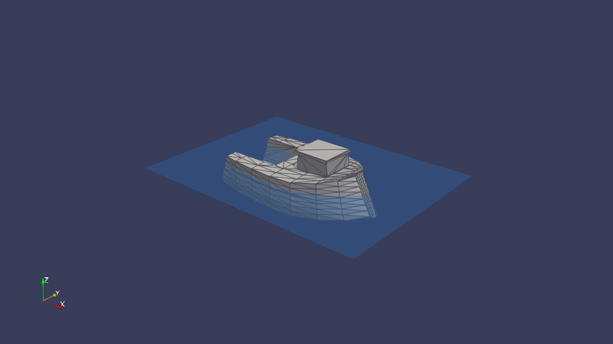
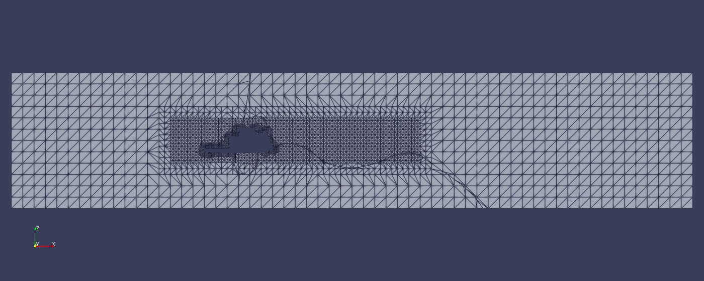
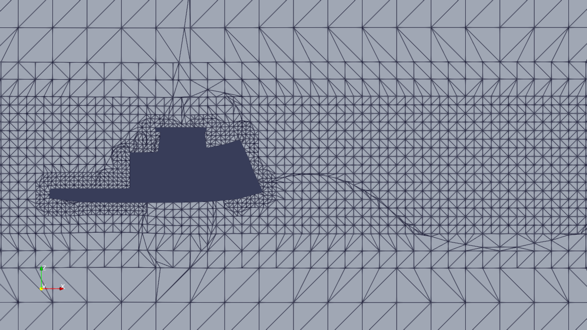
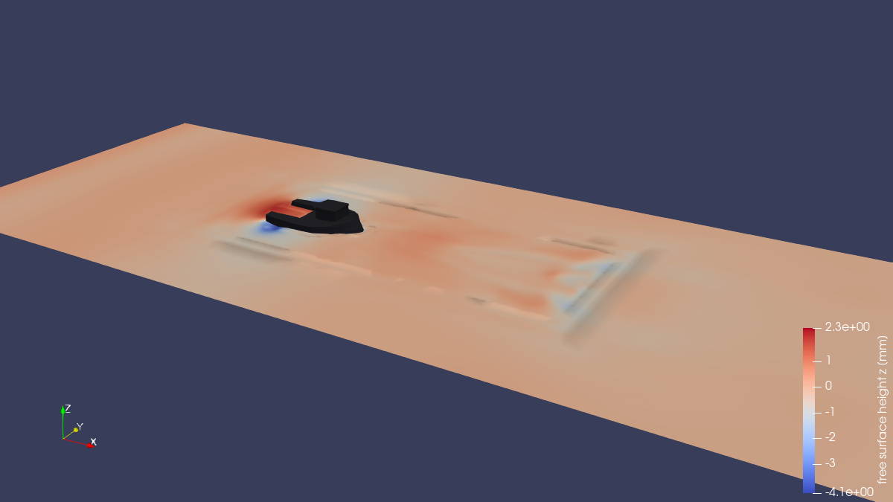
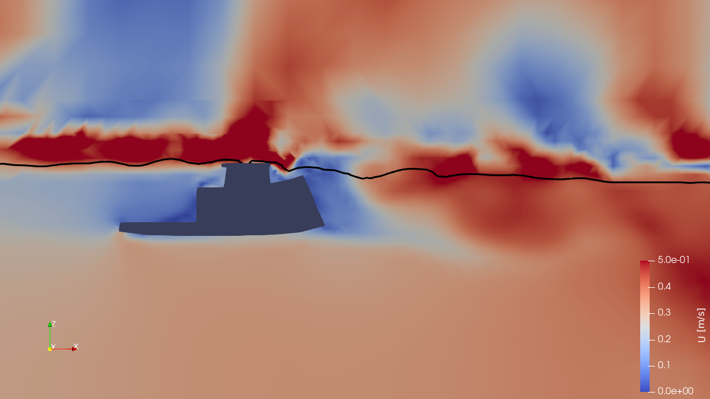
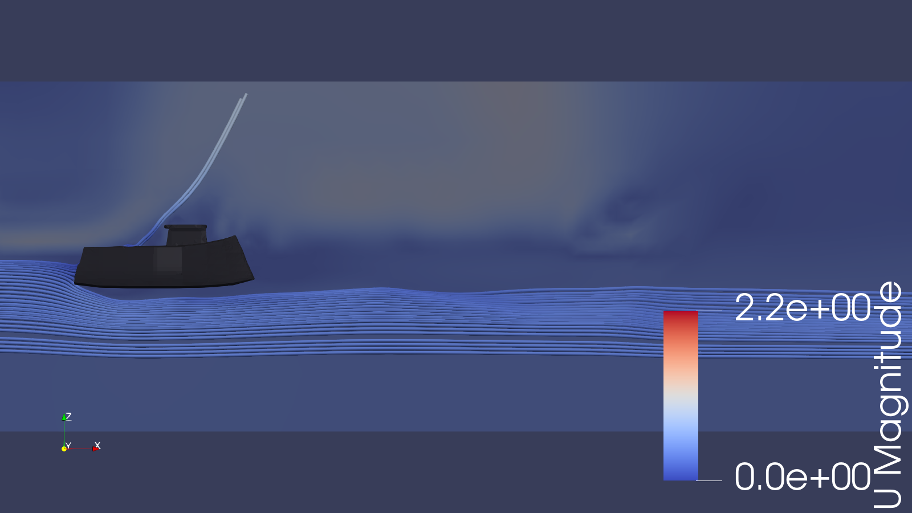
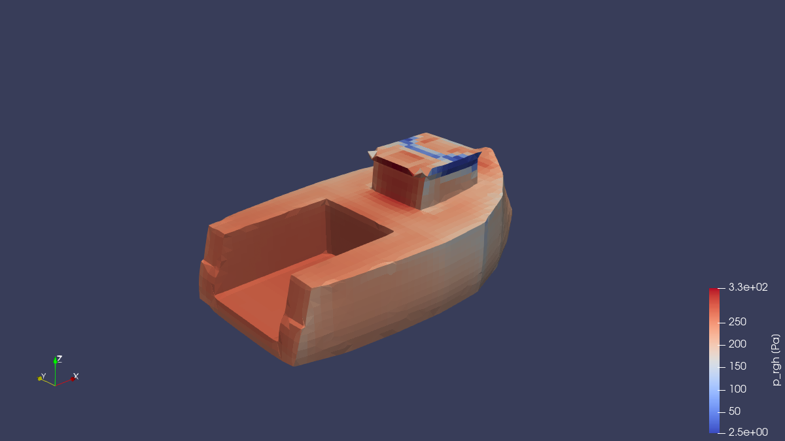

# Project 11 — Fixed Boat Hull in Calm Water

```
  ╔══════════════════════════════════════════════════════════════════════╗
  ║                                                                      ║
  ║      ~~~~~ ~~~~~~~~ ~~~~~~~~~~  FIXED HULL  ~~~~~~~~~ ~~~~~~~~~      ║
  ║                         ___                                          ║
  ║     ~~~~~  ~~~  _______/   \___   ~~~~~  ~~~~~  ~~~~~  ~~~~~         ║
  ║                /               \                                     ║
  ║     --------==/   BOAT  HULL    \==---------------------------       ║
  ║               \_______________  /                                    ║
  ║     ~~~~~  ~~~ ~~~  ~~~~  ~~  \/  ~~~~~  ~~~~  ~~~~~  ~~~~  ~~       ║
  ║                                                                      ║
  ║      Two-Phase VOF  ·  interFoam  ·  Water + Air  ·  Laminar         ║
  ║                                                                      ║
  ╚══════════════════════════════════════════════════════════════════════╝
```

> **Water at 0.3 m/s flows past a fixed toy boat hull whose waterline is at
> z = 0. The free surface is tracked with the Volume of Fluid (VOF) method in
> OpenFOAM's `interFoam` solver, and the forces on the hull are recorded.**

---

## Goal

What a learner should take away from this case:

- How a 3D body-fitted mesh is built from an STL file with `blockMesh`,
  `surfaceFeatureExtract` and `snappyHexMesh` (including the mm → m scaling).
- How a two-phase free-surface problem is set up in `interFoam`: `alpha.water`,
  `p_rgh`, `setFields`, `inletOutlet`, `totalPressure`,
  `pressureInletOutletVelocity`, `fixedFluxPressure`.
- How to read the quantities that control a VOF run: Courant and interface
  Courant number, phase volume fraction, boundedness of `alpha.water`.
- How to extract hull forces with the `forces` / `forceCoeffs` function
  objects and how to separate the hydrostatic part (buoyancy) from the flow
  part.
- What changes in [Project 12](../12_boat_hull_floating) when the same hull is
  allowed to move.

---

## Target

There is **no experimental or published reference value** for this toy hull,
so the targets below are consistency targets: they follow from the case files
or from the geometry, and each is checked by `verify.py`. All "measured"
values come from a real, complete run to `endTime = 2 s` with OpenFOAM 6
(image `cfdengine/openfoam`, 2,902 time steps, see
[Running time](#running-time)).

| Target | Value | Tolerance | Source of the value |
|--------|-------|-----------|---------------------|
| Background mesh | 14,400 cells | exact | $60 \times 20 \times 12$ in `blockMeshDict` |
| Final mesh | 75,515 cells, `checkMesh` "Mesh OK" | $\pm 10$ % cells | measured, OpenFOAM 6 |
| Mesh quality | max non-orthogonality 48.6°, max skewness 3.0 | below 65° and 4 | `meshQualityControls` limits |
| Initial water fraction | 0.4997 | $\pm 0.002$ around 0.4998 | half of the domain minus the submerged hull volume |
| Courant numbers | max Co 0.52, max interface Co 0.41 | below 1.5 $\times$ `maxCo` (0.5) and `maxAlphaCo` (0.3) | `controlDict`; the step follows the previous step's Co |
| `alpha.water` | stays in [0, 1] up to MULES undershoots (about $-6 \times 10^{-4}$) | $\pm 0.01$ | `fvSolution` MULES settings |
| Hull vertical force at start-up | 2.10 N (Archimedes for the STL below z = 0: 2.065 N) | $\pm 5$ % | `rho·g·V_submerged` from `boat_hull.stl` |
| Hull force direction | drag force along +x (flow direction) | sign only | flow is +x |
| Final state | `endTime = 2 s` reached, no `FOAM FATAL ERROR` | — | `controlDict` |
| Drag settled at `endTime` | last two 10 % windows agree within 10 % | $\pm 10$ % | **not met**: 38 % change (see [Expected Results](#expected-results)) |

The last target is **not met by the case as delivered**: with the water at
rest at t = 0 and a pressure outlet, the start-up produces a long surge and
sloshing that is still active at 2 s, so the drag has not settled. The
physically meaningful target — steady wave resistance of the hull at 0.3 m/s —
is therefore not reached; see
[Expected Results](#expected-results) and the notes for the case owner there.

Quantities **without** a reference value (reported in
[Expected Results](#expected-results) as measured values only): drag
magnitude, drag coefficient, wave height.

---

## Verification method

After a run (`./run_docker.sh` calls it automatically as its last step):

```bash
python3 verify.py
```

`verify.py` uses only the Python standard library and only reads files that the
run produced (`log.*`, `constant/polyMesh/boundary`, the newest time
directory, `postProcessing/`). It prints one line per check

```
PASS|FAIL|SKIP  <name>  measured=<value>  expected=<value> +/- <tol>
```

and exits with 0 if nothing failed, 1 if a check failed, 2 if results are
missing. Checks that need the complete 2 s run print `SKIP` when the run was
stopped earlier, and the summary says so. On the complete run described here
`verify.py` reports **26 passed, 1 failed** (the drag settling check).

| Check | What it proves | Expected | Tolerance and why | Measured |
|-------|----------------|----------|-------------------|----------|
| `blockMesh cells` | background mesh as in `blockMeshDict` | 14,400 | exact | 14,400 |
| `snappyHexMesh finished` | meshing ended without errors | "Finished meshing without any errors" | — | finished |
| `final cell count` | meshing settings give the same mesh | 75,515 | $\pm 10$ %: deterministic per version, differs slightly between OpenFOAM versions | 75,515 |
| `checkMesh Mesh OK` | no failed mesh checks | "Mesh OK." | — | Mesh OK |
| `max non-orthogonality [deg]` | within `meshQualityControls` | $\leq 65$ | `maxNonOrtho` of `snappyHexMeshDict` | 48.6 |
| `max skewness` | within `meshQualityControls` | $\leq 4$ | `maxInternalSkewness` | 2.99 |
| `domain bounding box error [m]` | snapped mesh keeps the domain | $\leq 1e-6$ | print precision of `checkMesh` | 0 |
| `hull patch faces` | `boat` patch exists and is not empty | $\geq 1$ | — | 3712 |
| `initial water fraction` | `setFields` filled z < 0 only | 0.4998 | $\pm 0.002$ (0.4 %): snapping of the hull | 0.4997 |
| `no FOAM FATAL ERROR` | solver did not abort | none | — | none |
| `max Courant number` | time step control works | $\leq 0.75$ | 1.5 $\times$ `maxCo`: the step is chosen from the previous step's Co, so single steps overshoot (a first guess of 1.1$\times$ was too tight for the interface Co) | 0.52 |
| `max interface Courant number` | interface transport is resolved | $\leq 0.45$ | 1.5 $\times$ `maxAlphaCo` (same reason); spikes up to 1.37$\times$ were seen | 0.41 |
| `min deltaT [s]` | time step did not collapse | $\geq 1e-5$ | divergence drives deltaT to zero; 1e-5 is 10$\times$ below the smallest step seen | 1.2e-4 |
| `min alpha.water (log)`, `(field)` | phase fraction bounded below | $\geq -0.01$ | 1 % of the unit range; MULES undershoot seen: 6e-4 | -5.7e-4 (log), -5.7e-7 (field at 2 s) |
| `max alpha.water (log)`, `(field)` | phase fraction bounded above | $\leq 1.01$ | 1 % of the unit range | 1.0006 (log), 1.00001 (field) |
| `water gain <= inlet flux` | water enters only below z = 0 | $\leq 1.05$ · U·W·depth·t / V | water cannot arrive faster than the lower inlet half supplies it; the old inlet (alpha = 1 on the whole face) gained twice as fast | 0.044 at 2 s (bound 0.20); 0.0098 at t = 0.1 s (bound 0.0100) |
| `water gain >= 0` | no unphysical water loss | $\geq -0.002$ | — | 0.044 |
| `|cumulative continuity err|` | incompressible solve is consistent | $\leq 1e-5$ | typical `interFoam` values are below 1e-6 | 7.5e-8 |
| `latest time has U,p_rgh,alpha.water` | results were written | all present | — | present (t = 2) |
| `forces finite` | no NaN in the force file | all finite | — | 290 rows, finite |
| `buoyancy Fz [N] (start-up)` | hydrostatic pressure and hull patch are right | 2.065 N | $\pm 5$ %: dynamic pressure (45 Pa vs 270 Pa hydrostatic at the keel) and snapped geometry; mean of rows with t $\leq 0.02$ s | 2.10 |
| `drag Fx > 0 [N]` | force on the hull points downstream | > 0 | sign only | 0.17 N (mean of the last 20 % of rows) |
| `Cd consistent with Fx` | `magUInf`, `Aref`, `rhoInf` in `forceCoeffs` agree with `forces` | Fx | $\pm 1$ % (output precision) | consistent |
| `drag change, last 2 windows` | drag has settled (full run only) | last two 10 % windows equal | $\pm 10$ %, chosen before the first full run | **FAIL**: 0.201 N vs 0.146 N (38 %) |
| `solver reached endTime` | complete run (full run only) | t $\geq 2$ s | — | t = 2 s |

`verify.py` does not prove that the wave pattern is physically accurate;
the drag magnitude has no reference value in this repository.

Manual checks (not covered by `verify.py`):

1. `grep "Courant" log.interFoam | tail` — the numbers should stay near the
   limits, not grow.
2. Open the case with `./open_paraview_streamlines.sh` and confirm that the
   interface (`alpha.water = 0.5`) is a thin, continuous surface around z = 0
   and the water does not detach from the hull.
3. Compare the pictures in [Expected Results](#expected-results) with your own
   run.

---

## Table of Contents

1.  [Overview](#overview)
2.  [Physics Background](#physics-background)
3.  [Boat Geometry](#boat-geometry)
4.  [Domain Sizing](#domain-sizing)
5.  [File-by-File Walkthrough](#file-by-file-walkthrough)
6.  [STL Scaling: Millimeters to Meters](#stl-scaling-millimeters-to-meters)
7.  [Meshing Strategy](#meshing-strategy)
8.  [Boundary Conditions](#boundary-conditions)
9.  [Phase Initialization (setFields)](#phase-initialization-setfields)
10. [VOF Theory](#vof-theory)
11. [The interFoam Solver](#the-interfoam-solver)
12. [Running the Simulation](#running-the-simulation)
13. [Post-Processing](#post-processing)
14. [Expected Results](#expected-results)
15. [Troubleshooting](#troubleshooting)
16. [Exercises](#exercises)
17. [Cross-References](#cross-references)

---

## Overview

This project simulates **flow around a fixed toy boat hull** sitting at the
air-water interface. The hull is held in place (no rigid-body motion) while an
inlet velocity of **0.3 m/s** drives water past it. The flow starts
impulsively from rest, so the run is a transient; the quantities of interest
are:

- The **free-surface deformation** around the hull (bow and stern waves)
- **Pressure and viscous forces** on the hull (drag, and the vertical force
  that contains the buoyancy)
- The **wake** behind the hull

We use OpenFOAM's **`interFoam`** solver, which implements the **Volume of
Fluid (VOF)** method for tracking two immiscible, incompressible fluids
(water and air) sharing the same computational domain.

### Why "Fixed Hull"?

In naval CFD, you typically start with a **fixed hull** simulation before
moving to a **free-floating** hull. Fixing the hull:

- Eliminates the complexity of 6-DOF rigid body motion
- Gives a stable baseline for mesh and solver settings
- Still captures the essential wave-making physics
- Is the natural precursor to Project 12 (floating hull)

### Differences from Project 12 (floating hull)

Both projects use the same STL and similar domains. The differences, taken
from the case files:

| Item | 11 — fixed (this project) | 12 — floating |
|------|---------------------------|---------------|
| Solver | `interFoam` | `interDyMFoam` + `sixDoFRigidBodyMotion` |
| Hull | fixed, `noSlip` wall | moves (`movingWallVelocity`; 6-DoF solver with constraints) |
| Inlet velocity | 0.3 m/s | 0 (no imposed flow) |
| Domain z | -0.15 … 0.15 m (14,400 background cells: $60 \times 20 \times 12$) | -0.20 … 0.15 m ($60 \times 20 \times 14$) |
| Lateral boundaries | `port`/`starboard` symmetry planes | one `sides` patch (slip) |
| End time | 2 s | 3 s |
| Force output | `forces` + `forceCoeffs` | `forces` + `sixDoFRigidBodyState` |

### Key Parameters

| Parameter            | Value                                |
|----------------------|--------------------------------------|
| Solver               | `interFoam` (VOF two-phase)          |
| Phases               | Water ($\rho$=998.2 $\mathrm{kg}/\mathrm{m}^{3}$) + Air ($\rho$=1.225 $\mathrm{kg}/\mathrm{m}^{3}$) |
| Flow speed           | 0.3 m/s (towing speed)               |
| Boat length          | 0.155 m (~6 inches)                  |
| Reynolds number      | Re $\approx$ 46,500 (based on boat length)   |
| Froude number        | Fr $\approx$ 0.243 (based on boat length)    |
| Turbulence model     | Laminar (first pass)                 |
| Surface tension      | $\sigma$ = 0.072 N/m                        |
| Gravity              | g = -9.81 $\mathrm{m}/\mathrm{s}^{2}$ (z-direction)         |
| End time             | 2 s (40 write times, every 0.05 s)   |

$Re = U L / \nu = 0.3 \cdot 0.155 / 10^{-6} = 46{,}500$.
The **Froude number** Fr = U / $\sqrt{gL}$ $\approx$ 0.3 / $\sqrt{$9.81 \times 0.155$}$ $\approx$ 0.243,
which is in the wave-making regime — surface waves are generated.

---

## Physics Background

### Two-Phase Flow

When a hull moves through water, it creates disturbances at the air-water
interface. Modeling this requires tracking **two fluids** simultaneously:

```
  ATMOSPHERE (air)         ρ = 1.225 kg/m³,  ν = 1.48e-5 m²/s
  ─────────────────────────────────────────────────────────────
  ~~~~~~~~~~~~ FREE SURFACE (interface) ~~~~~~~~~~~~~~~~~~~~~~~~
  ─────────────────────────────────────────────────────────────
  WATER                    ρ = 998.2 kg/m³,  ν = 1.00e-6 m²/s
```

The interface between water and air is not prescribed — it **evolves** as
part of the solution. This is what makes free-surface problems interesting
and computationally challenging.

### Volume of Fluid (VOF)

The VOF method tracks the interface using a **phase fraction** field
`alpha.water` ($\alpha$):

- $\alpha$ = 1: cell is fully water
- $\alpha$ = 0: cell is fully air
- 0 < $\alpha$ < 1: cell contains the interface

A single set of Navier-Stokes equations is solved for the **mixture**, with
material properties that vary according to $\alpha$:

```
ρ_mixture = α · ρ_water + (1 - α) · ρ_air
μ_mixture = α · μ_water + (1 - α) · μ_air
```

### Surface Tension

Surface tension $\sigma$ acts at the interface and is modeled using the
**Continuum Surface Force (CSF)** method. The surface tension force is
converted to a volume force:

```
F_σ = σ κ ∇α
```

where $\kappa$ is the interface curvature estimated from the $\alpha$ field.

---

## Boat Geometry

### Source STL File

The hull geometry is defined in `boat_hull.stl` at the repository root.
This is a **binary STL** file containing **960 triangles**.

> **The STL is in millimeters.** It must be scaled to meters before use.
> The `Allrun` script handles this automatically.



*Figure 1 — Hull STL after scaling (surface mesh edges shown) with the
z = 0 waterline plane in blue. The narrow, pointed end is at +x, the wide
blunt end at −x.*

### Bounding Box

```
                        Units: millimeters (as-stored in STL)
     ┌─────────────────────────────────────────────────────────┐
     │                                                         │
     │         ┌───────────────────────────────────┐           │
     │         │                                   │           │
     │         │          BOAT HULL STL            │  Height   │
     │  Width  │                                   │  54.50 mm │
     │ 81.70mm │         Length: 155.06 mm          │           │
     │         │                                   │           │
     │         │           (centered at origin)    │           │
     │         └───────────────────────────────────┘           │
     │                                                         │
     └─────────────────────────────────────────────────────────┘

     Bounding Box (mm):
       X: [-77.53, +77.53]   (length axis)
       Y: [-40.85, +40.85]   (beam/width axis, port to starboard)
       Z: [-27.25, +27.25]   (vertical axis, keel to deck)

     Bounding Box (m) — after scaling ×0.001:
       X: [-0.0775, +0.0775]
       Y: [-0.0409, +0.0409]
       Z: [-0.0273, +0.0273]
```

### Orientation

The STL is centered at the origin with:

- **X-axis**: longitudinal; the flow direction (inlet at x = -0.5 m)
- **Y-axis**: lateral (port ↔ starboard)
- **Z-axis**: vertical (keel → deck, gravity acts in -Z)

The hull is **symmetric about the XZ-plane** (Y = 0). Its bounding box is
centred on z = 0, so the waterline at z = 0 cuts the box in half; because the
hull narrows towards the deck, about **71 %** of the hull volume lies below
z = 0 (0.000211 $\mathrm{m}^{3}$ of 0.000297 $\mathrm{m}^{3}$, computed from the STL).

The end of the hull at **x = -0.0775 m is wide and blunt** (half-width about
35 mm) while the end at **x = +0.0775 m is narrow** (about 5 mm). The inlet is
at x = -0.5 m, so the incoming water meets the blunt end first: in this
setup the hull is towed with the pointed end downstream.

---

## Domain Sizing

### Rationale

The computational domain must be large enough that:
1. The inlet flow is undisturbed by the hull
2. Wake and waves can develop without hitting boundaries
3. Lateral boundaries don't constrain the flow

Rule of thumb for external flow around a body of length L = 0.155 m:

| Direction    | Distance                       | Value            | Reason                     |
|-------------|--------------------------------|------------------|----------------------------|
| Upstream    | 0.42 m from the hull ($\approx 2.7$ L)  | inlet at x = -0.5 m | Undisturbed inflow         |
| Downstream  | 0.92 m from the hull ($\approx 5.9$ L)  | outlet at x = 1.0 m | Wake/wave development      |
| Lateral     | 0.25 m from the centre line ($\approx 3$ W) | $\pm$0.25 m     | No wall interference       |
| Below       | 0.15 m below the waterline ($\approx 3$ H) | bottom at z = -0.15 m | No bottom effects          |
| Above       | 0.15 m above the waterline ($\approx 3$ H) | top at z = +0.15 m | Air space for waves        |

(W = 0.082 m hull width, H = 0.054 m hull height.)

### Domain Diagram

Not to scale: the hull is 0.155 m long in a 1.5 m long domain.

```
                           1.5 m total (x-direction)
            ◄─────────────────────────────────────────────────────────►

            x = -0.5                                          x = 1.0
         ┌────────────────────────────────────────────────────────────┐ z = 0.15
         │  ATMOSPHERE  (air, α = 0)                                  │
         │                                                            │ ▲
         │               ___......___                                 │ │ 0.15m
  INLET  │          ____/           \____                     OUTLET  │ │
  U=0.3→ │~~~~~~~~/     BOAT HULL      \~~~~~~~~~~~~~~~~~~~~~~~~→    │ z = 0
  m/s    │       \______           _____/                     (open)  │
         │              ‾‾‾......‾‾‾                                  │ │
         │  WATER  (water, α = 1)                                     │ │ 0.15m
         │                                                            │ ▼
         └────────────────────────────────────────────────────────────┘ z = -0.15
                                                                      
         y = -0.25  ◄──── 0.5 m (y-direction) ────►  y = +0.25

         ┌────────────────────────────────────────────────────────────┐
         │               SIDE (symmetryPlane, port, y = -0.25)         │
         │                                                            │
         │                    TOP VIEW                                │
         │             ___......___                                   │
  INLET  │        ____/    HULL    \____                      OUTLET  │
  ────►  │       ‾‾‾‾\___........___/‾‾‾‾                     ────►  │
         │                                                            │
         │               SIDE (symmetryPlane, starboard, y = +0.25)    │
         └────────────────────────────────────────────────────────────┘
```

---

## File-by-File Walkthrough

### Directory Structure

```
11_boat_hull_fixed/
├── Allrun                              ← Master run script
├── Allclean                            ← Cleanup script
├── run_docker.sh                       ← Docker runner (Allclean, Allrun, verify.py)
├── verify.py                           ← Result checks (reads logs/results only)
├── open_paraview.sh                    ← Open results in ParaView
├── open_paraview_streamlines.sh        ← Open the prepared slice/streamline view
├── paraview_streamlines.py             ← ParaView script for that view
├── paraview_screenshots.py             ← Offscreen script for the figures below
├── README.md                           ← This file
├── images/                             ← Figures (from a real run)
│
├── 0/                                  ← Initial & boundary conditions
│   ├── U                               ← Velocity field
│   ├── p_rgh                           ← Pressure (hydrostatic removed)
│   └── alpha.water                     ← Phase fraction (water/air)
│
├── constant/                           ← Physical properties
│   ├── transportProperties             ← Fluid properties (water + air)
│   ├── turbulenceProperties            ← Turbulence model (laminar)
│   ├── g                               ← Gravity vector
│   └── triSurface/                     ← STL geometry (created by Allrun, not tracked)
│       └── boat_hull.stl               ← (copied & scaled at runtime)
│
└── system/                             ← Solver & mesh configuration
    ├── controlDict                     ← Time control, I/O, function objects
    ├── blockMeshDict                   ← Background mesh definition
    ├── snappyHexMeshDict               ← Mesh refinement around hull
    ├── surfaceFeatureExtractDict        ← Edge feature extraction
    ├── setFieldsDict                   ← Phase initialization
    ├── fvSchemes                       ← Discretization schemes
    └── fvSolution                      ← Linear solver settings
```

### 0/U — Velocity Field

Defines the velocity boundary conditions and initial internal field.

- **inlet**: `fixedValue (0.3 0 0)` — uniform towing speed
- **outlet**: `pressureInletOutletVelocity` — zero gradient for outflow; for
  inflow the velocity is taken normal to the patch from the flux
- **atmosphere**: `pressureInletOutletVelocity` — open top
- **bottom**: `noSlip` — stationary tank floor
- **port**: `symmetryPlane` — lateral symmetry boundary at y = -0.25
- **starboard**: `symmetryPlane` — lateral symmetry boundary at y = +0.25
- **boat**: `noSlip` — no-slip on hull surface
- **internalField**: `uniform (0 0 0)` — fluid initially at rest

Because the fluid starts at rest while the inlet imposes 0.3 m/s, the start
of the run is an impulsive start.

### 0/p_rgh — Pressure Field

The pressure variable `p_rgh = p - ρgh` has the hydrostatic component
removed, which improves numerical conditioning for free-surface flows.

- **inlet/bottom/boat**: `fixedFluxPressure` — adjusts pressure to match
  the velocity boundary condition
- **port/starboard**: `symmetryPlane`
- **outlet/atmosphere**: `totalPressure` with p0 = 0 — reference pressure

### 0/alpha.water — Phase Fraction

The water volume fraction. Initialized to 0 everywhere (all air), then
`setFields` fills everything below z = 0 with water ($\alpha$ = 1).

- **inlet**: `fixedValue` — water ($\alpha$ = 1) below z = 0 and air
  ($\alpha$ = 0) above; the face values are written by `setFields` (the
  value `0` in the file is only the default)
- **outlet/atmosphere**: `inletOutlet` — zero gradient for outflow; any
  backflow brings in air ($\alpha$ = 0), not water
- **boat/bottom**: `zeroGradient` — interface meets walls naturally
- **port/starboard**: `symmetryPlane`

### constant/transportProperties

Defines the two-phase material properties:

```
Water:  ν = 1.00 × 10⁻⁶ m²/s,  ρ = 998.2 kg/m³   (at 20°C)
Air:    ν = 1.48 × 10⁻⁵ m²/s,  ρ = 1.225 kg/m³    (at 20°C, 1 atm)
Surface tension: σ = 0.072 N/m
```

### constant/turbulenceProperties

Set to `laminar` for this initial study. The Reynolds number (~46,500) is
in the transitional regime, but laminar gives a first approximation
and avoids the complexity of turbulence modeling at the free surface.
Free-surface waves are resolved; turbulence in the hull boundary layer and
wake is not modelled.

### constant/g — Gravity

Gravity points in the -z direction: `(0 0 -9.81)`. This is essential for:
- Hydrostatic pressure distribution
- Free surface position (water settles under gravity)
- Wave dynamics

### system/blockMeshDict — Background Mesh

Creates the base hexahedral mesh that `snappyHexMesh` will refine.

- **Domain**: [-0.5, 1.0] $\times$ [-0.25, 0.25] $\times$ [-0.15, 0.15]
- **Cells**: 60 $\times$ 20 $\times$ 12 = 14,400 cells
- **Cell size**: 25 mm in all directions (coarse — snappy will refine near hull)
- **Patches**: `inlet`, `outlet`, `bottom` (wall), `atmosphere`, `port` and
  `starboard` (symmetryPlane)

### system/controlDict — Run Control

| Setting          | Value           | Rationale                           |
|-----------------|-----------------|-------------------------------------|
| deltaT          | 0.0001 s        | Small initial step for stability    |
| endTime         | 2 s             | 0.6 m of water travel (0.4 domain flow-throughs, about 3.9 hull lengths) |
| adjustTimeStep  | yes             | Adaptive time stepping              |
| maxCo           | 0.5             | Courant number limit                |
| maxAlphaCo      | 0.3             | Interface Courant limit (stricter)  |
| maxDeltaT       | 0.01 s          | Upper bound for the adaptive step   |
| writeInterval   | 0.05 s          | 40 output frames (binary)           |

The `forces` and `forceCoeffs` function objects compute forces and
coefficients on the hull patch every 10th time step.
`forceCoeffs` uses `magUInf = 0.3`, `lRef = 0.155` and `Aref = 0.00443 m²`
(hull width $\times$ full hull height, $0.0817 \times 0.0545$ m, not the submerged frontal
area), with `liftDir = (0 0 1)` and `dragDir = (1 0 0)`. Cd and Cl scale with
this `Aref`; the force values in `forces.dat` do not.

### system/fvSchemes — Discretization

Key entries for interFoam (time scheme: `Euler`):

| Term                                          | Scheme              | Notes                        |
|----------------------------------------------|---------------------|------------------------------|
| `div(rhoPhi,U)`                              | linearUpwindV       | Momentum convection          |
| `div(phi,alpha)`                             | vanLeer             | Phase fraction (TVD)         |
| `div(phirb,alpha)`                           | linear              | Interface compression        |
| `div(((rho*nuEff)*dev2(T(grad(U)))))`        | linear              | Viscous stress tensor        |

The `div(phi,k)`, `div(phi,epsilon)` and `div(phi,omega)` entries are only
used if a RAS turbulence model is enabled (Exercise 3).

### system/fvSolution — Linear Solvers

- **alpha.water**: `smoothSolver`, MULES with semi-implicit correction
  (`MULESCorr yes`, `nAlphaCorr 2`, `cAlpha 1`) for boundedness
- **p_rgh**: `PCG` with GAMG preconditioner (efficient for pressure);
  `p_rghFinal` uses `relTol 0`
- **U**: `smoothSolver` with Gauss-Seidel; it is only used if the momentum
  predictor is switched on (`momentumPredictor no` here)
- **PIMPLE**: 1 outer, 3 pressure corrections, 1 non-orthogonal correction.
  With one outer corrector `interFoam` reports "PISO mode".
- `pcorr` settings are only used with a moving mesh (Project 12).

### system/setFieldsDict — Phase Initialization

Uses `boxToCell` to set $\alpha$ = 1 in a huge box from (-10,-10,-10) to (10,10,0).
Since z = 0 is the waterline, everything below gets filled with water. The
same box is applied with `boxToFace`, which writes $\alpha$ = 1 on the
boundary faces whose centre lies below z = 0; this gives the inlet its
water/air split.

### system/surfaceFeatureExtractDict

Extracts sharp edges (included angle < 150°, that is surface turning by more
than 30°) from the STL to create a `.eMesh`
file. These edges guide `snappyHexMesh` for accurate feature snapping.

### system/snappyHexMeshDict — Mesh Refinement

Three-stage mesh generation:

1. **Castellated mesh**: Refines cells near the hull surface
   - Surface refinement: levels 2-3 (cells 4-8$\times$ smaller than background)
   - Region refinement: level 2 in a box around the waterline
     (x -0.15…0.40, y $\pm 0.10$, z $\pm 0.05$ m)
2. **Snap**: Moves cell vertices onto the STL surface
3. **Add layers**: Disabled (`addLayers false`); the layer settings in the file
   are present but unused

---

## STL Scaling: Millimeters to Meters

The original `boat_hull.stl` is authored in millimeters. OpenFOAM works in
SI units (meters). The `Allrun` script handles conversion:

```bash
# Copy from repo root to case triSurface directory
mkdir -p constant/triSurface
cp ../../boat_hull.stl constant/triSurface/boat_hull.stl

# Scale by 0.001 (mm → m) IN-PLACE
surfaceTransformPoints -scale '(0.001 0.001 0.001)' \
    constant/triSurface/boat_hull.stl constant/triSurface/boat_hull.stl
```

**Before scaling** (mm):
```
X: [-77.53, 77.53]  →  Length = 155.06 mm
Y: [-40.85, 40.85]  →  Width  =  81.70 mm
Z: [-27.25, 27.25]  →  Height =  54.50 mm
```

**After scaling** (m):
```
X: [-0.0775, 0.0775]  →  Length = 0.155 m
Y: [-0.0409, 0.0409]  →  Width  = 0.082 m
Z: [-0.0273, 0.0273]  →  Height = 0.055 m
```

---

## Meshing Strategy

### Stage 1: Background Mesh (blockMesh)

`blockMesh` creates a uniform hexahedral grid filling the entire domain:

```
  ┌──┬──┬──┬──┬──┬──┬──┬──┬──┬──┐
  │  │  │  │  │  │  │  │  │  │  │     60 × 20 × 12 = 14,400 cells
  ├──┼──┼──┼──┼──┼──┼──┼──┼──┼──┤     Cell size = 25 mm
  │  │  │  │  │  │  │  │  │  │  │
  ├──┼──┼──┼──┼──┼──┼──┼──┼──┼──┤
  │  │  │  │  │  │  │  │  │  │  │
  └──┴──┴──┴──┴──┴──┴──┴──┴──┴──┘
```

### Stage 2: Surface Feature Extraction

`surfaceFeatureExtract` identifies sharp edges on the STL surface (where
the included angle between adjacent triangles is below 150°). These edges are
saved as `.eMesh` files and used by `snappyHexMesh` to ensure the mesh
conforms accurately to hull features like the bow, keel line, and transom.

### Stage 3: snappyHexMesh

`snappyHexMesh` transforms the coarse background mesh into a body-fitted
mesh around the hull:

```
  ┌──────────────────────────────────────────────────────────────────┐
  │                                                                  │
  │  Coarse background cells (level 0, 25 mm)                        │
  │                                                                  │
  │           ┌────────────────────────────┐                         │
  │           │  Refinement box (level 2)  │                         │
  │           │  6.25 mm cells             │                         │
  │           │      ┌──────────┐          │                         │
  │           │      │Hull surf.│          │                         │
  │           │      │(level 3) │          │                         │
  │           │      │ 3.1 mm   │          │                         │
  │           │      └──────────┘          │                         │
  │           └────────────────────────────┘                         │
  │                                                                  │
  └──────────────────────────────────────────────────────────────────┘
```



*Figure 2 — Cells on the y = 0 plane (whole domain; the diagonals come
from the slice filter cutting the hexahedra). Look for the refinement box
around the hull (x -0.15…0.40 m) and the coarse 25 mm cells elsewhere.*



*Figure 3 — Close-up of the y = 0 plane around the hull (the hull is the
cut-out; pointed end to the right): level-2 cells in the box and level-3 cells
at the hull surface.*

The `locationInMesh` point `(0.3, 0, 0.05)` tells snappy which side of the
hull surface is the "fluid" side (the point must be clearly outside the
boat and inside the domain).

**Cell counts after snappyHexMesh** (measured): 75,515 cells in total —
12,960 at level 0 (25 mm), 5,888 at level 1, 42,013 at level 2 (6.25 mm) and
14,654 at level 3 (3.1 mm). The `boat` patch has 3,712 faces. `checkMesh`:
max non-orthogonality 48.6°, max skewness 2.99, max aspect ratio 4.3,
"Mesh OK".

---

## Boundary Conditions

### Domain Patch Layout

```
                    atmosphere (top, z = 0.15)
         ┌────────────────────────────────────────────┐
         │                 ↑ open air                  │
         │                                             │
  inlet  │  U = 0.3 m/s →        → → →        outlet  │
  (left) │  α = 1 below z=0  ___/‾‾‾\___    (right)   │
  x=-0.5 │  p: fixedFlux    / BOAT HULL \   p: total  │  x=1.0
         │                  \___________/    α: outflow│
         │                                             │
         │  ══════════ water (α = 1) ═══════════       │
         │                                             │
         └────────────────────────────────────────────┘
                     bottom (wall, z = -0.15)

         port/starboard: symmetryPlane (y = ±0.25)
```

### Boundary Condition Summary Table

| Patch      | U                             | p_rgh              | alpha.water       |
|-----------|-------------------------------|--------------------|--------------------|
| inlet      | fixedValue (0.3 0 0)          | fixedFluxPressure  | fixedValue (1 below z = 0, 0 above) |
| outlet     | pressureInletOutletVelocity   | totalPressure 0    | inletOutlet 0      |
| atmosphere | pressureInletOutletVelocity   | totalPressure 0    | inletOutlet 0      |
| bottom     | noSlip                        | fixedFluxPressure  | zeroGradient       |
| port       | symmetryPlane                 | symmetryPlane      | symmetryPlane      |
| starboard  | symmetryPlane                 | symmetryPlane      | symmetryPlane      |
| boat       | noSlip                        | fixedFluxPressure  | zeroGradient       |

### Why These Choices?

- **fixedFluxPressure**: Adjusts the pressure gradient at the boundary to
  be consistent with the velocity BC. Essential for gravity-driven flows.
- **totalPressure**: Sets $p_0$ = 0 at the outlet/atmosphere: the pressure
  equals $p_0$ for outflow and $p_0$ - ½$\rho$|U|² for inflow (Bernoulli-like
  condition).
- **pressureInletOutletVelocity**: Zero-gradient for outflow; for inflow the
  velocity is taken normal to the patch from the flux, with zero tangential
  component (prevents sideways inflow).
- **inletOutlet for $\alpha$**: Zero-gradient for outflow; for backflow the
  prescribed `inletValue` 0 is used, so air (not water) is drawn in at the
  outflow boundaries.
- **inlet $\alpha$ profile**: the free surface must also be present on the
  inlet face. A uniform $\alpha$ = 1 would inject water above the waterline
  (the water volume then grows twice as fast as the lower inlet half
  supplies it), so the face values are set per face by `setFields`.

---

## Phase Initialization (setFields)

After meshing, the entire domain is initialized as air ($\alpha$ = 0). The
`setFields` utility reads `setFieldsDict` and fills the water region:

```
  BEFORE setFields:                    AFTER setFields:
  ┌──────────────────────┐             ┌──────────────────────┐
  │                      │             │                      │
  │   α = 0 (all air)   │             │   α = 0 (air)        │  z > 0
  │                      │             │                      │
  │                      │             ├══════════════════════╡  z = 0
  │                      │             │                      │
  │                      │             │   α = 1 (water)      │  z < 0
  │                      │             │                      │
  └──────────────────────┘             └──────────────────────┘
```

The `boxToCell` selector fills a giant box from (-10,-10,-10) to (10,10,0)
with $\alpha$ = 1. The box is intentionally oversized — only cells inside the
mesh domain are affected. The z = 0 cutoff creates the waterline.
`boxToFace` does the same for boundary faces (inlet profile); it also prints
the harmless warning "Ignoring internal face 0".

**Inside the hull**: Cells inside the boat geometry were removed by
snappyHexMesh, so `setFields` naturally skips them. The hull acts as a
solid obstacle.

`Allrun` restores the original `0/alpha.water` when it exits (`setFields`
overwrites it); the initialised field is in the first written time
directory.

---

## VOF Theory

### The Volume Fraction Equation

The VOF method solves a transport equation for the phase fraction $\alpha$:

```
∂α/∂t + ∇·(U α) + ∇·(U_r α(1-α)) = 0
```

where:
- `α`: volume fraction of water (0 = air, 1 = water)
- `U`: velocity field (shared by both phases)
- `U_r`: compression velocity (artificial, sharpens the interface)

The third term `∇·(U_r α(1-α))` is the **interface compression** term
that OpenFOAM's VOF implementation adds to keep the interface sharp.
The factor `α(1-α)` ensures
compression only acts at the interface (where 0 < $\alpha$ < 1), not in pure
fluid regions.

### MULES Algorithm

OpenFOAM uses the **Multidimensional Universal Limiter with Explicit
Solution (MULES)** algorithm to solve the $\alpha$ equation. MULES ensures:

1. **Boundedness**: $\alpha$ stays between 0 and 1 (no unphysical overshoot);
   small undershoots of the order $10^{-4}$ remain in practice ($-5.7 \times 10^{-4}$ in this run)
2. **Sharpness**: The interface remains thin (a few cells wide)
3. **Conservation**: Total water volume is conserved

The `cAlpha` parameter (set to 1 in `fvSolution`) controls the strength
of interface compression. Higher values give sharper interfaces but may
introduce artifacts.

### Material Properties

The mixture properties are computed cell-by-cell:

```
ρ = α · 998.2 + (1-α) · 1.225        [kg/m³]
μ = α · 998.2e-6 + (1-α) · 1.225·1.48e-5  [Pa·s]
```

This creates a smooth transition across the interface, avoiding sharp
discontinuities that would destabilize the numerics.

---

## The interFoam Solver

### What It Solves

`interFoam` solves the following coupled system at each time step:

1. **Volume fraction equation** ($\alpha$ transport):
   ```
   ∂α/∂t + ∇·(Uα) + ∇·(U_c α(1-α)) = 0
   ```

2. **Momentum equation** (Navier-Stokes for the mixture):
   ```
   ∂(ρU)/∂t + ∇·(ρUU) = -∇p_rgh - (g·h)∇ρ + ∇·(μ_eff (∇U + ∇Uᵀ)) + σκ∇α
   ```

3. **Pressure equation** (from continuity):
   ```
   ∇·((1/ρ) ∇p_rgh) = ∇·U*  (approximate)
   ```

The variables are:
- `U`: velocity vector field
- `p_rgh = p - ρgh`: modified pressure (hydrostatic part removed),
  with `h` the height measured against the reference level
- `α`: water volume fraction
- `ρ, μ`: mixture density and viscosity (functions of $\alpha$)
- `σκ∇α`: surface tension force (CSF model)

### Solution Algorithm (PIMPLE)

The PIMPLE algorithm (merged PISO-SIMPLE) proceeds:

```
For each time step:
  1. Solve α equation (MULES)
  2. Update ρ and μ from α
  3. Outer correction loop (nOuterCorrectors = 1):
     a. Momentum predictor → U*  (skipped here: momentumPredictor no)
     b. Inner correction loop (nCorrectors = 3):
        i.   Assemble and solve pressure equation → p_rgh
        ii.  Non-orthogonal corrections (nNonOrthogonalCorrectors = 1)
        iii. Correct velocity U from pressure gradient
  4. Advance time
```

### Adaptive Time Stepping

With `adjustTimeStep yes`, interFoam automatically adjusts $\Delta t$ to satisfy:

- **maxCo = 0.5**: Maximum Courant number for velocity
- **maxAlphaCo = 0.3**: Maximum Courant number for the interface

The interface Courant limit is stricter because the $\alpha$ equation is solved
explicitly and is more sensitive to time step size. See
[Note 08 — The CFL Number](https://github.com/djeada/OpenFoam-Tutorials/blob/main/notes/08_cfl_number.md) for details.

---

## Running the Simulation

### Prerequisites

- OpenFOAM installed and environment sourced (`. /opt/openfoam*/etc/bashrc`),
  or Docker with the `cfdengine/openfoam` image
- The `boat_hull.stl` file at the repository root

### Step-by-Step Execution

With Docker (cleans, runs everything and calls `verify.py`):

```bash
cd projects/11_boat_hull_fixed
./run_docker.sh
```

With a local OpenFOAM installation, the `Allrun` script automates everything:

```bash
cd projects/11_boat_hull_fixed
./Allrun
python3 verify.py
```

`run_docker.sh` mounts the **repository root** because `Allrun` reads
`../../boat_hull.stl`. Equivalent manual command, from the repository root:

```bash
docker run --rm -u "$(id -u):$(id -g)" \
  -v "$PWD":/work \
  -w /work/projects/11_boat_hull_fixed \
  cfdengine/openfoam \
  bash -lc 'source /opt/openfoam6/etc/bashrc && ./Allclean && ./Allrun'
```

Here's what happens at each step:

#### Step 1: Copy and Scale STL

```bash
mkdir -p constant/triSurface
cp ../../boat_hull.stl constant/triSurface/boat_hull.stl
surfaceTransformPoints -scale '(0.001 0.001 0.001)' \
    constant/triSurface/boat_hull.stl constant/triSurface/boat_hull.stl
```

Copies the STL from the repo root and scales from millimeters to meters.
Check the log: `log.surfaceTransformPoints`

#### Step 2: Background Mesh

```bash
blockMesh
```

Creates 14,400 hexahedral cells. Check: `log.blockMesh`

#### Step 3: Feature Extraction

```bash
surfaceFeatureExtract
```

Reads `boat_hull.stl`, identifies sharp edges, writes `boat_hull.eMesh`.
Check: `log.surfaceFeatureExtract`

#### Step 4: Mesh Refinement

```bash
snappyHexMesh -overwrite
```

Refines and snaps the mesh around the hull. The `-overwrite` flag writes
the final mesh to `constant/polyMesh` instead of creating time directories.
Check: `log.snappyHexMesh`

#### Step 5: Mesh Quality Check

```bash
checkMesh
```

Reports mesh statistics and quality metrics. Look for:
- "Mesh OK" at the end
- No "***" warnings about severely non-orthogonal faces

Check: `log.checkMesh`

#### Step 6: Phase Initialization

```bash
setFields
```

Sets $\alpha$ = 1 below z = 0 (water region), also on the inlet faces.
Check: `log.setFields`

#### Step 7: Run Solver

```bash
interFoam
```

Runs the VOF solver for 2 seconds of simulation time.
Check: `log.interFoam`

### Running time

Measured on a shared 20-core host (single process, other jobs running at the
same time, so the numbers vary with the load): the meshing chain takes under
one minute (`snappyHexMesh` about 28 s). The solver needed 2,902 time steps
and about 1,070 s of CPU time (1,074 s wall) for the 2 s of simulated time.
Time steps were $1.2 \times 10^{-4}$ s at the start and $5 \times 10^{-4}$ … $1.4 \times 10^{-3}$ s afterwards
(median $6.7 \times 10^{-4}$ s), limited by `maxAlphaCo`/`maxCo`. To get a shorter run,
lower `endTime` in `system/controlDict`; `verify.py` then marks the
full-run checks as `SKIP`.

### Monitoring Progress

While `interFoam` runs, you can monitor:

```bash
# Watch the log in real time
tail -f log.interFoam

# Check Courant numbers
grep "Courant Number" log.interFoam | tail -20

# Check interface Courant numbers
grep "Interface Courant" log.interFoam | tail -20

# Check continuity errors
grep "continuity errors" log.interFoam | tail -10

# Monitor time step
grep "^deltaT" log.interFoam | tail -20

# Water volume fraction and alpha bounds
grep "Phase-1 volume fraction" log.interFoam | tail -5
```

### Parallel Execution

For faster runs, decompose and run in parallel:

```bash
# Add to Allrun (before interFoam):
runApplication decomposePar
runParallel interFoam
runApplication reconstructPar

# Create system/decomposeParDict:
# method scotch; numberOfSubdomains 4;
```

Not tested in this project.

---

## Post-Processing

### ParaView Visualization

Open the results in ParaView:

```bash
./open_paraview.sh          # creates boat_hull_fixed.foam and opens it
# or
paraFoam
# or
touch boat_hull_fixed.foam && paraview boat_hull_fixed.foam
```

For a prepared view with a center slice, hull surface, and streamlines:

```bash
./open_paraview_streamlines.sh
```

To render the pictures of this README offscreen (needs `pvbatch`, run from the
project directory after the case has been solved):

```bash
touch boat_hull_fixed.foam
pvbatch paraview_screenshots.py            # writes images/*.png
```

#### Visualize the Free Surface

1. Load the case and click **Apply**
2. Add a **Clip** filter:
   - Scalars: `alpha.water`
   - Value: `0.5`
   - **Invert**: unchecked (keeps `alpha.water` $\geq 0.5$)
3. This clips away the air, showing only the water volume
4. Color by `p_rgh` to see pressure distribution on the water surface

#### Water Surface Contour

1. Apply a **Contour** filter on `alpha.water` at value `0.5`
   (needs point data: apply **Cell Data to Point Data** first)
2. This creates an isosurface at the air-water interface
3. Color by `U` magnitude to see flow speed along the waterline

#### Pressure on Hull

1. Extract the hull surface: in the reader's **Mesh Regions** select only
   `patch/boat` (or **Extract Block** → `boat` patch)
2. Color by `p_rgh` to see pressure distribution
3. High pressure where the flow stagnates, low pressure along the sides

#### Velocity Field

1. Apply a **Slice** filter at y = 0 (centerplane)
2. Color by `U` magnitude
3. Add **Glyph** filter for velocity vectors

#### Animation

1. Set the time toolbar to the desired range
2. File → Save Animation → choose format and resolution
3. This creates a frame-by-frame animation of wave evolution

### Force Extraction

The `forceCoeffs` function object writes data to:

```
postProcessing/forceCoeffs/0/forceCoeffs.dat   (Time Cm Cd Cl Cl(f) Cl(r))
postProcessing/forces/0/forces.dat             (pressure, viscous, porous force and moment vectors)
```

Plot drag coefficient vs. time:

```bash
# Using gnuplot:
gnuplot -e "
set xlabel 'Time (s)';
set ylabel 'Cd';
plot 'postProcessing/forceCoeffs/0/forceCoeffs.dat' u 1:3 w l title 'Drag';
pause -1
"

# Or extract drag force:
cat postProcessing/forces/0/forces.dat | tail -20
```

The `forces` function object uses the static pressure `p`, which includes the
hydrostatic part. The vertical force (`Cl`, z component of `forces.dat`)
therefore contains the buoyancy of the part of the hull below z = 0
(about 2.1 N, the weight of 0.21 kg of water) and is not a flow-induced lift.

---

## Expected Results

All numbers in this section were measured in the complete 2 s run described
under [Running time](#running-time). They are not reference values.

> **Read this first.** The water is at rest at t = 0 and the outlet is a
> pressure outlet, so the inlet flux of water first *raises the water level*
> instead of passing through the domain: the water volume fraction rises from
> 0.4997 to a maximum of 0.600 at t = 1.17 s (a mean level rise of about
> 30 mm in a 150 mm deep domain) and has fallen back to 0.544 at t = 2 s.
> The hull force is dominated by this surge and the sloshing that follows, not
> by steady wave making: the drag has **not settled** at 2 s (`verify.py`
> check `drag change, last 2 windows` fails with 38 %). The results below
> describe this transient. A steady wave-resistance value needs a different
> initialisation (for example `U = (0.3 0 0)` in the whole domain through
> `setFields`) and/or a longer run; this was not tried, see the owner notes at
> the end of this section.

### Flow Features

At Fr $\approx$ 0.24 and Re $\approx$ 46,500, the expected flow pattern is:

```
  SIDE VIEW (centerplane, y = 0), flow from left to right (schematic):

                  upstream wave
                       /\
                      /  \
  ─── ─── ─── ──────/    \___     ___/\___/\___  ─── ─── ─── ───
                    │UPSTR │  \__/                    undisturbed
  ══════════════════│      │══════════════════════════════════════
                    │HULL  │     wake region
  ══════════════════│      │══════════════════════════════════════
                    │DNSTR │  ___
  ─── ─── ─── ─────\______/\/   \___/\___ ─── ─── ─── ─── ─── 
                    downstream wave
```

(UPSTR = end at x = -0.0775 m, DNSTR = end at x = +0.0775 m; the pointed bow
of this STL is the downstream end, see [Orientation](#orientation).)

1. **Wave at the upstream end** (expected in steady state): water piles up
   where the flow meets the hull
2. **Wake pattern** (expected in steady state): wave system trailing the hull;
   the domain is only 0.5 m wide with symmetry planes, so waves reflect from
   them
3. **Depression behind the hull** (expected in steady state): water level
   drops downstream of the hull
4. **Boundary layer**: laminar boundary-layer thickness at this Re is about
   5 L/√Re $\approx 3.6$ mm, about one cell of the 3.1 mm surface layer; without
   prism layers it is not resolved

What the 2 s run actually shows (Figure 4): the free surface is tilted, from
+33 mm at the inlet to −6.7 mm at the outlet (relative to z = 0), because of
the start-up surge, with smaller disturbances around and behind the hull. The
individual hull waves are small compared with this tilt.



*Figure 4 — alpha.water = 0.5 isosurface coloured by height z (mm) at
t = 2 s (colour scale = data range, −6.7 … 33 mm), hull in dark grey. Look
for the overall slope of the surface from inlet (left, high) to outlet
(right, low) and for the local disturbances around the hull.*



*Figure 5 — |U| on the y = 0 plane with the interface (black line) at
t = 2 s. Look for acceleration around the hull and the water surface
deformation. The colour scale is capped at 0.5 m/s; the maximum |U| in the
domain at 2 s is 1.75 m/s. A band of fast air sits just above the interface,
and velocities in the air are irregular.*



*Figure 6 — Streamlines seeded upstream of the hull at t = 2 s, on the
y = 0 slice (script `paraview_streamlines.py`, colour scale 0–2.2 m/s).
Look for the streamlines passing under the hull; the flow is directed
towards the lower right.*

### Pressure Distribution

```
  HULL SURFACE PRESSURE (approximate):

  Upstream end:   HIGH pressure  (stagnation, ~½ρU² ≈ 45 Pa)
  Sides:          LOW pressure   (accelerated flow)
  Downstream end: MODERATE       (pressure recovery, some separation)
```



*Figure 7 — `p_rgh` on the hull surface at t = 2 s. `p_rgh` has the
hydrostatic part removed.*

At t = 2 s `p_rgh` on the hull ranges from 2.5 Pa to 326 Pa. That is
larger than the stagnation value ½$\rho$U² = 45 Pa because `p_rgh` is referenced to
z = 0 and the water level has risen (the volume fraction at 2 s corresponds
to a mean rise of about 13 mm, i.e. about 130 Pa of hydrostatic head).

### Drag Components

The total drag on the hull has two main components:

1. **Pressure drag (form drag)**: Due to pressure difference upstream vs. downstream
2. **Friction drag**: Due to viscous shear stress on the hull surface

For a bluff body like a toy boat at this Reynolds number, pressure drag is
expected to dominate. Measured share of the viscous force in Fx: 13 % for
t < 0.05 s and 2.6–5 % in the averaging windows 0.05–2 s, so the pressure
force is 87–97 % of the drag. The "pressure" part also contains the
wave-making and the sloshing pressure, so it is not pure form drag.

### Typical Values

| Quantity           | Measured (this run) |
|-------------------|---------------------|
| Hull force Fx (pressure + viscous) | 0.006 … 0.49 N over the run; window means 0.008 N (t < 0.05 s), 0.16 N (0.05–0.5 s), 0.17 N (0.5–1 s), 0.07 N (1–1.5 s), 0.16 N (1.5–2 s) |
| Cd (with `Aref` = 0.00443 $\mathrm{m}^{2}$) | 0.03 … 2.4; 1.22 at 2 s (not settled, not a resistance value) |
| Hull force Fz (buoyancy) | 2.10 N at start (STL: 2.065 N), up to 2.95 N when the water level is high |
| Max Courant number | 0.52 (limit 0.5) |
| Max interface Courant number | 0.41 (limit 0.3), isolated steps; typically 0.25–0.3 |
| Time step | $1.2 \times 10^{-4}$ s at the start, then $5 \times 10^{-4}$ … $1.4 \times 10^{-3}$ s |
| Water volume fraction | 0.4997 at t = 0, maximum 0.600 at 1.17 s, 0.544 at 2 s |
| Max \|U\| in the domain | 1.75 m/s at 2 s (inlet 0.3 m/s) |

The start is impulsive (water at rest, inlet at 0.3 m/s), so the force values
above are transient values, not a converged resistance. No wave-height
reference is available.

### Notes for the case owner (not changed here)

- **Impulsive start.** `internalField uniform (0 0 0)` with a 0.3 m/s inlet
  and a fixed-pressure outlet produces the surge described above. Initialising
  `U` to the inlet velocity (and running longer) is the usual remedy; it
  changes the case, so it was not applied. A trial of exactly this
  (`internalField uniform (0.3 0 0)`, `endTime 3`) was started but **aborted
  during meshing**, so it is **not validated** and not part of the repository.
  The files in this directory are the verified state: impulsive start,
  `endTime 2`, and `verify.py` reports 26 passed / 1 failed (drag settling).
- **Hull orientation.** The pointed end of the STL is at +x and the blunt end
  at −x, so the flow meets the blunt end first. Rotating the STL by 180° about
  z (`surfaceTransformPoints -rotate-z 180`) would put the pointed end
  upstream; Project 12 uses the same orientation.
- **Reference area.** `Aref = 0.00443 m²` is width $\times$ full height of the
  hull, not the wetted frontal area, so Cd is not a conventional resistance
  coefficient.
- **Mass in Project 12.** With the waterline at z = 0 the hull displaces
  about 0.21 kg; Project 12 uses `mass 0.050`.

---

## Troubleshooting

### Common Issues

#### 1. Interface Smearing

**Symptom**: The water surface becomes diffuse ($\alpha$ spreads over many cells).

**Causes and fixes**:
- Mesh too coarse at waterline → increase refinement level in `snappyHexMeshDict`
- cAlpha too low → increase `cAlpha` in `fvSolution` (try 1.5 or 2)
- Time step too large → reduce `maxAlphaCo` (try 0.2)
- Wrong div scheme → ensure `div(phi,alpha)` uses a TVD scheme (vanLeer)

#### 2. Divergence (Solver Crash)

**Symptom**: "FOAM FATAL ERROR" or extremely large velocity/pressure values.

**Causes and fixes**:
- Time step too large → reduce `maxCo` and `maxAlphaCo`
- Bad mesh quality → run `checkMesh` and fix issues
- Incorrect BCs → verify boundary conditions match the physics
- locationInMesh inside the boat → move it clearly outside

#### 3. Mesh Quality Warnings

**Symptom**: `checkMesh` reports non-orthogonality > 70° or negative volumes.

**Fixes**:
- Increase `nNonOrthogonalCorrectors` in PIMPLE (try 2 or 3)
- Relax `maxNonOrtho` in `meshQualityControls` of `snappyHexMeshDict`
- Reduce refinement level or increase `nCellsBetweenLevels`

#### 4. Slow Convergence

**Symptom**: Simulation runs but residuals don't drop.

**Fixes**:
- Increase `nOuterCorrectors` (try 2-3 for better accuracy)
- Check that `adjustTimeStep` is enabled
- Ensure initial conditions are reasonable

#### 5. STL Problems

**Symptom**: snappyHexMesh fails or produces strange mesh.

**Fixes**:
- Verify STL is watertight: `surfaceCheck constant/triSurface/boat_hull.stl`
- Check STL bounds after scaling: `surfaceMeshInfo constant/triSurface/boat_hull.stl`
- Ensure the STL is inside the blockMesh domain

#### 6. Boundary Layer Not Resolved

**Symptom**: Flow doesn't slow down near the hull surface.

**Fix**: Enable `addLayers true` in `snappyHexMeshDict` and configure
appropriate layer parameters. This adds thin cells near the hull surface
for boundary layer resolution. (Not tested in this project; the
layer settings in the file are untuned.)

#### 7. Water Volume Grows Faster Than the Inlet Supplies

**Symptom**: `grep "Phase-1 volume fraction" log.interFoam` rises faster than
U·W·depth·t / V_total (`verify.py` check `water gain <= inlet flux`).

**Fix**: check that the inlet `alpha.water` has water only below z = 0
(`setFields` must write the inlet faces; see `log.setFields`).

---

## Exercises

### Exercise 1: Mesh Sensitivity Study

Run the simulation with different refinement levels:

1. Change `refinementSurfaces` level from (2 3) to (1 2) — coarser
2. Change to (3 4) — finer
3. Compare: free-surface shape, drag force, and computation time
4. At what refinement does the drag converge to within 5%?

### Exercise 2: Speed Variation

Modify the inlet velocity and observe how waves change:

1. Run at U = 0.15 m/s (Fr $\approx$ 0.12) — minimal wave making
2. Run at U = 0.3 m/s (Fr $\approx$ 0.24) — moderate waves (baseline)
3. Run at U = 0.6 m/s (Fr $\approx$ 0.49) — strong waves
4. Plot drag vs. speed — does it follow a U$^2$ relationship?

Change `0/U` (inlet) and `magUInf` in `controlDict` together.

### Exercise 3: Enable Turbulence

Switch from laminar to a turbulence model:

1. Change `turbulenceProperties` to `simulationType RAS`
2. Add `RAS { RASModel kOmegaSST; ... }` settings
3. Create `0/k`, `0/omega`, and `0/nut` boundary condition files
4. Compare drag with the laminar result — how much does it change?

### Exercise 4: Add Boundary Layers

Enable the layer addition in `snappyHexMeshDict`:

1. Set `addLayers true`
2. Configure 3-5 layers on the boat patch with expansion ratio 1.2
3. Check y+ values on the hull after running
4. How does the velocity profile near the hull change?

### Exercise 5: Domain Size Study

Test whether the domain is large enough:

1. Double the downstream length (xMax = 2.0 m)
2. Halve the lateral width (yMax = 0.125 m)
3. Compare results — if they differ significantly, the original domain
   was too small in that direction

### Exercise 6: Transition to Floating Hull

This project is the stepping stone to Project 12 (floating hull):

1. Review the current fixed-hull results
2. Read about `sixDoFRigidBodyMotion` in OpenFOAM
3. Estimate the hull's buoyancy: does the waterline position make sense?
   (With the waterline at z = 0 the hull displaces 0.21 kg of water; compare
   with the `mass` in Project 12's `dynamicMeshDict`.)
4. What additional dictionary entries would you need for a floating hull?
5. Proceed to [Project 12](https://github.com/djeada/OpenFoam-Tutorials/tree/main/projects/12_boat_hull_floating) to see the answer

---

## Cross-References

### Related Notes

| Note | Topic | Relevance |
|------|-------|-----------|
| [01 — CFD Introduction](https://github.com/djeada/OpenFoam-Tutorials/blob/main/notes/01_short_intro_to_cfd.md) | Fundamentals of CFD | Navier-Stokes equations, discretization basics |
| [04 — Meshing](https://github.com/djeada/OpenFoam-Tutorials/blob/main/notes/04_meshing.md) | Meshing in OpenFOAM | blockMesh, snappyHexMesh theory and practice |
| [05 — Boundary Conditions](https://github.com/djeada/OpenFoam-Tutorials/blob/main/notes/05_boundary_conditions.md) | BCs in OpenFOAM | Detailed explanation of all BC types used here |
| [08 — CFL Number](https://github.com/djeada/OpenFoam-Tutorials/blob/main/notes/08_cfl_number.md) | Stability & time stepping | Why maxCo and maxAlphaCo matter for interFoam |
| [09 — Linear Solvers](https://github.com/djeada/OpenFoam-Tutorials/blob/main/notes/09_linear_solvers.md) | Solver settings | PCG, GAMG, smoothSolver configuration |

### Related Projects

| Project | Description | Connection |
|---------|-------------|------------|
| [08 — Dam Break](https://github.com/djeada/OpenFoam-Tutorials/tree/main/projects/08_dam_break) | Two-phase dam break simulation | Also uses interFoam/VOF — simpler geometry, same physics |
| [12 — Floating Hull](https://github.com/djeada/OpenFoam-Tutorials/tree/main/projects/12_boat_hull_floating) | Free-floating boat hull | Next step — adds 6-DOF rigid body motion to this case |
| [04 — NACA Airfoil](https://github.com/djeada/OpenFoam-Tutorials/tree/main/projects/04_naca_airfoil_analysis) | External aerodynamics | Similar external flow concepts, single-phase |
| [06 — Ahmed Body](https://github.com/djeada/OpenFoam-Tutorials/tree/main/projects/06_ahmed_body_aerodynamics) | Bluff body aerodynamics | Similar drag analysis concepts |

### Learning Path

```
  ┌─────────────────────┐     ┌──────────────────────────┐
  │  08 — Dam Break     │ ──► │  11 — Fixed Boat Hull    │
  │  (intro to VOF)     │     │  (THIS PROJECT)          │
  └─────────────────────┘     └──────────┬───────────────┘
                                         │
                                         ▼
                              ┌──────────────────────────┐
                              │  12 — Floating Boat Hull  │
                              │  (adds 6-DOF motion)      │
                              └──────────────────────────┘
```

---

## References

- OpenFOAM User Guide: [interFoam](https://www.openfoam.com/documentation/guides/latest/doc/guide-applications-solvers-multiphase-interFoam.html)
- OpenFOAM Tutorial: `$FOAM_TUTORIALS/multiphase/interFoam/laminar/damBreak`
- Berberović, E. et al. (2009). "Drop impact onto a liquid layer of finite
  thickness." *Physical Review E*, 79(3).
- Hirt, C.W. & Nichols, B.D. (1981). "Volume of Fluid (VOF) Method for
  the Dynamics of Free Boundaries." *Journal of Computational Physics*,
  39(1), 201-225.

---

*Part of the [OpenFOAM Tutorials](https://github.com/djeada/OpenFoam-Tutorials/blob/main/README.md) learning series.*
