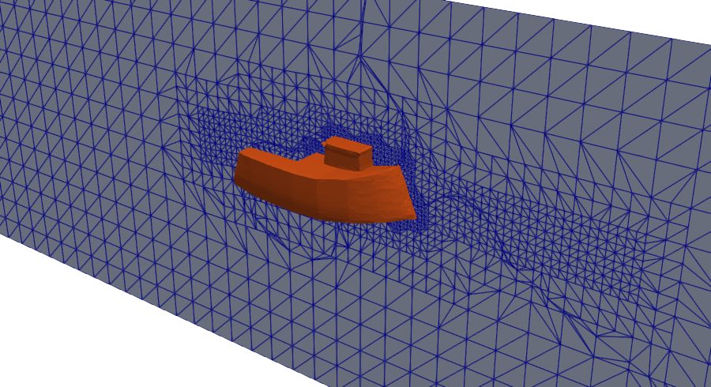
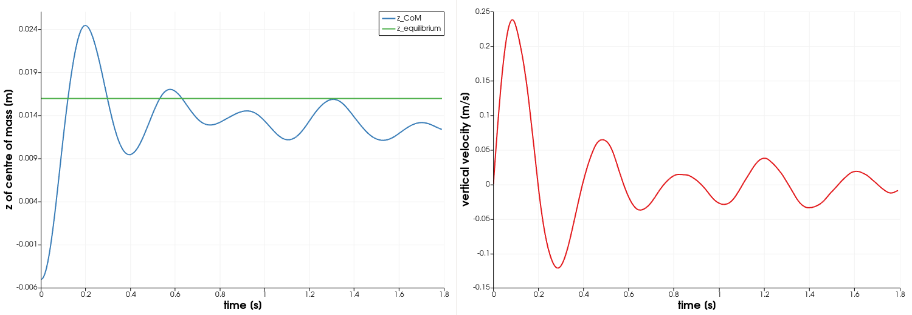
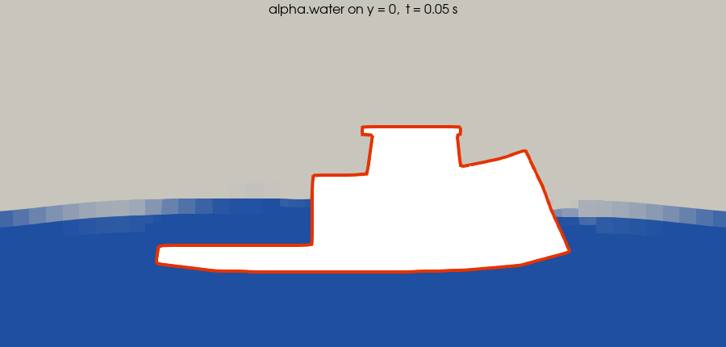
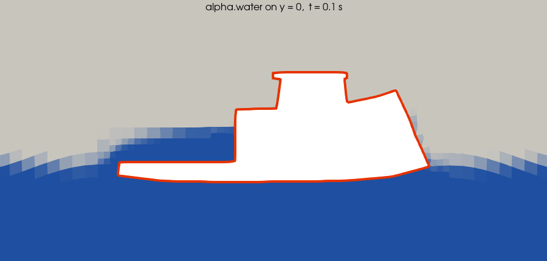
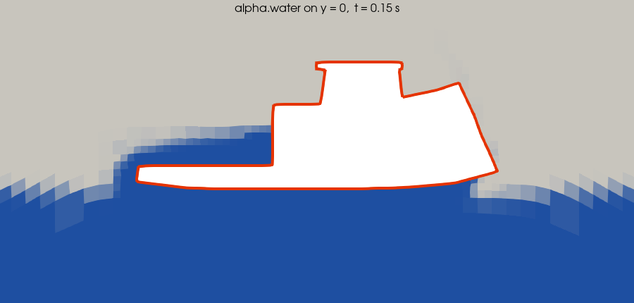
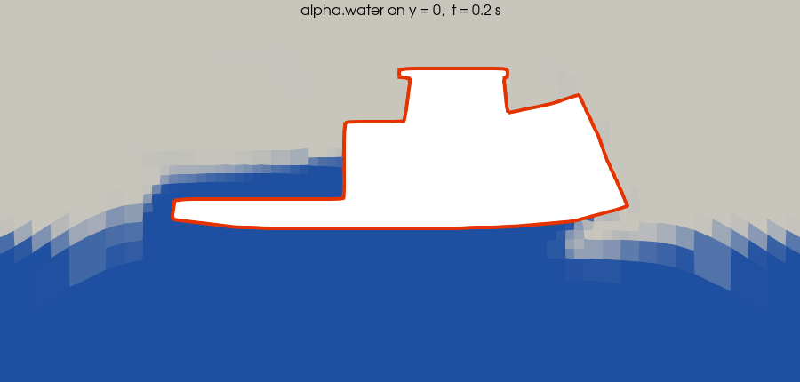
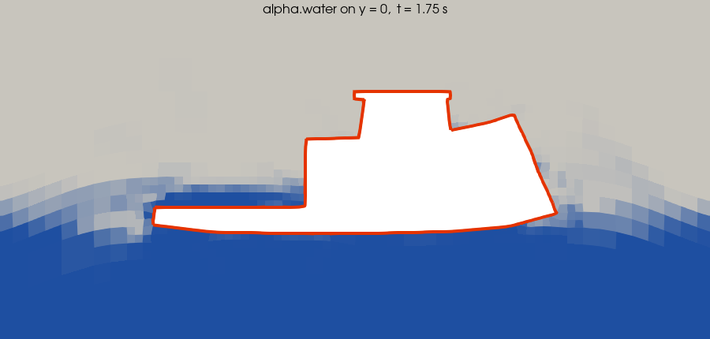

# Project 12 — Floating Boat Hull (6-DoF Rigid Body Motion)

```
  ╔══════════════════════════════════════════════════════════════════════╗
  ║                                                                      ║
  ║   ██████╗  ██████╗  █████╗ ████████╗    ██╗  ██╗██╗   ██╗██╗         ║
  ║   ██╔══██╗██╔═══██╗██╔══██╗╚══██╔══╝    ██║  ██║██║   ██║██║         ║
  ║   ██████╔╝██║   ██║███████║   ██║       ███████║██║   ██║██║         ║
  ║   ██╔══██╗██║   ██║██╔══██║   ██║       ██╔══██║██║   ██║██║         ║
  ║   ██████╔╝╚██████╔╝██║  ██║   ██║       ██║  ██║╚██████╔╝███████╗    ║
  ║   ╚═════╝  ╚═════╝ ╚═╝  ╚═╝   ╚═╝       ╚═╝  ╚═╝ ╚═════╝╚══════╝     ║
  ║                                                                      ║
  ║   F L O A T I N G   —   6 - D o F   R i g i d   B o d y              ║
  ║                                                                      ║
  ║   Solver:   interFoam  (VOF + dynamic mesh + sixDoFRigidBodyMotion)  ║
  ║   Physics:  Two-phase free surface + rigid body motion               ║
  ║   Motion:   Heave (z) free · yaw free · surge/sway/pitch/roll locked ║
  ║                                                                      ║
  ╚══════════════════════════════════════════════════════════════════════╝
```

---

## Goal

Learn how a free-surface VOF simulation is coupled to a rigid body whose
motion is computed from the fluid forces, and what that coupling requires
numerically:

- a `dynamicMeshDict` with `sixDoFRigidBodyMotion` (mass, centre of mass,
  moment of inertia, constraints, mesh-motion distances),
- `movingWallVelocity` and `pointDisplacement` boundary conditions,
- PIMPLE settings for a strongly coupled, light body (several outer
  correctors, acceleration relaxation),
- how to check a floating-body result against Archimedes' principle.

## Target

What the case is expected to produce. There is no published reference
solution for this geometry; the reference values below are analytical
(Archimedes on the STL volume) and the simulation is checked for
consistency with them.

| Quantity | Target | Source |
|----------|--------|--------|
| Hull volume (closed STL) | 296.7 cm³ | computed from `boat_hull.stl` |
| Initial state | hull centre at the waterline, 210.8 cm³ submerged: buoyancy 2.065 N against weight 0.4905 N, **net force 1.57 N upwards** (the hull is *not* in equilibrium at t = 0) | STL clipped at z = 0 |
| Initial acceleration | Archimedes alone would give a = 1.57 N / 0.05 kg = 31 m/s²; the surrounding water has to be accelerated too (added mass), measured a ≈ 4 m/s² and a vertical fluid force on the hull of ≈ 0.65 N instead of 2.06 N during the first 10 ms | `log.interFoam`, `postProcessing/forces` |
| Equilibrium (Archimedes) | displaced volume m/ρ = 50.1 cm³, waterline 21.0 mm below the hull centre: **draft 6.3 mm, hull rises 21.0 mm**, z of centre of mass = −0.005 + 0.021 = **+0.016 m** | STL + `mass` in `dynamicMeshDict` |
| Motion type | heave only (plus yaw, which stays at zero for a symmetric hull in calm water); no surge, sway, pitch or roll | `constraints` |
| Early motion (measured, t ≤ 0.22 s) | z rises from −0.0050 m, crosses z = +0.016 m at t = 0.12 s with v ≈ 0.19 m/s, peaks at **+0.0244 m at t = 0.197 s** (8.5 mm above equilibrium), then falls back | `log.interFoam` |
| Settling | damped heave oscillation around z = +0.016 m | physical expectation, **not verified** (see below) |

**The full 3 s run was NOT completed, and two checks FAIL on the longest
run.** The case needs several hours on one core (about 6000 s of wall-clock
time per simulated second on this machine, see section 9). The longest run
reached **t = 1.791 s** (10 759 s of solver time) and was then interrupted by a
machine shutdown; time directories exist up to 1.75 s. Within that time the
hull rose from z = −0.0050 m, first crossed the equilibrium height
z = +0.016 m at t = 0.12 s, peaked at +0.0244 m at t = 0.197 s and was at
z = +0.0124 m with v_z = −0.0086 m/s at the end. The settled state and the
oscillation decay were therefore *not* observed; `verify.py` reports those
four checks as SKIP.

`verify.py` result at t = 1.791 s: **18 PASS, 2 FAIL, 4 SKIP.** The two FAILs
are real findings and were **not** tuned away:

| Check | Measured | Limit | What is known |
|-------|----------|-------|---------------|
| max yaw | 4.17° | ≤ 2° | was 0.51° at 0.24 s, so the yaw grows with time although the hull is symmetric and nothing excites it. A numerical asymmetry (the snappyHexMesh mesh is not exactly symmetric) amplified by the free yaw axis is the likely cause; **not diagnosed**. |
| water volume conserved | 0.56732 vs 0.57123 (−0.69 %) | ± 0.0015 absolute on the fraction (0.26 % relative) | the water fraction in the domain drops by 0.7 % over 1.79 s; cause **not diagnosed** (candidates: water leaving through the open boundaries, or non-conservation of alpha on the moving mesh). |

The mesh, the constraints, the Courant numbers, boundedness of alpha,
momentum balance and heave direction all pass. Until the run is repeated to
3 s and the two FAILs are understood, treat the heave motion results as
**unverified** beyond the first second.

## Verification method

After `./run_docker.sh` (which calls it as the last step), or at any time
after a run:

```bash
python3 verify.py        # standard library only, reads logs/results, exit 0 = all PASS
```

`verify.py` reads `log.snappyHexMesh`, `log.checkMesh`, `log.interFoam`,
`postProcessing/forces/*/forces.dat`, the time directories, the case
dictionaries and `../../boat_hull.stl`. It prints one line per check
(`PASS|FAIL|SKIP name measured= expected= ± tol`) and a summary. Exit code is
0 only if nothing FAILED; with missing logs it exits with code 2 and an error
message. SKIP is used for checks that need the full run (to `endTime`).

| Check | What it proves | Expected | Tolerance and reason | Measured |
|-------|----------------|----------|----------------------|----------|
| snappyHexMesh finished | meshing completed | "Finished meshing without any errors" | exact | ok |
| checkMesh Mesh OK | mesh passes all checkMesh tests | "Mesh OK." | exact | ok |
| hull patch closed | `boat` is a closed surface (needed for buoyancy) | "closed singly connected" | exact | closed |
| max non-orthogonality | quality within snappyHexMesh `maxNonOrtho` | ≤ 65° | limit set in `snappyHexMeshDict` | 48.5° |
| max skewness | within `maxInternalSkewness` | ≤ 4 | limit set in `snappyHexMeshDict` | 2.99 |
| no fatal error / NaN | solver log is clean | none | exact | none (after the controlDict fix, see below) |
| DoF constraints | only z translation and z rotation allowed | tensors `(0 0 0 0 0 0 0 0 1)` | exact | as expected |
| initial water volume fraction | setFields + mesh give water below z = 0 minus submerged hull | 0.57127 (from block dimensions and STL) | ± 2e-4 (52 cm³: snapped hull volume known to ~10 % of 211 cm³) | 0.57123 |
| water volume conserved | no net water loss through boundaries / MULES | first value | ± 1.5e-3 absolute on the fraction (225 cm³ = 0.3 mm level change = 5 % of the draft) | **FAIL**: −6.9e-3 relative (0.56732 vs 0.57123) at t = 1.79 s; was −6.3e-4 at 0.24 s |
| alpha.water bounded | interface not smeared/oscillating | within [0, 1] | ± 0.01 (1 % of range) | +2.3e-4 / −6.6e-6 |
| max Courant | stable explicit convection | ≤ 0.5 | stability bound; case limit 0.4 is exceeded transiently because deltaT follows the previous step | 0.434 |
| max interface Courant | stable MULES transport | ≤ 0.5 | same; case limit 0.25 | 0.368 |
| surge/sway | line constraint holds | 0 | 1e-9 m (round-off) | 0 |
| pitch/roll | axis constraint holds | 0 | 1e-6 (round-off) | 0 |
| max yaw | symmetric hull does not yaw | 0° | 2° (numerical asymmetry only) | **FAIL**: 4.17° at t = 1.79 s (0.51° at 0.24 s) |
| max heave speed | no blow-up; energy bound sqrt(2 (ρgV − mg) Δz / m) | ≤ 1.32 m/s | 15 % margin on the bound | 0.239 m/s |
| momentum balance | force output and motion agree: m·v = accelerationDamping · ∫(F − mg) dt | −0.00065 kg m/s | ± 0.0034 (sampling and relaxation lag; the longer run has a larger ∫\|F − mg\| dt) | −0.00043 kg m/s |
| centre of mass rises | direction of motion (consistency only) | z_end − z_start > 1e-4 m | none, sign check | +0.0174 m |
| time directories | results written | ≥ 1 | exact | 35 (0.05 … 1.75) |
| settled z of centre of mass | converges to Archimedes equilibrium z = +0.0160 m | +0.0160 m | ± 3 mm (half the draft; waterline cells are 6 mm) | SKIP (needs run to 3 s), **unverified** |
| heave oscillation decays | damping | — | — | SKIP (needs run to 3 s), **unverified** (also the amplitude, final speed and period checks) |

An earlier partial run was made before `sixDoFRigidBodyState` was removed
from `controlDict` (that function object does not exist in OpenFOAM.org v6;
OpenFOAM printed a "FOAM FATAL ERROR: Unknown function type" warning at
start and at each `controlDict` re-read). `verify.py` flagged it (FAIL on
"no fatal error"). With the entry removed the log has no such message.
The measured values in the table are from the longest run (t = 1.791 s);
the settled height, oscillation decay, final speed and period need the full
3 s and are **unverified**.

---

## Table of Contents

1.  [Overview](#1-overview)
2.  [Prerequisites — Run Project 11 First](#2-prerequisites--run-project-11-first)
3.  [What Makes This Different from Project 11](#3-what-makes-this-different-from-project-11)
4.  [Physics Background](#4-physics-background)
    - [4.1 Volume of Fluid (VOF) — Recap](#41-volume-of-fluid-vof--recap)
    - [4.2 6-DoF Rigid Body Motion — The New Ingredient](#42-6-dof-rigid-body-motion--the-new-ingredient)
    - [4.3 Coupling: Fluid Forces ↔ Body Motion](#43-coupling-fluid-forces--body-motion)
5.  [Dynamic Mesh — How the Mesh Moves](#5-dynamic-mesh--how-the-mesh-moves)
6.  [Boat Geometry and Physical Properties](#6-boat-geometry-and-physical-properties)
7.  [Domain and Mesh Design](#7-domain-and-mesh-design)
8.  [File-by-File Walkthrough](#8-file-by-file-walkthrough)
    - [8.1  0/U](#81-0u)
    - [8.2  0/p_rgh](#82-0p_rgh)
    - [8.3  0/alpha.water](#83-0alphawater)
    - [8.4  0/pointDisplacement](#84-0pointdisplacement)
    - [8.5  constant/transportProperties](#85-constanttransportproperties)
    - [8.6  constant/turbulenceProperties](#86-constantturbulenceproperties)
    - [8.7  constant/g](#87-constantg)
    - [8.8  constant/dynamicMeshDict — The Key File](#88-constantdynamicmeshdict--the-key-file)
    - [8.9  system/blockMeshDict](#89-systemblockmeshdict)
    - [8.10 system/controlDict](#810-systemcontroldict)
    - [8.11 system/fvSchemes](#811-systemfvschemes)
    - [8.12 system/fvSolution](#812-systemfvsolution)
    - [8.13 system/setFieldsDict](#813-systemsetfieldsdict)
    - [8.14 system/surfaceFeatureExtractDict](#814-systemsurfacefeatureextractdict)
    - [8.15 system/snappyHexMeshDict](#815-systemsnappyhexmeshdict)
9.  [Running the Simulation](#9-running-the-simulation)
10. [Post-Processing](#10-post-processing)
11. [Expected Results](#11-expected-results)
12. [Stability and Troubleshooting](#12-stability-and-troubleshooting)
13. [Exercises](#13-exercises)
14. [Cross-References](#14-cross-references)

---

## 1. Overview

This project simulates a **toy boat hull floating freely** on a water surface.
Unlike Project 11 — where the hull was *fixed* in the domain and the water
flowed past it — here the boat is a (partially constrained) rigid body that
**responds to the fluid forces during the simulation**.

The solver is **`interFoam`**, which in OpenFOAM.org v6 combines three
capabilities:

| Capability              | What it does                                      |
|-------------------------|---------------------------------------------------|
| **VOF** (Volume of Fluid)    | Tracks the air / water interface               |
| **Dynamic mesh**             | Deforms the mesh as the body moves             |
| **6-DoF rigid body motion**  | Solves Newton / Euler equations for the hull   |

```
  interFoam  =  VOF solver  +  dynamicFvMesh  +  sixDoFRigidBodyMotion
                (alpha, p_rgh,   (constant/       (rigid-body dynamics,
                 U, PIMPLE)       dynamicMeshDict)  mesh point motion)
```

> **Note on `interDyMFoam`:** older OpenFOAM versions and tutorials use a
> separate `interDyMFoam` application. In OpenFOAM.org v6 (the Docker image
> used here) `interDyMFoam` is only a stub that prints "The dynamic mesh
> functionality in interDyMFoam has been merged into interFoam" and exits
> without error. The dynamic mesh is enabled by the presence of
> `constant/dynamicMeshDict`; run `interFoam`.

The simulation loop each timestep:

```
  ┌─────────────────────────────────────────────────────────────┐
  │  1. Solve Navier-Stokes + VOF on current mesh               │
  │  2. Compute pressure + viscous forces on boat surface       │
  │  3. Pass forces → 6-DoF solver → new position / rotation    │
  │  4. Move mesh to conform to new body position               │
  │  5. Go to next timestep                                     │
  └─────────────────────────────────────────────────────────────┘
```

The hull starts with its geometric centre at the water surface. Its weight
(0.49 N) is much smaller than the buoyancy of the initially submerged half
(2.07 N), so it is pushed **upwards** by about 21 mm until the displaced
volume equals m/ρ (Archimedes' principle). The expected result is a damped
heave oscillation around this equilibrium draft (about 6 mm).

---

## 2. Prerequisites — Run Project 11 First

**Project 11** (`11_boat_hull_fixed/`) is the *fixed-hull* version of this
case. It uses `interFoam` — the same VOF two-phase solver, but with a
**static mesh**. The hull sits motionless while water flows around it.

If you haven't run Project 11 yet, do that first. It teaches:

- How to import and scale an STL surface (mm → m)
- Background mesh creation with `blockMesh`
- Surface snapping with `snappyHexMesh`
- Two-phase VOF initialisation with `setFields`
- Interpreting free-surface results in ParaView

Project 12 builds on *all* of those skills and adds:

- Dynamic mesh motion (`dynamicMotionSolverFvMesh`)
- Rigid body dynamics (`sixDoFRigidBodyMotion`)
- New boundary conditions (`movingWallVelocity`, `pointDisplacement`)
- Tighter coupling (3 PIMPLE outer correctors) and small timesteps for
  stability of a light body

```
  Progression:   Project 08  →  Project 11  →  Project 12
                 (dam break)    (fixed hull)   (floating hull)
                  basic VOF      STL + VOF      STL + VOF + 6-DoF
```

---

## 3. What Makes This Different from Project 11

| Aspect                     | Project 11 (Fixed)           | Project 12 (Floating)              |
|----------------------------|------------------------------|-------------------------------------|
| Solver                     | `interFoam`                  | `interFoam` (+ `dynamicMeshDict`)   |
| Mesh                       | Static                       | Dynamic — points move every step    |
| Hull motion                | None (fixed in space)        | Heave (+ yaw); other DoF locked     |
| Water                      | Inlet current 0.3 m/s        | Initially at rest                   |
| Boat wall BC for U         | `noSlip`                     | `movingWallVelocity`                |
| Extra BC file              | —                            | `0/pointDisplacement`               |
| Extra constant file        | —                            | `constant/dynamicMeshDict`          |
| fvSolution PIMPLE          | `nOuterCorrectors 1`         | `nOuterCorrectors 3`, `moveMeshOuterCorrectors yes` |
| Domain depth (z)           | −0.15 … 0.15 m               | −0.20 … 0.15 m                      |
| Initial `deltaT`, `maxCo`, `maxAlphaCo`, `maxDeltaT` | 1e-4, 0.5, 0.3, 0.01 | 5e-5, 0.4, 0.25, 0.005 |
| `endTime`                  | 2 s                          | 3 s                                 |
| Computational cost         | Moderate                     | High — see [section 9](#9-running-the-simulation) |

The **dynamicMeshDict** is the most important new file. It tells OpenFOAM:
- Which patches belong to the rigid body (`boat`)
- The body's mass, centre of mass, and moments of inertia
- How far the mesh morphing extends from the body
- What constraints apply (here: heave along z, rotation only about z)

---

## 4. Physics Background

### 4.1 Volume of Fluid (VOF) — Recap

The VOF method tracks the interface between two immiscible fluids (water and
air) using a scalar field **$\alpha$** (alpha):

```
  α = 1  →  pure water
  α = 0  →  pure air
  0 < α < 1  →  interface region
```

The transport equation for $\alpha$:

```
  ∂α/∂t + ∇·(U α) + ∇·(U_r α(1-α)) = 0
```

where `U_r` is a compression velocity that sharpens the interface.

Fluid properties are blended (interFoam blends density and dynamic
viscosity; `ν` is then `μ/ρ`):

```
  ρ = α · ρ_water + (1-α) · ρ_air
  μ = α · ρ_water ν_water + (1-α) · ρ_air ν_air
```

This is identical to Project 11 and Project 08.

### 4.2 6-DoF Rigid Body Motion — The New Ingredient

A rigid body in 3D space has **six degrees of freedom**:

```
  Translation (3 DoF):          Rotation (3 DoF):
  ┌────────────────────┐       ┌─────────────────────┐
  │  Surge  (x)        │       │  Roll    (about x)  │
  │  Sway   (y)        │       │  Pitch   (about y)  │
  │  Heave  (z)        │       │  Yaw     (about z)  │
  └────────────────────┘       └─────────────────────┘
```

```
                    Yaw ↺ (z-axis)
                        │
                        │     Pitch ↺ (y-axis)
                        │    ╱
                        │   ╱
              ┌─────────┼──╱──────────┐
             ╱│         │ ╱          ╱│
            ╱ │         │╱  BOAT    ╱ │
           ╱  │         ┼─────────╱──→ Surge (x)
          ┌───│─────────│────────┐   │
          │   │         │        │   │
          │   └─────────│────────│───┘
          │  ╱     Roll ↺        │  ╱
          │ ╱      (x-axis)      │ ╱
          │╱                     │╱
          └──────────────────────┘
                  │
                  ↓ Heave (z)
```

**Newton's Second Law (translation):**

```
  F = m · a

  where:
    F = total force on the body (pressure + viscous + gravity)
    m = body mass
    a = acceleration of the centre of mass
```

The fluid exerts pressure forces on every face of the boat patch. Gravity
pulls the boat down. The net force determines the translational acceleration.

**Euler's Equations (rotation):**

```
  τ = I · α + ω × (I · ω)

  where:
    τ = total torque about the centre of mass
    I = moment of inertia tensor (diagonal for symmetric bodies)
    α = angular acceleration
    ω = angular velocity
```

For our small boat, the cross-coupling term `ω × (I · ω)` is very small
since angular velocities are low. But OpenFOAM solves the full equations.

**In this case only heave and yaw are free** (see
[section 8.8](#88-constantdynamicmeshdict--the-key-file)): the motion is
effectively one-dimensional, vertical.

### 4.3 Coupling: Fluid Forces ↔ Body Motion

Each timestep, the solver executes this coupling loop:

```
  ┌─────────────────────────────────────────────────────────────────┐
  │                     PIMPLE outer loop                           │
  │                                                                 │
  │  ┌──────────────┐    ┌──────────────┐    ┌──────────────┐       │
  │  │ Solve p, U   │───→│ Integrate p  │───→│ 6-DoF solver │       │
  │  │ and α on     │    │ and τ over   │    │ F = ma       │       │
  │  │ current mesh │    │ boat patches │    │ τ = Iα       │       │
  │  └──────────────┘    └──────────────┘    └──────┬───────┘       │
  │                                                  │              │
  │                                          new position           │
  │                                          new rotation           │
  │                                                  │              │
  │                                          ┌───────▼──────┐       │
  │                                          │  Move mesh   │       │
  │                                          │  (morph)     │       │
  │                                          └───────┬──────┘       │
  │                                                  │              │
  │                                          back to top            │
  │                                          (next outer corr.)     │
  └─────────────────────────────────────────────────────────────────┘
```

The setting `moveMeshOuterCorrectors yes` in `fvSolution` enables this
re-meshing within the PIMPLE loop, which is essential for accurate coupling.
The log prints one "6-DoF rigid body motion" block (centre of mass,
orientation, velocities) per outer corrector.

---

## 5. Dynamic Mesh — How the Mesh Moves

### Mesh Morphing with innerDistance / outerDistance

When the boat moves, the mesh must follow. The `sixDoFRigidBodyMotion`
solver does **not** solve a Laplacian equation for the displacement (that is
`displacementLaplacian`, not used here). It computes the rigid-body
displacement of the hull patch points and scales it for every other mesh
point with a function of the distance to the hull:

```
  point displacement = (rigid-body displacement of the hull)
                       × scale(distance to the hull)

  scale = 1                           distance <= innerDistance
  scale = decreasing from 1 to 0      innerDistance < distance < outerDistance
  scale = 0                           distance >= outerDistance
```

(Laplacian mesh motion, for comparison, solves
`∇·(γ ∇ cellDisplacement) = 0`; that is why `cellDisplacement` entries are
*not* needed in `fvSchemes`/`fvSolution` of this case.)

The `innerDistance` and `outerDistance` parameters define three zones:

```
                     outerDistance = 0.08 m
               ┌───────────────────────────────┐
               │                               │
               │   innerDistance = 0.01 m      │
               │   ┌───────────────────┐       │
               │   │                   │       │
               │   │   ┏━━━━━━━━━━━┓   │       │
               │   │   ┃   BOAT    ┃   │       │
               │   │   ┃  (rigid)  ┃   │       │
               │   │   ┗━━━━━━━━━━━┛   │       │
               │   │                   │       │
               │   │  ZONE A: rigid    │       │
               │   │  (moves with body)│       │
               │   └───────────────────┘       │
               │                               │
               │  ZONE B: blended              │
               │  (smooth interpolation)       │
               │                               │
               └───────────────────────────────┘

               ZONE C: fixed (no displacement)
```

| Zone   | Distance from body         | Displacement                  |
|--------|---------------------------|-------------------------------|
| **A**  | < innerDistance (0.01 m)   | Full body displacement (rigid) |
| **B**  | innerDistance → outerDistance | Smoothly blended to zero     |
| **C**  | > outerDistance (0.08 m)   | Zero — mesh stays fixed        |

This means:
- Cells very close to the boat move exactly with it (rigid motion)
- Cells in the transition zone deform smoothly
- Cells far away don't move at all
- The domain boundaries stay fixed

Because the hull rises by about 21 mm and zone B is only 70 mm thick, the
cells in zone B are compressed above the hull and stretched below it; the
refined waterline cells near the hull move up with the hull.

### Why Mesh Quality Can Degrade

As the body moves, cells in Zone B get stretched and compressed. If the body
moves too far in a single timestep, cells can become:
- **Inverted** (negative volume) — solver crashes
- **Highly skewed** — poor accuracy
- **Very thin** — tiny cell volumes → tiny timesteps

This is why:
- Timesteps must be small (initial 5e-5 s, about 4e-4 s during the run)
- `accelerationRelaxation` is used to limit sudden body motion
- The Courant number limit is lower (maxCo 0.4) than for a static mesh

---

## 6. Boat Geometry and Physical Properties

### STL Geometry

The hull geometry comes from `boat_hull.stl` at the repository root:

```
  File:           boat_hull.stl (binary, 960 triangles, closed surface)
  Native units:   millimeters (scaled to meters by Allrun)

  Bounding box (mm):
    X: [-77.53, 77.53]     Length ≈ 155 mm
    Y: [-40.85, 40.85]     Width  ≈  82 mm
    Z: [-27.25, 27.25]     Height ≈  54 mm

  Bounding box (m, after scaling):
    X: [-0.0775, 0.0775]   Length ≈ 0.155 m
    Y: [-0.0409, 0.0409]   Width  ≈ 0.082 m
    Z: [-0.0273, 0.0273]   Height ≈ 0.054 m

  Bounding box centre: (0, 0, 0)
  Enclosed volume:     296.7 cm³
  Volume centroid:     (0.6, -0.0, -7.7) mm  (below the bounding-box centre)
```

```
  Outline of boat_hull.stl, generated from the triangles (x to the right,
  bow at +x; # = hull projection, 1 character = 2.5 mm in x)

  Top view (X-Y plane, y up)             Width 82 mm
  .........##############################.......................
  ###############################################...............
  #####################################################.........
  ##########################################################....
  ##############################################################
  ##########################################################....
  #####################################################.........
  ###############################################...............
  .........##############################.......................

  Side view (X-Z plane, z up)            Height 54 mm, flat keel, deckhouse
  ...............................###############................
  ................................#############.................
  ................................#############......#####......
  ................................#########################.....
  ...#######################################################....
  ...#######################################################....
  ..#########################################################...
  .###########################################################..
  .############################################################.
  #############################################################.
  .....##############################################...........
```



*Hull patch (orange) and the y = 0 slice of the snapped mesh at the first
written time (t = 0.05 s). Look for the refinement around the hull and in the
waterline box; the slice filter shows the cells triangulated.*

### Physical Properties (3D-printed PLA toy boat)

| Property              | Value                         | Units         |
|-----------------------|-------------------------------|---------------|
| Mass                  | 0.050                         | kg            |
| Centre of mass        | (0, 0, $-$0.005)                | m             |
| Ixx (roll)            | 3.4 $\times$ 10$^{-5}$                   | kg·m$^2$         |
| Iyy (pitch)           | 7.1 $\times$ 10$^{-5}$                   | kg·m$^2$         |
| Izz (yaw)             | 8.3 $\times$ 10$^{-5}$                   | kg·m$^2$         |

The centre of mass is 5 mm below the geometric centre. This is a modelling
choice (the volume centroid of the STL is 7.7 mm below the centre; a
low centre of mass improves roll stability). The mean density of the hull is
50 g / 296.7 cm³ = 168 kg/m³, i.e. the hull is light and floats high.

### Why These Inertia Values?

For a uniform rectangular solid with mass m, length L, width W, height H:

```
  Ixx = m/12 · (W² + H²) = 0.05/12 · (0.082² + 0.054²) ≈ 4.0e-05
  Iyy = m/12 · (L² + H²) = 0.05/12 · (0.155² + 0.054²) ≈ 1.1e-04
  Izz = m/12 · (L² + W²) = 0.05/12 · (0.155² + 0.082²) ≈ 1.3e-04
```

The hull is not a full rectangular block, so the bounding-box values are an
upper estimate. Integrating the actual STL volume with uniform density
(mass 0.05 kg, about the bounding-box centre) gives

```
  Ixx = 3.4e-05    Iyy = 7.1e-05    Izz = 8.3e-05   kg·m²
```

which are the values in `dynamicMeshDict`. A hollow hull with the same mass
has *larger* moments of inertia than this uniform-density estimate (mass is
further from the centre). Only `Izz` has any effect in this case, because
pitch and roll are constrained (see section 8.8).

> An earlier version of this case used (5e-6, 1.5e-5, 1.5e-5), which is 4–7
> times smaller than the uniform-density value; the justification given for
> it ("hollow shell, mass concentrated near the centre") was physically
> backwards.

---

## 7. Domain and Mesh Design

### Domain Dimensions

```
                     z
                     ↑  atmosphere (top, z = +0.15 m)
  ┌──────────────────────────────────────────┐
  │                AIR                       │
  │                                          │
  │          ┏━━━━━━━━━┓                     │
  │ inlet    ┃  BOAT   ┃              outlet │
  │ x=-0.5   ┃─────────┃────────────────────→│ x=1.0
  │──────────┗━━━━━━━━━┛   waterline z=0     │
  │                                          │
  │               WATER                      │
  │                                          │
  └──────────────────────────────────────────┘
           bottom (z = -0.20 m)             (sides: y = ±0.25 m)

  x: [-0.5, 1.0]   →  1.5 m total  (≈ 10× boat length)
  y: [-0.25, 0.25]  →  0.5 m total  (≈ 6× boat width)
  z: [-0.20, 0.15]  →  0.35 m total

  Water depth: 0.20 m (below waterline)
  Air height:  0.15 m (above waterline)
```

Patches: `inlet` (x = −0.5), `outlet` (x = 1.0), `atmosphere` (z = 0.15),
`bottom` (z = −0.20, wall), `sides` (y = ±0.25), `boat` (created by
snappyHexMesh from `boat_hull.stl`). The hull is centred at the origin, so
its initial waterline is at the hull's geometric centre.

The domain is slightly deeper than Project 11 (0.20 m vs 0.15 m) to give the
boat room to bob up and down without the bottom boundary interfering.

### Background Mesh

```
  Cells:  60 × 20 × 14  =  16,800 background cells (25 mm cubes)
  After snappyHexMesh:    46,772 cells (measured, checkMesh)

  Refinement strategy (snappyHexMeshDict):
  - Level 1: refinementBox, x[-0.15, 0.25] y[-0.08, 0.08] z[-0.06, 0.06] m
  - Level 2: waterlineBox,  x[-0.15, 0.25] y[-0.08, 0.08] z[-0.02, 0.02] m
  - Level 2-3: on the hull surface itself (3 at feature edges / curvature)
  - Level 3: along hull feature edges (eMesh)
```

The refinement levels are not additive: a cell inside both boxes gets the
larger of the two levels.

### Why the Waterline Refinement Box?

The free surface at z $\approx$ 0 is where all the action happens: waves, splashing,
the hull entering and leaving the water. Fine cells here improve:
- Interface sharpness
- Force calculation accuracy (buoyancy depends on knowing exactly where the
  waterline intersects the hull)
- Wave capture

---

## 8. File-by-File Walkthrough

### 8.1 `0/U`

**Velocity field** — boundary conditions for fluid velocity.

```
  inlet:       fixedValue (0 0 0)          Calm water, no incoming current
  outlet:      pressureInletOutletVelocity  Allows outflow, prevents inflow
  atmosphere:  pressureInletOutletVelocity  Air can flow in/out at top
  bottom:      slip                         Free-slip wall (reduces drag)
  sides:       slip                         Free-slip (symmetric-like)
  boat:        movingWallVelocity           ← THE KEY DIFFERENCE
```

**Why `movingWallVelocity` on the boat?**

In Project 11, the boat was fixed, so we used `noSlip` (velocity = 0 at the
wall). Here, the boat *moves*. The `movingWallVelocity` BC ensures the fluid
velocity at the boat surface matches the velocity of the moving mesh wall.
This is a no-slip condition *in the reference frame of the moving body*:

```
  U_fluid(at wall) = U_wall (mesh velocity)
```

If you used `noSlip` instead, the fluid at the hull would be forced to zero
velocity while the wall moves, so no consistent (mass-conserving) flux
through the hull patch exists.

### 8.2 `0/p_rgh`

**Reduced pressure** (p - $\rho$gh).

Using p_rgh instead of p removes the hydrostatic component, which improves
numerical accuracy for free-surface flows.

```
  inlet:       fixedFluxPressure       Pressure adjusts to give correct flux
  outlet:      totalPressure (p0=0)    Reference pressure at outlet
  atmosphere:  totalPressure (p0=0)    Reference pressure at top
  bottom:      fixedFluxPressure       No normal flow through bottom
  sides:       fixedFluxPressure       No normal flow through sides
  boat:        fixedFluxPressure       Pressure adjusts for body forces
```

### 8.3 `0/alpha.water`

**Phase fraction** — identifies where water and air are.

Initially set to 0 everywhere (air). The `setFields` utility fills
everything below z = 0 with $\alpha$ = 1 (water). `setFields` overwrites
`0/alpha.water` in place; `Allrun` restores the tracked file on exit.

```
  inlet:       inletOutlet (inletValue 1)  Water for inflow (inlet U is zero)
  outlet:      inletOutlet (inletValue 0)  Defaults to air if flow reverses
  atmosphere:  inletOutlet (inletValue 0)  Air at top
  bottom:      zeroGradient                No phase gradient at wall
  sides:       zeroGradient                No phase gradient at wall
  boat:        zeroGradient                Phase slides along hull
```

### 8.4 `0/pointDisplacement`

**Point displacement field** — tells the mesh motion solver how much each
mesh point has moved from its original position.

This file is **new in Project 12** — it doesn't exist in Project 11 because
the mesh was static.

```
  class:   pointVectorField    (defined at mesh POINTS, not cell centres)
  object:  pointDisplacement

  boat:        calculated           6-DoF solver provides the displacement
  all others:  fixedValue (0 0 0)   Domain boundaries don't move
```

**Key point:** The `class` must be `pointVectorField` (not `volVectorField`).
Mesh motion operates on *points* (vertices), not cell centres. The `calculated`
type on the boat means "the motion solver will fill in this value."

### 8.5 `constant/transportProperties`

Two-phase fluid properties — identical to Project 11.

```
  Water:  ρ = 998.2 kg/m³,   ν = 1.0 × 10⁻⁶ m²/s
  Air:    ρ = 1.225 kg/m³,   ν = 1.48 × 10⁻⁵ m²/s
  Surface tension: σ = 0.072 N/m
```

### 8.6 `constant/turbulenceProperties`

```
  simulationType  laminar;
```

Laminar flow — appropriate for a small toy boat at low speed. Re $\approx$ UL/$\nu$ =
0.2 $\times$ 0.155 / 1e-6 $\approx$ 31,000 — borderline, but laminar is acceptable for
a learning case.

### 8.7 `constant/g`

Gravity vector — points downward in the z-direction.

```
  dimensions  [0 1 -2 0 0 0 0];
  value       (0 0 -9.81);
```

This is critical for buoyancy. The VOF solver uses gravity to compute
hydrostatic pressure gradients, and the 6-DoF solver uses it for the body's
weight force.

### 8.8 `constant/dynamicMeshDict` — The Key File

This is the **most important file in the project**. It configures the dynamic
mesh motion and the 6-DoF rigid body solver.

```
  dynamicFvMesh       dynamicMotionSolverFvMesh;
  motionSolverLibs    ("libsixDoFRigidBodyMotion.so");
  motionSolver        sixDoFRigidBodyMotion;
```

#### Top-Level Settings

| Setting                | Value                              | Purpose |
|------------------------|------------------------------------|---------|
| `dynamicFvMesh`        | `dynamicMotionSolverFvMesh`       | Use a motion-solver-based dynamic mesh |
| `motionSolverLibs`     | `libsixDoFRigidBodyMotion.so`     | Load the 6-DoF library |
| `motionSolver`         | `sixDoFRigidBodyMotion`           | Use 6-DoF solver as the motion solver |

#### sixDoFRigidBodyMotionCoeffs — Body Properties

| Parameter              | Value                  | Meaning |
|------------------------|------------------------|---------|
| `patches`              | `(boat)`               | Which patches form the rigid body |
| `mass`                 | `0.050`                | Body mass in kg |
| `centreOfMass`         | `(0 0 -0.005)`         | CoM position in m |
| `momentOfInertia`      | `(3.4e-05 7.1e-05 8.3e-05)` | Ixx, Iyy, Izz in kg·m$^2$ |
| `report`               | `on`                   | Print position/rotation each outer corrector |

#### sixDoFRigidBodyMotionCoeffs — Mesh Motion

| Parameter              | Value   | Meaning |
|------------------------|---------|---------|
| `innerDistance`         | `0.01`  | Points within 1 cm of the body move rigidly |
| `outerDistance`         | `0.08`  | Points beyond 8 cm don't move at all |

#### sixDoFRigidBodyMotionCoeffs — Solver

```
  solver { type Newmark; }
```

The **Newmark** time integration scheme is used to advance the body's position
and velocity (second-order accurate). OpenFOAM also supports
`CrankNicolson` and `symplectic`.

#### sixDoFRigidBodyMotionCoeffs — Stability Controls

| Parameter                    | Value  | Purpose |
|------------------------------|--------|---------|
| `accelerationRelaxation`     | `0.7`  | Under-relaxes the computed acceleration between outer correctors (1 = no relaxation) |
| `accelerationDamping`        | `0.9`  | Factor applied to the acceleration in the Newmark update (1 = no damping, smaller = more damping) |

Note the direction of both parameters: **1.0 means "off"**. With
`accelerationDamping 0.9` the body responds about 10 % less to the computed
acceleration (the time scale of the motion is stretched); it does not change
the equilibrium position. Both are numerical aids against the coupling
("added mass") instability, not physical damping.

#### Constraints — Restricting Degrees of Freedom

```
  fixedLine
  {
      sixDoFRigidBodyMotionConstraint line;
      direction (0 0 1);
  }
```

This constrains the body's translation to a **vertical line** (z-axis only).
The boat can heave (move up/down) but cannot surge (x) or sway (y).

```
  fixedAxis
  {
      sixDoFRigidBodyMotionConstraint axis;
      axis (0 0 1);
  }
```

This constrains the rotation to a **fixed axis**: the body *may rotate only
about* z (yaw), i.e. pitch and roll are **locked** (OpenFOAM source:
"Orientation constraint: may only rotate around a fixed axis"). The log
confirms this with "Translational constraint tensor (0 0 0 0 0 0 0 0 1)" and
"Rotational constraint tensor (0 0 0 0 0 0 0 0 1)".

**Summary of allowed/suppressed DoFs:**

```
  ┌─────────────┬───────────┬─────────────────────────────────┐
  │  Degree     │  Status   │  Reason                         │
  ├─────────────┼───────────┼─────────────────────────────────┤
  │  Surge (x)  │ LOCKED    │  line constraint (z-direction)  │
  │  Sway  (y)  │ LOCKED    │  line constraint (z-direction)  │
  │  Heave (z)  │ FREE  ✓   │  allowed by line direction      │
  │  Roll  (x)  │ LOCKED    │  axis constraint (z-axis only)  │
  │  Pitch (y)  │ LOCKED    │  axis constraint (z-axis only)  │
  │  Yaw   (z)  │ FREE  ✓   │  rotation about the z-axis      │
  └─────────────┴───────────┴─────────────────────────────────┘
```

Why this choice:
- Heave is the primary motion we want to observe (boat finding its draft).
- Yaw is free but is not excited for a symmetric hull in calm water.
- Pitch and roll are locked because the coupling was unstable when they were
  free: in a test with only the `line` constraint (and the original,
  too small inertia) the angular velocity reached 2.6 × 10⁵ rad/s within
  5 × 10⁻⁴ s. Whether the corrected inertia values of this version allow
  free pitch/roll was not tested (see Exercise 4).

### 8.9 `system/blockMeshDict`

Creates the background hexahedral mesh: 60 $\times$ 20 $\times$ 14 cells.

```
  Domain: [-0.5, 1.0] × [-0.25, 0.25] × [-0.20, 0.15] m
  Cell size: ~25 mm × 25 mm × 25 mm (background)
```

Patches:
```
  inlet (x = -0.5)    — left face
  outlet (x = 1.0)    — right face
  atmosphere (z = 0.15) — top face
  bottom (z = -0.20)  — bottom face
  sides                — front and back (y = ±0.25)
```

### 8.10 `system/controlDict`

| Setting            | Value          | Reason |
|--------------------|----------------|--------|
| `application`      | `interFoam`    | VOF solver; dynamic mesh from `dynamicMeshDict` |
| `endTime`          | `3`            | 3 seconds for the boat to settle |
| `deltaT`           | `5e-05`        | Very small initial timestep |
| `adjustTimeStep`   | `yes`          | Adaptive based on Courant number |
| `maxCo`            | `0.4`          | Lower than typical (0.5) for mesh stability |
| `maxAlphaCo`       | `0.25`         | Lower limit near the interface |
| `maxDeltaT`        | `0.005`        | Cap on timestep growth |
| `writeInterval`    | `0.05`         | Write every 50 ms → 60 frames |

The `libs` section loads the 6-DoF library:
```
  libs ("libsixDoFRigidBodyMotion.so");
```

**Function objects:**
- `forces` — computes and logs forces/moments on the boat patch
  (`rho rho`: the local mixture density is used for the viscous part;
  `CofR (0 0 0)` is the reference point of the moments)

### 8.11 `system/fvSchemes`

Standard interFoam schemes:

```
  ddtSchemes:           Euler (first-order, robust)
  gradSchemes:          Gauss linear
  divSchemes:           linearUpwind for momentum, vanLeer for alpha
  laplacianSchemes:     Gauss linear corrected (default)
```

There is no `cellDisplacement` laplacian entry: that would only be used by a
`displacementLaplacian` mesh motion solver, which this case does not use
(`sixDoFRigidBodyMotion` scales the rigid-body displacement by distance, see
section 5). `fluxRequired` is not needed in OpenFOAM v6.

### 8.12 `system/fvSolution`

Standard interFoam solvers, with dynamic-mesh PIMPLE settings:

```
  PIMPLE:
    nOuterCorrectors         3     ← strong coupling of fluid and body
    nCorrectors              3
    moveMeshOuterCorrectors  yes   ← re-mesh within the outer PIMPLE loop
    correctPhi               yes    ← correct fluxes after mesh motion
```

**Why `moveMeshOuterCorrectors yes`?**

With this flag on, the mesh is re-positioned at each outer iteration —
giving a tighter coupling between fluid forces and body motion within a
single timestep. Without it, the mesh would only move once per timestep,
which can be insufficiently accurate.

**Why 3 outer correctors?** The hull (0.05 kg) is lighter than the water it
displaces (0.21 kg initially), the typical situation for the added-mass
instability of partitioned fluid-body coupling. With `nOuterCorrectors 2`
the case diverged at t ≈ 0.025 s (hull force of order kN on a 0.05 kg body,
velocity growing from 0.3 to 8 m/s within about 15 steps); with 3 it ran smoothly
(OpenFOAM's own `floatingObject` tutorial also uses 3).

### 8.13 `system/setFieldsDict`

Initialises the water region:

```
  defaultFieldValues:  alpha.water = 0  (air everywhere)
  boxToCell:           everything below z = 0 → alpha.water = 1 (water)
```

The box `(-10 -10 -10) (10 10 0)` is intentionally huge — it fills *all*
cells below the waterline, regardless of domain size.

After `setFields`, the boat hull sits with its centre at the waterline:
- Bottom half submerged in water ($\alpha$ = 1)
- Top half in air ($\alpha$ = 0)

### 8.14 `system/surfaceFeatureExtractDict`

Extracts sharp edges from the STL for better snapping:

```
  boat_hull.stl:
    extractionMethod:  extractFromSurface
    includedAngle:     150°
```

Edges where the surface normal changes by more than 30° (180 - 150) are
marked as "features" and get extra refinement.

### 8.15 `system/snappyHexMeshDict`

Refines and snaps the background mesh to the hull surface.

**Refinement regions:**

| Region           | Level | Purpose                           |
|------------------|-------|-----------------------------------|
| Hull surface     | 2–3   | Sharp hull geometry               |
| Feature edges    | 3     | Crisp edges (bow, stern, keel)    |
| refinementBox    | 1     | Near-body region                  |
| waterlineBox     | 2     | Free-surface resolution           |

```
  locationInMesh: (0.3 0 0.05) — a point in the air, outside the hull
```

This tells snappyHexMesh which side of the hull to keep (the fluid region,
not the interior of the boat). Layer addition is disabled (`addLayers false`).

---

## 9. Running the Simulation

### Quick Start

```bash
cd projects/12_boat_hull_floating
./run_docker.sh          # cleans, meshes, solves in Docker, then runs verify.py
```

`run_docker.sh` mounts the repository root (Allrun reads `../../boat_hull.stl`)
and uses the image `cfdengine/openfoam` (OpenFOAM.org v6). With a local
OpenFOAM installation: `./Allrun`.

The full run (3 s) takes hours. To stop early and keep the results, set
`stopAt writeNow;` in `system/controlDict` while it runs
(`runTimeModifiable yes`), then restore `stopAt endTime;`.

### Step-by-Step (manual)

```bash
# 1. Source OpenFOAM environment (if not already done)
source /opt/openfoam6/etc/bashrc    # adjust path for your installation

# 2. Clean any previous run
./Allclean

# 3. Copy and scale the STL
mkdir -p constant/triSurface
cp ../../boat_hull.stl constant/triSurface/boat_hull.stl
surfaceTransformPoints -scale '(0.001 0.001 0.001)' \
    constant/triSurface/boat_hull.stl \
    constant/triSurface/boat_hull.stl

# 4. Generate background mesh
blockMesh

# 5. Extract surface features
surfaceFeatureExtract

# 6. Snap mesh to hull
snappyHexMesh -overwrite

# 7. Check mesh quality
checkMesh

# 8. Initialise water phase (overwrites 0/alpha.water)
setFields

# 9. Run the solver (dynamic mesh is read from constant/dynamicMeshDict)
interFoam

# 10. Post-process
paraFoam          # or ./open_paraview.sh
```

### Expected Runtime

Measured on one core of a 20-core workstation (OpenFOAM.org v6 in Docker,
machine shared with other jobs):

| Stage                      | Time           |
|----------------------------|----------------|
| blockMesh, surfaceFeatureExtract | < 1 s    |
| snappyHexMesh              | 6 s (46,772 cells) |
| interFoam                  | 0.63 s per time step (3 outer × 3 pressure correctors) |
| deltaT during the run      | 6.0e-5 … 8.8e-4 s (mean 1.9e-4 s) |
| 0.2225 s simulated         | 743 s (1181 time steps) |
| 1.79 s simulated (longest run) | 10 759 s of solver time, about 6000 s per simulated second |
| 3 s simulated (extrapolated from the longest run) | ≈ 5 h on one core |

For parallel runs (use at most as many ranks as you have cores):

```bash
# Decompose
decomposePar

# Run on 4 cores
mpirun -np 4 interFoam -parallel

# Reconstruct
reconstructPar
```

You will need a `system/decomposeParDict` for parallel runs (not included by
default — see Exercise 5).

### Monitoring Progress

While the simulation runs, you can watch the 6-DoF output:

```bash
# Watch body position and rotation in real time
tail -f log.interFoam | grep -E "Centre of mass|Orientation"

# Or check the forces file
tail -f postProcessing/forces/0/forces.dat
```

---

## 10. Post-Processing

### 10.1 Tracking Body Motion

The 6-DoF state is printed to `log.interFoam` once per outer corrector
(`report on`). (The `sixDoFRigidBodyState` function object exists in ESI
OpenFOAM but not in OpenFOAM.org v6; it is therefore not used here.)

**Plotting heave over time** (last outer corrector of each time step):

```bash
awk '/^Time =/ {t=$3}
     /Centre of mass/ {gsub(/[()]/,""); z=$NF}
     /Angular velocity/ {print t, z}' log.interFoam > heave.dat
```

(each time appears 3 times, once per outer corrector; the last is the
converged value). Plot `heave.dat` with gnuplot, matplotlib or ParaView.



*Left: z of the centre of mass against the Archimedes equilibrium
z = +0.016 m (from the STL). Right: vertical velocity. The hull passes the
equilibrium height at t = 0.12 s and peaks at +0.0244 m at t = 0.197 s; after
that the heave is a damped oscillation (period about 0.8 s, from the maxima at
0.57, 0.93 and 1.31 s) whose mean lies about 3 mm below z = +0.016 m at
1.79 s, when the run was interrupted. The plot is made by `make_images.py` from
`log.interFoam` (`images/heave_early.png` shows the first 0.25 s).*

### 10.2 Visualising in ParaView

```bash
./open_paraview.sh        # or: paraFoam
```

Key visualisations:

1. **Water surface:** Apply a Contour filter on `alpha.water = 0.5`
2. **Hull position:** The boat patch moves with time — scrub the timeline
3. **Pressure on hull:** Colour the boat surface by `p_rgh`
4. **Velocity field:** Clip to the centreline (y = 0) and colour by |U|

**Tip:** Use *File → Save Animation* to create a video of the boat settling.







*`alpha.water` on the y = 0 plane (blue = water, white = air; the red line is
the hull outline, the hull interior has no cells). The hull rises out of the
water; at 0.20 s its keel is about 2 mm above the undisturbed waterline
(z = 0) and the water surface is raised around it. At 1.75 s the hull floats
with its keel in the water again and the surface is slightly tilted. Images are made by
`make_images.py` (`pvbatch make_images.py`, run in the project directory
after a run).*

### 10.3 Force Analysis

The `forces` function object writes to:
```
  postProcessing/forces/0/forces.dat
```

Columns include pressure force, viscous force, and porous force (zero here)
in x, y, z directions, followed by the moments. The z-component of the
pressure force is the **buoyancy force** acting on the hull.

At equilibrium, the vertical hull force (pressure + viscous) balances the
weight:
```
  F_buoyancy (z)  ≈  m × g  =  0.050 × 9.81  =  0.4905 N
```

---

## 11. Expected Results

### Equilibrium Draft Calculation

By Archimedes' principle, the boat floats when:

```
  Weight = Buoyancy
  m · g  = ρ_water · g · V_submerged
  m      = ρ_water · V_submerged

  V_submerged = m / ρ_water = 0.050 / 998.2 ≈ 5.01 × 10⁻⁵ m³
```

A rough estimate treating the waterplane as the bounding rectangle:

```
  A_waterplane ≈ L × W = 0.155 × 0.082 = 0.01271 m²
  draft ≈ V_submerged / A_waterplane = 5.01e-5 / 0.01271 ≈ 0.0039 m ≈ 4 mm
```

The hull is not a box, so this underestimates the draft. Clipping the real
STL with a horizontal plane (done by `verify.py`) gives the displaced volume
as a function of waterline height:

| Waterline above hull centre | Displaced volume |
|-----------------------------|------------------|
| 0 mm (initial)              | 210.8 cm³        |
| −10 mm                      | 139.4 cm³        |
| −20 mm                      | 59.4 cm³         |
| **−21.0 mm (equilibrium)**  | **50.1 cm³**     |

So the boat should settle with a **draft of 6.3 mm** (bottom of the hull
below the waterline) with the hull having risen **21.0 mm**, i.e. the centre
of mass at z = −0.005 + 0.021 = **+0.016 m**. Of the 54 mm hull height only
about 12 % is submerged.

### Expected Motion Timeline

```
  Time 0.0 s     Hull centre at the waterline (z_CoM = -0.005 m)
                  Buoyancy 2.07 N vs weight 0.49 N: net 1.57 N upwards

  Early phase    The hull accelerates upwards (about 4 m/s², much less
                  than 31 m/s² because the water must be accelerated too);
                  buoyancy decreases as the submerged volume shrinks

  Equilibrium    z_CoM = +0.016 m (rise of 21 mm, draft 6.3 mm)
                  The hull has momentum when it reaches it: overshoot,
                  then damped heave oscillation around +0.016 m

  Final          Pitch/roll = 0 by constraint, yaw ≈ 0 (symmetric hull)
```

Only the early phase was verified by a run (see Target); measured values:

| t [s]  | z of centre of mass [m] | v_z [m/s] |
|--------|-------------------------|-----------|
| 0      | −0.0050                 | 0         |
| 0.05   | +0.0003                 | 0.194     |
| 0.10   | +0.0117                 | 0.228     |
| 0.12   | +0.0160 (= z_eq)        | ≈ 0.19    |
| 0.15   | +0.0211                 | 0.138     |
| 0.197  | +0.0244 (maximum)       | 0         |
| 0.2225 | +0.0236                 | −0.060    |

The hull overshoots the equilibrium by 8.5 mm and starts to fall back. The
part after that (further oscillations, damping, settling time) is the
physical expectation and has not been run to completion.

Note that the vertical fluid force on the hull is *not* ρ g V_submerged while
the hull accelerates: the force output of the solver was about 0.65 N at
t = 0 (Archimedes: 2.06 N) and still 0.35 N when the hull bottom was already
above the undisturbed waterline, because accelerating the hull also
accelerates the surrounding water (added mass) and the interface is dragged
along. `verify.py` therefore checks momentum balance rather than comparing
the instantaneous force with Archimedes.

```
  Heave (z) vs Time — Expected Behaviour (schematic, not measured)

  z ↑
    │                      ╭──╮
    │                   ╭╯    ╰╮  ╭──╮     ╭─── equilibrium
    │                 ╭╯       ╰─╯   ╰───╯     z_CoM = +0.016 m
    │               ╭╯
    │            ╭─╯
    │        ╭──╯
  ──┼────────╯ ────────────────────────→ time
    │ z_CoM(0) = -0.005 m
    │
    │  ← rise (buoyancy > weight)  ← overshoot/damped oscillation → steady
```

### What You Should See

1. **The boat rises** from its initial position (it does not sink: the
   initial buoyancy is about 4 times its weight)
2. **Overshoots** the equilibrium height (measured: peak 8.5 mm above
   z = +0.016 m at t ≈ 0.2 s)
3. **Damped oscillation** — each bob is smaller than the last
4. **Settles** at a draft of about 6 mm (z_CoM ≈ +0.016 m)
5. **Pitch and roll stay exactly zero** (locked by the `axis` constraint)
6. **Yaw stays near zero** (symmetric hull, no lateral forces)

---

## 12. Stability and Troubleshooting

### Why Small Timesteps Matter Even More

With dynamic mesh, three timestep constraints must be satisfied simultaneously:

```
  1. Courant number:    Co = U · Δt / Δx  <  maxCo (0.4)
  2. Interface Courant:  Co_α            <  maxAlphaCo (0.25)
  3. Mesh quality:       No inverted cells after mesh motion
```

Constraint 3 is the new one. If the body moves too far in one step, cells
near it can invert. The `adjustTimeStep` mechanism handles constraints 1 and 2
but does NOT directly monitor mesh quality.

**Rule of thumb:** Start with a very small $\delta t$ (5e-5) and let the adaptive
timestepping find the right value. Don't increase `maxDeltaT` beyond 0.005.

### Acceleration Relaxation and Damping

These parameters in `dynamicMeshDict` help against the "added mass instability":

```
  accelerationRelaxation  0.7    (1 = no relaxation, smaller = stronger)
  accelerationDamping     0.9    (1 = no damping,    smaller = stronger)
```

**What is added mass instability?**

When the body accelerates, it must also accelerate the surrounding fluid.
This "added mass" creates a feedback loop:

```
  Body accelerates → fluid forces change → body accelerates differently →
  fluid forces change again → oscillation grows → DIVERGENCE
```

It is worst for light bodies (body mass comparable to or smaller than the
displaced fluid mass), as here. Relaxation and damping limit how much the
acceleration can change between iterations, but they were **not sufficient
on their own** in this case: with `nOuterCorrectors 2` the run diverged at
t ≈ 0.025 s, and changing `accelerationRelaxation` from 0.7 to 0.3 had no
visible effect once `nOuterCorrectors` was 3. More outer correctors (a
stronger coupling) was the effective measure.

### Common Problems and Solutions

#### Problem: "Mesh quality check failed" or negative cell volumes

```
  Cause:  Body moved too far in one timestep
  Fix:    Reduce maxCo to 0.2, reduce maxDeltaT to 0.001
          Increase nOuterCorrectors to 4
```

#### Problem: Boat flies off to infinity

```
  Cause:  Incorrect mass, inertia, or constraint setup
  Fix:    Check units (mass in kg, not grams!)
          Verify constraints are correct
          Increase nOuterCorrectors; ensure accelerationRelaxation < 1.0
          Check the log: forces growing to kN and velocities to m/s within
          a few steps mean the coupling is unstable
```

#### Problem: Boat doesn't float (sinks through bottom)

```
  Cause:  Mass too high, or mesh too coarse to resolve pressure forces
  Fix:    Check mass is realistic (0.050 kg for a toy boat; the hull cannot
          float if heavier than ρ_water × 296.7 cm³ = 0.296 kg)
          Increase mesh refinement around hull
          Verify alpha.water is correctly initialised below waterline
```

#### Problem: Boat doesn't move at all

```
  Cause:  dynamicMeshDict not being read, or wrong patch names
  Fix:    Check log for "Selecting motion solver: sixDoFRigidBodyMotion"
          Verify patch name 'boat' matches snappyHexMeshDict
          Make sure the libs entry is in controlDict
          Make sure you ran interFoam (interDyMFoam is a stub in v6)
```

#### Problem: Very slow simulation

```
  Cause:  Timestep is adapting to very small values
  Fix:    Check log for current deltaT
          Coarsen mesh if possible
          Run in parallel (decomposePar + mpirun)
```

#### Problem: Water phase (alpha) becomes noisy near hull

```
  Cause:  Poor mesh quality near moving boundary
  Fix:    Increase nAlphaSubCycles to 2
          Reduce maxAlphaCo to 0.15
          Improve snappyHexMesh settings (more smoothing)
```

---

## 13. Exercises

### Exercise 1: Calm Water Float Test → Current Flow

The default setup starts with zero velocity everywhere (calm water). After the
boat has settled to its equilibrium draft (the settling time was not
measured; check the heave plot), try adding a gentle current:

1. Change `0/U` inlet to `fixedValue uniform (0.1 0 0)` — 10 cm/s current
2. Restart from the last written timestep
3. Observe: Does the boat pitch? Does the draft change? Are there waves?

Note that surge is locked (`line` constraint), so the hull cannot drift; the
hull force in x shows the drag instead (to let it pitch, see Exercise 4).

Compare the pressure distribution on the hull with the fixed-hull result from
Project 11.

### Exercise 2: Heavy Boat vs Light Boat

Change the mass in `dynamicMeshDict` (draft from the STL volume curve, the
same method as in section 11; inertia scaled with mass is optional):

| Case    | Mass (kg) | Expected draft (mm) | Hull rise from start (mm) | Expected behaviour |
|---------|-----------|---------------------|---------------------------|--------------------|
| Light   | 0.025     | 3.7                 | 23.6                      | Floats higher, faster oscillations |
| Default | 0.050     | 6.3                 | 21.0                      | Baseline |
| Heavy   | 0.100     | 11.9                | 15.4                      | Sits lower, slower oscillations |
| Too heavy | 0.200   | 25.8                | 1.5                       | Nearly at the initial waterline; a heavier hull would sink below it |

Plot heave vs time for each case. How does the oscillation frequency change
with mass? (Lighter bodies make the coupling less stable: see section 12.)

### Exercise 3: Release from Above the Water

Instead of starting the boat at the waterline, release it from above. The
hull *geometry* is fixed by the STL, so changing `centreOfMass` alone only
moves the centre of mass inside the hull. To start 30 mm higher:

1. Translate the STL after scaling in `Allrun`, e.g.
   `surfaceTransformPoints -translate '(0 0 0.03)' ...`
2. Set `centreOfMass` to `(0 0 0.025)` in `dynamicMeshDict`
3. Update the refinement boxes in `snappyHexMeshDict` (they are centred on
   the hull at the origin) and `locationInMesh` if needed; keep `setFields`
   at z = 0 for the waterline
4. The boat should fall, splash into the water, and settle

This is a much more dramatic simulation but requires finer timesteps and may
need more mesh motion iterations.

### Exercise 4: Free the Remaining Degrees of Freedom

Remove the constraints from `dynamicMeshDict`:

```
constraints { }
```

Now the boat can surge, sway, pitch, roll and yaw freely. What happens? Is
the simulation stable? Does the boat drift?

**Warning:** With the inertia of the original version of this case the
rotation diverged within a few time steps when only the `axis` constraint was
removed. Expect to need more outer correctors, stronger acceleration
relaxation, or a restraint (e.g. a `linearDamper`/`sphericalAngularDamper`
restraint) to limit runaway drift.

### Exercise 5: Parallel Decomposition

Create `system/decomposeParDict` for parallel execution:

```
numberOfSubdomains  4;
method              scotch;
```

Run with:
```bash
decomposePar
mpirun -np 4 interFoam -parallel
reconstructPar
```

Compare runtime vs serial. Note: parallel dynamic mesh can have load balancing
challenges. (The 6-DoF state is computed on the master rank and scattered.)

### Exercise 6: Turbulence Model

Switch from laminar to a RANS turbulence model:

1. Change `constant/turbulenceProperties` to use `kOmegaSST`
   (`simulationType RAS; RAS { RASModel kOmegaSST; turbulence on; printCoeffs on; }`)
2. Add `0/k`, `0/omega`, `0/nut` boundary condition files
3. Use appropriate wall functions on the boat patch
4. Re-run and compare forces on the hull

Does turbulence modelling change the equilibrium draft? The oscillation
damping rate?

---

## 14. Cross-References

### Related Notes

| Note  | Topic                              | Relevance |
|-------|------------------------------------|-----------|
| 02    | OpenFOAM cases                     | Basic case structure applies here |
| 04    | Meshing                            | blockMesh and snappyHexMesh |
| 05    | Boundary conditions                | `movingWallVelocity`, `totalPressure`, ... |
| 08    | CFL number                         | Courant limits and adaptive timestep |
| 12    | Multiphase flows                   | interFoam / VOF method |

### Related Projects

| Project | Title                    | Relevance |
|---------|--------------------------|-----------|
| 08      | Dam Break                | VOF basics, free-surface initialisation |
| 11      | Fixed Boat Hull Flow     | **Direct prerequisite** — same geometry, static mesh |
| 12      | **This project**         | Floating hull with 6-DoF motion |

### Progression Path

```
  ┌──────────────────────────────────────────────────────────────────┐
  │                                                                  │
  │  Project 08        Project 11          Project 12                │
  │  ┌──────────┐     ┌──────────────┐    ┌────────────────────┐     │
  │  │Dam Break │ ──→ │Fixed Hull    │ ──→│Floating Hull       │     │
  │  │(VOF)     │     │(VOF + STL)   │    │(VOF + STL + 6-DoF) │     │
  │  └──────────┘     └──────────────┘    └────────────────────┘     │
  │                                                                  │
  │  Learn VOF         Learn STL meshing   Learn dynamic mesh        │
  │  Learn setFields   Learn snappyHex     Learn rigid body motion   │
  │                    Learn interFoam     Learn mesh-motion coupling│
  │                                                                  │
  └──────────────────────────────────────────────────────────────────┘
```

### Key OpenFOAM Tutorials to Compare

The official OpenFOAM tutorials contain a similar case:

```
  $FOAM_TUTORIALS/multiphase/interFoam/RAS/floatingObject/
```

(OpenFOAM.org v6; a floating box. It ships a `dynamicMeshDict.sixDoF`
variant with the same `sixDoFRigidBodyMotion` syntax, and uses 3 outer
correctors.) It is an excellent reference for the `dynamicMeshDict` syntax
and solver settings.

---

## Appendix: Complete File Listing

```
projects/12_boat_hull_floating/
├── 0/
│   ├── U                          Velocity BCs (movingWallVelocity on boat)
│   ├── p_rgh                      Reduced pressure BCs
│   ├── alpha.water                Phase fraction BCs
│   └── pointDisplacement          Mesh displacement BCs (pointVectorField)
├── constant/
│   ├── dynamicMeshDict            ★ 6-DoF rigid body + mesh motion config
│   ├── g                          Gravity vector
│   ├── transportProperties        Water/air properties
│   ├── turbulenceProperties       Laminar
│   └── triSurface/                (STL copied here by Allrun)
├── system/
│   ├── blockMeshDict              Background mesh (60×20×14)
│   ├── controlDict                interFoam settings, function objects
│   ├── fvSchemes                  Discretisation schemes
│   ├── fvSolution                 Solvers + PIMPLE
│   ├── setFieldsDict              Water initialisation (z < 0)
│   ├── snappyHexMeshDict          Hull mesh refinement
│   └── surfaceFeatureExtractDict  Edge extraction
├── images/                        Screenshots used in this README
├── Allrun                         Run script (copy STL → mesh → solve)
├── Allclean                       Clean script
├── run_docker.sh                  Docker runner (clean, run, verify)
├── verify.py                      Result checks (reads logs, no OpenFOAM needed)
├── make_images.py                 README screenshots (pvbatch, offscreen)
├── open_paraview.sh               Opens the case in ParaView
└── README.md                      This file
```

---

*This project is part of the OpenFOAM Tutorials series.*
*For questions or improvements, see the repository README.*
