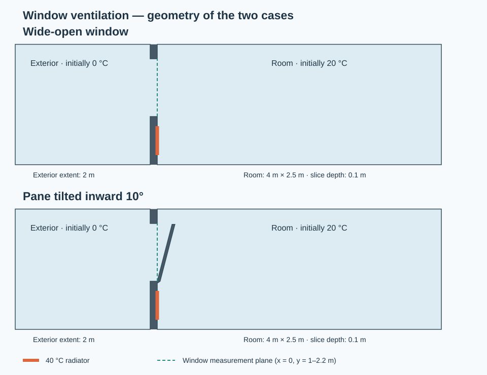
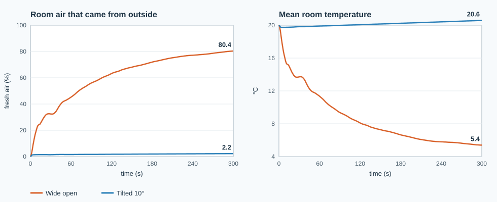

# Project 13 — Window ventilation: wide open versus tilted

Compare how a warm room exchanges air with a cold exterior through a single
window. The two cases share a room, a heated radiator patch, material properties,
and run duration. One removes the window pane; the other includes a pane tilted
10 degrees inward about its lower edge.

The motivating image labels its cases “70%” and “7% of the air replaced”. Those
numbers are **not input data, validation targets, or promised results**: the image
does not specify elapsed time, dimensions, wind, or heating conditions. This
project measures replacement using a transported tracer rather than inferring it
from the temperature colours.

## Model and geometry



| Quantity | Both cases |
|---|---|
| Solver / release | `buoyantBoussinesqPimpleFoam`, **OpenFOAM Foundation 6** |
| Model | Transient, incompressible Boussinesq buoyancy; laminar 2D cross-section |
| Room | 4 m long, 2.5 m high; one 0.1 m extrusion layer with `empty` front/back |
| Exterior region | 2 m to the left of the room, with open left/top/bottom boundaries |
| Wall / opening | 0.1 m thick wall; opening from y = 1 to 2.2 m |
| Tilted pane | 1.2 m long; 0.04 m horizontal thickness; 10° inward tilt |
| Radiator | Fixed-temperature wall patch, x = 0, y = 0.2 to 0.8 m |
| Initial room / exterior | 20 °C / 0 °C, initially at rest |
| Radiator temperature | 40 °C, maintained throughout the run |
| Walls and pane | No slip, adiabatic; no solid thermal mass |
| Tracer `c` | Initially 1 in room air, 0 in exterior; incoming exterior air has c = 0 |
| Tracer diffusivity | Constant 2 × 10⁻⁵ m²/s |
| Default duration / output | 300 s / 5 s |

`prepare_cases.py` creates both complete cases from `template/` and writes their
Gmsh geometries. The mesh resolves the pane itself. It is not a reduced-area
boundary condition. Both cases use the same 0.02 m cell size around the window and
radiator, so a difference between them comes from the pane rather than from the
mesh. An embedded line at x = 0 makes the room cell zone and window
flux plane align with mesh faces. Only the opening connects room and exterior;
there is no door, second window, imposed inlet velocity, or prescribed ACH.

The room air volumes are 1 m³ (`wide_open`) and approximately 0.995193 m³ (`tilted`),
for this 0.1 m slice. The second excludes the pane and its small sill attachment.
Reported volume flow and energy refer to the slice; ACH and replacement fraction
are volume-normalised.

The exterior uses `pressureInletOutletVelocity`, cold `inletOutlet` temperature
and tracer, and `totalPressure` on the **kinematic reduced pressure** `p_rgh`.
`TRef` equals the exterior temperature, so the incoming cold reservoir has
`rhok = 1`. This approximates a still, remote exterior reservoir. Test sensitivity
to exterior extent and these truncation conditions before interpreting flow rates.

## Run

Host requirements: Python 3, Gmsh 4.x (tested with 4.12.1 and 4.15.2), and either a
sourced Foundation 6 installation or Docker. Python analysis uses only the standard library. Gmsh is
run on the host, as in projects 03 and 04; the Docker image supplies OpenFOAM.

```bash
cd projects/13_window_ventilation

# Native Foundation 6:
source /opt/openfoam6/etc/bashrc
./Allrun

# Or Docker, with Gmsh and Python on the host:
./run_docker.sh
```

For an initial **2-second smoke run**, use either launcher with:

```bash
./run_docker.sh --end-time 2 --write-interval 1 --mesh-size 0.12
```

This tests the mesh, solver startup, and measurement pipeline. Two seconds is not
a ventilation study and is not a substitute for the default 300-second run.
The default 300-second run (about 23,000 cells per case, roughly 46,000 adaptive time
steps) took about 30 minutes of wall-clock time in Docker, with both cases running
side by side on one core each.

Change the temperature constants in `prepare_cases.py` to try other conditions.
Both cases are regenerated from the same templates; Gmsh point sizes in
`geometry()` control local refinement near the window and radiator.

The two scenarios are independent, so `run_cases.sh` runs them at the same time,
using one core each. The launchers stop at the first failure, keep per-case `log.*`
files, then run `verify.py`, `analyze.py` and `plot_results.py`. They refuse to overwrite `cases/`. To start again,
archive any results you need, then run `./Allclean`; it deletes generated cases
and `comparison.csv`, preserving templates and source files.

For separate stages, run `./mesh_cases.sh [options]`, then `./run_cases.sh` in a
Foundation 6 environment, then `python3 verify.py`, `python3 analyze.py` and
`python3 plot_results.py`.
Use the matching release: later Foundation/OpenCFD versions are not assumed to
accept these solver names, dictionaries, or function-object interfaces unchanged.

## Measurements and outputs

`scalarTransport` advances the passive tracer at every time step. `roomStats`
then records **volume-weighted** averages of `c` and `T` over the room cell zone,
excluding the exterior and solid pane.

\[
f_{\mathrm{fresh}}(t) = 1 - \frac{1}{V_{\mathrm{room}}}
\int_{\mathrm{room}} c(\mathbf{x},t)\,dV.
\]

This is the fraction of current room air originating outside, under the tracer
model. Original room air that leaves and re-enters retains its tracer; it is not
automatically counted as fresh. Radiator heating changes temperature without
changing the tracer, which is why a thermal image alone cannot measure renewal.

`windowFlux` records the sum of absolute volumetric face fluxes on the internal
frame plane x = 0. For an incompressible room with a single opening, net flux is
zero; one-way exchange is half that absolute sum:

\[
Q_{\mathrm{exchange}} = \tfrac12\sum_{\mathrm{window}}|\phi_f|,
\qquad \mathrm{ACH} = 3600\,Q_{\mathrm{exchange}}/V_{\mathrm{room}}.
\]

Instantaneous exchange ACH counts movement across the plane. It does not directly
measure fresh-air replacement: recirculation and re-entry affect tracer removal.

`comparison.csv` contains scenario, elapsed time, original-air fraction,
fresh-air percentage, mean temperature in °C, exchange in m³/s and ACH, and the
decrease in room-air sensible energy relative to its initial state. The last uses
fixed reference values ρ = 1.2 kg/m³ and cp = 1005 J/(kg K). It is an **air energy
inventory change**, not cumulative heat lost outdoors or radiator consumption;
the radiator supplies heat during the run. A negative decrease means warming.

## Results (default 300-second run)



| Elapsed | Wide open: fresh air / mean T | Tilted 10°: fresh air / mean T |
|---|---|---|
| 60 s | 45% / 11.4 °C | 1.5% / 19.9 °C |
| 120 s | 63% / 8.1 °C | 1.8% / 20.1 °C |
| 300 s | **80%** / 5.4 °C | **2.2%** / 20.6 °C |

With the pane removed, a cold gravity current flows in along the floor while warm
air leaves through the top of the opening. Within five minutes, four fifths of the
room air is outside air. With the pane tilted, cold air entering over the top
collects in the pocket between the pane and the wall. After a brief start-up
transient the exchange almost stops (0.5 ACH at 300 s versus 11 ACH wide open). The
radiator then warms the room above its starting temperature while the air stays
stale. A real tilted window also leaks through its two triangular side gaps, which a
2D section cannot represent, so this model understates the tilted exchange. Use these
numbers for the qualitative comparison, not as a measured 70%/7% replication.

## Visualise

Run `./open_paraview.sh` to open the wide-open case, then add
`cases/tilted/tilted.foam` with File → Open. Alternatively, open both generated
`cases/*/*.foam` files manually. Apply both readers, select the same physical time,
and use a shared colour range:

- Temperature `T`: 273.15–297.15 K for the image's 0–24 °C air scale. The radiator
  is hotter than that scale; expand to 313.15 K to inspect its boundary.
- Tracer `c`: 0–1, where 0 is outside-origin air and 1 is original room air.
- Velocity `U`: add streamlines or in-plane glyphs to inspect exchange and the
  radiator plume. View along the z axis, with the same camera for both cases.

Use the numeric tracer history to label replacement percentages. Compare cases
at matching times; a temperature contour is not evidence of a particular ACH.

### Reels

[`reel.json`](reel.json) configures the repository's
[reel renderer](../../tools/make_reel.py) for this project. Each reel is about
55 seconds long: an intro question, the five minutes of simulation played about 7×
faster than real time with captions explaining what is happening, and a closing card
with the computed fresh-air shares. The two cases are stacked in one vertical video,
each labelled with its live fresh-air percentage from `roomStats`, over a generated
ambient soundtrack.

- `temperature`: air temperature (0–24 °C).
- `fresh_air`: the share of air that came from outside, `100 (1 − c)`.

```bash
./run_docker.sh --write-interval 1     # denser output for the reels (time interpolation fills the gaps)
cd ../.. && pvbatch tools/make_reel.py projects/13_window_ventilation
# -> output/artifacts/13_window_ventilation/{temperature,fresh_air}.mp4
```

The captions describe this run's results. If you change the setup, check that they
still match before you publish a reel.

## Verification and limits

`python3 verify.py` checks mesh acceptance, normal solver termination, reaching
the requested end time, complete output histories, exact room volume and window
plane area, local tracer/temperature bounds, finite pressure, and a maximum
Courant number of 0.5 against a configured target of 0.4. The target leaves room
for velocity growth between adaptive time-step estimates. Tracer advection uses
upwind differencing, and tracer diffusion omits the explicit non-orthogonal
correction to avoid small negative concentrations on the triangular mesh.
Thresholds are
consistency tolerances, not experimental reference data. Missing output fails.
There is no assertion that the wide-open case must match 70%, the tilted case
must match 7%, or a fixed ratio must hold.

Parser and measurement regression tests run without OpenFOAM:

```bash
python3 -m unittest discover -s . -p 'test_*.py' -v
```

Before drawing quantitative conclusions, refine the mesh (including local sizes
in `geometry()`), lower `maxCo`/`maxDeltaT`, enlarge the exterior, and compare the
tracer and temperature histories. This is a laminar 2D teaching case: a real
tilted window has three-dimensional side gaps, turbulent mixing, wind, and frame
details. A wide-open pane is removed, and a tilted pane is a simplified solid
notch. Walls have no thermal storage, and there is no radiation or thermostat.
The full temperature range gives βΔT up to 0.14, so Boussinesq density linearisation
is another approximation. No mesh-independent or experimentally validated
air-replacement percentages are supplied.

## Related notes and primary references

- [Case setup](../../notes/02_openfoam_cases.md),
  [meshing](../../notes/04_meshing.md),
  [boundary conditions](../../notes/05_boundary_conditions.md), and
  [CFL/time stepping](../../notes/08_cfl_number.md).
- [Foundation 6 buoyantBoussinesqPimpleFoam source](https://cpp.openfoam.org/v6/buoyantBoussinesqPimpleFoam_8C_source.html).
- [Foundation 6 passive scalar transport](https://cpp.openfoam.org/v6/scalarTransport_8H_source.html).
- [Foundation 6 volume measurements](https://cpp.openfoam.org/v6/volFieldValue_8H_source.html)
  and [surface measurements](https://cpp.openfoam.org/v6/surfaceFieldValue_8H_source.html).
